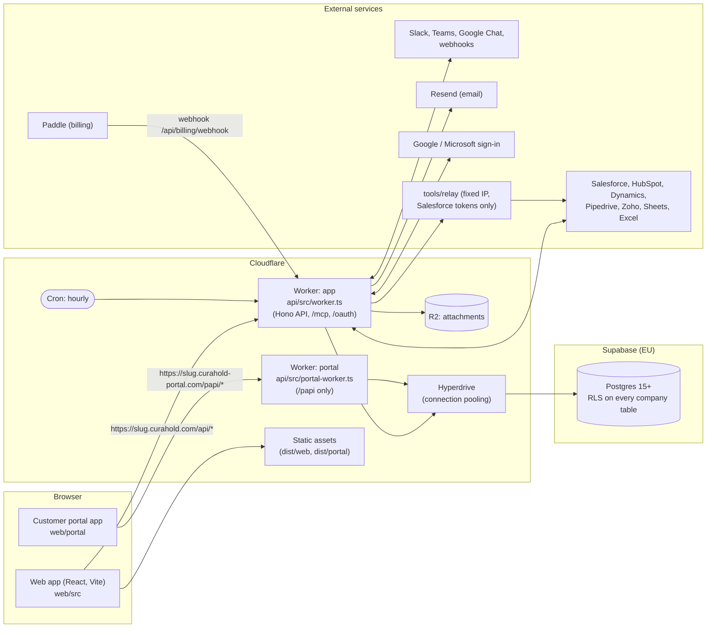
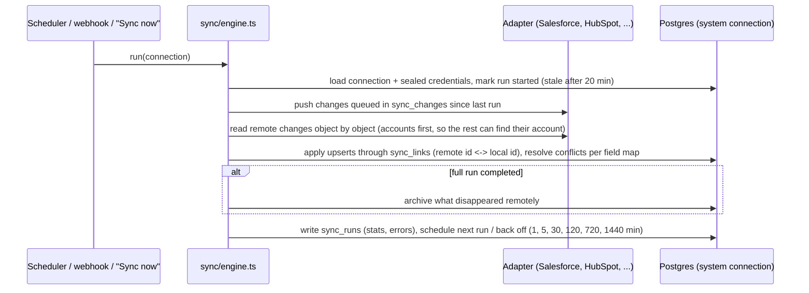

# Architecture

This is the map for an engineer who owns Curahold. It explains how the system is put together and, most
importantly, **how one company is kept apart from another**. Day-to-day "how do I add an endpoint" detail
lives in [docs/DEVELOPER.md](docs/DEVELOPER.md); decisions and their reasons live in [docs/ADR/](docs/ADR/README.md);
operations live in [docs/RUNBOOK.md](docs/RUNBOOK.md); the threat model and reporting live in [SECURITY.md](SECURITY.md).

Contents: [1 System](#1-system-at-a-glance) · [2 Layers](#2-layers) · [3 Data model](#3-data-model) ·
[4 Tenant isolation](#4-tenant-isolation) · [5 Authentication and sessions](#5-authentication-and-sessions) ·
[6 Reliability mechanics](#6-reliability-mechanics) · [7 Sync](#7-sync-crms-and-spreadsheets) ·
[8 Scheduler](#8-the-scheduler) · [9 Live updates](#9-live-updates) · [10 Deployment shapes](#10-deployment-shapes)

---

## 1. System at a glance



Self-hosted shape (one company, no Cloudflare): `api/src/selfhost.ts` runs the same Hono app on Node with
`postgres.js` straight to Postgres 16, attachments on disk, SMTP for mail and a `setInterval` instead of the
cron trigger. `docker-compose.yml` packages it. Local development runs the same app on an in-memory Postgres
(PGlite) with a seeded demo company. The code for all three is shared; only the entry file and the three
service adapters (`Db`, `Storage`, `EmailSender`) differ.

| Entry point | Used for | Database | Files | Mail |
| --- | --- | --- | --- | --- |
| `api/src/worker.ts` | Hosted service (Cloudflare Worker) | Supabase via Hyperdrive, `postgres.js` | R2 | Resend |
| `api/src/portal-worker.ts` | Customer portal (second Worker, own domain) | same | R2 (logos only) | Resend |
| `api/src/selfhost.ts` | A company's own server (Docker) | Postgres 16+ | Disk (`FILES_DIR`) | SMTP (`SMTP_URL`) or log |
| `api/src/node.ts` | Local development, `start:local`, e2e | PGlite (in memory) | Memory | Memory / console |

## 2. Layers

```
shared/src/   Pure TypeScript used by BOTH server and browser: types (model.ts), the dictionaries
              (i18n/), money, repeat rules, health score, billing plans, sync config shapes.
              No I/O, no framework imports. The contract between the other layers.

db/           db/migrations/NNNN_*.sql: the schema, RLS policies, helper functions and roles, applied in
              name order, once each (api/src/db/migrate.ts). Append-only: never edit an applied migration.

api/src/      The server (Hono). One app (app.ts) mounted by every entry point.
  app.ts        middleware order, which routers mount where
  context.ts    Config / Deps / request context; run() (transaction wrapper), requirePerm(), requireWriter()
  db/           the database seam: the Db interface (index.ts) and two drivers (postgres.ts, pglite.ts)
  routes/       one Hono router per area (tasks, accounts, boards, auth, billing, portal, ...)
  lib/          logic shared by routes and background jobs (notify, automations, health, playbooks,
                reports, repeats, trash, webhooks, scheduler, crypto, sessions, ...)
  connectors/   messaging connectors: Slack, Teams, Google Chat, generic webhook
  sync/         CRM and spreadsheet adapters + the two-way sync engine

web/src/      The React app (Vite). pages/, components/, lib/ (API client, offline queue, live pulse).
web/portal/   The customer portal's own small app (separate bundle, separate domain).
web/demo/     The in-browser demo (runs the API in PGlite inside the page).
site/         Marketing site and demo hub generators.
docs/site/    Help pages (Markdown, en + tr) built into static HTML by scripts/build-docs.ts.
integrations/ Salesforce package, Zapier and Make apps. tools/relay/ the fixed-IP Salesforce relay.
scripts/      migrate, seed-demo, build scripts, perf test, quality measurements.
tests/        Vitest suites (API-level, on PGlite or real Postgres) and tests/e2e (real Chrome).
```

Dependency rule: `shared` imports nothing from the other layers; `api` and `web` import from `shared` but never
from each other. Routes call `lib/`; `lib/` never imports from `routes/`.

## 3. Data model

Postgres, one schema (`public`). Every company-owned table has an `org_id` column. Group by purpose
(see `db/migrations/` for the authoritative DDL; this is an orientation, not a spec):

| Area | Main tables | Notes |
| --- | --- | --- |
| Company and people | `orgs`, `roles`, `users`, `teams`, `team_members`, `sessions`, `login_tokens`, `join_requests`, `signups` | `orgs` holds name, slug, locale, time zone, terminology (`terms`), settings, billing state. Roles carry permission lists; `users.seat` is `full` or viewer. |
| Work | `boards`, `board_members`, `tasks`, `comments`, `files`, `task_events`, `task_watchers`, `task_links`, `time_entries`, `checklist_templates`, `saved_views` | Tasks live on boards; archiving by age is a nightly job. |
| Customers and records | `accounts`, `record_types`, `records`, `record_comments`, `activities`, `planned_meetings`, `plan_templates`, `playbook_runs`, `health_history`, `health_dirty` | Custom fields are configuration, not code (`orgs.account_fields`, record types). Health score is computed in `lib/health.ts` from rules each company configures. |
| Automation and notifications | `automations`, `automation_runs`, `notifications`, `webhooks`, `webhook_events`, `connections`, `chat_identities` | `notifications` and `webhook_events` are the **outbox** (section 6). |
| CRM sync | `sync_links`, `sync_changes`, `sync_runs`, `import_batches` | `connections` rows with `kind = 'source'` are CRMs; credentials are sealed (AES) in the row. |
| Platform | `api_tokens`, `oauth_clients`, `oauth_codes`, `pages`, `reports`, `billing_events`, `idempotency_keys`, `trash`, `trash_rows`, `trash_links`, `undo_log`, `audit_log`, `error_log`, `replay_sessions`, `replay_chunks` | `audit_log` is append-only per company. `trash*` hold soft-deleted rows for 30 days. |
| Support (Curahold's own) | `help_requests`, `help_messages`, `help_files`, `support_grants`, `support_sessions`, `desk_codes`, `desk_claims`, `desk_log` | A company can grant Curahold support time-boxed access; the desk tables have **no** privileges for request roles. |
| Customer portal | `portal_users`, `portal_tokens`, `portal_sessions`, `portal_identities`, `portal_passkeys`, `portal_passwords`, `portal_challenges` | Reached only through `portal_*` SQL functions (section 4). |

Conventions: UUID primary keys, `timestamptz` everywhere, due dates are `date` interpreted in the company's time
zone (`app_today()` gives the company's day inside a transaction), text sorting uses a per-locale `sort_text`
so Turkish `İ/ı` order correctly, JSON columns for company-configurable shapes.

## 4. Tenant isolation

This is the most important property of the product (QUALITY.md priority 1: *no cross-company leakage*). It is
defended in layers, and the database is the last one.

### 4.1 The three connection modes

`api/src/db/index.ts` defines the only database seam the code sees:

```ts
interface Db {
  tenant(ctx, fn)  // a transaction scoped to ONE company (and optionally one person)
  portal(ctx, fn)  // a transaction as the customer-portal role
  system(fn)       // owner access, no scoping
}
```

| Mode | Runs as | What the transaction sets | What the database enforces |
| --- | --- | --- | --- |
| `db.tenant({orgId, userId, locale, today}, fn)` | `set local role curahold_app` | `app.org_id`, `app.user_id`, `app.locale`, `app.today` (via `set_config(..., true)`, transaction-local) | **Row-level security**: every policy is written against `app_org()` / `app_user()` (and `app_has_perm(...)`). A query for another company's rows returns nothing and a write is rejected, whatever the SQL says. |
| `db.portal({orgId, portalUserId}, fn)` | `set local role curahold_portal` | `app.org_id`, `app.portal_user` | The role has **no table privileges at all**; it can only call `portal_*` `SECURITY DEFINER` functions, each of which filters on `app_org()` and the portal person. |
| `db.system(fn)` | The **owner / connecting user** (no `set role`) | nothing | **Nothing.** RLS is not applied (no table uses `FORCE ROW LEVEL SECURITY`, so the owner bypasses it). |

All request routes go through `run(c, ...)` in `context.ts`, which opens `db.tenant(...)` with the authenticated
person. A route handler never receives a raw connection.

### 4.2 The `db.system()` owner connection (read this twice)

`db.system()` exists because some work belongs to no single company or happens before a company is known:

- running migrations and creating a company / its first admin (`createOrg`, `selfhost.ts`);
- the hourly scheduler (digests for every company, retries, clean-up, syncs);
- sign-in before there is a session (looking up a login token, `resolve_org`-style lookups);
- inbound webhooks and chat/CRM callbacks, billing webhooks, help-desk mail;
- recording errors (`error_log`) and the platform owner's whole-business metrics.

Because `system()` bypasses RLS, **correctness of every `system()` query is entirely the author's job**:

1. Every statement that reads or writes company data **must name `org_id`** (`where org_id = $1 ...`) taken from
   a trusted source (the authenticated session, a verified signature, a row you just loaded), never from request input
   alone. The sync engine says this at the top of `sync/engine.ts` ("works with owner access, so every statement
   filters by company explicitly").
2. **Never** use `system()` inside a request route to "make a query work" that failed under RLS: a failing
   `tenant()` query almost always means a missing policy or permission, which should be fixed in a migration.
3. Tests enforce part of this: `tests/rls.test.ts` statically checks that `db.system()` queries touching company
   tables mention `org_id`, against a reviewed baseline that **may only shrink**. If you add a legitimately
   cross-company query, add it to the baseline in the same PR, with a one-line reason, and expect review.

### 4.3 Defence in depth

| Layer | Mechanism | Where |
| --- | --- | --- |
| Routing | The company is resolved from the host (`<slug>.curahold.com`), never from a client-supplied field in production. `x-curahold-org` is honoured only when `devOrgHeader` is on (local dev). Self-host pins one slug. | `app.ts` `companyFromHost` |
| Session | A session row belongs to one `org_id`; the cookie is host-only (`app_session`), so a session for one company is never sent to another subdomain. | `routes/auth.ts`, `lib/sessions.ts` |
| Code | Routes call `requirePerm(...)` / `requireWriter()`; "see it as them" re-runs checks as the target person, read-only. | `context.ts`, `app.ts` |
| **Database** | RLS enabled on every table with `org_id`; policies keyed on `app_org()`; `SECURITY DEFINER` functions pin `search_path` and re-filter on `app_org()`. | `db/migrations/0001_init.sql` onward |
| Tests | `tests/rls.test.ts` (every company table has RLS + policy or no privileges; definer functions pin `search_path`), `tests/isolation.test.ts` (raw queries in company A see only A), `tests/isolation-routes.test.ts` (**every** route that takes an id is called as another company's admin and must answer 404, and no table row changes). New routes are discovered from code, so a new endpoint is tested automatically; if it cannot be, the test fails and asks you to say why. | `tests/` |
| CI | The three above are required checks. | `.github/workflows/ci.yml` |

### 4.4 Known deployment requirement

The migrations grant `curahold_app` / `curahold_portal` to the user that ran them, and the API connects as that
same user so that `system()` works. The role separation that would make this fully robust (`FORCE ROW LEVEL
SECURITY` plus a login role that does not own the tables) is a **deployment concern, not schema**, and is tracked in
[SECURITY.md](SECURITY.md#known-operational-requirements). A bug that runs raw SQL as the connecting user, or an
SQL injection that issues `reset role`, would not be stopped by RLS today. Treat that as the reason `system()` review
is strict and why parameterised queries are mandatory.

## 5. Authentication and sessions

- **Who can sign in.** Email magic link (`login_tokens`: only the SHA-256 of the token is stored; 15-minute-class
  expiry) and Google / Microsoft OIDC with PKCE (`lib/oidc.ts`, central callback on `app.<domain>`). A person must
  already belong to the company, or be admitted by `join_requests` / an allowed email domain (`orgs.domains`,
  `auto_join`).
- **Sessions.** `sessions` rows; the browser holds a host-only cookie `app_session` (an opaque token whose hash is
  stored). `lib/sessions.ts` implements the device limit ("balanced" policy): a seat may be used on N devices
  (default 2, `MAX_DEVICES`); signing in on one more revokes the least recently used and tells the person why. Every
  request also carries `x-curahold-device`; a mismatch is `device_mismatch`. Sessions last 30 days; revoked and
  expired rows are cleaned after 90 days. The device limit is the current defence against one seat being shared; dedicated sharing detection with an admin alert is planned (QUALITY.md).
- **Non-browser callers.** API keys and OAuth app tokens (`api_tokens`, `oauth_clients`, `routes/oauth.ts`) act as
  their owner, **read-only unless explicitly allowed to write**. The AI connector is the `/mcp` endpoint with the same
  tokens. Chat apps and CRMs call back into `/api/hooks/*` and `routes/connections.ts` with provider signatures
  (Slack signing secret, Teams/Google Chat JWTs, HMAC for generic webhooks).
- **Roles and permissions.** `roles.perms` is a list of permission keys; `app_has_perm('x')` is available in SQL
  policies and `requirePerm('x')` in routes. Field-level access: `lib/fieldAccess.ts`.
- **Customer portal.** A separate Worker on a separate registrable domain, with its own people (`portal_users`),
  sessions, passkeys (WebAuthn), passwords and tokens. Nothing from the app (cookies, storage, API) is reachable
  from it, and it reaches the database only through `curahold_portal`.
- **Curahold support.** Support staff never get standing access. A company administrator grants time-boxed `view`
  or `edit` access (`support_grants`); the support desk (`desk.<domain>`) signs staff in by emailed code
  (`SUPPORT_STAFF` list); entries are logged (`desk_log`, `audit_log`).
- **Secrets at rest.** Connector credentials in `connections` are sealed with AES-GCM using a key derived from
  `SECRETS_KEY` (falls back to `AUTH_SECRET`). Rotating that key requires re-sealing (see RUNBOOK).
- **Browser protections.** CSP, HSTS, no-framing and no-sniff on every API answer (`lib/headers.ts`) and on static
  files (`web/public/_headers`; `tests/security.test.ts` keeps both in step). Rate limiting is *not* in the app: it
  belongs to Cloudflare rate rules at the edge (see [SECURITY.md](SECURITY.md#known-operational-requirements)).

## 6. Reliability mechanics

These rules come from QUALITY.md ("Güvenilirlik", reliability). Most are implemented and tested; the table says which are still planned:

| Guarantee | Mechanism |
| --- | --- |
| No lost concurrent edits | Tasks carry a `version`; edits to different fields merge, the same field conflicting returns a "changed just now" answer with undo (`shared/src/merge.ts`). Extending version checks to customers and records is on the QUALITY.md list. |
| A repeated request does its work once | `Idempotency-Key` header; the key is written in the request's **first transaction**, answer stored on it, a retry gets the first answer (`lib/repeats.ts`). Keys purge after 2 days. |
| Side effects never lost or doubled | Notifications, chat messages, emails and webhooks are written to an **outbox** (`notifications`, `webhook_events`) **in the same transaction** as the change, with a `dedupe_key`; delivery happens after the response (`defer`) and is retried hourly (`lib/notify.ts`, `lib/webhooks.ts`). |
| Offline edits survive | **Planned, not built yet**: queue writes while offline and replay them with the same idempotency keys (the keys already make that safe). Today an offline write shows an "offline" error. |
| Nothing is deleted for good immediately | `trash*` keep deleted rows 30 days; imports are undoable for 30 days. |
| Partial sync destroys nothing | The engine archives records that vanished remotely only on a *full* successful run (section 7). |
| Time | Due dates are `date` in the company's zone; digests respect each company's hour and quiet hours; DST is tested. |
| Errors are recorded | `app.onError` and `POST /client-error` write to `error_log` (no bodies, headers or secrets; purged at 30 days; admin sees own company's via `GET /admin/errors`). |

## 7. Sync (CRMs and spreadsheets)

`api/src/sync/` implements two-way sync between Curahold and an external system, one **connection** at a time:



- **Adapters** (`sync/adapters/*`): `salesforce`, `hubspot`, `dynamics`, `pipedrive`, `zoho`, `sheets` (Google Sheets / Excel),
  `support` (ticket systems), `keyed` (generic keyed CRM), and `demo` (in-memory pretend CRM, used by tests and the
  demo). Each implements `CrmAdapter` (`sync/adapters/types.ts`). Provider OAuth uses PKCE and a refresh-lock to avoid
  double-refresh races (see INTEGRATIONS.md).
- **Safety rules.** Missing or late data makes the run wait, not act; a half-finished sync deletes nothing; the last
  successful run is visible per connection, and two failures in a row alert the admin.
- **Why `system()`.** The engine runs without a signed-in person, so it uses the owner connection and **filters every
  statement by `org_id`** (4.2).
- **Salesforce relay.** `tools/relay` is a ~150-line, dependency-free passthrough with a fixed IP, used only for
  Salesforce token renewals when the customer's Salesforce restricts IP ranges (`SALESFORCE_RELAY_URL/KEY`).

## 8. The scheduler

One entry, `runScheduled(deps, now)` in `api/src/lib/scheduler.ts`, triggered **hourly**: by the Cloudflare cron
(`wrangler.toml`: `0 * * * *`, handled by `scheduled()` in `worker.ts`) or by `setInterval` in `selfhost.ts`/`node.ts`.
Each hour it runs, in order and each isolated by `.catch`, so one failing job never blocks the rest:

1. morning digests (per person, in the company's time zone and the person's chosen hour);
2. scheduled automations; weekly summaries; stale-work nudges and escalations;
3. delivery of pending notifications (outbox drain, batches of 100) and webhook retries;
4. health-score recomputation (dirty set every hour; everyone once a day at 03:00 UTC, plus trend point);
5. scheduled CRM syncs;
6. 03:00 UTC: clean-up (expired tokens and sessions, old notifications, sync runs, idempotency keys, error log,
   replay recordings, trash older than 30 days) and archiving of finished tasks;
7. 05:00 UTC: automatic renewal playbooks for contracts coming due;
8. seat sync with Paddle (billing on only).

Jobs must be **idempotent and resumable**: the hourly trigger can overlap with a slow earlier run or be delayed. The
last-run status per job is the thing to monitor (see RUNBOOK, "On-call basics").

## 9. Live updates

Today the web app polls `GET /api/pulse` and refreshes what changed. The pulse is **scoped**: a board follows only its
own cards, an account page only changes under that account, so a change elsewhere does not refresh every page. The
live channel carries no data, only "something changed" stamps; data always comes through the normal API with the
normal permission checks. QUALITY.md decision 1 is to replace polling with one Durable Object per company using
WebSocket Hibernation (Node: `ws` + Postgres `LISTEN/NOTIFY` for self-host), falling back to polling when WebSockets are
blocked. That is **decided but not built**.

## 10. Deployment shapes

| Shape | How | Config |
| --- | --- | --- |
| Hosted | Cloudflare Workers (`wrangler.toml`, `wrangler.portal.toml`) + Supabase EU + R2 + Resend + Paddle. `npm run build && npx wrangler deploy`. Deploys are manual and deliberate (QUALITY.md rule: no auto-deploy). | `[vars]` in the toml, secrets by `wrangler secret put` |
| Self-host | `docker compose up -d` (Postgres 16 + app). Migrations run on every start; the first start creates the company and first admin. | `.env` from `selfhost.env.example` |
| Local | `npm run dev` (API on :8787 with PGlite and a seeded company, Vite on :5173). | none |
| Demo | `npm run build:demo`: the API runs inside the browser on PGlite. | none |

See [docs/ENVIRONMENT.md](docs/ENVIRONMENT.md) for every setting.
