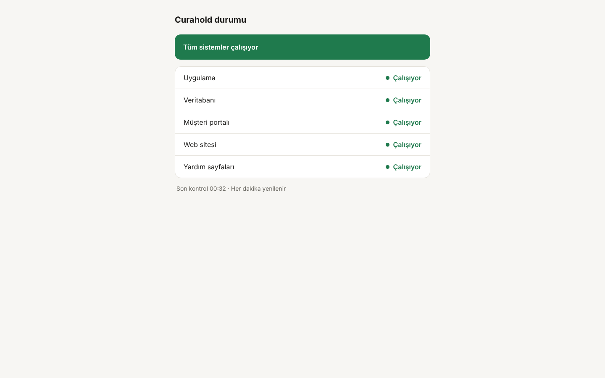
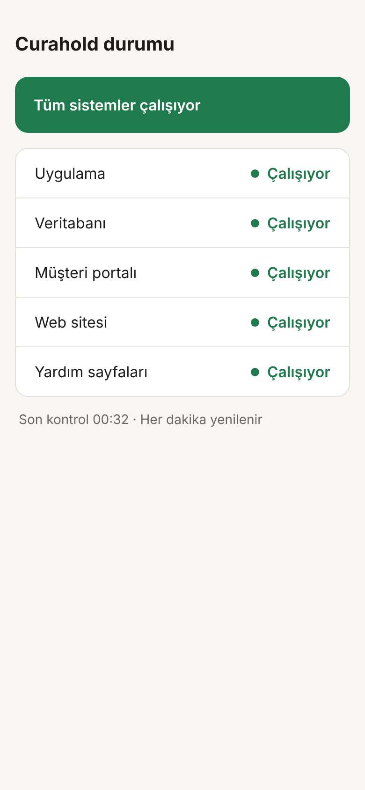
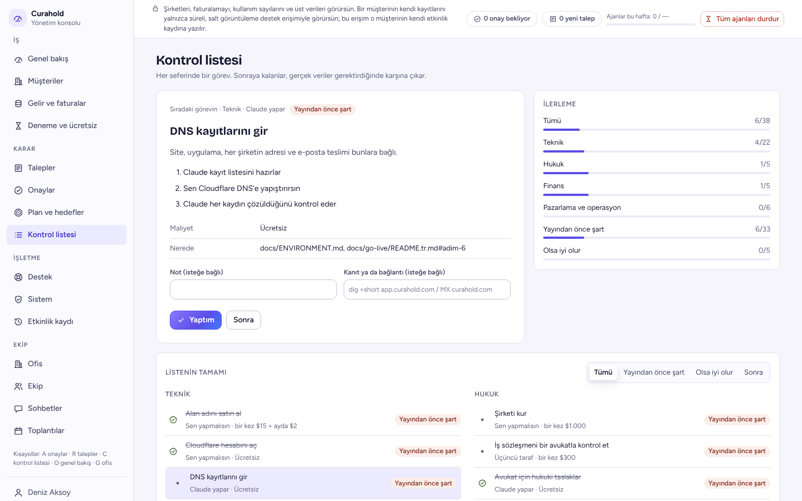
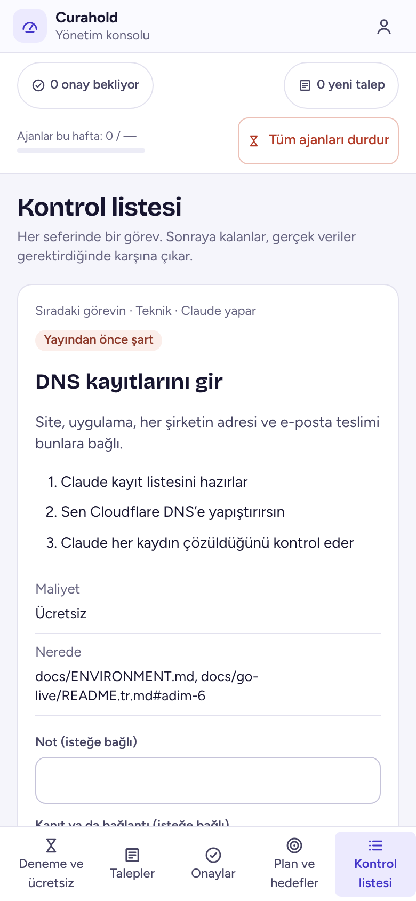

# Curahold'u yayına alma rehberi

Telefondan okunacak şekilde yazıldı: her adımda **tek iş** var. Her adımın başında kimin yapacağı, ne kadar tuttuğu ve (varsa) senden beklenen karar yazıyor.

- **Sen yapmalısın**: kimliğin, kartın ya da imzan gerekiyor; Claude yapamaz.
- **Claude yapar**: sen "yayına al" dedikten sonra Claude komutları çalıştırır ve sonucu sana gösterir.
- **kontrol et**: başka bir firmanın ekranı; düğme adı zamanla değişmiş olabilir. Bulamazsan ekrandaki en yakın adı seç, Claude'a ekran görüntüsünü gönder.
- Kopyalanacak her değer gri kutuda. Kutunun içini olduğu gibi kopyala, hiçbir şeyi değiştirme (değiştirmen gereken yer `<böyle>` yazılı).

**Kural:** Bu rehberdeki hiçbir şey sen "yayına al" demeden çalıştırılmaz. 1–16 arası adımlar hazırlık; hiçbiri siteyi açmaz.

## Toplam maliyet (19 Kasım 2026 fiyatları, USD)

| Kalem | Bir kez | Aylık | Not |
| --- | --- | --- | --- |
| curahold.com + curahold-portal.com + curahold-staging.com | — | ~2,80 (yıllık ~33,50) | Cloudflare Registrar maliyet fiyatı: .com yılda 11,17 |
| Cloudflare (DNS, güvenlik duvarı, Turnstile, Pages, R2 10 GB) | — | 0 | Ücretsiz plan |
| Cloudflare Workers Paid | — | 5 | İlk müşteriden önce şart değil; günlük 100.000 istek sınırı yaklaşınca aç |
| Google Workspace Business Starter | — | 7 / kullanıcı | Sen + `no-reply@` = 14 (karar: Adım 10) |
| Supabase Pro (AB, Frankfurt) | — | 25 | Staging için ikinci proje: ücretsiz plan |
| Yapay zekâ model anahtarı | — | en çok 40 | Üst sınırı sen koyarsın (Adım 15); anahtar yoksa 0 |
| Zamana geri dönüş (PITR) | — | ~105 | **Şimdi değil**: ilk ödeme yapan müşteriden sonraki bir ay içinde |
| **Başlangıçta toplam** | — | **~45–55** | Yapay zekâ ve Workers Paid hariç ~35–40 |

## İçindekiler

**A. Alan adı** — [1 Kayıt firması](#adim-1) · [2 Satın al](#adim-2) · [3 Güvenlik](#adim-3)
**B. Cloudflare** — [4 Hesap](#adim-4) · [5 Alan adını ekle](#adim-5) · [6 Web kayıtları](#adim-6) · [7 Portal kayıtları](#adim-7)
**C. E-posta** — [8 Google Workspace](#adim-8) · [9 MX/SPF/DKIM/DMARC](#adim-9) · [10 Gönderim hesabı](#adim-10)
**D. Barındırma** — [11 Veritabanı](#adim-11) · [12 R2](#adim-12) · [13 Claude'a erişim](#adim-13)
**E. Gizli anahtarlar** — [14 Worker anahtarları](#adim-14) · [15 Model anahtarı](#adim-15) · [16 Turnstile](#adim-16)
**F. Önce staging** — [17 Veritabanı geçişleri](#adim-17) · [18 Staging kurulumu](#adim-18) · [19 Duman testi](#adim-19) · [20 Yük testi](#adim-20)
**G. Yayına al** — [21 Yayın anahtarları](#adim-21) · [22 Canlıya kurulum](#adim-22) · [23 Bot Fight Mode + 48 saat](#adim-23)
**H. Sonra** — [24 İzleme ve durum sayfası](#adim-24) · [25 Yedekler](#adim-25) · [26 Geri yükleme tatbikatı](#adim-26) · [27 Geri alma](#adim-27) · [28 Kontrol listesi](#adim-28)

---

## A. Alan adı

<a id="adim-1"></a>
### Adım 1 — Kayıt firmasını seç

**Sen yapmalısın** · Maliyet: yok · **Karar gerekli**

Önerim: **Cloudflare Registrar.** Alan adını maliyet fiyatına satar (.com yılda 11,17 USD; başka bir firmada aynı alan adı 14,48 olarak görüldü), WHOIS gizliliği ücretsizdir ve alan adı zaten Cloudflare'de olduğu için Adım 5'teki "nameserver değiştir" işi kendiliğinden olur.

- Cloudflare Registrar'ı seçersen: **önce Adım 4'ü yap** (hesap aç), sonra Adım 2'ye dön.
- Başka bir firma seçersen: Adım 2'yi orada yap; Adım 5'te nameserver'ları değiştireceksin.

<a id="adim-2"></a>
### Adım 2 — Üç alan adını satın al

**Sen yapmalısın** · Maliyet: yılda ~33,50 USD (3 × 11,17) · Karar: yok

Cloudflare panelinde: **Domain Registration → Register Domains** (kontrol et). Sırayla ara ve satın al:

```
curahold.com
```
```
curahold-portal.com
```
```
curahold-staging.com
```

- `curahold-portal.com`: müşteri portalı ayrı bir alan adında durur ki uygulamanın çerezleri portalla paylaşılmasın (güvenlik kuralı).
- `curahold-staging.com`: her şeyi gerçek müşterilerden önce denediğimiz kopya (Adım 18). Ücretsiz sertifika `*.staging.curahold.com` gibi iki seviyeli adresleri kapsamadığı için ayrı alan adı en ucuz yol.
- Ödeme ekranında **Auto-renew** (otomatik yenileme) açık olsun.

<a id="adim-3"></a>
### Adım 3 — Alan adlarını kilitle

**Sen yapmalısın** · Maliyet: yok · Karar: yok

Her alan adı için kayıt firmasının ekranında üçünü kontrol et (Cloudflare'de: **Domain Registration → Manage Domains → Configuration**, kontrol et):

1. **Auto-renew: On** — kart süresi dolarsa alan adı kaybolmasın diye kartı güncel tut.
2. **WHOIS privacy / redaction: On** — adın ve adresin herkese açık listede görünmez (Cloudflare'de varsayılan açık).
3. **Registrar lock (transfer lock): On**.

Hesabın kendisi için iki adımlı girişi Adım 4'te açacağız.

---

## B. Cloudflare

<a id="adim-4"></a>
### Adım 4 — Cloudflare hesabını aç ve iki adımlı girişi aç

**Sen yapmalısın** · Maliyet: yok (ücretsiz plan) · Karar: yok

1. `dash.cloudflare.com` adresinde şirket e-postanla hesap aç (Google Workspace henüz yoksa kişisel e-postanla aç, Adım 8'den sonra **My Profile → Email** ile değiştir; kontrol et).
2. **My Profile → Authentication → Two-Factor Authentication** (kontrol et): telefonundaki doğrulama uygulamasıyla aç. Kurtarma kodlarını parola yöneticine kaydet.

<a id="adim-5"></a>
### Adım 5 — Alan adlarını Cloudflare'e bağla

**Sen yapmalısın** · Maliyet: yok · Karar: yok

- **Cloudflare Registrar'dan aldıysan:** bu adım kendiliğinden yapıldı. Her alan adının durumu **Active** görünüyorsa geç.
- **Başka firmadan aldıysan:** Cloudflare'de **Add a domain** (kontrol et) → alan adını yaz → **Free** planı seç. Cloudflare sana iki nameserver adı verir (her hesapta farklıdır, örneğin `ada.ns.cloudflare.com`). Kayıt firmanın ekranında **Nameservers → Custom** bölümüne bu ikisini yaz. Durumun **Active** olması birkaç dakika ile 24 saat sürer. Üç alan adı için tekrarla.

<a id="adim-6"></a>
### Adım 6 — curahold.com web kayıtları

**Sen yapmalısın** (kopyala–yapıştır) · Maliyet: yok · Karar: yok

Cloudflare → **curahold.com → DNS → Records → Add record** (kontrol et). Her satır bir kayıt; **Proxy status** her birinde turuncu bulut (**Proxied**) olsun.

**1. Joker kayıt** — her şirketin adresi (`<şirket>.curahold.com`), onboarding merkezi (`/onboarding`), `app.` ve `desk.` bundan açılır. Bir kez eklenir, şirket kaydoldukça hiçbir şey eklenmez:

Type **CNAME** · Name **\*** · Proxy **Proxied** · Target:

```
curahold.com
```

**2. www** — siteye yönlenir:

Type **CNAME** · Name **www** · Proxy **Proxied** · Target:

```
curahold.com
```

**3. docs** (isteğe bağlı kısa adres) — yardım sayfaları `app.curahold.com/docs/` adresindedir; `docs.curahold.com` yazan oraya gitsin:

Type **CNAME** · Name **docs** · Proxy **Proxied** · Target:

```
curahold.com
```

Ardından **Rules → Redirect Rules → Create rule** (kontrol et): ad `docs`, koşul **Hostname equals** `docs.curahold.com`, hedef türü **Dynamic**, ifade:

```
concat("https://app.curahold.com/docs", http.request.uri.path)
```

durum kodu **301**, **Preserve query string** açık.

**Site (`curahold.com`'un kendisi) ve `api` için kayıt ekleme:**
- `curahold.com` adresini Adım 22'de Claude, Cloudflare Pages'e bağladığında Cloudflare kaydı kendisi ekler.
- API ayrı bir adreste değil: `https://app.curahold.com/api/…` ve her şirketin kendi adresinde. `api.curahold.com` joker kayda düşer ve "şirket yok" cevabı verir (bu ad bir şirkete verilemez).
- `status.` için de kayıt yok: durum sayfası Cloudflare Pages'in kendi ücretsiz adresinde durur (Adım 24).

<a id="adim-7"></a>
### Adım 7 — Portal ve staging kayıtları

**Sen yapmalısın** (kopyala–yapıştır) · Maliyet: yok · Karar: yok

Cloudflare → **curahold-portal.com → DNS → Records → Add record**. Bu adres yalnızca portal Worker'ına gider; `100::` "boş hedef" demektir (Worker cevap verir):

Type **AAAA** · Name **\*** · Proxy **Proxied** · IPv6 address:

```
100::
```

Type **AAAA** · Name **@** · Proxy **Proxied** · IPv6 address:

```
100::
```

Aynı iki kaydı **curahold-staging.com** için de ekle.

Claude'un kontrolü (sen yapmasan da olur): rastgele bir adın Cloudflare adresine çıktığını görmek için

```
dig +short herhangibirsey.curahold.com
```

---

## C. E-posta (Google Workspace)

<a id="adim-8"></a>
### Adım 8 — Google Workspace'i aç

**Sen yapmalısın** · Maliyet: kullanıcı başına aylık 7 USD (Business Starter; 10 Kasım 2026–10 Şubat 2027 arası ilk üç ay %50 indirim kampanyası görüldü) · Karar: yok

1. `workspace.google.com` → **Get started** (kontrol et) → şirket adı → alan adı olarak **curahold.com** ("I have a domain").
2. Kendi kullanıcını oluştur: örneğin `adin@curahold.com`.
3. Google alan adının sana ait olduğunu doğrulamak için bir **TXT** kaydı ister. Google, Cloudflare'i tanırsa **Sign in to Cloudflare** düğmesiyle kendisi ekler; tanımazsa verdiği değeri Cloudflare → DNS → **Add record → TXT, Name `@`** olarak yapıştır.
4. Admin konsolunda: **Security → Authentication → 2-step verification → Allow users to turn on** ve kendi hesabında iki adımlı doğrulamayı aç (kontrol et).

<a id="adim-9"></a>
### Adım 9 — E-posta kayıtları: MX, SPF, DKIM, DMARC

**Sen yapmalısın** (kopyala–yapıştır) · Maliyet: yok · Karar: yok

Cloudflare → **curahold.com → DNS → Records → Add record**. Bu kayıtlarda Proxy yoktur (gri bulut, **DNS only**).

**MX** (gelen posta):

Type **MX** · Name **@** · Priority **1** · Mail server:

```
smtp.google.com
```

**SPF** (bizim adımıza kim gönderebilir):

Type **TXT** · Name **@** · Content:

```
v=spf1 include:_spf.google.com ~all
```

**DKIM** (imza): Google Admin konsolu → **Apps → Google Workspace → Gmail → Authenticate email → Generate new record** (kontrol et), anahtar uzunluğu **2048**, önek `google`. Çıkan değeri kopyala:

Type **TXT** · Content: Google'ın verdiği `v=DKIM1; k=rsa; p=…` değeri (Google ekranından kopyala) · Name:

```
google._domainkey
```

Cloudflare'de kaydı ekledikten sonra Google ekranında **Start authentication** düğmesine bas.

**DMARC** (sahte gönderimlere ne olacağı). İlk iki hafta yalnızca rapor:

Type **TXT** · Name **_dmarc** · Content:

```
v=DMARC1; p=none; rua=mailto:dmarc@curahold.com; fo=1
```

İki hafta sonra raporlarda sorun yoksa Claude sana değiştirilecek değeri verir: `p=quarantine`.

Ardından `dmarc@curahold.com` adresini kendi kullanıcına **takma ad (alias)** olarak ekle: Admin konsolu → **Directory → Users → (sen) → User information → Alternate email addresses** (kontrol et). Aynı yoldan `support@`, `security@` ve `no-reply@` için de takma ad ekleyebilirsin (Adım 10'daki karara bağlı).

Kontrol: kendine Gmail dışı bir adresten bir e-posta at ve cevapla; gelen mesajın **Show original** (Orijinali göster) ekranında `SPF: PASS`, `DKIM: PASS`, `DMARC: PASS` görmelisin.

<a id="adim-10"></a>
### Adım 10 — Ürünün e-posta gönderim hesabı (SMTP relay)

**Sen yapmalısın** · Maliyet: 0 ya da aylık 7 USD · **Karar gerekli**

Ürün (giriş kodları, davetler, hatırlatmalar) postayı Google Workspace üzerinden gönderir (senin seçimin). Gönderen hesap için iki yol:

- **Önerim — ayrı kullanıcı `no-reply@curahold.com` (aylık +7 USD):** uygulama parolası yalnızca bu hesabı açar; sızarsa senin postana kimse giremez.
- **Ücretsiz yol — kendi hesabının uygulama parolası:** maliyet yok, ama parola senin posta kutunu da açar.

Sonra:
1. Admin konsolu → **Apps → Google Workspace → Gmail → Routing → SMTP relay service → Configure** (kontrol et). Ad `Curahold`, **Allowed senders: Only addresses in my domains**, **Authentication: Require SMTP Authentication**, **Encryption: Require TLS encryption** → **Save**.
2. Gönderen hesapla giriş yap → `myaccount.google.com` → **Security → App passwords** (kontrol et; iki adımlı doğrulama açık olmalı) → ad `Curahold` → 16 harfli parolayı kopyala. **Bu parolayı sohbete yazma**: Adım 14'te Claude sorduğunda doğrudan terminale yapıştıracaksın.

Not: yeni Workspace hesapları ilk günlerde günde 500 alıcıyla sınırlı olabilir; ürünün açılış hacmi için yeterli.

---

## D. Barındırma

<a id="adim-11"></a>
### Adım 11 — Veritabanı: Supabase, AB (Frankfurt)

**Sen yapmalısın** · Maliyet: aylık 25 USD (Pro) + staging için ücretsiz proje · Karar: yok (bölge önerisi aşağıda)

1. `supabase.com` → hesap aç (GitHub ile değil, şirket e-postanla) → **Account → Security**'de iki adımlı girişi aç.
2. **New organization** → plan **Pro** → kart bilgileri.
3. **New project**: ad `curahold`, **Region: Central EU (Frankfurt)** (kontrol et), güçlü bir veritabanı parolası oluştur ve **parola yöneticine** kaydet.
4. İkinci proje: ad `curahold-staging`, aynı bölge, **Free** plan (ücretsiz proje bir hafta kullanılmazsa durur; staging için sorun değil).

**Bölge ve KVKK:** Veriler Almanya'da (AB) durur. Türkiye'deki müşterilerin kişisel verisi için bu bir **yurt dışına aktarımdır** (KVKK m. 9, 1 Haziran 2024 değişikliği). Türkiye için yeterlilik kararı yok; yol **standart sözleşme**dir: Kurum'un metni değiştirilmeden Türkçe imzalanır ve son imzadan sonra **5 iş günü içinde** Kurum'a bildirilir. Bu, kontrol listesindeki **"KVKK aktarım"** maddesidir; ilk Türk müşteride kendiliğinden "zorunlu" olur ve avukat onayı ister. AB müşterileri için Frankfurt zaten AB içidir.

Bitince Claude'a yalnızca **proje referansını** (proje adresindeki `https://<referans>.supabase.co` içindeki kısım) söyle. Parolayı sohbete yazma.

<a id="adim-12"></a>
### Adım 12 — Dosya deposu: R2

**Sen yapmalısın** · Maliyet: 0 (10 GB'a kadar ücretsiz) · Karar: yok

Cloudflare → **R2 Object Storage → Purchase R2 / Enable** (kontrol et; ücretsiz kullanım için bile kart ister, 10 GB'ın altında ücret çıkmaz). Sonra **Create bucket** ile üç kova oluştur, konum **Automatic** ya da **Europe (EEUR)** (kontrol et; önerim Europe):

```
curahold-files
```
```
curahold-backups
```
```
curahold-files-staging
```

Kovaların hiçbirinde **Public access** açma; dosyalar yalnızca uygulamanın içinden, giriş yapmış kişiye verilir.

<a id="adim-13"></a>
### Adım 13 — Claude'a kurulum erişimi ver (API anahtarı)

**Sen yapmalısın** · Maliyet: yok · Karar: yok

Claude'un Worker'ları kurabilmesi için sınırlı yetkili bir anahtar:

Cloudflare → **My Profile → API Tokens → Create Token → Edit Cloudflare Workers** şablonu → **Use template** (kontrol et). **Account Resources:** kendi hesabın; **Zone Resources:** `curahold.com`, `curahold-portal.com`, `curahold-staging.com`. Şu izinleri de ekle (**+ Add more**):

- Account · **Hyperdrive** · Edit
- Account · **Workers R2 Storage** · Edit
- Account · **Cloudflare Pages** · Edit
- Zone · **DNS** · Read

**TTL**: bir ay. **Create Token** → anahtarı bir kez gösterir. Claude yayın günü sorduğunda terminale `CLOUDFLARE_API_TOKEN` olarak yapıştırırsın; sohbete yazma. İş bitince aynı ekrandan **Roll** ya da **Delete** ile kapatırsın.

---

## E. Gizli anahtarlar

<a id="adim-14"></a>
### Adım 14 — Worker anahtarlarını koy

**Claude yapar**, değerleri sen yapıştırırsın · Maliyet: yok · Karar: yok

Claude her komutu çalıştırır; komut `Enter a secret value:` diye sorduğunda değeri **sen** yapıştırırsın. Değerler hiçbir dosyaya ve sohbete yazılmaz. Rastgele olanları Claude üretir.

Uygulama Worker'ı (`curahold`):

| Ad | Değer nereden | Kim |
| --- | --- | --- |
| `AUTH_SECRET` | rastgele, 48 karakter | Claude üretir |
| `SECRETS_KEY` | rastgele, 48 karakter (**parola yöneticine de kaydet**: kaybolursa tüm bağlı CRM'ler yeniden bağlanır) | Claude üretir |
| `SMTP_RELAY_USER` | Adım 10'daki gönderen adres | sen |
| `SMTP_RELAY_PASSWORD` | Adım 10'daki 16 harfli parola | sen |
| `PLATFORM_OWNER` | konsolu görecek tek kişi: senin adresin | sen |
| `SUPPORT_STAFF` | destek masasına girebilecek adresler, virgülle | sen |
| `PADDLE_API_KEY`, `PADDLE_WEBHOOK_SECRET` | Paddle hesabı açılınca (kontrol listesindeki Paddle maddesi) | sen |
| `ANTHROPIC_API_KEY` | Adım 15 | sen |
| `TURNSTILE_SECRET_KEY` | Adım 16 | sen |

Claude'un kullandığı komut biçimi (örnek, her ad için bir kez):

```
npx wrangler secret put AUTH_SECRET
```

Portal Worker'ı aynı `AUTH_SECRET`, `SECRETS_KEY`, `SMTP_RELAY_USER`, `SMTP_RELAY_PASSWORD`, `TURNSTILE_SECRET_KEY` değerlerini alır (aynı olmaları şart):

```
npx wrangler secret put AUTH_SECRET --config wrangler.portal.toml
```

Kontrol (yalnızca adlar listelenir, değerler asla görünmez):

```
npx wrangler secret list
```

<a id="adim-15"></a>
### Adım 15 — Yapay zekâ model anahtarı ve aylık sınır

**Sen yapmalısın** · Maliyet: aylık en çok koyduğun sınır (önerim 40 USD) · **Karar gerekli: aylık sınır**

Anahtar olmadan ürün çalışır: yardım asistanı yardım sayfalarında arayarak cevap verir, AI ekibi uyumaz ama hiç çalışmaz. Anahtarla asistan tam cevap verir ve AI ekibi takvimine göre uyanır.

1. Model sağlayıcının konsolunda (`console.anthropic.com`) şirket hesabı aç → **Billing**'de aylık harcama sınırı koy (kontrol et) — önerim **40 USD**.
2. **API Keys → Create Key**, ad `curahold-production` → kopyala → Adım 14'teki `ANTHROPIC_API_KEY` sorusunda yapıştır.

Claude'un ayarladığı ürün içi sınırlar (`wrangler.toml` → `[vars]`), ikinci bir emniyet (Claude yazar, sen bir şey kopyalamazsın):

```
TEAM_MONTHLY_USD = "40"
TEAM_SCHEDULER = "auto"
```

**AI ekibinin saati (yeni):** Worker her 10 dakikada bir kısa bir bakış yapar (Cloudflare'in ücretsiz zamanlayıcısı). Anahtar yoksa ya da `TEAM_SCHEDULER = "off"` ise veritabanına bile dokunmadan döner; aylık sınır dolduysa, herkes duraklatıldıysa ya da o dakikada sırası gelen ve kuyrukta işi olan kimse yoksa **hiçbir model çağrısı yapmaz**. İstediğin an durdurmak için Claude'a "AI ekibinin saatini kapat" demen yeter (`TEAM_SCHEDULER = "off"`); sohbetler ve "Şimdi başlat" çalışmaya devam eder.

<a id="adim-16"></a>
### Adım 16 — Formlarda insan kontrolü (Turnstile)

**Sen yapmalısın**, sonra **Claude yapar** · Maliyet: yok · Karar: yok

Cloudflare → **Turnstile → Add widget** (kontrol et):

**Widget Mode: Managed**, **Pre-clearance: No**. Widget name:

```
Curahold forms
```

Hostnames (her birini ayrı ekle):

```
app.curahold.com
```
```
curahold-portal.com
```
```
app.curahold-staging.com
```

**Create** → iki anahtar çıkar. **Secret key**'i Adım 14'te `TURNSTILE_SECRET_KEY` olarak yapıştır; **Site key**'i Claude'a sohbette söyleyebilirsin (gizli değil). Claude onu iki `wrangler` dosyasına `TURNSTILE_SITE_KEY` olarak yazar.

---

## F. Önce staging

<a id="adim-17"></a>
### Adım 17 — Veritabanı geçişleri (migrations)

**Claude yapar** · Maliyet: yok · Karar: yok

Claude önce staging veritabanına, sonra (Adım 22'de) canlıya aynı dosyaları uygular. Geçişler yalnızca **ekleme** yapar (yeni tablo, yeni sütun); böylece geri alma her zaman eski kodla çalışır.

```
DATABASE_URL='<staging bağlantı adresi>' npm run migrate
```

Beklenen son satır: tüm geçişler uygulandı (son dosya `0212_file_scans.sql`).

<a id="adim-18"></a>
### Adım 18 — Staging'i kur

**Claude yapar** · Maliyet: yok · Karar: yok

Staging, canlının birebir kopyasıdır ama kendi alan adında (`curahold-staging.com`), kendi veritabanında ve kendi kovasındadır; ödeme **sandbox** modundadır, AI ekibinin saati kapalıdır. Ayarlar `wrangler.toml` içindeki `[env.staging]` bölümünde hazır.

```
npx wrangler hyperdrive create curahold-staging-db --connection-string='<staging bağlantı adresi>'
npm run build
npx wrangler deploy --env staging
```

Claude Hyperdrive'ın verdiği kimliği `[env.staging]` içindeki `<staging-hyperdrive-config-id>` yerine yazar.

<a id="adim-19"></a>
### Adım 19 — Staging'de duman testi

**Claude yapar**, sen sonucu onaylarsın · Maliyet: yok · Karar: sonuca bak

1. Sentetik kontrol: her açık adresi dışarıdan, ziyaretçi gibi çağırır ve süresini ölçer.

```
SYN_APP=https://app.curahold-staging.com SYN_SITE=https://app.curahold-staging.com npx tsx scripts/synthetic.ts
```

Her satır `up` olmalı (`slow` = çalışıyor ama 1,5 saniyeden yavaş).

2. Elle beş dakika (Claude yapar, sana ekran görüntüsü gönderir): bir deneme şirketi aç → giriş kodu e-postayla gelsin → bir pano aç → görev oluştur ve tamamla → bildirim gelsin → dosya ekle ve indir.
3. `npx wrangler tail --env staging` bir dakika: `[curahold] unhandled` satırı olmamalı.

<a id="adim-20"></a>
### Adım 20 — Yük testi

**Claude yapar** · Maliyet: yok · Karar: sonuca bak

`scripts/load.ts` sunucunun kendi kodunu, gerçek ağ gecikmesiyle **staging veritabanına** karşı çalıştırır: önce `scripts/perf.ts` büyük deneme şirketini (310 kişi, 120.000 görev) staging veritabanına kurar, sonra 200 kişi aynı anda kullanır. (Cloudflare'in kendi sınırları bu testin dışında; onlar Adım 23'te izlenir.)

```
PERF_DATABASE_URL='<staging bağlantı adresi>' PERF_SCALE=0.3 npx tsx scripts/perf.ts
PERF_DATABASE_URL='<staging bağlantı adresi>' LOAD_KEEP=<perf.ts'in yazdığı veritabanı> npx tsx scripts/load.ts
```

Claude sana p50/p95/p99 sürelerini ve kaç isteğin reddedildiğini gösterir. Normal kullanımda **hiç ret olmamalı**; ani yüklenmede 429 (yavaşla) cevabı beklenir.

---

## G. Yayına al

<a id="adim-21"></a>
### Adım 21 — Yayın anahtarları

**Claude yapar**, sen "yayına al" dersin · Maliyet: yok · **Karar gerekli: "yayına al"**

Claude değişikliği sana fark (diff) olarak gösterir, sen onaylayınca uygular. `wrangler.toml` → `[vars]`:

```
SIGNUP_MODE = "request"
PADDLE_ENV = "live"
TEAM_SCHEDULER = "auto"
```

- `SIGNUP_MODE = "request"`: şirketler deneme **talebi** gönderir, sen konsoldan onaylarsın (bugünkü kararın). Herkesin anında açabilmesi için `"instant"` — şimdilik değil.
- `PADDLE_ENV = "live"`: gerçek ödeme. `DEMO_CRM` **hiç** yazılmaz.
- **Reklam pikselleri** (Meta, TikTok): ziyaretçi "pazarlama" iznini verene kadar zaten yüklenmez; ayrıca site derlemesinde `CURAHOLD_MARKETING_PIXELS` ayarlanmadıkça tamamen kapalıdır. Açılışta **kapalı** kalır; reklam kampanyası kararı verdiğinde açılır.

<a id="adim-22"></a>
### Adım 22 — Canlıya kur ve doğrula

**Claude yapar** · Maliyet: yok · Karar: yok

Sıra hep aynı: önce veritabanı, sonra uygulama, sonra portal, en son site.

```
DATABASE_URL='<canlı bağlantı adresi>' npm run migrate
npx wrangler hyperdrive create curahold-db --connection-string='<canlı bağlantı adresi>'
npm run build
npx wrangler deploy
npx wrangler deploy --config wrangler.portal.toml
npx wrangler pages deploy site/dist --project-name curahold-site
```

Site ilk kez kurulunca Claude, Pages projesine **Custom domains → curahold.com** ve **www.curahold.com** ekler (kontrol et).

Doğrulama (Claude yapar, sonucu sana gönderir):

```
SYN_APP=https://app.curahold.com SYN_SITE=https://curahold.com SYN_PORTAL=https://status.curahold-portal.com npx tsx scripts/synthetic.ts
```

Ardından: bir şirkette giriş → görev oluştur ve tamamla → portalı aç → `wrangler tail` bir dakika temiz. Paddle'da bildirim adresi:

```
https://app.curahold.com/api/billing/webhook
```

<a id="adim-23"></a>
### Adım 23 — Bot koruması ve 48 saat izleme

**Sen yapmalısın** · Maliyet: yok · Karar: 48 saat sonra açık mı kalsın

Önce `docs/RUNBOOK.md` → **Go-live: bots and scrapers** bölümündeki AI tarayıcı ayarı, iki WAF kuralı ve bir hız sınırı kuralı (Claude değerleri hazır verir). Sonra:

1. Cloudflare → **curahold-portal.com → Security → Settings → Bot traffic → Bot fight mode → On** (kontrol et). Portalda yalnızca tarayıcılar var; açık kalır.
2. Aynısı **curahold.com** için → **On**.
3. **48 saat boyunca günde iki kez**: **Security → Events** (kontrol et). Şu adreslerde bir **Managed Challenge / Block** görürsen bu gerçek bir müşteriyi durduruyor demektir:

```
/api/   /mcp   /oauth/   /api/hooks/   /api/inbound/   /api/billing/webhook
```

Görürsen `curahold.com` için Bot fight mode'u **Off** yap (portalda açık kalsın); kodun kendi sınırları ve robot kuralları aynı işi adres adres yapar. 48 saat temizse açık kalır. Kontrol listesinde **"Bot Fight Mode, ardından 48 saat izleme"** maddesini işaretle.

---

## H. Yayından sonra

<a id="adim-24"></a>
### Adım 24 — İzleme, uyarılar ve durum sayfası

**Claude yapar**, bir adımı sen · Maliyet: yok · Karar: yok

Hazır olanlar (açmak için bir şey gerekmez):

- **Sağlık adresleri:** `https://app.curahold.com/api/health` (uygulama ayakta mı) ve `/api/health/ready` (veritabanına ulaşıyor mu, kaç milisaniyede). Portal: `/papi/health`.
- **Hata ve yavaşlık uyarıları:** 5 dakikada cevapların %5'inden fazlası hata verirse ya da en yavaş %5'lik dilim 2 saniyeyi geçerse; bir saatte 20'den fazla sunucu hatası kaydedilirse; bildirimler bir saatten fazla kuyrukta beklerse → **sahip konsolunun uyarılarına** düşer ve sana **bir kez e-posta** gelir. Kapatmak için `OPS_ALERTS = "off"`; yalnızca e-postayı kapatmak için `OPS_ALERT_EMAIL = "off"`.

Claude yapar — durum sayfasını yayınlar (Cloudflare Pages, ücretsiz, uygulamadan ayrı durur; uygulama çökse de açılır):

```
npx wrangler pages deploy tools/status-page --project-name curahold-status
```

Adresi `https://curahold-status.pages.dev` olur (kontrol et: ad doluysa Claude başka bir ad seçer). Sayfa her dakika sağlık adreslerini sorar ve dokuz dilde gösterir:





Sen yapmalısın — bir deneme uyarısı: Claude bir uyarıyı tetikler; e-postanın geldiğini ve konsolda göründüğünü onayla.

İsteğe bağlı (ücretsiz, yeni hesap gerektirir — karar sende): dışarıdan 5 dakikada bir kontrol eden ücretsiz bir uptime hizmeti ya da GitHub'ın zamanlanmış işiyle `scripts/synthetic.ts`. Şimdilik önerim: durum sayfası + konsol uyarıları yeterli.

<a id="adim-25"></a>
### Adım 25 — Yedekler

**Claude yapar**, bir kontrol sen · Maliyet: yok · Karar: yok

1. **Günlük yedek (Supabase, kendiliğinden):** Supabase → proje → **Database → Backups** (kontrol et): günlük yedeklerin listede olduğunu gör (Pro'da 7 gün tutulur).
2. **Haftalık şifreli dış kopya (Claude yapar):**

```
BACKUP_DATABASE_URL='<canlı bağlantı adresi>' BACKUP_PASSPHRASE='<parola yöneticindeki yedek parolası>' BACKUP_DIR=./backups npx tsx scripts/backup/backup.ts
npx wrangler r2 object put curahold-backups/<dosya adı> --file ./backups/<dosya adı> --remote
```

Her yedek bir **manifest** ile gelir (her tablonun satır sayısı, son geçiş, sağlama toplamı). Bir kopya da senin bilgisayarına. **Yedek parolası yalnızca parola yöneticinde durur**, dosyanın yanında asla.

3. **Dosyalar (R2):** ekler ve logolar `curahold-files` kovasında; haftalık kopya aynı yoldan `curahold-backups`'a gider.

<a id="adim-26"></a>
### Adım 26 — Geri yükleme tatbikatı

**Claude yapar** · Maliyet: yok · Karar: yok

Hiç geri yüklenmemiş yedek bir umuttur. Tatbikat: kur → yedekle → **sil** → boş bir veritabanına geri yükle → her tablonun satır sayısını ve şirketler arası güvenlik duvarını (row-level security) doğrula.

```
DRILL_PG='<deneme sunucusu>' npx tsx scripts/backup/restore-drill.ts
```

**19 Kasım 2026'da yapıldı (yerel Postgres 16):**

| Ne | Sonuç |
| --- | --- |
| Örnek kurulum (144 tablo) | **4,1 saniyede geçti**: yedek 0,4 s, silme 0,1 s, geri yükleme 1,4 s, doğrulama 0,1 s |
| Büyük deneme şirketi (473 MB, 1,29 milyon satır) | yedek **15 s** (şifreli 72 MB), geri yükleme + doğrulama **161 s** |
| Satır sayıları | her tabloda eşit |
| Şirketler arası güvenlik | her tabloda açık; bir şirket diğerinin görevlerini **göremedi** |

Canlıya geçtikten sonra Claude bunu bir kez de **canlı yedeğin kopyasıyla** yapar (Supabase → **Backups → Restore to a new project**, kontrol et) ve her çeyrekte tekrarlar. Kurtarma noktası şimdilik son günlük yedek (en kötü durumda 24 saatlik kayıp); ilk ödeme yapan müşteriden sonraki bir ay içinde "zamana geri dönüş" (aylık ~105 USD) açılır — kontrol listesinde kendiliğinden "zorunlu" olur.

<a id="adim-27"></a>
### Adım 27 — Geri alma (rollback)

**Claude yapar** · Maliyet: yok · Karar: yok

Her yayından önce Claude önceki sürümün kimliğini not eder:

```
npx wrangler deployments list
```

Bir sürüm bir şeyi bozarsa, saniyeler içinde önceki sürüme:

```
npx wrangler rollback
npx wrangler rollback --config wrangler.portal.toml
```

Veritabanı geçişleri geri alınmaz ama yalnızca ekleme yaptıkları için eski kod yeni veritabanında çalışır. Yanlış bir geçiş olursa önce **yeni bir düzeltme geçişi**; son çare Adım 26'daki geri yükleme.

<a id="adim-28"></a>
### Adım 28 — Kontrol listesinde işaretle

**Sen yapmalısın** · Maliyet: yok · Karar: yok

Sahip konsolu → **Kontrol listesi**. Her madde bir sonraki işi gösterir; "Kanıt" kutusunda neyin kanıt sayıldığı yazar (komut çıktısı, ekran). Bu rehberin her adımı orada bir maddedir.




