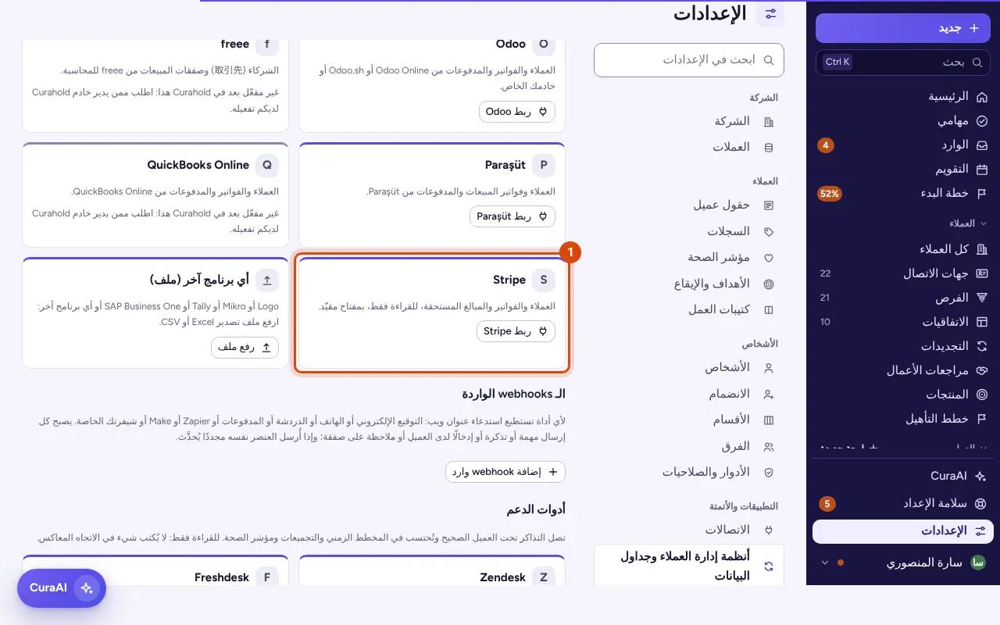

# Stripe (للقراءة فقط)

العملاء والفواتير (مع تاريخ الاستحقاق والمبلغ المتبقي) والمدفوعات من Stripe. لا يكتب Curahold أي شيء في Stripe: المفتاح الذي تعطيه إياه يقرأ فقط.

## في Curahold {#connect}

1. افتح **الإعدادات ← أنظمة إدارة العملاء وجداول البيانات**، وابحث عن **برامج المحاسبة**، وانقر **ربط Stripe**.
   

الصق المفتاح المقيّد في **المفتاح المقيّد** وانقر **تحقق واربط**. يُرفض مفتاح السرّ الكامل (`sk_…`) عمدًا. ثم انقر **بدء** وراجع العملاء غير المطابقين في تبويب **المطابقة**.

## في Stripe

1. افتح **Developers ← API keys** وانقر **Create restricted key**.
2. سمِّه `Curahold`.
3. اجعل **Customers** و**Invoices** و**Events** على **Read**، واترك كل ما سواها على **None**.
4. انقر **Create key**، وأكّد بخطوتك الثانية، وانسخ المفتاح. يبدأ هكذا:

```text
rk_live_
```

استخدم مفتاحًا من بيئة تجريبية (`rk_test_…`) للتجربة أولًا.

## الحدود والتوقيت

تجلب القراءة الأولى كل شيء؛ ثم ما تغيّر فقط، من قائمة أحداث Stripe (يحتفظ بها Stripe 30 يومًا). يسمح Stripe بـ 100 طلب في الثانية (25 في البيئة التجريبية)؛ ويبقى Curahold أدنى من ذلك بكثير. تُقرأ المبالغ حسب كسور كل عملة (الين بلا كسور). الفاتورة التي يعدّها Stripe «uncollectible» تبقى مستحقة هنا، فيظل التأخير ظاهرًا.

## إذا حدثت مشكلة

المفتاح المُجدَّد أو المحذوف يجعل الاتصال **يحتاج إلى انتباه**: أنشئ مفتاحًا مقيّدًا جديدًا والصقه عبر **إعادة الربط**. وإذا نقصت صلاحية، تذكرها خطوة الربط. **إزالة** تحذف المفتاح؛ وتبقى الأرقام المقروءة حتى تزيلها.

## انظر أيضًا

- [برامج المحاسبة](/docs/ar/accounting/)
