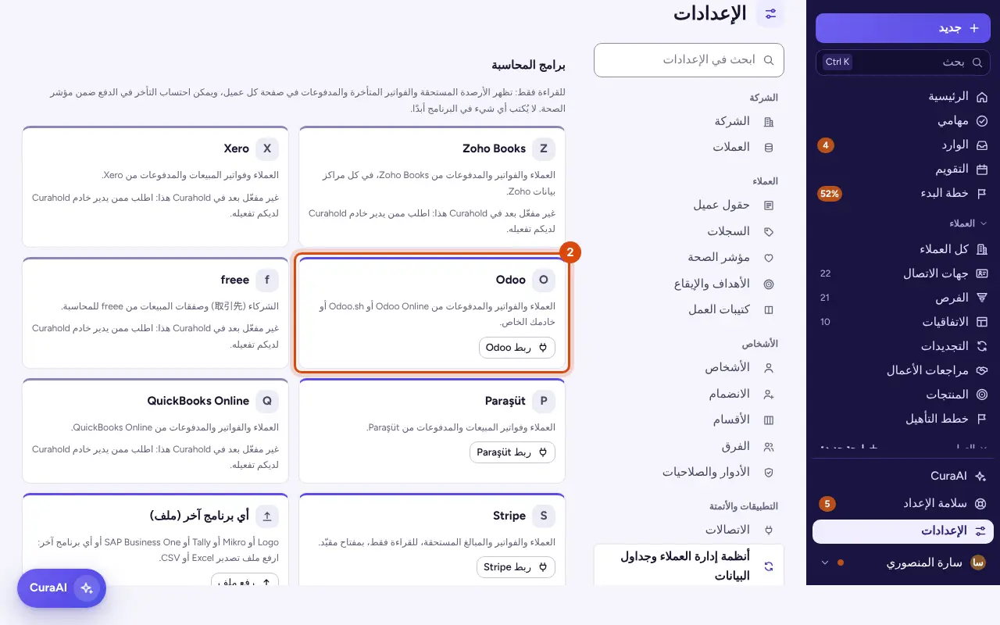

# برامج المحاسبة

اربط برنامج المحاسبة لديك فتعرض صفحة كل عميل ما عليه: الرصيد المستحق، والمتأخر ومدة تأخره، وآخر دفعة، والفواتير. يمكن احتساب التأخر في الدفع ضمن درجة الصحة. Curahold يقرأ فقط: لا يُكتب أي شيء في البرنامج أبدًا.

## أي البرامج

| البرنامج | طريقة الربط | الصفحة |
| --- | --- | --- |
| Zoho Books | تسجيل الدخول عبر Zoho | [Zoho Books](/docs/ar/accounting-zohobooks/) |
| Xero | تسجيل الدخول عبر Xero | [Xero](/docs/ar/accounting-xero/) |
| Odoo | العنوان واسم الدخول ومفتاح API | [Odoo](/docs/ar/accounting-odoo/) |
| freee | تسجيل الدخول عبر freee | [freee](/docs/ar/accounting-freee/) |
| Paraşüt | رقم الشركة وعميل API ومستخدم | [Paraşüt](/docs/ar/accounting-parasut/) |
| QuickBooks Online | تسجيل الدخول عبر Intuit | [QuickBooks Online](/docs/ar/accounting-quickbooks/) |
| أي برنامج آخر (Logo وMikro وTally وSAP Business One…) | ملف Excel أو CSV | [ملف](/docs/ar/accounting-file/) |

## اربط برنامجك {#connect}

تحتاج إلى صلاحية إدارة الاتصالات (لدى المسؤولين).

1. افتح **الإعدادات ← أنظمة إدارة العملاء وجداول البيانات** ومرّر إلى **برامج المحاسبة**. انقر **ربط …** في بطاقة برنامجك، أو **رفع ملف** في **أي برنامج آخر (ملف)**، واتبع صفحة البرنامج في الجدول أعلاه.
   

## مطابقة العملاء

يُطابَق كل عميل في برنامج المحاسبة مع عميل واحد في Curahold: أولًا بالرقم الضريبي، ثم بعنوان الموقع أو نطاق البريد الإلكتروني، ثم بالاسم (تُهمل أشكال الشركات مثل Ltd. أو A.Ş. أو 株式会社). إذا ناسب عميل واحد بالضبط تتم المطابقة؛ وإذا لم يناسب أحد أو ناسب أكثر من واحد ينتظر في تبويب **المطابقة** للاتصال. هناك يمكنك اختيار العميل أو استبعاده. تبقى المطابقات اليدوية كما هي.

## من يرى الأرقام

تظهر المبالغ للأدوار التي لديها **عرض الأرقام المالية** (المسؤولون والمديرون في البداية؛ غيّر ذلك من الإعدادات ← الأدوار). أي شخص آخر يرى العميل لا يرى إلا عدد أيام تأخر الدفع ضمن درجة الصحة، ولا يرى أي مبلغ.

يرى أعضاء قسم **المالية** المبالغ أيضًا مهما كان دورهم، وكذلك الأقسام المختارة تحت **من يرى المالية في صفحة العميل** في الإعدادات ← الأقسام. إيقاف قسم المالية يلغي ذلك.

## التأخر في الدفع ضمن درجة الصحة

عند بدء القراءة الأولى يمكنك تحديد **احتساب التأخر في الدفع ضمن درجة الصحة**. تمنح إشارة **الدفع في موعده** النقاط كاملة إذا لم يتأخر شيء، ولا نقاط عندما تتأخر أقدم فاتورة غير مدفوعة 60 يومًا؛ ويمكن تغيير الرقمين من الإعدادات ← درجة الصحة. لا يُحتسب العملاء غير المطابقين مع البرنامج.

## صحة الاتصال

تظهر اتصالات المحاسبة في الإعدادات ← الاتصالات مع غيرها: تعمل، أو بها مشكلة، أو متوقفة مؤقتًا، ومتى عملت آخر مرة.
