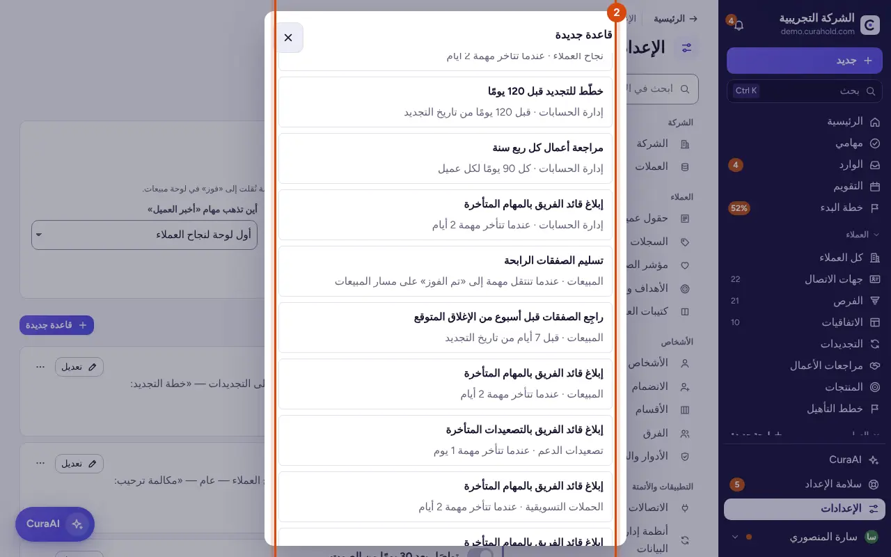
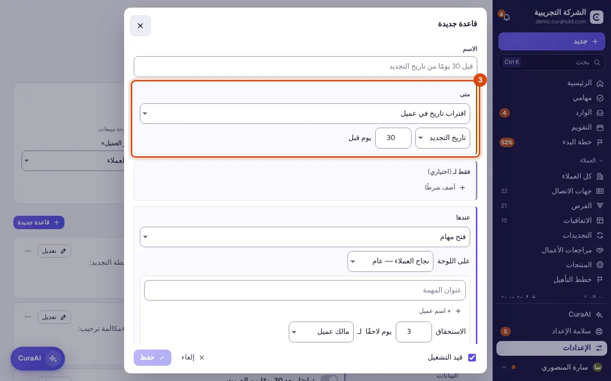
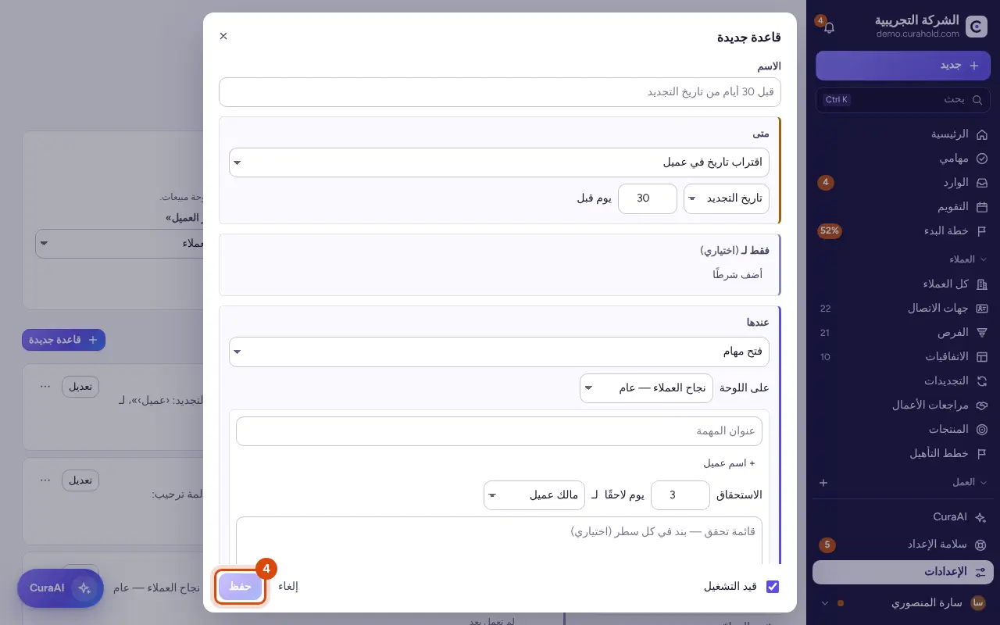

# الأتمتة

تقوم القواعد بالأعمال الروتينية عنك: خطة تجديد قبل 90 يومًا، ومكالمة ترحيب بعميل جديد، وتذكير عند تأخر مهمة، وبطاقة التسليم عند الفوز بصفقة. لا تُعدّ ولا سقف لها في أي خطة.

## أنشئ قاعدة {#new-rule}

تحتاج إلى صلاحية إدارة الأتمتة (لدى المسؤولين).

1. افتح **الإعدادات ← الأتمتة** وانقر **قاعدة جديدة**.
   
2. اختر قاعدة جاهزة مناسبة، أو **البدء من الصفر**.
   
3. تحت **متى** اختر ما يبدأ القاعدة وتفاصيله (أي تاريخ، كم يومًا، أي لوحة). انقر **أضف شرطًا** لحصرها في بعض العملاء أو المهام. وتحت **عندها** اختر ما يحدث. يعرض السطر "اليوم ستنفّذ هذه القاعدة إجراءً على…" ما ستلمسه الآن؛ لم يتغير شيء بعد.
   
4. أعطها **الاسم**، واترك **قيد التشغيل** محددًا، وانقر **حفظ**.
   

## ما الذي يبدأ القاعدة {#when}

تاريخ قادم على العميل (تجديد، نهاية عقد)، كل عدد من الأيام لكل عميل، عميل صار هادئًا، عميل جديد، مهمة متأخرة، مهمة تنتقل إلى عمود، مهمة تُضاف أو تنتهي، طلب عبر نموذج لوحة، سجل يبلغ مرحلة، تذكرة دعم تُفتح.

## ما الذي تفعله القاعدة {#then}

فتح مهام (بقائمة تحقق، لمسؤول العميل أو لأي شخص)، إرسال تذكير، تعيين، نقل، تعبئة حقل، كتابة تعليق، الإرسال إلى الـ webhooks، أو تحضير بطاقة التسليم.

## التشغيل والإيقاف {#running}

تعرض كل قاعدة عدد مرات تشغيلها في آخر 30 يومًا. **تشغيل الآن** يشغّل القاعدة المجدولة فورًا بدل انتظار الساعة التالية، وتظل تعمل مرة واحدة لكل مناسبة. أوقف القاعدة لإيقافها مؤقتًا. حذف القاعدة يُبقي المهام التي فتحتها، وتبقى القاعدة في سلة المهملات 30 يومًا.

إعدادات التسليم أعلى الصفحة نفسها موجودة في [التسليم والطلبات والعودة إلى العميل](/docs/ar/handover-and-requests/).
