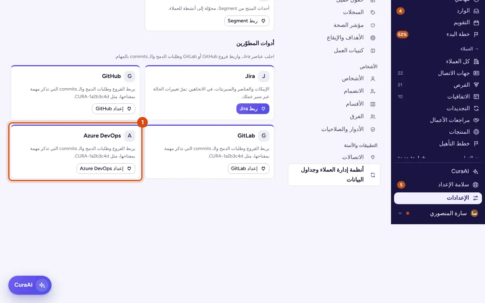
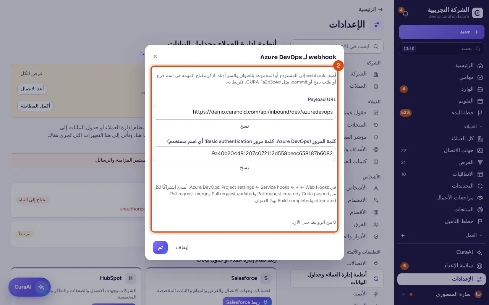

# Azure DevOps

الفروع وطلبات السحب والـ commits في Azure Repos التي تذكر مهمة تُربط بها، مع حالتها (مفتوح، مدمج، مغلق) ونتيجة البناء. تعمل مثل GitHub وGitLab: ضع مفتاح المهمة، مثل `CURA-1a2b3c4d`، في اسم الفرع أو عنوان طلب السحب أو رسالة الـ commit.

## في Curahold {#connect}

1. افتح **الإعدادات ← أنظمة إدارة العملاء وجداول البيانات**، وابحث عن **أدوات المطوّرين**، وانقر **إعداد Azure DevOps**.
   
2. انقر **تشغيل**، ثم انسخ **العنوان** و**كلمة المرور** المعروضين.
   

## في Azure DevOps

افعل هذا مرة لكل حدث (Code pushed وPull request created وPull request updated وPull request merge attempted وBuild completed):

1. افتح المشروع ← **Project settings** ← **Service hooks** ← **+** (Create subscription).
2. اختر **Web Hooks** وانقر **Next**.
3. اختر الحدث، واترك المرشحات كما هي، وانقر **Next**.
4. الصق العنوان في **URL**. اكتب أي **Username** (مثل `azure`) والصق كلمة المرور في **Password**.
5. اترك **Resource details to send** على **All**، وانقر **Test** ثم **Finish**.

## الحدود والتوقيت

تظهر الروابط بمجرد أن يرسلها Azure DevOps. يرسل Azure DevOps عبر HTTPS فقط ولا يوقّع شيئًا: كلمة المرور هي الدليل، فاحفظها ككلمة مرور.

## إذا حدثت مشكلة

يعرض Azure DevOps ردّ كل إرسال في **Service hooks ← History**: الرمز 401 يعني أن كلمة المرور خاطئة (شغّل الـ webhook مجددًا لكلمة مرور جديدة وحدّث كل اشتراك). **إيقاف** يوقف الروابط الجديدة؛ وتبقى الروابط الموجودة على المهام.

## انظر أيضًا

- [الاتصالات وCRM](/docs/ar/connections/)
- [المهام واللوحات](/docs/ar/tasks/)
