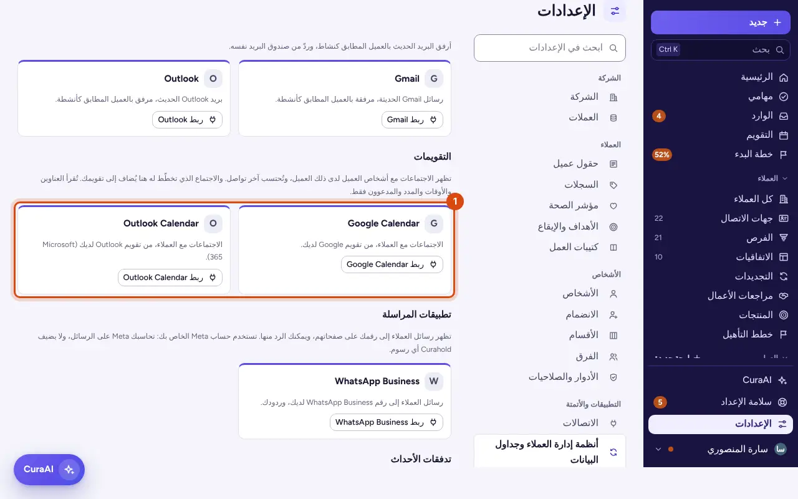

# تقويم Google وتقويم Outlook

اربط تقويمك، فيظهر كل اجتماع عقدته مع أشخاص العميل في مخططه الزمني كاجتماع بمدته، ويُحتسب آخر تواصل. ومن المخطط الزمني للعميل يمكنك التخطيط لاجتماع مباشرة في تقويمك؛ والتقويم يرسل الدعوات.

## ما الذي يُقرأ وما الذي لا يُقرأ

الاجتماعات التي جرت فعلًا فقط، من تقويمك الرئيسي: العنوان والوقت والمدة والمدعوون. لا يُقرأ الوصف ولا المكان ولا رابط المكالمة أبدًا. تُستبعد الاجتماعات الخاصة وإدخالات اليوم الكامل والاجتماعات التي لا أحد فيها من الخارج. يُوضع الاجتماع لدى العميل الذي إحدى جهات اتصاله مدعوّة، أو الذي عنوان موقعه نطاق أحد المدعوين.

## في Curahold {#connect}

1. افتح **الإعدادات ← أنظمة إدارة العملاء وجداول البيانات**، وابحث عن **التقويمات**، وانقر **ربط Google Calendar** أو **ربط Outlook Calendar**.
   

تفتح صفحة Google أو Microsoft. اختر حساب العمل وانقر **Allow** (Google) أو **Accept** (Microsoft). وعند العودة إلى Curahold انقر **بدء**: تُقرأ آخر 90 يومًا، ثم كل ساعة.

## خطّط لاجتماع

في صفحة العميل افتح **المخطط الزمني** وانقر **خطّط لاجتماع في Google Calendar** (أو Outlook). اكتب العنوان والوقت والمدة وبريد المدعوين، ثم انقر **أضف إلى …**. يظهر الاجتماع في المخطط الزمني بعد انعقاده.

## الحدود والتوقيت

يُقرأ كل ساعة؛ ويُحدَّث الاجتماع الذي نُقل أو غُيّر اسمه خلال الأسبوع الأخير. أما الاجتماع الملغى فيبقى: احذفه من الخط الزمني إن لم يُعقد (ينتقل إلى سلة المحذوفات). يحدّ Google وMicrosoft عدد الطلبات في الدقيقة: الرد «مشغول» يوقف القراءة مؤقتًا، وتستمر في المرة التالية.

## إذا حدثت مشكلة

إذا انتهت صلاحية تسجيل الدخول يُجدَّد تلقائيًا. وإذا سُحب الوصول (كلمة مرور جديدة، قرار مسؤول) يظهر الاتصال **يحتاج إلى انتباه**: انقر **إعادة الربط** وسجّل الدخول بالحساب نفسه. **إزالة** تحذف تسجيل الدخول؛ وتبقى الاجتماعات الموجودة في المخططات الزمنية.

## انظر أيضًا

- [المخطط الزمني ومؤشر الصحة](/docs/ar/timeline-and-health/)
- [الاتصالات وCRM](/docs/ar/connections/)
