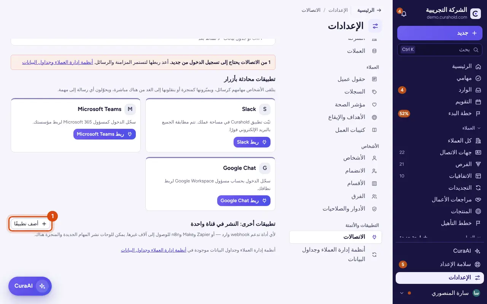
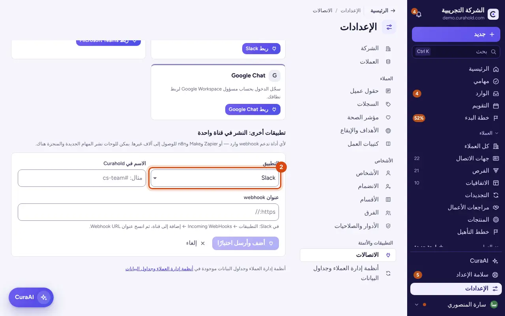

# إشعارات Lark وFeishu وTelegram

يمكن للوحة أن تنشر أخبارها (مهمة جديدة، مهمة منتهية) في محادثة جماعية. يستخدم Lark وFeishu البوت المخصص للمجموعة، ويستخدم Telegram بوتًا تنشئه في دقيقتين. كلاهما في اتجاه واحد: ينشران، ولا يأتي رد من خلالهما.

## في Curahold {#connect}

1. افتح **الإعدادات ← الاتصالات** وانقر **أضف تطبيقًا**.
   
2. اختر **Lark · Feishu** أو **Telegram**، والصق ما تعطيك إياه الخطوات أدناه، وانقر **أضف وأرسل اختبارًا**. تصل رسالة اختبار إلى المجموعة.
   

ثم افتح اللوحة، واختر في إعداداتها الإشعارات، وحدّد الاتصال الجديد للأخبار التي تريدها.

## Lark · Feishu

1. في المجموعة افتح **Settings ← Bots ← Add bot ← Custom bot**، وسمِّه وانقر **Add**.
2. انسخ **عنوان الـ webhook**. يبدو هكذا:

```text
https://open.larksuite.com/open-apis/bot/v2/hook/0f3c2a9e-7d1b-4c55-9a7e-2b8f6c1d3e4f
```

اختياري ومستحسن: تحت **Security settings** فعّل **Signature verification** وانسخ السرّ إلى **مفتاح التوقيع** في Curahold. لا تستخدم مرشّح الكلمات المفتاحية: ستُسقط الرسائل.

## Telegram

1. في Telegram راسل **‎@BotFather‎** وأرسل `/newbot` وأجب عن سؤاليه وانسخ **الرمز** الذي يعطيك إياه.
2. أضف البوت إلى مجموعتك (للقناة: أضفه مشرفًا).
3. أرسل رسالة واحدة في المجموعة. يجد Curahold المجموعة منها، فلا تحتاج إلى معرّفها.
4. الصق الرمز في **رمز البوت** في Curahold. للقناة العامة يمكنك كتابة `@اسمها` بدلًا من ذلك.

## الحدود والتوقيت

يقبل Lark نحو 100 منشور في الدقيقة لكل بوت، وTelegram نحو 20 في الدقيقة لكل مجموعة؛ والرد «مشغول» يُعاد إرساله ولا يضيع. رسائل Telegram نص عادي حتى 4096 حرفًا.

## إذا حدثت مشكلة

سرّ توقيع خاطئ أو بوت مُزال أو رمز ملغى يجعل الاتصال **يحتاج إلى انتباه** في الإعدادات ← الاتصالات، ويقول الاختبار ذلك. أصلح الأمر في الطرف الآخر ثم انقر **إرسال اختبار** مجددًا: الاختبار الناجح يزيل المشكلة. **إزالة** توقف المنشورات؛ ويبقى البوت في مجموعتك حتى تزيله هناك.

## انظر أيضًا

- [الاتصالات وCRM](/docs/ar/connections/)
- [الإشعارات](/docs/ar/notifications/)
