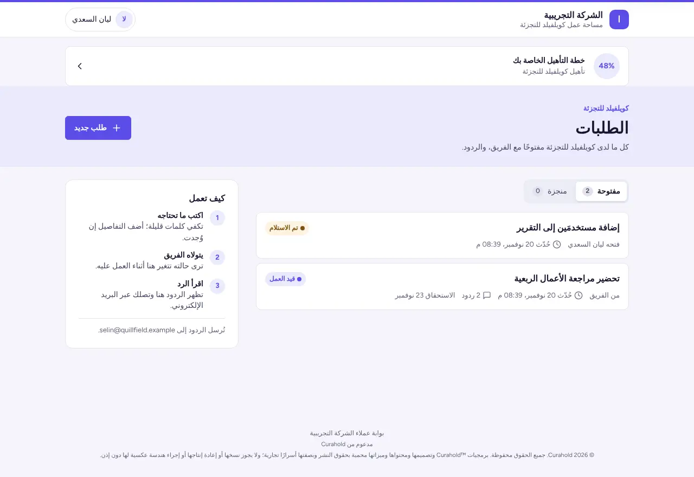

# بوابة العملاء

تفتح بوابة العملاء لوحات مختارة لأشخاص عملائك. يسجّلون الدخول على عنوانهم الخاص (مثل `acme.curahold-portal.com`)، ويرون ما هو مفتوح لشركتهم وأين وصل، ويفتحون طلبات جديدة ويردّون.

## ما يراه العميل وما لا يراه أبدًا

| يرى | لا يرى أبدًا |
|---|---|
| مهام شركته **المشتركة معه** | أي مهمة لعميل آخر |
| العنوان والوصف والحالة (بالاسم الذي اخترته للعمود) | الملاحظات الداخلية والتعليقات الداخلية |
| التعليقات المكتوبة كـ **رد على العميل** | فريقك وأدواره والأشخاص الآخرين |
| التفاصيل التي تسمح بها في اللوحة (تاريخ الاستحقاق، والأولوية، ومن يعمل عليها) | حقول العملاء والصفقات ومؤشر الصحة والسجلات |
| | اللوحات الأخرى والشركات الأخرى وCurahold نفسه |

تعمل البوابة على نطاق منفصل: لا يمكن الوصول منها إطلاقًا إلى جلسات التطبيق أو ملفات تعريف الارتباط أو API الخاصة به. ودور قاعدة البيانات خلف طلبات البوابة لا يستطيع قراءة أي جدول؛ يستطيع فقط استدعاء دوال البوابة، التي تُرجع بيانات شركة الشخص المسجّل للدخول وحدها.

## التفعيل (للمسؤولين)

1. **الإعدادات ← بوابة العملاء ← بوابة العملاء قيد التشغيل.** ويظهر هناك العنوان الذي يسجّل عملاؤك الدخول عليه.
2. في **إعدادات اللوحة** التي تريد فتحها ← **بوابة العملاء**:
   - **افتح هذه اللوحة للعملاء**
   - **تصل الطلبات الجديدة إلى:** اختر عمودًا. ويُسند الطلب الجديد إلى مسؤول العميل.
   - **ما يقرؤه العملاء لكل عمود:** «قيد المراجعة» بدل «بانتظار الإدارة القانونية» مثلًا. وإذا تُرك فارغًا يظهر اسم العمود نفسه.
   - **التفاصيل التي يراها العملاء:** تاريخ الاستحقاق، والأولوية، ومن يعمل عليها.

   أسرع، ما دامت لا توجد لوحة مفتوحة بعد: تعرض **الإعدادات ← بوابة العملاء** لوحاتك؛ انقر **افتح … للعملاء** على اللوحة التي ستصل إليها الطلبات (تصل إلى عمودها الأول).

لا يمكن فتح اللوحات الخاصة. وإيقاف المفتاح يغلق البوابة على الجميع فورًا.

## دعوة الأشخاص

من **الإعدادات ← بوابة العملاء ← من يستطيع تسجيل الدخول**، أو من قسم **بوابة العملاء** في صفحة العميل: اسم وبريد إلكتروني، ثم **دعوة**. يستطيع الدعوةَ مسؤولُ العميل والمسؤولون.

- تعمل الدعوة مرة واحدة خلال 7 أيام. بعدها يسجّل الناس الدخول بالطرق التي تسمح بها الشركة (أدناه).
- لا يمكن دعوة عنوان يخص أحدًا في شركتك؛ البوابة للعملاء.
- **إيقاف** ينهي وصولهم وجلساتهم المفتوحة فورًا.

## طرق تسجيل الدخول

في **الإعدادات ← بوابة العملاء ← كيف يسجّل العملاء الدخول**، اختر الطرق التي تناسب عملاءك:

| الطريقة | كيف تعمل |
|---|---|
| **رمز ورابط بالبريد** | رسالة واحدة فيها رمز من ستة أرقام ورابط، يعمل كل منهما مرة واحدة خلال 30 دقيقة. يتيح الرمز قراءة البريد على الهاتف وتسجيل الدخول على الحاسوب. |
| **Google** | حساب Google الخاص بشركتهم. إذا أغلقت شركتهم الحساب تُغلق البوابة أمامهم أيضًا. |
| **Microsoft** | حساب Microsoft 365. يُؤكَّد أول دخول عبر Microsoft مرة واحدة برمز مرسل بالبريد، وبعدها يُتعرّف على الحساب نفسه. |
| **مفتاح المرور** | بصمة الإصبع أو الوجه أو رمز الجهاز. أكثر الطرق أمانًا؛ يضيفه الشخص من **حسابك** بعد أول تسجيل دخول. ولا يعمل مفتاح المرور إلا على عنوان تلك البوابة، لا على موقع مقلّد أبدًا. |
| **كلمة المرور** | للعملاء الذين يطلبونها (معطّلة افتراضيًا). 10 أحرف على الأقل؛ وخمس محاولات خاطئة تقفلها 15 دقيقة؛ و«نسيت كلمة المرور؟» يعيد تعيينها بالبريد. |

- **البقاء مسجّلًا للدخول:** 1 أو 7 أو 30 (الافتراضي) أو 90 يومًا.
- **إشعار تسجيل الدخول:** بعد الدخول عبر Google أو Microsoft أو مفتاح المرور أو كلمة المرور، تصل الشخصَ رسالة «تسجيل دخول جديد» (يمكن إيقافها).
- إيقاف طريقة ينهي الجلسات التي فُتحت بها، وتقصير مدة البقاء ينهي الجلسات الأقدم. ويجب أن تبقى طريقة دخول واحدة على الأقل مفعّلة (البريد أو Google أو Microsoft أو كلمة المرور).
- لا يقول نموذج الدخول أبدًا إن كان لعنوان ما وصول، ولا يحصل العنوان الواحد على أكثر من 5 رسائل في الساعة.
- في **حسابك** يضيف الناس مفاتيح المرور، ويضبطون كلمة المرور، ويفصلون Google أو Microsoft، أو يسجّلون الخروج من كل مكان.

## مشاركة المهام والرد

- الطلبات التي يفتحها العميل تُشارَك وحدها.
- لإظهار مهمة فتحها فريقك، حدّد **مشاركة مع العميل** في لوحة المهمة (يجب أن يكون للمهمة عميل، وأن تكون في لوحة مفتوحة).
- في المهمة المشتركة اختر **ملاحظة داخلية** (الافتراضي) أو **رد على العميل** عند التعليق. وتُعلَّم الردود على العميل بخط برتقالي وعبارة «يراها العميل»، وتُرسل إليه بالبريد.
- ما يكتبه العملاء يظهر بوسم «العميل»، ويصل إلى المسؤولين عن المهمة إشعارًا.
- عندما يتغيّر عميل المهمة تتوقف المشاركة وحدها: لا تنتقل محادثة عميل إلى عميل آخر أبدًا.

## ملفات من العملاء

يستطيع العملاء إرسال الملفات فقط إلى الطلبات والتذاكر المشتركة معهم، وإلى خطوات خطة البدء الخاصة بهم. ولا مكان غير ذلك.

- مستندات وصور وجداول وCSV وPDF وZIP، حتى 25 ميغابايت لكل ملف. يُفحص كل ملف حسب نوعه وأول بايتاته، ويُفتح دائمًا كتنزيل.
- ما يستطيع عملاؤك إرساله إجمالًا يُضبط في الإعدادات ← **بوابة العملاء** ← **ملفات من العملاء** (2048 ميغابايت ما لم تغيّرها). عند امتلائها يُطلب منهم إرسال الملف بطريقة أخرى.
- يظهر كل ملف يرسله العميل في الخط الزمني لذلك العميل.

## الحدود

يستطيع كل شخص فتح 30 طلبًا على الأكثر وكتابة 200 رد في اليوم.
