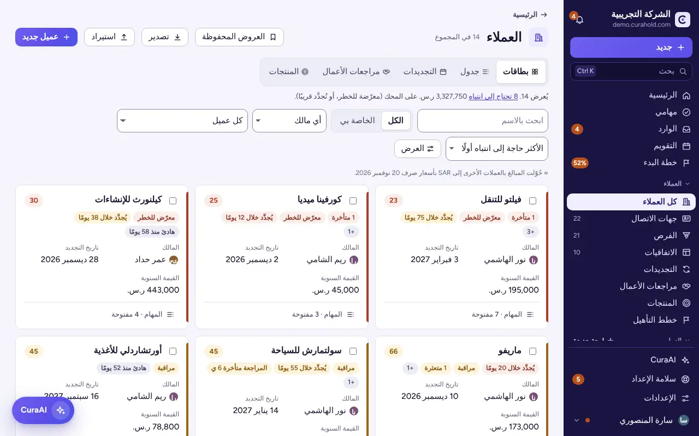
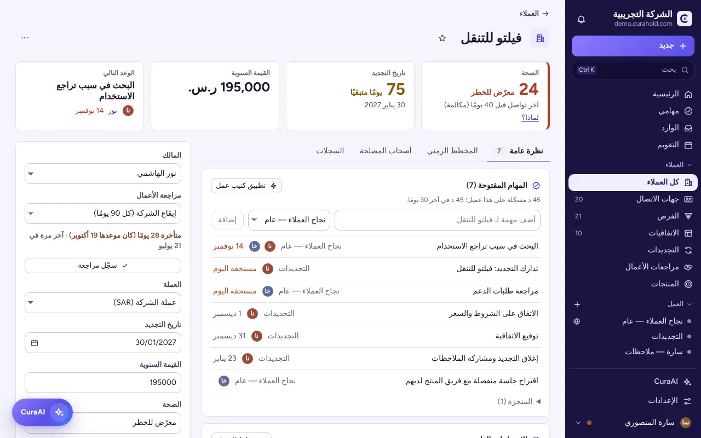

# العملاء والحقول والسجلات

العملاء في قلب Curahold. لكل عميل مسؤول، وفريق اختياري، وحقول خاصة بشركتك.

## صفحة العميل

في أعلى صفحة العميل شريط يُقرأ بنظرة: **الصحة** مع سببها وزر **لماذا؟**، وتاريخ التجديد والأيام المتبقية، والقيمة السنوية، و**الوعد التالي**: أقرب خطوة وعدتم بها العميل، ومن يحملها. وتحت الشريط تبويبات: **نظرة عامة** (المهام المفتوحة والاجتماعات القادمة)، و**المخطط الزمني**، و**أصحاب المصلحة**، و**السجلات**، و**التفاصيل**. يبقى التبويب المفتوح في العنوان، فيعود إليه التحديث والرابط المرسَل.

## الحقول

أضف الحقول من الإعدادات ← حقول العملاء: نص، أو رقم، أو مبلغ، أو تاريخ، أو اختيار، أو بريد إلكتروني، أو رابط. يمكن أن يكون لخيارات الاختيار لون، فيظهر حقل مثل الصحة بذلك اللون في القوائم والبطاقات.

ويمكنك تغيير اسم «العميل» أيضًا: «حساب»، أو «علامة تجارية»، أو «شريك»؛ ما يقوله فريقك يظهر في كل مكان من الواجهة.

## السجلات: جهات الاتصال والفرص وغيرها

احفظ السجلات تحت العملاء:

- **جهات الاتصال (أصحاب المصلحة):** المسمى الوظيفي، ودور القرار (صاحب قرار، أو معتمد الميزانية، أو مؤثر، أو مقيّم، أو مستخدم)، والموقف منكم (مناصر، أو داعم، أو محايد، أو متشكك، أو معرقل).
- **الفرص:** المبلغ، وتاريخ الإغلاق، والمرحلة، والحالة.
- **أنواع سجلات خاصة بكم:** «المشاريع» أو «العقود» مثلًا.

يمكن أن تغذّي السجلات حقول العملاء: «المسار المفتوح»، و«المناصرون»، و«المعرقلون». يتحدّث الحقل وحده عندما يتغيّر سجل.

## العروض: البطاقات والجدول والتجديدات والمنتجات

بدّل بين أربعة عروض بالأزرار أعلى صفحة العملاء؛ ويُحفظ اختيارك على ذلك الجهاز.

- **البطاقات:** بطاقة لكل عميل تقول ما يستحق النظر: مهام متأخرة، أو صحة في خطر أو تحت المراقبة، أو تجديد قادم أو فات موعده، أو مهام لم تُلمس منذ 14 يومًا، أو لا تواصل منذ 30 يومًا. الأخطر أولًا، و«كل شيء على ما يرام» حين لا يوجد شيء. تأتي البطاقات مرتبة حسب «الأحوج إلى الاهتمام» افتراضيًا، ويمكن ترتيبها بالاسم أو الصحة أو القيمة أو التجديد أو المهام المفتوحة. اختر الحقول الظاهرة على البطاقة من قائمة **العرض**.
- **الجدول:** قائمة قابلة للفرز يمكنك فيها تغيير عدة عملاء دفعة واحدة.
- **التجديدات:** تجديدات الأشهر الاثني عشر القادمة شهرًا بشهر، مع مجموع كل شهر وكم منه في خطر أو تحت المراقبة.
- **المنتجات:** من لديه أي منتج، حسب حقل اختيار في نوع سجل (مثل «الاشتراك ← المنتج»). وعلامة **+** في خلية فارغة تفتح مهمة بيع إضافي لذلك العميل.

تقول الجملة في الأعلى كم عميلًا يحتاج إلى اهتمام وكم من القيمة في خطر، ورابط «يحتاجون إلى اهتمام» يقصر القائمة عليهم. وعلى الهاتف تجتمع عوامل التصفية في صفحة **تصفية** واحدة.

## الاستيراد

أفلت ملف Excel أو CSV، وطابق الأعمدة مع الحقول، وراجع المعاينة، ثم استورد. ويمكن التراجع عن استيراد لم ينجح بنقرة واحدة خلال 30 يومًا.

## التصدير

نزّل قوائم العملاء والسجلات، مع عامل التصفية المفعّل، بصيغة Excel أو CSV. يُنشأ الملف في متصفحك، والحقول التي لا تستطيع رؤيتها لا تكون فيه أيضًا.

## تغيير عدة عملاء دفعة واحدة

حدّد عدة عملاء في القائمة وغيّر مسؤولهم أو فريقهم أو حقلًا معًا. يعرض الإشعار في الأسفل زر **تراجع**.

## حذف عميل واستعادته

يذهب العميل المحذوف إلى [سلة المحذوفات](/docs/ar/trash/) مع سجلاته ومخططه الزمني واجتماعاته وأشخاص بوابته، ويمكن إعادته خلال 30 يومًا: اختر **تراجع** في الإشعار بعد الحذف مباشرة، أو افتح قائمتك واختر **سلة المحذوفات** ثم **إعادة**. تبقى مهامه في لوحاتها دون عميل، وتشير إليه مجددًا عندما يعود. ولإبعاد عميل عن الطريق دون حذفه، أرشِفه.

## كتيبات العمل

**كتيب العمل** مجموعة مهام مؤرّخة توضع على عميل بنقرة واحدة: الإعداد، أو التحضير للتجديد، أو مراجعة أعمال ربعية. يكتبه المسؤول مرة واحدة في الإعدادات ← **كتيبات العمل** (عنوان المهمة، وبعد كم يومًا من البداية، ولمن)؛ وفي صفحة العميل يتيح لك زر **تطبيق كتيب عمل** اختيار يوم البداية وإضافتها كلها. ويصبح `{account_name}` في العنوان اسمَ العميل.

## مراجعات الأعمال

قرّر مرة واحدة كم مرة تجلس مع كل عميل: الإعدادات ← **الأهداف والإيقاع** ← *مراجعات الأعمال* (كل 90 يومًا مثلًا). ويمكن أن يكون لعميل واحد إيقاعه الخاص في حقل **مراجعة أعمال** في صفحته، و«بلا مراجعات» يُخرج ذلك العميل من الإيقاع.

مراجعة الأعمال اجتماع تعقده مع كل عميل بين حين وآخر لمراجعة النتائج والخطط. تعرض **العملاء ← مراجعات الأعمال** ما حان موعده: المتأخر، وما في الأيام الثلاثين القادمة، وما بعدها. عندما تعقد المراجعة، يفتح زر **تم** في الصف (أو في صفحة العميل) نموذج الاجتماع؛ وبعد الحفظ تظهر في **الاجتماعات** والمخطط الزمني للعميل باسم «مراجعة أعمال»، وينتقل الموعد التالي وحده. وللعميل الذي لم يُراجَع قط، يبدأ العدّ من يوم إضافته. وتظهر المراجعة المتأخرة أيضًا علامةً على بطاقة العميل.

## الاجتماعات

تعرض **الاجتماعات** في صفحة العميل كل اجتماع ومراجعة أعمال ومكالمة مع ذلك العميل، الأحدث أولًا: التاريخ، والنوع، والعنوان، والمدة، ومن سجّله، ومن حضر (من جانبهم ومن جانبنا)، والملاحظات، والخطوات التالية. الأزرار فوقها تعرض نوعًا واحدًا فقط، وموعد مراجعة الأعمال التالية بجانب العنوان.

يطلب **سجّل اجتماعًا** (في صفحة العميل، أو **+ جديد ← تسجيل اجتماع أو مكالمة أو ملاحظة**):

- النوع (اجتماع، أو مراجعة أعمال، أو مكالمة)، والعنوان، والتاريخ، والمدة،
- من حضر من جانبهم (جهات اتصال العميل) ومن جانبنا،
- الملاحظات: ما نوقش وما تقرر،
- الخطوات التالية: كل خطوة، مع من يحملها وموعدها، تصبح مهمة على اللوحة التي تختارها، لهذا العميل.

تظهر الخطوات التالية تحت الاجتماع مع حالتها (المنجزة مشطوبة)؛ انقر إحداها لفتح المهمة. ويمكن تعديل الاجتماع لاحقًا، أو إضافة خطوات تالية، أو حذفه؛ وتبقى مهام الاجتماع المحذوف، ويمكن إعادة الاجتماع نفسه من [سلة المحذوفات](/docs/ar/trash/) خلال 30 يومًا.
