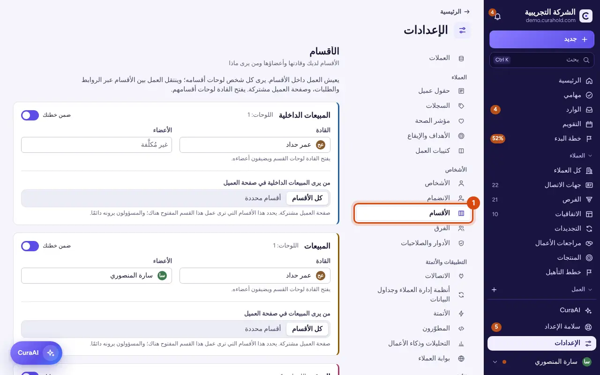
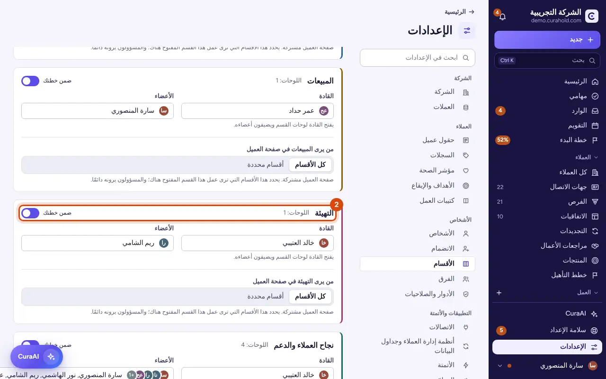
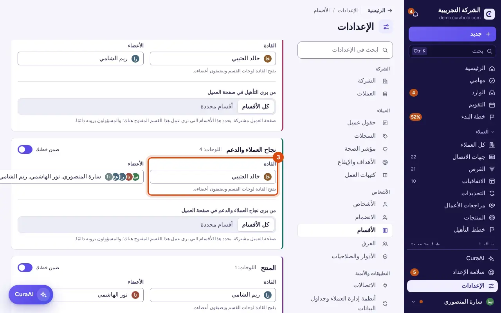
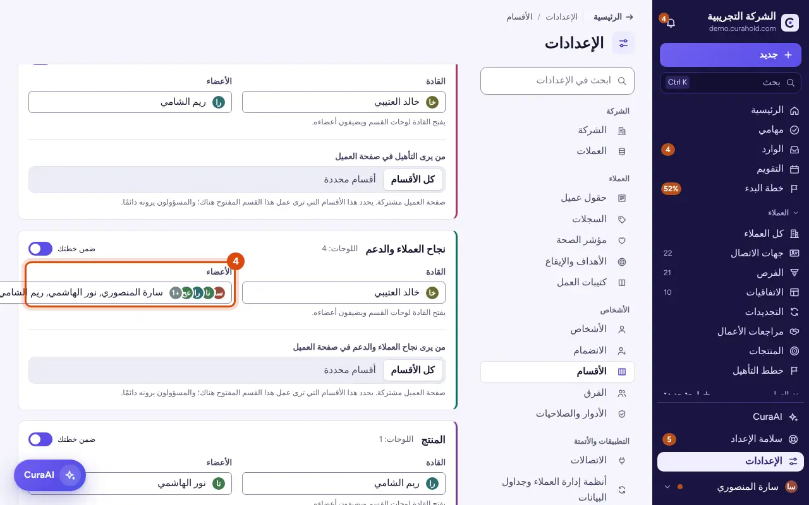
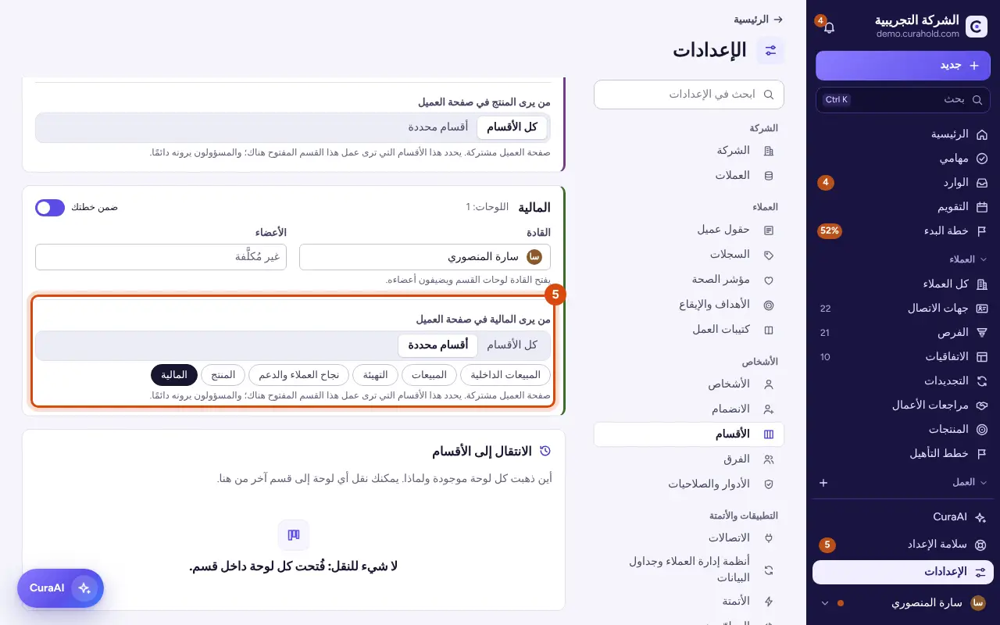
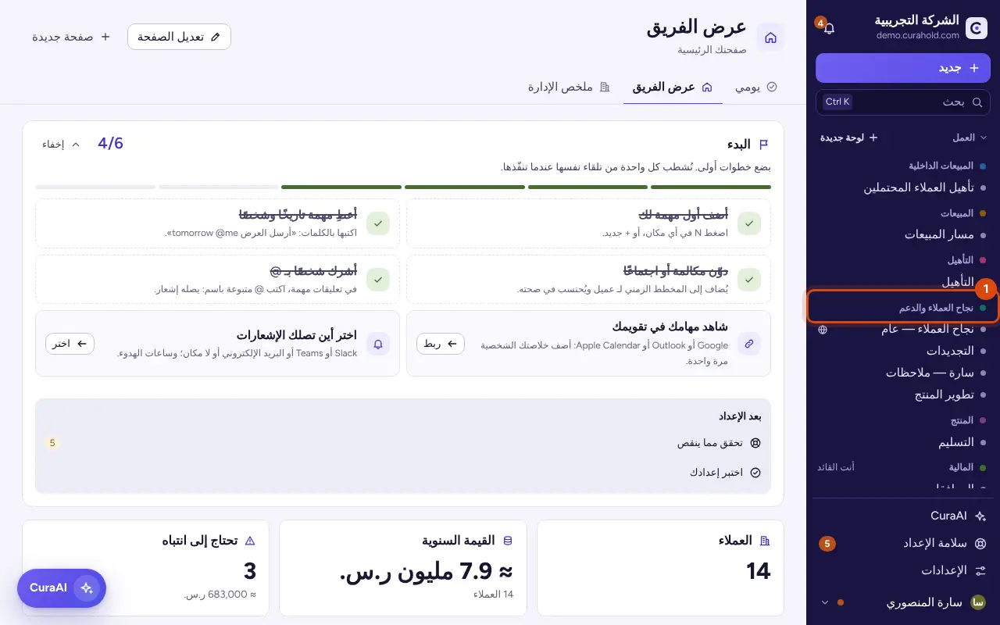
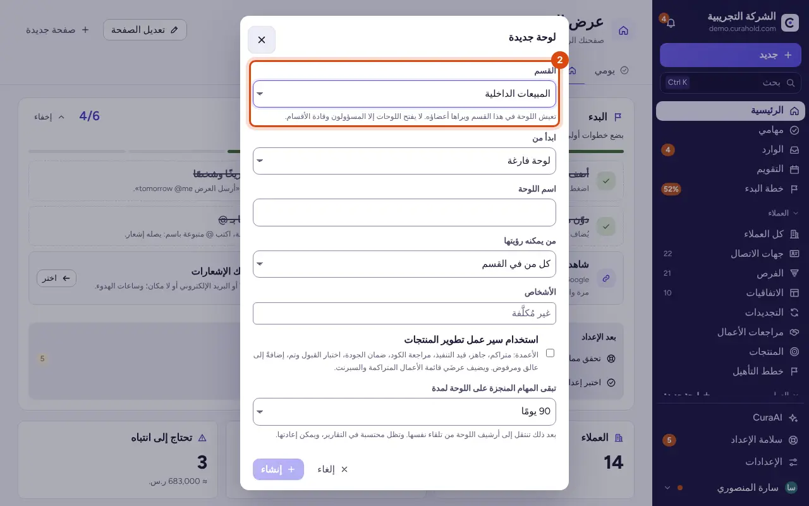
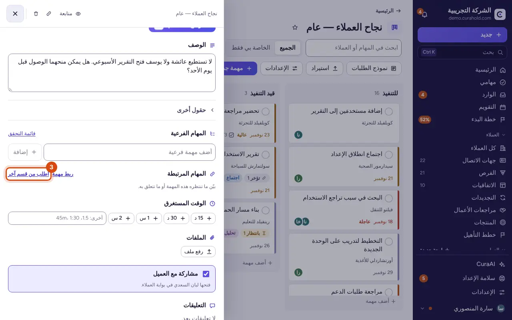
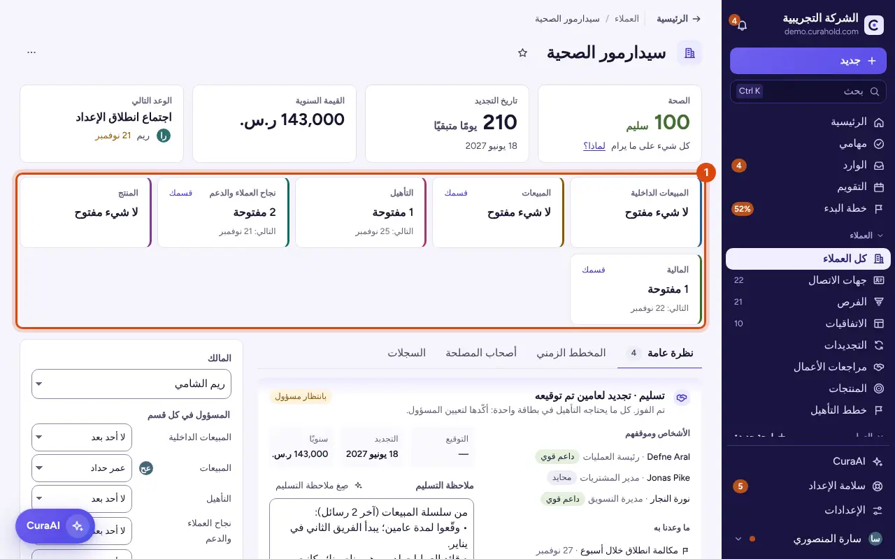
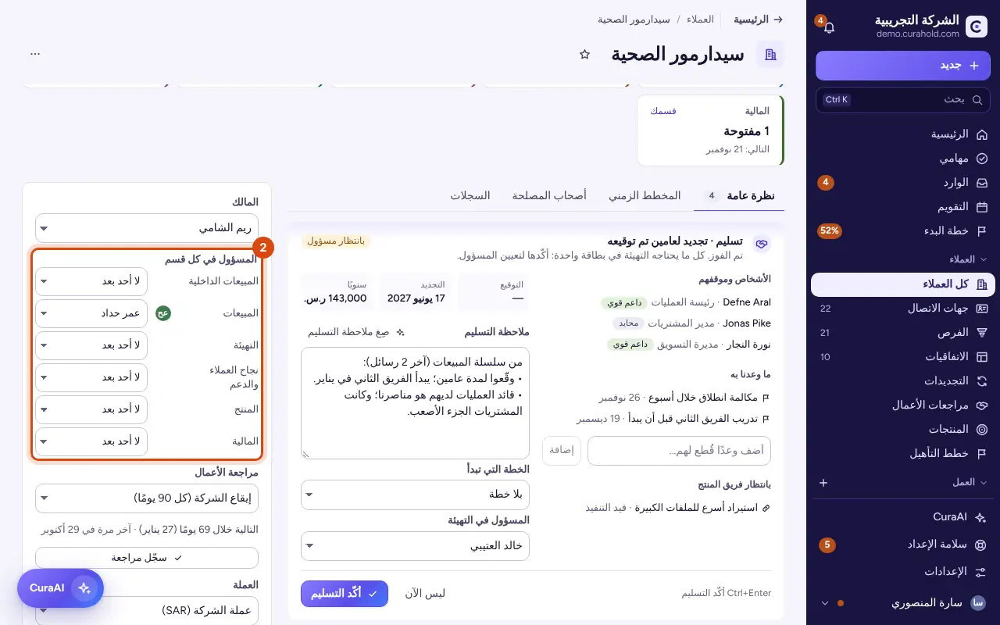

# الأقسام

يعيش العمل في Curahold داخل الأقسام: المبيعات الداخلية، والمبيعات، والتأهيل، ونجاح العملاء والدعم، والمنتج، والمالية. يرى كل شخص لوحات أقسامه. ينتقل العمل إلى قسم آخر عبر طلب، أما صفحة العميل فمشتركة بين كل من يحق له رؤية ذلك العميل.

## إعداد الأقسام {#set-up}

يجب أن تكون مسؤولًا (أو ممن يديرون الأشخاص).

1. في القائمة الجانبية انقر **الإعدادات**، ثم **الأقسام** (تحت **الأشخاص**).
   
2. اترك **ضمن خطتك** مفعّلًا لكل قسم موجود في شركتك. أوقفه للقسم الذي لا تستخدمه: يُخفى عن الجميع، وتبقى لوحاته محفوظة حتى تعيد تفعيله.
   
3. في **القادة** اختر من يقود القسم. يفتح القادة لوحات القسم ويضيفون أعضاءه.
   
4. في **الأعضاء** اختر كل من يعمل فيه غيرهم. يمكن أن يكون الشخص في أكثر من قسم.
   
5. تحت **من يرى … في صفحة العميل** اختر **كل الأقسام**، أو **أقسام محددة** ثم انقر الأقسام التي يحق لها رؤية العمل المفتوح لهذا القسم هناك. المسؤولون يرونه دائمًا. تبدأ المالية مرئية للمالية وحدها.
   

يُحفظ كل شيء أثناء العمل. الشخص الذي لم يُضف إلى أي قسم بعد يحتفظ بعمله في **مهامي** حتى تضيفه.

عند انتقال شركتك إلى الأقسام وُضعت كل لوحة موجودة في قسم. يعرض **الانتقال إلى الأقسام** أسفل الصفحة نفسها أين ذهبت كل لوحة ولماذا؛ غيّر قسم أي لوحة من هناك. وتعرض **أشخاص بانتظار التعيين** من كانوا يرون لوحة سابقًا ولا يعملون عليها: **امنح الوصول** يجعلهم أعضاء.

## اللوحات داخل القسم {#boards}

1. في القائمة تُجمع اللوحات تحت اسم قسمها. وتظهر **أنت القائد** بجانب القسم الذي تقوده.
   
2. لفتح لوحة جديدة انقر **+** بجانب **العمل**. في **القسم** اختر مكان اللوحة، ثم سمّها وانقر **إنشاء**. لا يفتح اللوحات إلا المسؤولون وقادة الأقسام.
   

تكون الرؤية افتراضيًا **كل من في القسم**؛ ويمكنك حصرها في فريق أو أشخاص تختارهم.

## اطلب من قسم آخر {#ask}

1. افتح المهمة التي يخصها الطلب وانقر **اطلب من قسم آخر**. اختر لوحة القسم من القائمة، واملأ نموذج الطلب وأرسله.
   

يصل الطلب إلى لوحة ذلك القسم ويُربط بمهمتك. ترى عنوانه وحالته، ولا ترى لوحة القسم الآخر أبدًا. يبدأ القسم باستقبال الطلبات حين يفعّل قائده نموذج الطلبات في إحدى اللوحات (**إعدادات اللوحة ← الحقول ونموذج الطلبات**).

## في صفحة العميل {#customer-page}

1. في صفحة العميل يعرض **عبر الأقسام** العمل المفتوح لكل قسم مع هذا العميل، وكم منه متأخر، وأقرب موعد. وتشير **قسمك** إلى الأقسام التي أنت فيها.
   
2. على الجانب يعرض **المسؤول في كل قسم** من يتولى العميل في كل قسم. اختر شخصًا لتعيينه.
   

التسليم بين الأقسام (صفقة رابحة تذهب إلى التأهيل أو نجاح العملاء) موجود في [التسليم والطلبات والعودة إلى العميل](/docs/ar/handover-and-requests/).
