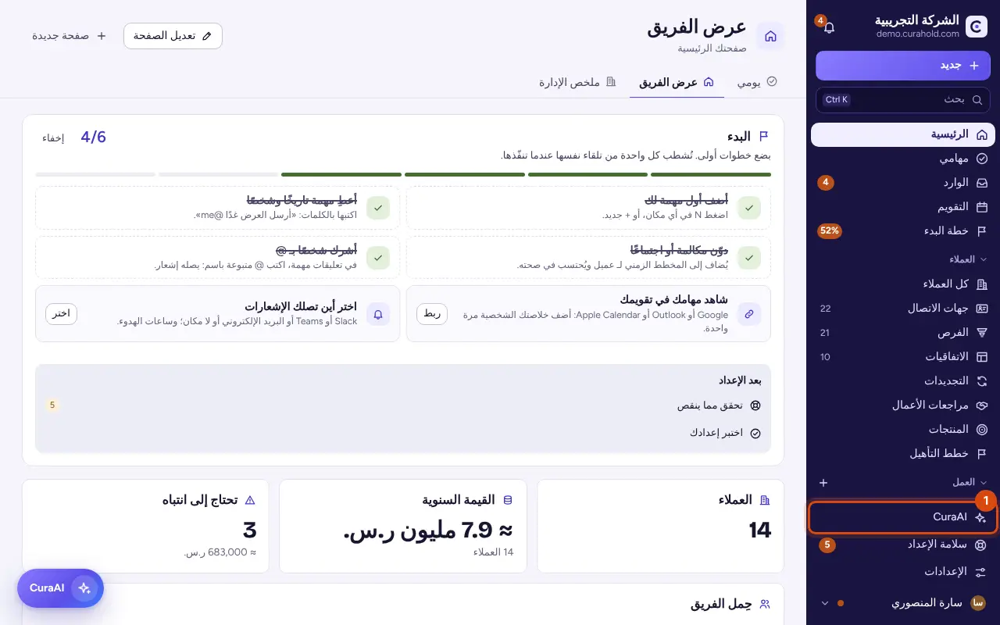
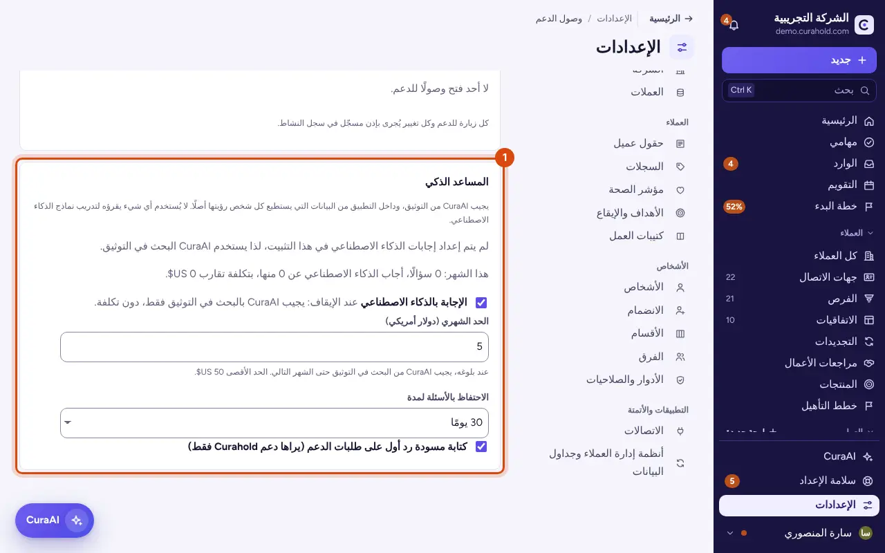
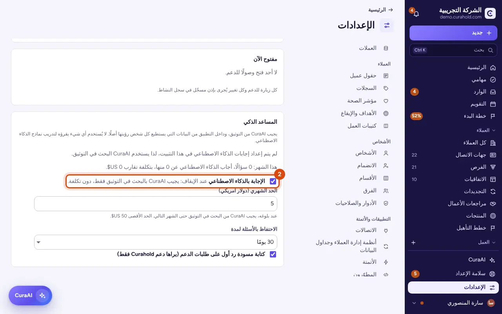

# الحصول على المساعدة

خطوتان بهذا الترتيب: **اسأل**، وإن لم يحسم ذلك الأمر **اكتب إلى الدعم**.

## اسأل أولًا {#ask}

1. انقر **CuraAI** في القائمة الجانبية (على الهاتف الزر في الأسفل؛ وفي هذه الوثائق زر **اسأل**). اكتب سؤالك بكلماتك: "كيف أستورد العملاء"، "من يرى هذا الحقل".
   

تأتي الإجابة من هذه الوثائق مع المكان الذي جاءت منه. حين تكون **الإجابة بالذكاء الاصطناعي** مفعّلة في شركتك (انظر أدناه) يقرأ CuraAI أيضًا ما يحق لك رؤيته في Curahold، مثل عملائك وتجديداتك ومهامك، فتستطيع أن تسأل "ما الذي يتجدد خلال 90 يومًا؟". هو يقرأ فقط ولا يغيّر شيئًا. حين تكون متوقفة أو غير مُعدّة أو تجاوزت حد الشهر، يجري البحث في الوثائق على جهازك ولا يُرسل شيء مما تكتبه.

إن لم تكن الإجابة ما تحتاجه فقل ذلك: تحصل على أقرب الأماكن التالية وزر لمراسلة الدعم وسؤالك مكتوب مسبقًا.

## التواصل مع الدعم: إرسال طلب

استخدم **اكتب إلى الدعم** أسفل CuraAI. يسأل النموذج عما يحتاجه الدعم ليجد المشكلة دون أن يعود إليك بأسئلة. لا يُرسل شيء لم تره؛ أنت تختار ما يذهب.

1. **الموضوع**: شيء لا يعمل، أو كيف أفعل…، أو بيانات أو اتصال، أو فكرة، أو الفوترة والخطة.
2. **الأثر**: للأخطاء ومشكلات البيانات، قل هل يوقف عملك. ويتبعه ترتيب الدعم.
3. **العنوان**: بضع كلمات. وأثناء الكتابة تُقترح صفحات من الوثائق قد تجيب عنه.
4. **ما الذي حدث**: ما كنت تحاول فعله، وما توقعته، وما حدث بدلًا منه. وإن ظهرت رسالة خطأ فانسخها حرفيًا.
5. **كيف نراه يحدث**: للأخطاء، خطوة خطوة (اختياري، لكنه يساعد كثيرًا).
6. **أبقِ على اطلاع** و**مطلوب بحلول** (كلاهما اختياري): زملاء يقرؤون الطلب ويسمعون الإجابة، واليوم الذي تحتاجه فيه.

تحصل على **رقم مرجعي** (مثل CH-000123) ونسخة بالبريد الإلكتروني.

## المحادثة: الإجابات والردود ودور من الآن

الطلب محادثة. افتحه من **طلباتي** (زر الوارد أعلى CuraAI):

- **إجابة الدعم** تصل بالبريد وعلى الطلب. وعلامة على زر CuraAI تقول إن إجابة تنتظرك.
- **رُدّ** داخل المنتج، أو ببساطة **أجب على البريد**: ما تكتبه فوق الجزء المقتبس يصل إلى الطلب.
- يقول الطلب **دور من الآن**: *لدى الدعم*، أو *بانتظار ردك*، أو *تم الحل*. و**تمييز كمحلول** يغلقه، والكتابة من جديد تفتحه.
- **الزملاء الذين على اطلاع** يقرؤون الطلب، وتصلهم إجابات الدعم بالبريد، ويستطيعون الرد. ولا يضيفهم أو يزيلهم إلا صاحب الطلب. ويستطيع المسؤول قراءة أي طلب في الشركة، لكنه لا يجيب إلا على طلباته.
- قد يحتفظ فريق Curahold **بملاحظات خاصة به** على الطلب. لا تُعرض على شركتك ولا تُرسل إليها أبدًا.

## لقطات الشاشة والملفات

- **التقط الشاشة**: يسألك المتصفح أي تبويب تشارك؛ اختر تبويب Curahold. تتنحى نافذة المساعدة جانبًا، فلا يُلتقط إلا الصفحة.
- **الصق أو أفلت**: الصق صورة منسوخة في النموذج، أو أفلت الملفات عليه.
- **علّم**: أبرز المهم بإطار أحمر. و**إخفاء** يغطي ما لا ينبغي أن يراه الدعم (اسم عميل، أو مبلغ)، ويُحذف من الصورة المرسلة.

حتى 6 ملفات، 10 ميغابايت لكل منها. صور، وPDF، ونص، وCSV، وJSON، وExcel، ومقاطع فيديو قصيرة.

## التفاصيل التقنية المضافة إلى الطلب

يضيف النموذج هذه وحده ويعرضها عليك قبل الإرسال:

| التفصيل | لماذا يفيد |
|---|---|
| عنوان الصفحة | أين المشكلة. وتُحذف الأجزاء السرية من العنوان (رموز الدخول وما شابهها). |
| المتصفح والشاشة وإصدار التطبيق | للمشكلات التي تحدث في متصفح واحد فقط. |
| آخر الصفحات التي فتحتها | كيف وصلت إلى هناك. العناوين فقط، دون محتوى الصفحات. |
| أخطاء الصفحة | رسائل الخطأ في الخلفية. وتُخفى عناوين البريد والنصوص التي تشبه المفاتيح. |
| الطلبات التي فشلت | أي إجراء فشل (المسار ورمز الحالة). |
| ما هو مفتوح الآن | العميل أو اللوحة أو المهمة المفتوحة لديك. |

ألغِ تحديد ما تفضّل عدم إرساله. ولا يدخل في هذه التفاصيل شيء مما كتبته ولا أي بيانات في الصفحة.

## السماح للدعم بالنظر في حسابك

بعض المشكلات يصعب إصلاحها دون رؤيتها. لهذا وُجدت خانة **السماح لدعم Curahold بالنظر في حسابي** في آخر النموذج. ولا تُحدَّد نيابة عنك أبدًا.

- **ما يراه الدعم**: ما تراه أنت بالضبط — العملاء واللوحات والحقول نفسها. لا أكثر.
- **إلى متى**: 24 ساعة أو 3 أيام أو 7 أيام. وينتهي الوصول وحده. وتستمر كل زيارة للدعم 8 ساعات على الأكثر.
- **ما يستطيع الدعم فعله**: **النظر فقط**. لا يغيّر الدعم شيئًا في حسابك أبدًا.
- **بعيد المنال دائمًا**: أجهزتك وجلساتك، ومفاتيح API، والتطبيقات وwebhooks، ودعوة الأشخاص، والأدوار، وإعدادات الشركة، وتصدير البيانات أو محوها. ولا يستطيع الدعم تمديد وصوله بنفسه.
- **إغلاقه**: في أي وقت، من **المساعدة ← طلباتي ← إغلاق الوصول**. وتنتهي زيارة الدعم الجارية فورًا. وما دام الوصول مفتوحًا، يذكّرك شريط أعلى الصفحة.
- **السجل**: تُكتب كل زيارة للدعم، وكل ما يقرؤه أثناءها، في **الإعدادات ← سجل النشاط** مع اسم موظف الدعم.

وما دام الدعم في الداخل، يعرض شريط أعلى الشاشة من ينظر وحتى متى.

## إعداد الشركة (للمسؤولين)

في **الإعدادات ← الأمان ← وصول الدعم**، اختر من يستطيع السماح للدعم بالدخول:

- **أي شخص**: لما يستطيع هو رؤيته (الافتراضي).
- **المسؤولون فقط**: ينتهي الآن كل وصول مفتوح منحه غيرهم.
- **لا أحد**: يستطيع الدعم الرد بالبريد، لكنه لا يستطيع الدخول.

وتعرض الصفحة نفسها الوصول المفتوح الآن، ومن منحه، وآخر زيارة، وتتيح لك إغلاق أي منه.

## تسجيل الجلسات للدعم

لكي يرى الدعم ما حدث عندما يتعطل شيء — بدل أن يطلب منك وصفه — تسجّل الصفحة نفسها أثناء استخدامك لها (أي الأزرار، وأي الشاشات، وما رسمه التطبيق). وهذا منفصل عن السماح للدعم بالنظر في حسابك؛ يعمل بهدوء في الخلفية.

- **لا يُسجَّل شيء مما تكتبه.** كل حقل — عمليات البحث، والملاحظات، وبيانات العملاء التي تدخلها — مخفي. التسجيل للواجهة، لا لما تكتبه فيها.
- **يُحفظ 7 أيام** ثم يُحذف.
- **لا يفتح التسجيل إلا فريق دعم Curahold**، من مكتبه الخاص، وتُكتب كل مرة يُفتح فيها تسجيل في سجل مكتب الدعم. ولا ترى شركتك تسجيلاتها.
- **يستطيع المسؤولون إيقافه** من **الإعدادات ← الأمان ← وصول الدعم ← تسجيل الجلسات للدعم**. وعند إيقافه لا يُسجَّل شيء.

وإن احتاجت مؤسستك إلى إخبار موظفيها بذلك في إشعار خصوصية، فهذا المفتاح وهذه الصفحة أساسه.

## الإجابة بالذكاء الاصطناعي (للمسؤولين) {#ai-answers}

1. افتح **الإعدادات ← وصول الدعم** ومرّر إلى **المساعد الذكي**.
   
2. حدّد **الإجابة بالذكاء الاصطناعي** ليجيب CuraAI بالذكاء الاصطناعي، أو أزل التحديد ليجيب بالبحث في الوثائق وحده دون تكلفة. لا يُستخدم ما يقرؤه CuraAI أبدًا لتدريب نماذج الذكاء الاصطناعي. تبدأ الشركة الجديدة وهذا الخيار **متوقف**: لا يُرسل أي شيء إلى مزوّد الذكاء الاصطناعي إلى أن يحدّده أحد المسؤولين، وتذكر البطاقة ذلك ما دام متوقفًا.
   

في البطاقة نفسها:

- **الحد الشهري (دولار أمريكي)**: عند بلوغه يجيب CuraAI من البحث في الوثائق حتى الشهر التالي. تعرض البطاقة أسئلة هذا الشهر وتكلفتها.
- **الاحتفاظ بالأسئلة لمدة**: كم تُحفظ الأسئلة (أو لا تُحفظ). أسئلة الشخص نفسه موجودة في تنزيل بياناته الشخصية.
- **كتابة مسودة رد أول على طلبات الدعم**: يرى دعم Curahold مسودة رد أول على طلباتكم؛ لا ترى المسودة أبدًا، بل الرد الحقيقي من الدعم.

إن قالت البطاقة إن الإجابة بالذكاء الاصطناعي غير مُعدّة في هذا التثبيت فإن CuraAI يستخدم البحث في الوثائق؛ ويضيف مفتاح الذكاء الاصطناعي من يدير خادم Curahold لديكم.

**يُسأل الجميع أولًا.** عندما يفتح شخص CuraAI لأول مرة وإجابات الذكاء الاصطناعي مفعّلة، يوضح CuraAI ما يُرسل إلى مزوّد الذكاء الاصطناعي ولماذا ولأي مدة، ويضع رابط إشعار الخصوصية، مع **موافق** و**رفض** (لا شيء محدد مسبقًا). وإلى أن يوافق، لا يغادر جهازه أي شيء يكتبه ويجيب البحث في الوثائق؛ والرفض لا يكلّفه شيئًا. يمكنه سحب الموافقة في أي وقت أسفل CuraAI أو في **إعداداتك ← الموافقة على مساعد الذكاء الاصطناعي**، ويُسأل مجددًا عندما يتغيّر الإشعار. يرفض الخادم أي سؤال بلا "نعم"، وتُسجَّل كل إجابة في سجل النشاط. وتسأل بوابة العملاء والوثائق العامة بالطريقة نفسها.

## سجل الأخطاء (للمسؤولين) {#errors}

تعرض **الإعدادات ← الأخطاء** ما تعطّل لدى أشخاصك في آخر 30 يومًا وأين: الشاشة، والطلب الذي فشل، وعدد المرات. لا شيء شخصي فيه. أرفق ما تراه هناك عندما تراسل الدعم.
