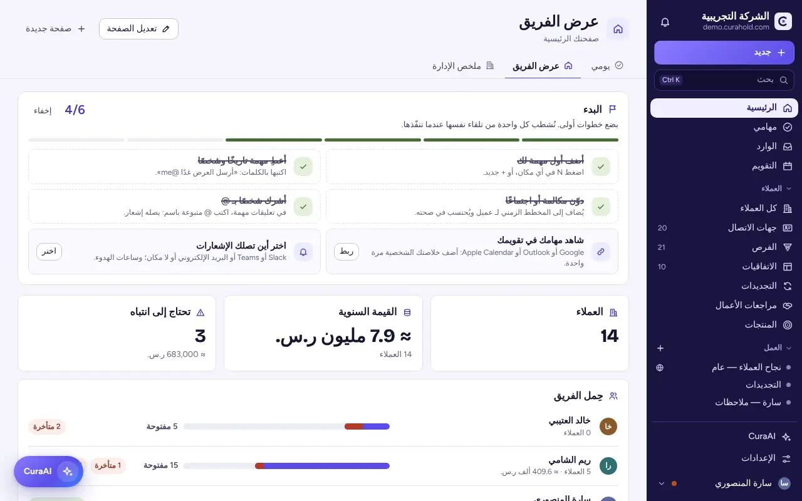

# البدء

Curahold هو المكان الذي تدير فيه فرق نجاح العملاء وإدارة الحسابات عملاءها وأصحاب المصلحة لديهم وعملها اليومي في مكان واحد. تشرح هذه الصفحة دقائقك الخمس عشرة الأولى.

## عنوان شركتك

لكل شركة عنوانها الخاص: `yourcompany.curahold.com`. يسجّل كل أفراد فريقك الدخول من هناك. لا تظهر بيانات أي شركة أخرى على هذا العنوان أبدًا؛ فالفصل بين الشركات مفروض داخل قاعدة البيانات نفسها.

## تسجيل الدخول

- **رابط بالبريد الإلكتروني:** اكتب عنوان بريدك وانقر الرابط الذي نرسله. لا كلمات مرور.
- **Google أو Microsoft:** بنقرة واحدة، إذا فعّلتها شركتك. على جهاز لم نره من قبل نطلب أيضًا الرمز المكوّن من 6 أرقام المرسل إلى بريدك.
- **مفتاح المرور:** بصمة الإصبع أو الوجه أو رمز الجهاز، بعد أول تسجيل دخول.
- **خطوة ثانية:** يمكنك إضافة تطبيق مصادقة من إعداداتك ← **أمان تسجيل الدخول**، ومعه 10 رموز استرداد. يستطيع المسؤول أن يجعل الخطوة الثانية إلزامية للمسؤولين أو للجميع.
- قبل الأعمال الحساسة (تغيير الأدوار، ومفاتيح API، وتصدير بياناتك…) يُطلب منك **أكّد أنك أنت** إن لم تسجّل الدخول في الدقائق العشر الأخيرة.
- يحصل العنوان الواحد على 5 روابط دخول على الأكثر في 15 دقيقة.

## الإعداد الأول

يختار من ينشئ الشركة قالبًا: نجاح العملاء، أو إدارة الحسابات، أو المبيعات، أو الدعم، أو قالبًا فارغًا. يأتي القالب بحقول العملاء (تاريخ التجديد، والقيمة السنوية، والصحة…) واللوحات والأتمتة الجاهزة. ويمكن تغيير كل ذلك لاحقًا.

ثم ادعُ فريقك. إذا أضفت نطاق البريد الإلكتروني لشركتك (`@yourcompany.com`)، يستطيع أصحاب هذا النطاق طلب الانضمام أو الانضمام فورًا.

## يومك الأول

تعرض بطاقة **البدء** في صفحتك الرئيسية بضع خطوات أولى: إضافة أول مهمة، وتحديد تاريخ وشخص لمهمة، وتدوين مكالمة، وإشراك أحدهم بـ @، ورؤية مهامك في تقويمك، واختيار أين تصلك الإشعارات. تُشطب كل خطوة وحدها عندما تنجزها، وزر **إخفاء** يطوي البطاقة.

زر **+ جديد** على اليسار يضيف أي شيء من مكان واحد: مهمة، أو عميلًا، أو ملاحظة مكالمة، أو لوحة. وعندما تكتب مهمة يمكنك وضع التاريخ والشخص والعميل في السطر نفسه؛ انظر [الإضافة السريعة والاختصارات](/docs/ar/quick-add/). وفي قائمتك (اسمك في أسفل اليسار) الوضع الفاتح أو الداكن، واللغة، والاختصارات.

## اللغة

يتحدث Curahold إحدى عشرة لغة: الإنجليزية، والتركية، والعربية، والعبرية، والفارسية، والصينية المبسطة والتقليدية، واليابانية، والكورية، والهندية، والملايوية. وتُختار اللغة في أحد مكانين:

- **لنفسك:** إعداداتك ← اللغة. تتبعك إلى كل أجهزتك.
- **للشركة:** يضبطها المسؤول في الإعدادات ← الشركة. يبدأ الأشخاص الجدد عندها بهذه اللغة، وتُكتب بها الرسائل الموجهة إلى الشركة كلها.

لا شيء يُخمَّن من متصفحك، فيرى كل من يفتح الرابط نفسه الشيء نفسه. والتواريخ والأرقام والمبالغ تتبع اللغة التي اخترتها، والعربية والعبرية والفارسية تُعرض من اليمين إلى اليسار.

## حد الأجهزة

يستطيع الشخص البقاء مسجّلًا للدخول على جهازين في وقت واحد، ويمكن للمسؤول ضبط ذلك بين 1 و5. تسجيل الدخول على جهاز إضافي يُخرجك من أقدم جهاز. وهكذا لا يتقاسم عدة أشخاص مقعدًا واحدًا.

> **نصيحة:** إعداداتك ← الأجهزة تعرض أين أنت مسجّل للدخول، وتتيح لك الخروج من أي منها.

## ثبّته على هاتف أو حاسوب

يُثبَّت Curahold مثل تطبيق، دون أي متجر.

- **Android والحواسيب (Chrome وEdge):** انقر اسمك في أسفل اليسار ← **تثبيت Curahold**. وأيقونة التثبيت في شريط عنوان المتصفح تفعل الشيء نفسه.
- **iPhone وiPad (Safari):** زر المشاركة ← **إضافة إلى الشاشة الرئيسية** ← إضافة.

يفتح التطبيق المثبّت في نافذته الخاصة، والضغط المطوّل على أيقونته يعرض «مهامي» و«الوارد» و«العملاء».

**دون اتصال** يفتح التطبيق رغم ذلك ويعرض آخر ما رأيته: مهامك، ولوحاتك، وعملاءك، والوارد. يقول شريط في الأعلى إنك غير متصل، ولا يمكن حفظ التغييرات حتى يعود الاتصال. وتسجيل الخروج يحذف النسخة المحفوظة على الجهاز.

**التحديث المباشر:** ما دامت الصفحة مفتوحة، يظهر تغيير يجريه شخص آخر (بطاقة جديدة، أو مهمة نُقلت، أو تعليق، أو إشعار جديد) من تلقاء نفسه خلال ثوانٍ؛ لا حاجة إلى إعادة التحميل. ولا يتحرك شيء تحت يديك وأنت تكتب أو تسحب بطاقة.

## التالي

- [العملاء والحقول والسجلات](/docs/ar/customers/)
- [المهام واللوحات](/docs/ar/tasks/)
- [الأدوار والصلاحيات](/docs/ar/roles-and-access/)
- [الإضافة السريعة والاختصارات](/docs/ar/quick-add/)
