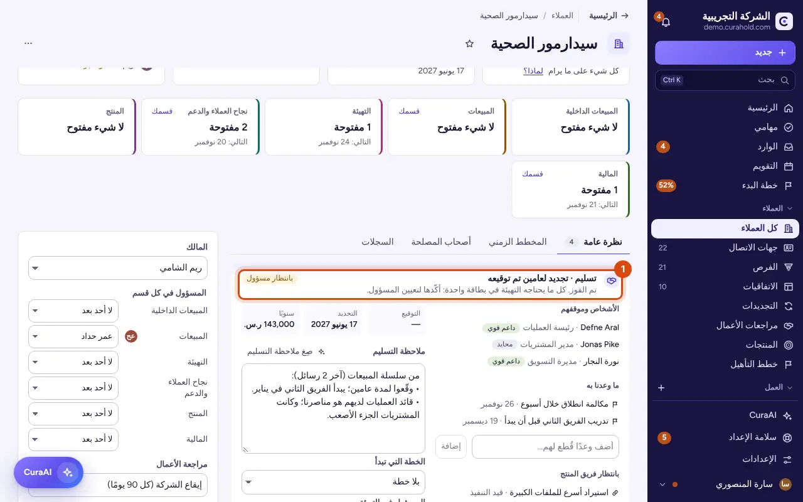
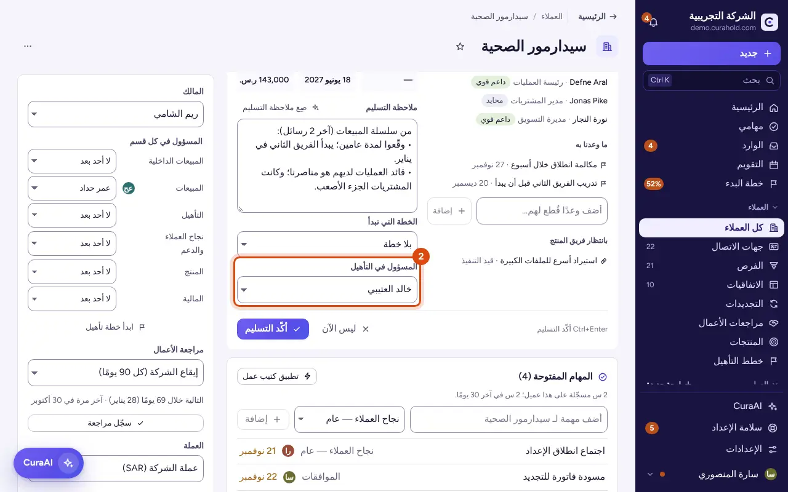
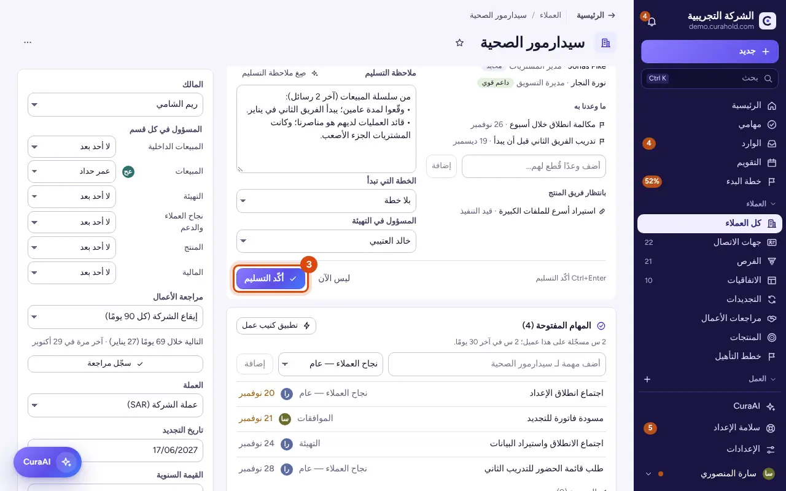
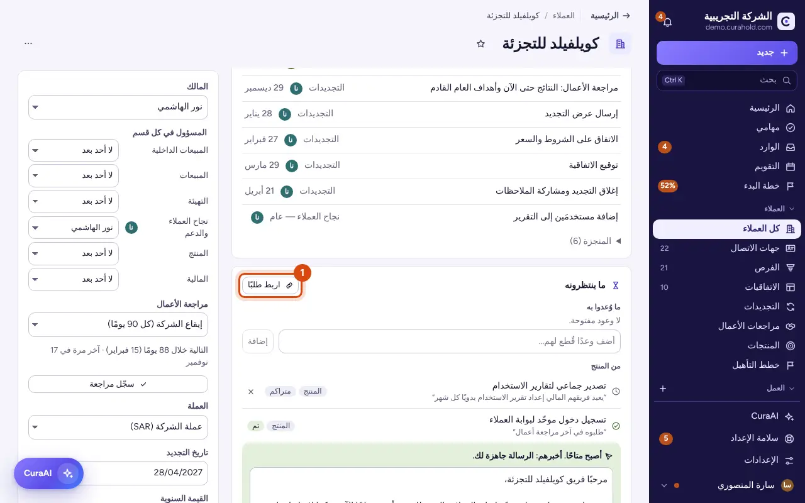
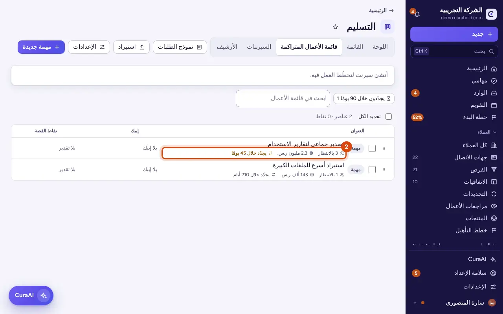
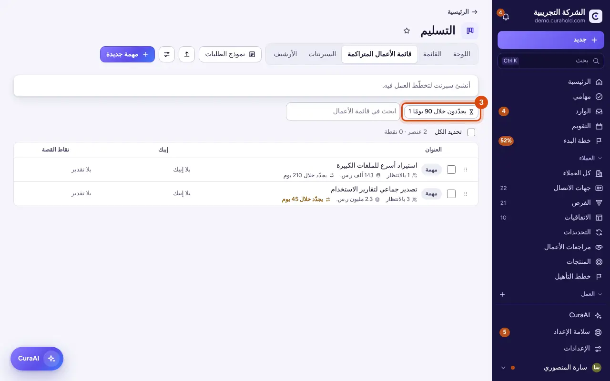
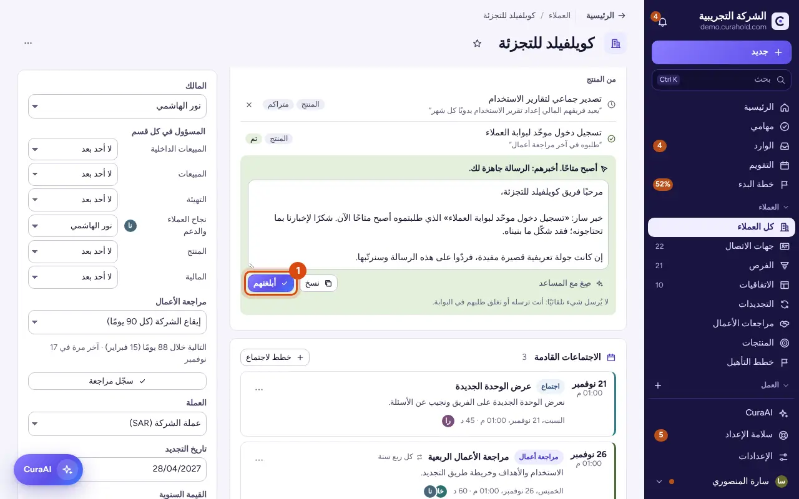
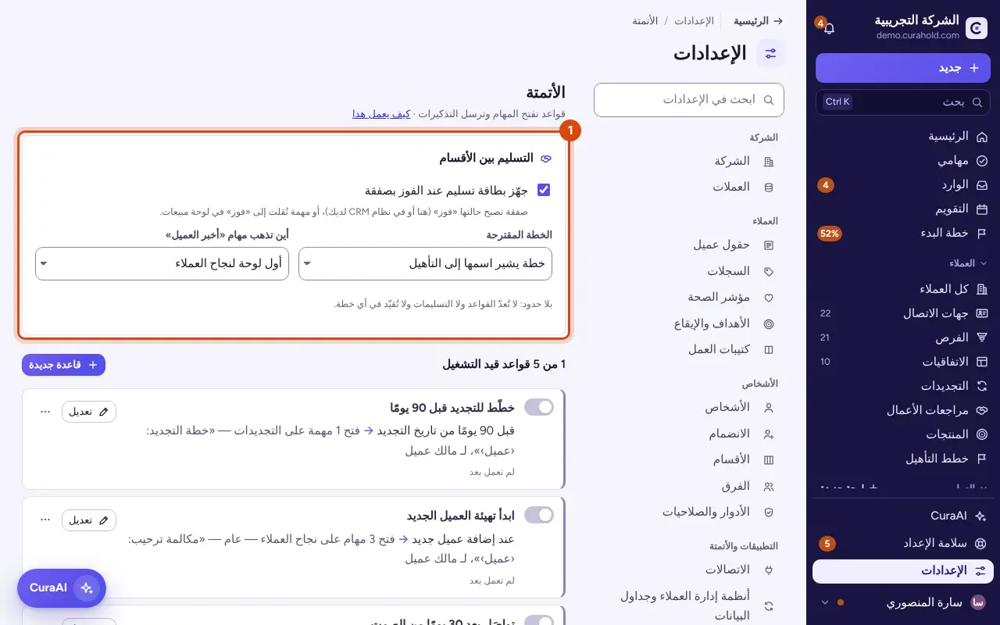

# التسليم والطلبات والعودة إلى العميل

ينتقل العمل من المبيعات إلى التهيئة أو نجاح العملاء، ومن العملاء إلى المنتج. يحفظ Curahold ما يحتاجه كل فريق في صفحة العميل، فلا يُعاد كتابة شيء ولا يحتاج أحد إلى فتح لوحة قسم آخر.

## عند الفوز بصفقة {#handover}

الصفقة التي تصبح حالتها **رابحة** (هنا أو في نظام إدارة العملاء لديك)، أو المهمة التي تُنقل إلى **رابحة** في لوحة المبيعات، تحصل على **بطاقة تسليم** واحدة في صفحة العميل. تذهب إلى **التهيئة** إن كان هذا القسم لدى شركتك، وإلا إلى **نجاح العملاء**.

1. افتح صفحة العميل. البطاقة في أعلى **نظرة عامة** وعليها **بانتظار مسؤول**. اقرأها: الأشخاص وموقفهم منكم، وما وعدت به المبيعات، وما ينتظره العميل من المنتج، والتواريخ، والقيمة السنوية (إن كان يحق لك رؤية هذا الحقل)، وملاحظة التسليم من محادثة المبيعات.
   
2. في **المسؤول في …** اختر من يتسلم العميل. وراجع **الخطة التي تبدأ** بجانبه.
   
3. انقر **أكّد التسليم** (أو Ctrl+Enter، و⌘+Enter على Mac). يُعيَّن المسؤول وتبدأ الخطة ويُبلَّغ المسؤول ويسجل الجدول الزمني للعميل الخطوتين.
   

**ليس الآن** يخفي البطاقة. **صِغ ملاحظة التسليم** يطلب من المساعد كتابة الملاحظة؛ تقرؤها وتعدّلها قبل حفظ أي شيء.

## اربط طلب العميل بعمل المنتج {#requests}

1. في صفحة العميل، تحت **ما ينتظرونه**، انقر **اربط طلبًا**. ابحث في أعمال المنتج واختر العمل، وأضف إن شئت ما طلبوه بكلماتهم. إن لم يناسب شيء فاطلبه من المنتج من النافذة نفسها.
   

يمكن لعملاء كثيرين انتظار العمل نفسه، ويُحسب كل منهم. يرى كل من يرى العميل عنوان العمل وحالته ونهاية السبرنت والقسم، ولا يرى لوحة المنتج أبدًا.

## ما يراه المنتج {#backlog}

1. في لوحة للمنتج افتح **قائمة الأعمال المتراكمة**. تحت كل عمل: كم عميلًا ينتظره، وقيمتهم السنوية (لمن يحق له رؤية الحقل فقط)، وأقرب تجديد.
   
2. انقر **يجدّدون خلال 90 يومًا** لترى فقط العمل الذي ينتظره عملاء يجدّدون قريبًا، الأقرب أولًا.
   

## عند الإطلاق {#shipped}

عند انتهاء عمل مرتبط يحصل مسؤول كل عميل على مهمة، وتظهر في صفحة العميل رسالة جاهزة تحت العمل.

1. اقرأ الرسالة وعدّلها إن شئت، وانقر **نسخ** وأرسلها من بريدك أو محادثتك. ثم انقر **أبلغتهم**. إن طلب العميل عبر البوابة فإن **أغلق طلبهم في البوابة** يغلقه هناك أيضًا.
   

**لا يُرسل شيء من تلقاء نفسه.** يكتب الجدول الزمني "بُني لهم"، ويذكره ملخص التجديد.

## الإعدادات (للمسؤولين) {#settings}

1. افتح **الإعدادات ← الأتمتة**. تحت **التسليم بين الأقسام** اختر هل تحصل الصفقة الرابحة على بطاقة تسليم، والخطة التي تقترحها، وأين تذهب مهام "أبلغ العميل".
   

## مسودات من المساعد

يمكن للمساعد أن يصوغ ملاحظة التسليم ورسالة "أُطلق" ووعود الاجتماع وخطواته التالية. تقرأ كل مسودة وتعدّلها قبل الحفظ، والتراجع يعيدها، ومن دون المساعد (أو بعد حده الشهري) تأتي المسودة من القالب.

## القواعد

يمكن أن تبدأ القواعد عند إضافة مهمة أو إنهائها، أو وصول طلب عبر نموذج، أو بلوغ سجل مرحلة، أو فتح تذكرة دعم؛ ويمكنها التعيين والنقل وتعبئة حقل والتعليق والإرسال إلى الـ webhooks وتحضير التسليم. لا تُعدّ القواعد ولا يوضع لها سقف.
