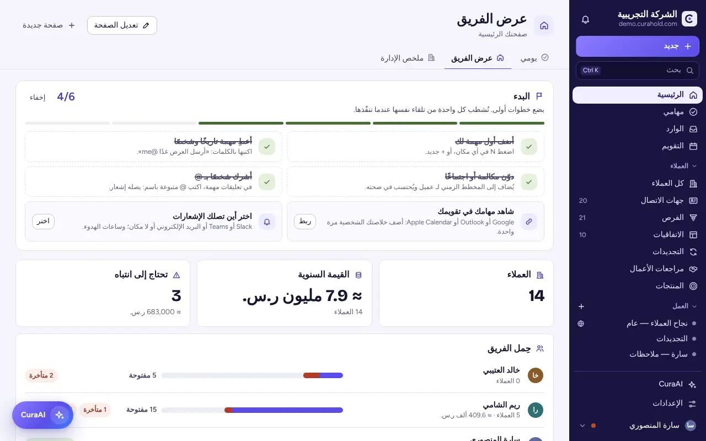

# الصفحات الرئيسية والبطاقات

وُجدت الصفحة الرئيسية ليرى الناس عملهم لحظة فتح Curahold. كل صفحة مكوّنة من بطاقات، ويبدأ كل دور على صفحته الرئيسية الخاصة.

## البطاقات

| البطاقة | ما تعرضه |
| --- | --- |
| مهامي المفتوحة | مهامك غير المنجزة، المتأخرة أولًا |
| التجديدات القادمة | العملاء الذين يُجدَّدون خلال الأيام التي تختارها، ومجموع قيمتهم |
| يحتاجون إلى اهتمام | العملاء الذين صحتهم في خطر أو تستحق المراقبة |
| انقطع تواصلهم | العملاء الذين لا نشاط معهم منذ مدة |
| مخاطر أصحاب المصلحة | المعرقلون والمتشككون، والعملاء الذين لا مناصر لهم |
| رقم | قيمة واحدة، مثل عدد العملاء أو مجموع القيمة |
| التوزيع | العملاء مقسّمين حسب حقل اختيار |
| حِمل الفريق | العملاء والعمل المفتوح والمتأخر والمعرّض للخطر لكل شخص |
| صحة الاتصالات | كيف تسير مزامنة CRM وجداول البيانات |
| ملاحظة | إعلان قصير أو رابط للفريق |

تعمل معظم البطاقات على «لي» أو «لفريقي» أو «للجميع». وتُحسب البطاقة ضمن ما يُسمح للناظر برؤيته: شخصان يفتحان الصفحة نفسها يريان أرقامًا مختلفة إذا اختلفت صلاحياتهما.

## تعديل الصفحة

يستخدم المسؤولون **تعديل الصفحة** لإضافة البطاقات وترتيبها وتحديد أحجامها، واختيار الأدوار التي تبدأ على تلك الصفحة. ويمكن أيضًا إظهار صفحة لبعض الأدوار فقط.

> **نصيحة:** لترى ما يراه دور ما، استخدم **عرضه كما يراه …** في الإعدادات ← الأدوار والصلاحيات. يفتح شاشات ذلك الشخص للقراءة فقط.
