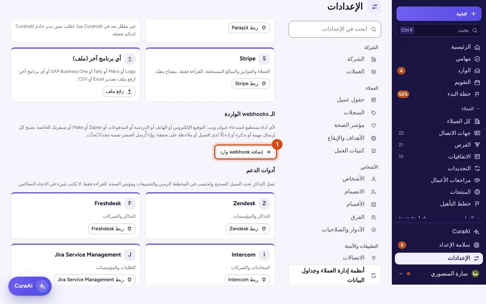
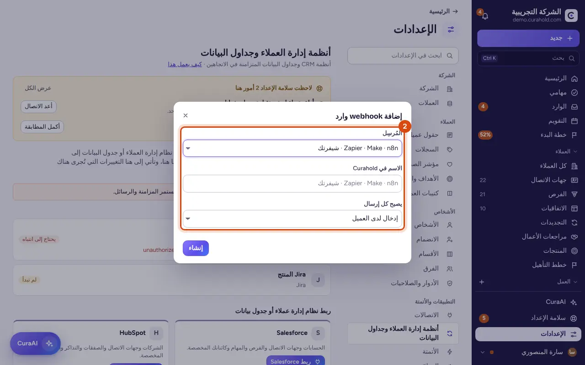
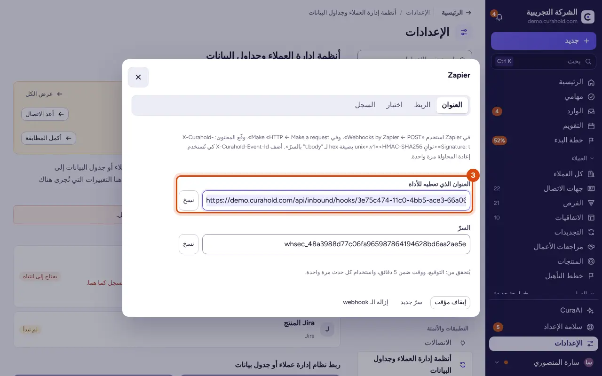
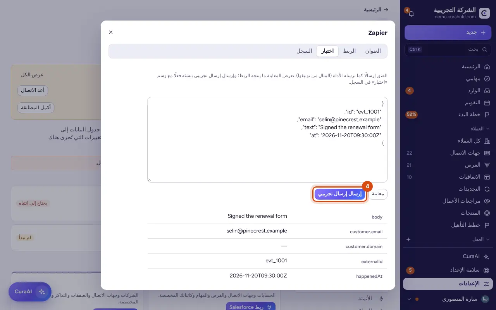
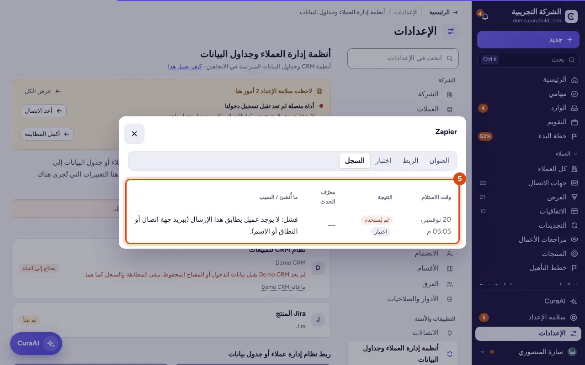

# الـ webhooks الواردة

للأدوات التي ليس لها رابط جاهز في Curahold. ترسل الأداة إلى عنوان خاص بك؛ ويصبح كل إرسال **مهمة** أو **تذكرة دعم** أو **إدخالًا في المخطط الزمني للعميل** أو **ملاحظة على صفقة**. وإذا أُرسل العنصر نفسه مجددًا يُحدَّث ما أُنشئ. يُتحقق من كل إرسال: التوقيع (أو رمز مشترك) ووقته واستخدام كل حدث مرة واحدة.

## في Curahold {#connect}

1. افتح **الإعدادات ← أنظمة إدارة العملاء وجداول البيانات**، وانزل إلى **الـ webhooks الواردة**، وانقر **إضافة webhook وارد**.
   
2. تحت **المُرسِل** اختر الأداة (أو **Zapier · Make · n8n · شيفرتك**)، وراجع **يصبح كل إرسال**، وانقر **إنشاء**.
   
3. في تبويب **العنوان** انسخ العنوان والسرّ إلى الأداة.
   
4. في تبويب **اختبار** انقر **معاينة** لترى ما ينتجه الربط من المثال، ثم **إرسال إرسال تجريبي**.
   
5. في تبويب **السجل** راجع كل إرسال: استُخدم أو تُخطّي أو لم يُستخدم (مع السبب) أو رُفض.
   

## الربط

كل قيمة نصٌّ فيه `{{path}}` لقيمة من الإرسال، مثل `{{data.envelopeSummary.status}}` أو `{{items[0].email}}`. يُعثر على العميل ببريد جهة اتصال، ثم بعنوان الويب، ثم بالاسم. **معرّف العنصر في الأداة** يجعل «الإنشاء أو التحديث» يعمل. و**استخدم فقط عندما تكون هذه القيمة…** تتخطّى الأحداث الأخرى (وتُسجَّل كمتخطّاة).

## وصفات جاهزة

| الأداة | التوقيع | يصبح |
| --- | --- | --- |
| التوقيع الإلكتروني (DocuSign Connect؛ وCloudSign وModusign وLeegality بالطريقة نفسها) | `X-DocuSign-Signature-1`, HMAC-SHA256, base64, المفتاح الذي تنشئه في الأداة | ملاحظة على الصفقة |
| Aircall | رمز الـ webhook في المحتوى | مكالمة لدى العميل |
| Tawk.to | `X-Tawk-Signature`, HMAC-SHA1, hex | تذكرة |
| Razorpay (وiyzico بالطريقة نفسها) | `X-Razorpay-Signature`, HMAC-SHA256, hex | إدخال لدى العميل |
| Freshchat وKylas وSansan وأي أداة أخرى | رمز مشترك (`X-Curahold-Token` / `?token=`) | حسب اختيارك |

## التوقيع بنفسك (Zapier وMake وn8n والشيفرة) {#sign}

أرسل `X-Curahold-Signature` و`X-Curahold-Event-Id`:

```text
X-Curahold-Signature: t=1763631000,v1=<HMAC-SHA256 بصيغة hex لـ "1763631000.<المحتوى الخام>" بالسرّ>
X-Curahold-Event-Id: evt_1001
```

في الشيفرة (Node.js):

```js
const t = Math.floor(Date.now() / 1000);
const v1 = crypto.createHmac('sha256', secret).update(`${t}.${body}`).digest('hex');
fetch(address, { method: 'POST', body, headers: { 'content-type': 'application/json', 'x-curahold-signature': `t=${t},v1=${v1}`, 'x-curahold-event-id': id } });
```

يجب أن يكون الوقت ضمن 5 دقائق. معرّف الحدث المكرر يُجاب بـ `200` مع `duplicate` ولا يُستخدم مجددًا. الردود: `200` (مع `status` ok أو skipped أو failed)، و`401` (التوقيع أو الوقت أو الرمز)، و`404` (غير معروف أو متوقف). القائمة الكاملة: مرجع الـ API.

## وصفات Zapier وMake لأدوات بلا رابط بعد

استخدم مشغّل الأداة، ثم **Webhooks by Zapier ← POST** (Zapier) أو **HTTP ← Make a request** (Make) إلى العنوان أعلاه مع الترويستين. تحسب خطوة **Custom JS** في Make أو **Code** في Zapier التوقيع (الشيفرة أعلاه).

| الأداة | المشغّل | حقول المحتوى المرسلة | يصبح |
| --- | --- | --- | --- |
| LINE WORKS | رسالة جديدة في قناة بوت | `id` و`email` المرسل و`text` | إدخال |
| Chatwork | رسالة جديدة في غرفة | `id` و`email` و`text` | إدخال |
| kintone | سجل أُضيف أو عُدّل | `id` و`email` و`title` و`status` | مهمة |
| Money Forward Cloud | فاتورة أُنشئت أو دُفعت | `id` و`email` و`text` (الرقم، المبلغ، الاستحقاق) | إدخال |
| Channel Talk | دردشة أُغلقت | `id` و`email` و`title` | تذكرة |
| KakaoWork | رسالة بوت | `id` و`email` و`text` | إدخال |
| LeadSquared | تحديث عميل محتمل أو فرصة | `id` و`email` و`title` و`status` | مهمة |
| Razorpay | دفعة مستلمة | `id` و`email` و`text` | إدخال (أو الوصفة) |
| DingTalk | رسالة روبوت | `id` و`email` و`text` | إدخال |
| WeCom | رسالة تطبيق | `id` و`email` و`text` | إدخال |

## الحفظ والإزالة

يحتفظ السجل بـ 30 يومًا و500 إرسال على الأكثر لكل webhook. **سرّ جديد** يوقف القديم فورًا؛ و**إيقاف مؤقت** يجيب `404` حتى الاستئناف؛ و**إزالة الـ webhook** تحذفه مع سجله، ويبقى ما أنشأه. يعمل الـ webhook بصلاحيات من أعدّه: يصل فقط إلى اللوحات والعملاء الذين يصل إليهم، ويتوقف إن غادر.

## انظر أيضًا

- [الاتصالات وCRM](/docs/ar/connections/)
