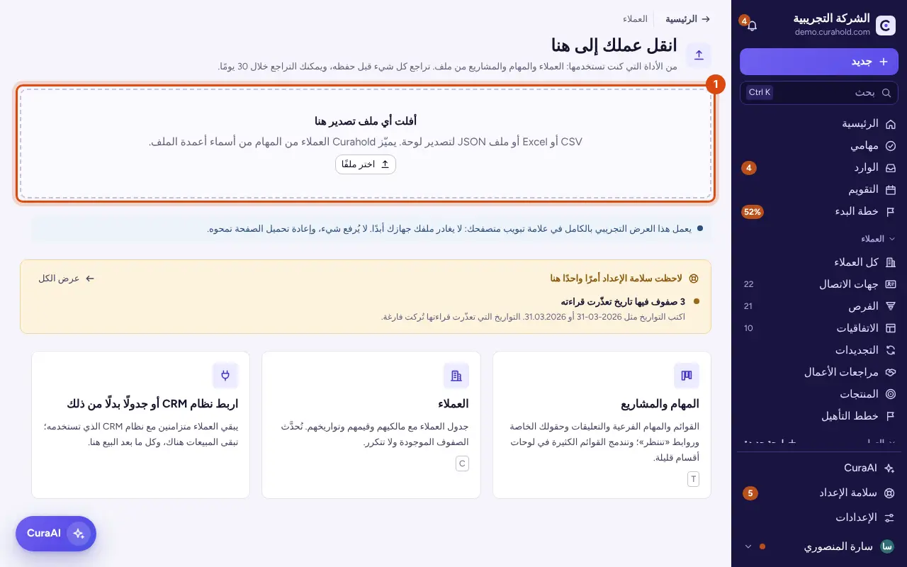
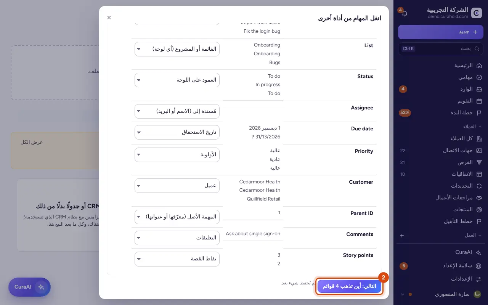
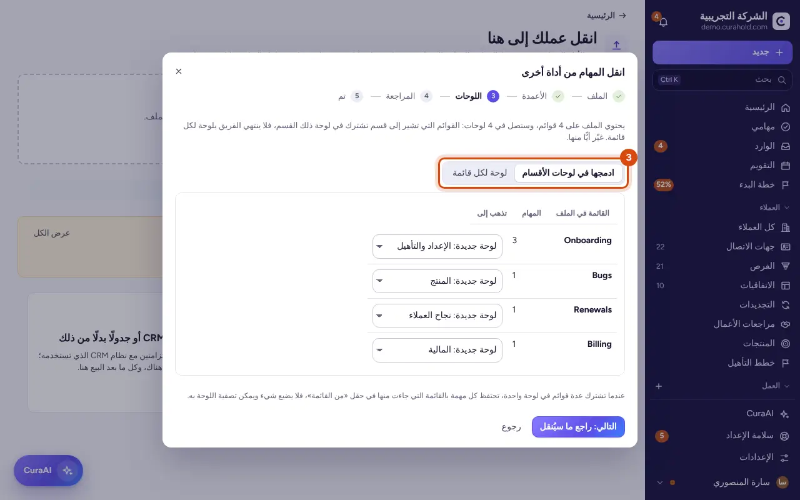
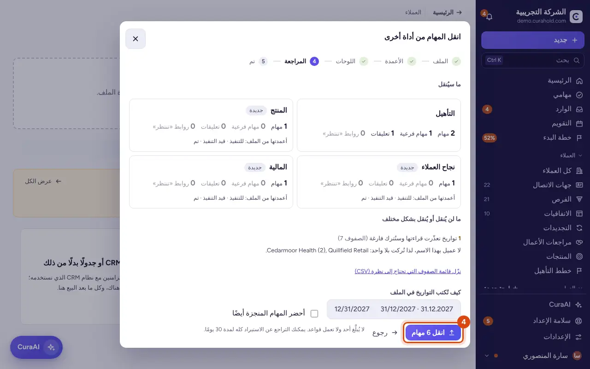
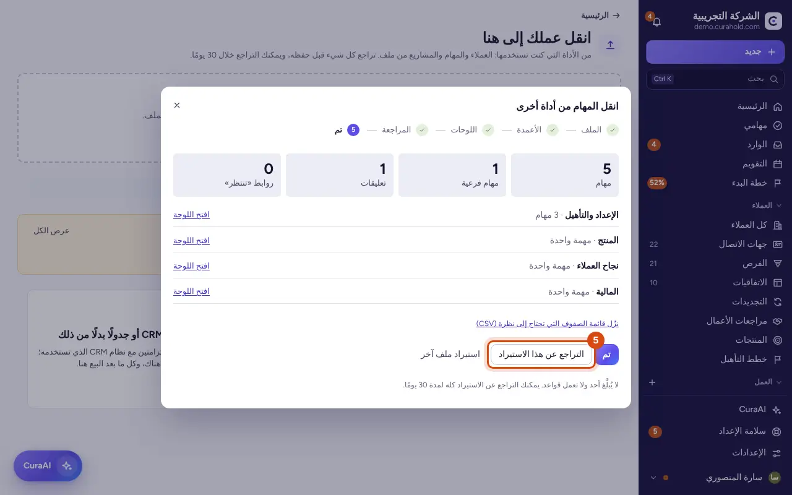

# الانتقال من أداة أخرى

صدّر عملك من الأداة التي كنت تستخدمها (CSV أو ورقة Excel ‏(.xlsx) أو تصدير JSON للوحة كانبان) وانقله من ذلك الملف. لا يُحفظ شيء قبل الخطوة الأخيرة، ولا يُبلَّغ أحد، ولا تعمل أي قاعدة: هذا انتقال إلى بيت جديد، لا عمل جديد.

## انقل مهامك {#tasks}

1. افتح **انقل عملك إلى هنا**: اكتب "import" في البحث (Ctrl K، أو ⌘ K على Mac)، أو استخدم زر السهم للأعلى في لوحة. أفلت ملفك على **أفلت أي ملف تصدير هنا** أو انقر **اختر ملفًا**. يميّز Curahold العملاء من المهام بأسماء أعمدة الملف؛ اضغط **T** للمهام أو **C** للعملاء لتختار بنفسك.
   
2. **الأعمدة.** يُطابَق كل عمود من ملفك مع وجهته: العنوان، الوصف، العمود في اللوحة، الأشخاص، التواريخ، الأولوية، العميل، النقاط، المعرّف في الأداة القديمة، المهمة الأم، التعليقات، روابط "ينتظر"، أو حقل خاص. تُظهر القيم الأولى ما سيصبح عليه كل منها. صحّح الخطأ ثم انقر **التالي**.
   
3. **اللوحات.** إن كان في الملف قوائم كثيرة فإنها تُدمج في بضع لوحات للأقسام: قائمة "التجديدات" تذهب إلى نجاح العملاء، و"الأخطاء" إلى المنتج. انقر **لوحة لكل قائمة** لإبقائها منفصلة، أو اختر أي لوحة لأي قائمة. تحتفظ كل مهمة بقائمتها الأصلية في حقل **من القائمة**. انقر **التالي: راجع ما سيُنقل**.
   
4. **المراجعة.** اقرأ، لوحة لوحة، كم مهمة ومهمة فرعية وتعليقًا ورابطًا سيُنقل، ومع أرقام الصفوف ما لن يُنقل أو سيُنقل بشكل مختلف. **نزّل قائمة الصفوف التي تحتاج إلى نظرة (CSV)** إن أردت إصلاحها في ملفك أولًا. ثم انقر **انقل … مهام**.
   
5. **تم.** لكل لوحة رابط **افتح اللوحة**. إن لم يكن شيء كما أردت فانقر **التراجع عن هذا الاستيراد**.
   

يفهم Curahold سطر عنوان فوق رؤوس الأعمدة، والمجموعات التي تتكرر الرؤوس تحت كل منها، والعناصر الفرعية المزاحة تحت عنصرها.

## التراجع {#undo}

يعمل **التراجع عن هذا الاستيراد** 30 يومًا، من شاشة النتيجة أو من **عمليات الاستيراد السابقة** في الخطوة الأولى. المهام التي لم يلمسها أحد تذهب إلى سلة المهملات كعنصر واحد؛ والمهمة التي غيّرها أحد أو علّق عليها منذ ذلك الحين تبقى في أرشيف لوحتها. وتُزال اللوحة التي أُنشئت للاستيراد وبقيت فارغة.

## القالب {#template}

يعطيك **نزّل قالبًا** في الخطوة الأولى ملفًا فيه كل عمود يقرؤه Curahold وثلاثة صفوف مثال، ويُفتح في Excel. سطره الأول (Region مثال على عمود خاص بك):

```text
ID,Title,Description,List,Status,Assignee,Due date,Priority,Customer,Parent ID,Comments,Depends on,Story points,Region
```

## في العرض التجريبي

يعمل العرض التجريبي كله داخل علامة التبويب في متصفحك. يفتح **جرّب ملفك** في شريط العرض الصفحة نفسها: يُقرأ ملفك في علامة التبويب ولا يغادر جهازك أبدًا، وإعادة تحميل الصفحة تنساه.
