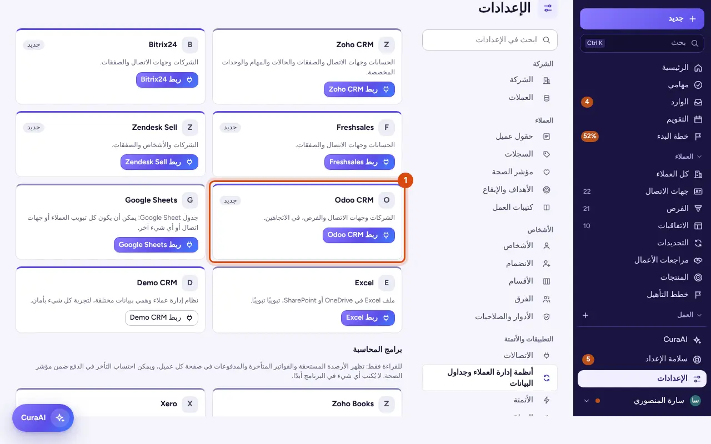

# Odoo CRM

الشركات وجهات الاتصال التابعة لها والفرص من Odoo Online أو Odoo.sh أو خادمك، متطابقة في الاتجاهين: يصل التغيير في Odoo خلال ساعة، ويذهب التغيير في Curahold فورًا.

## في Curahold {#connect}

1. افتح **الإعدادات ← أنظمة إدارة العملاء وجداول البيانات** وانقر **ربط Odoo CRM** على بطاقته.
   

ثم املأ الحقول الأربعة وانقر **ربط**:

- **عنوان Odoo**، مثلًا:

```text
https://yourcompany.odoo.com
```

- **اسم قاعدة البيانات**: فقط على Odoo.sh أو خادمك الذي فيه عدة قواعد بيانات.
- **اسم الدخول (البريد الإلكتروني)**: مستخدم Odoo الذي يعمل Curahold بصلاحياته.
- **مفتاح API**: انظر أدناه.

بعدها حدّد **الشركات** و**جهات الاتصال** و**الفرص**، وراجع أزواج الحقول المقترحة، وانقر **ابدأ المزامنة**. تُعدّ الفرصة رابحة عند احتمال 100٪ وخاسرة عندما يؤرشفها Odoo.

## في Odoo

1. انقر صورتك (أعلى اليسار) ← **Preferences** (في Odoo 17 وما بعده: **My Profile**).
2. افتح **Account Security** وانقر **New API Key**.
3. اكتب اسمًا (مثل `Curahold`) واختر مدة صلاحيته وانقر **Generate key**.
4. انسخ المفتاح. يعرضه Odoo مرة واحدة.

على Odoo Online يحتاج الوصول إلى الـ API إلى خطة **Custom** (قاعدة Odoo). ويجب أن يكون تطبيق CRM مثبّتًا.

## الحدود والتوقيت

لا ينشر Odoo حدًا ثابتًا؛ يلتزم Curahold بنحو طلبين في الثانية. يجيب Odoo 19 وما بعده عبر JSON-2 API، والإصدارات الأقدم عبر JSON-RPC الذي يزيله Odoo في الإصدار 20. يدوم المفتاح ثلاثة أشهر على الأكثر في Odoo 19: أنشئ مفتاحًا جديدًا وأعد الربط قبل انتهائه.

## التعارضات والأخطاء والإزالة

إذا غيّر الطرفان الحقل نفسه، تقرّر القاعدة المختارة للاتصال (افتراضيًا: التغيير الأحدث). القيمة المرفوضة تنتظر في تبويب **الحالة** مع رسالة Odoo نفسها. المفتاح الملغى أو المنتهي يجعل الاتصال **يحتاج إلى انتباه**: الصق مفتاحًا جديدًا عبر **إعادة الربط**؛ ويبقى الربط كما هو. **إزالة** تحذف المفتاح؛ ويبقى العملاء والسجلات التي وصلت في Curahold.

## انظر أيضًا

- [الاتصالات وCRM](/docs/ar/connections/)
- [Odoo (المحاسبة)](/docs/ar/accounting-odoo/)
