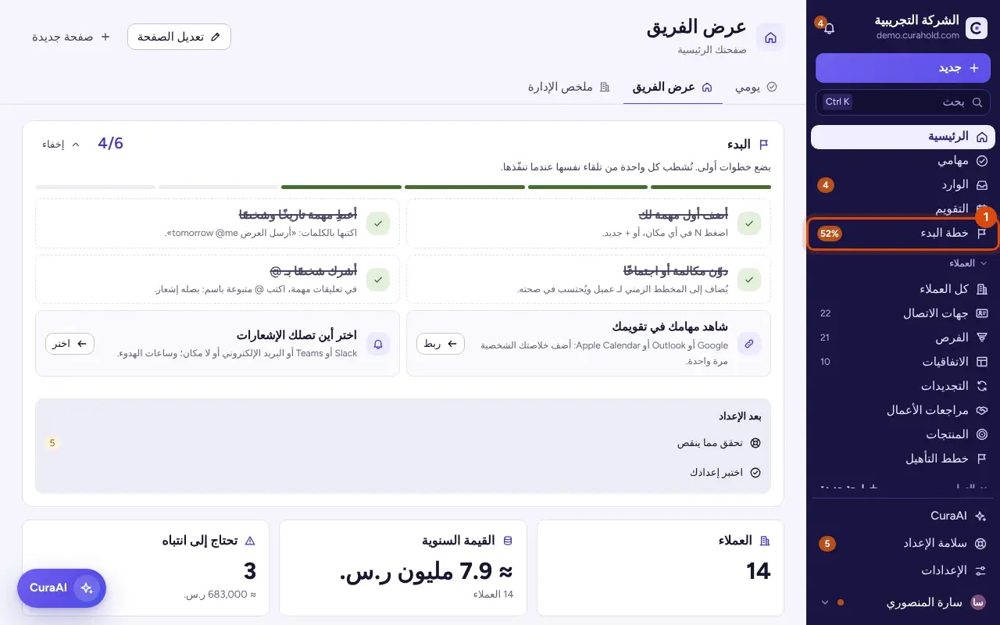
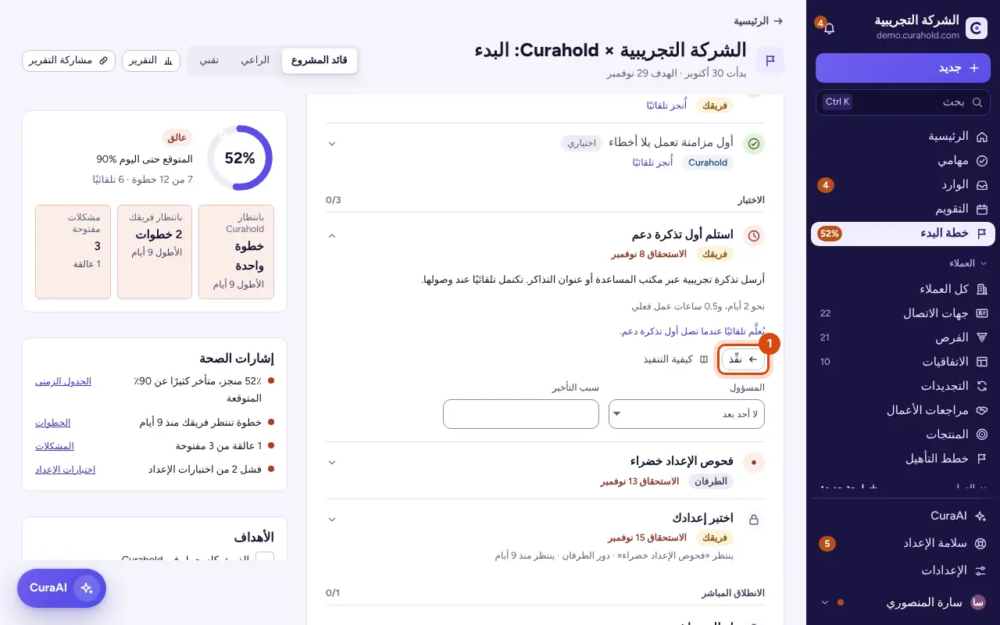
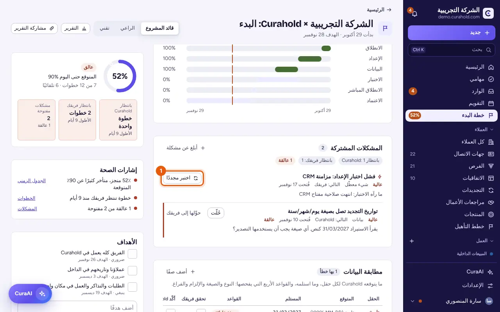
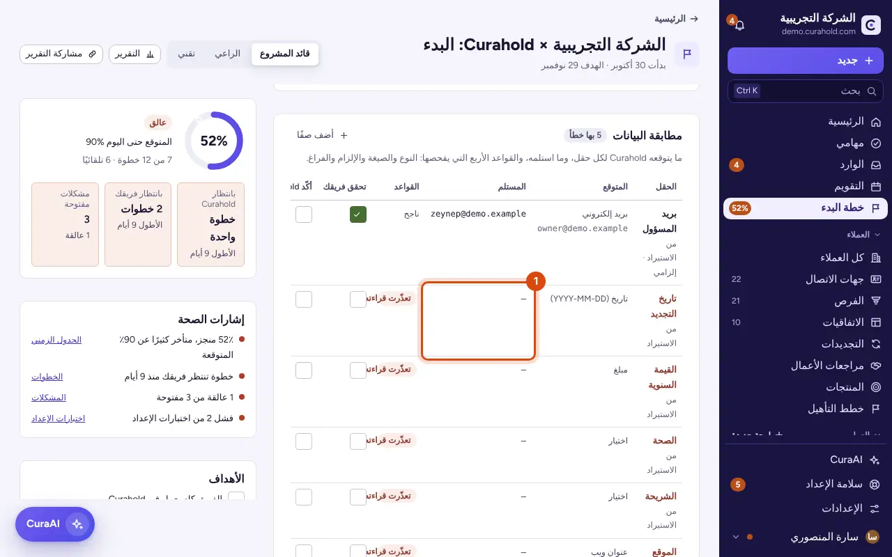
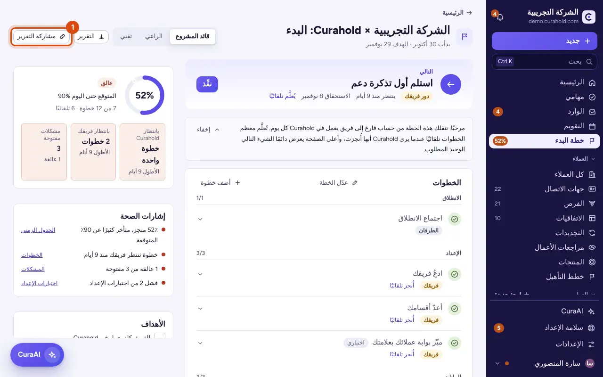
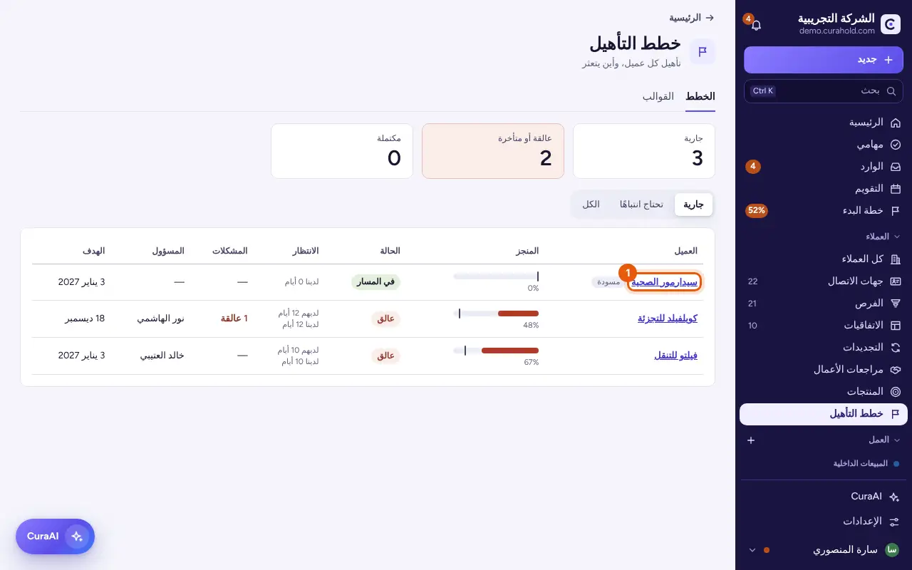

# خطة التأهيل

خطة التأهيل صفحة واحدة يعمل عليها طرفان معًا. تستخدمها شركتك للبدء مع Curahold، وتستخدم الخطة نفسها لكل عميل تؤهّله. تُعلَّم معظم الخطوات تلقائيًا عندما يرى Curahold أنها أُنجزت؛ ولا تعلّم يدويًا إلا ما لا يراه Curahold، مثل اجتماع.

## 1. افتح خطتك {#start}

انقر **خطة البدء** في القائمة اليمنى. الرقم بجانبها هو نسبة ما أُنجز.

```text
https://<شركتك>.curahold.com/onboarding
```



## 2. نفّذ الشيء التالي {#next}

البطاقة في الأعلى تعرض دائمًا الشيء التالي الوحيد، ودور من، ومنذ متى ينتظر. انقر **نفِّذ**: يفتح Curahold الشاشة التي يتم فيها ذلك.


## 3. افتح خطوة {#team}

انقر أي خطوة لترى الغرض منها ومدتها وهل تُعلَّم تلقائيًا. الخطوة المقفلة تنتظر خطوة أخرى؛ والسطر تحتها يقول أيها ودور من. انقر **علِّم كمنجز** فقط للخطوات التي لا يراها Curahold.



## 4. أصلح مشكلة مشتركة {#health}

كل مشكلة تقول على من الدور؛ والمفتوحة منذ خمسة أيام أو بعد تاريخها تُعلَّم **عالقة**. اختبار الإعداد الفاشل يظهر هنا مرة واحدة. انقر **اختبر مجددًا** بعد الإصلاح: عندما ينجح الاختبار تُغلق المشكلة تلقائيًا.



## 5. تحقق من بياناتك {#mapping}

يعرض جدول البيانات لكل حقل ما يتوقعه Curahold وما استلمه والقواعد الأربع: النوع والصيغة والإلزام والفراغ. الصف الفاشل يقول أي قاعدة فشلت. عندما تكون القيمة صحيحة علّم مربع طرفك.

```text
2027-03-31
```



## 6. سمِّ الأشخاص {#people}

تحت **أشخاص الطرفين** انقر **أضف شخصًا** واختر دوره. يذكّر Curahold مسؤول كل خطوة داخل التطبيق عندما يحين دوره، ومرة أخرى إن تعثرت. التذكير بالبريد متوقف ما لم يشغّله مسؤول.

## 7. شارك تقرير التقدم {#report}

انقر **مشاركة التقرير** وانسخ الرابط. من لديه الرابط يرى التقرير فقط (بلا ملاحظات ولا بيانات تواصل). افتح **التقرير** لطباعته أو حفظه PDF.



## 8. خطط البدء لعملائك {#customers}

انقر **خطط التأهيل** تحت العملاء. عند الفوز بصفقة تُفتح خطة مسودة تلقائيًا مع ملاحظة التسليم، وتبدأ عند تأكيد التسليم. يرى عميلك الخطة نفسها في بوابتك بألوانك. عند الانتهاء انقر **أنهِ وسلِّم**: تُحفظ درجة الصحة كخط أساس ويستلم نجاح العملاء بطاقة تسليم.



## 9. اجعل خطة العميل خاصة به {#personal}

خطة كل عميل نسخة خاصة به: عدّلها دون المساس بالقالب.

1. في **الخطوات** داخل الخطة، انقر **عدّل الخطة**.
2. غيّر اسم المرحلة في خانتها، أو انقلها بالأسهم، أو أضف مرحلة بـ**أضف مرحلة**. لا تُزال مرحلة فيها خطوات: انقل خطواتها أو أزلها أولًا.
3. غيّر اسم الخطوة في خانتها، أو انقلها بالأسهم، أو اختر لها مرحلة أخرى، أو أزلها.
4. انقر **انتهيت من التعديل**. لاستخدام هذه الخطة مجددًا، انقر **احفظ كقالب** وأعطه اسمًا.

## 10. خطط تُفتح وحدها {#won}

يقرر ذلك المسؤول، في أسفل **خطط التأهيل ← القوالب**:

1. فعّل **افتح خطة بدء عند الفوز بصفقة**. تبقى متوقفة حتى تشغّلها.
2. اختر القالب الذي تُفتح به، أو **اسأل في كل مرة**: عندها تطلب المسودة ممن يستلم العميل أن يختار.
3. اختياري: أضف قواعد حسب الشريحة أو الباقة أو المنطقة (أي حقل للعميل). أول قاعدة يطابقها العميل تختار القالب.

تظهر التذكيرات دائمًا في التطبيق. ويقرر كل شخص في إعدادات الإشعارات الخاصة به إن كان يريدها بالبريد أيضًا.

## على الهاتف

الصفحة نفسها بعمود واحد: الشيء التالي أولًا.


