# سلامة الإعداد واختبار إعدادك

شاشتان تساعدانك على إنهاء الإعداد دون تخمين. **سلامة الإعداد** تخبرك بما ينقص أو ما هو خاطئ. و**اختبر إعدادك** تتيح لك تجربة كل شيء كما سيستخدمه فريقك. لا يتغير شيء نيابة عنك: كل إصلاح زر يفتح الشاشة الصحيحة، وأنت تكمل الباقي.

## اعثر على ما ينقص

1. في القائمة الجانبية، انقر **سلامة الإعداد**. الرقم بجانبها هو عدد الأمور التي تستحق نظرة، ويختفي عندما يصبح كل شيء صحيحًا.
   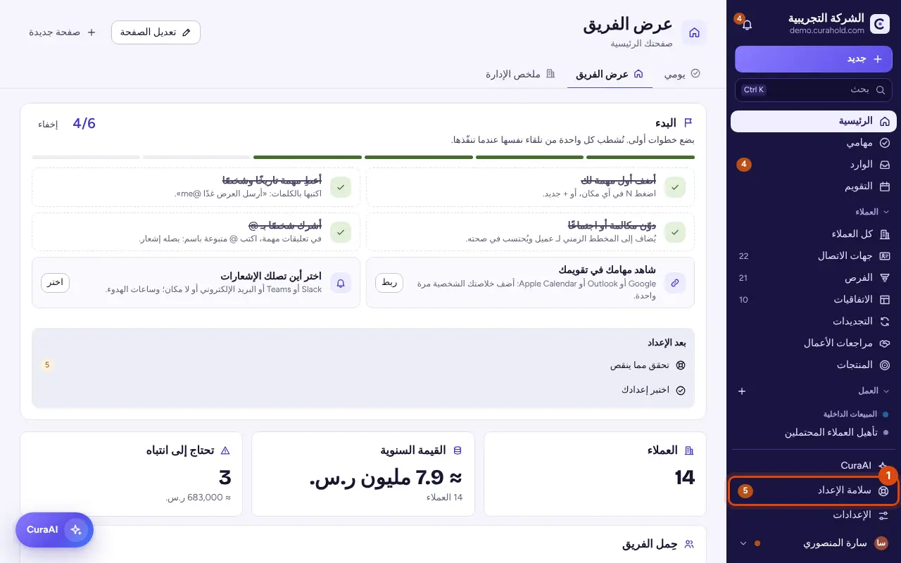
2. اقرأ السطر الأول. الأهم يأتي أولًا: **أصلح أولًا**، ثم **يستحق الإصلاح**، ثم **عندما يتسنى لك**. يقول كل سطر ما لاحظناه ولماذا يهم.
   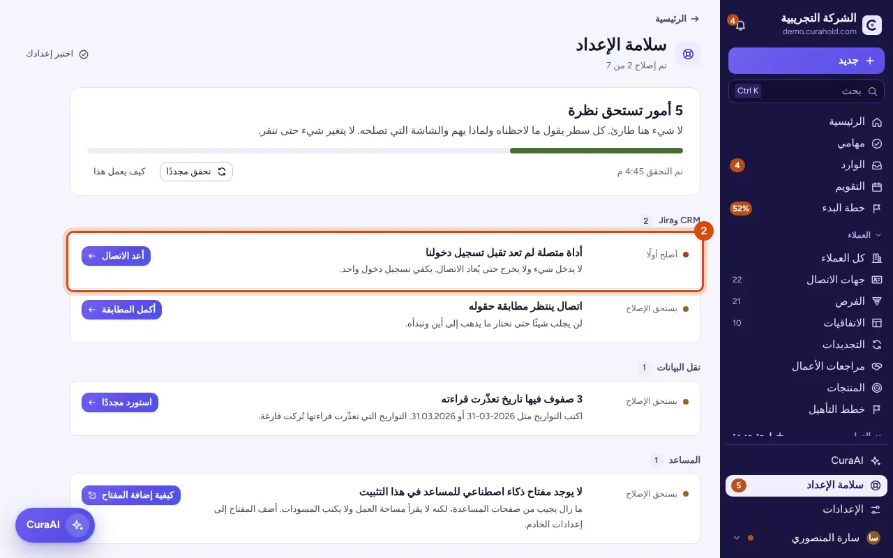
3. انقر الزر في ذلك السطر. يفتح الشاشة نفسها التي تُصلح منها المشكلة.
   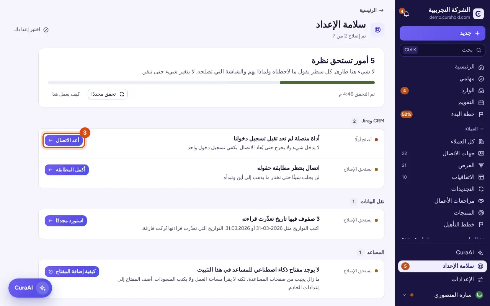
4. بعد الإصلاح، ارجع وانقر **تحقق مجددًا**. ينتقل السطر إلى **ما تم إصلاحه**، ويذكر أعلى الصفحة عدد ما أُصلح.
   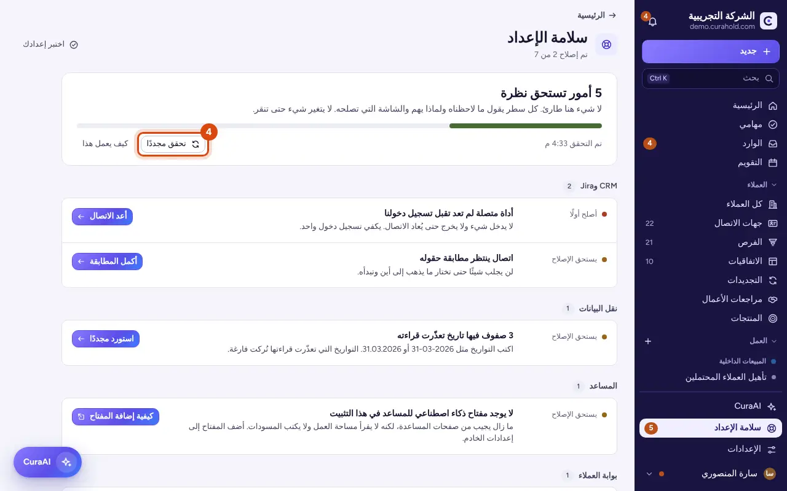
5. ترى المشكلة أيضًا على الشاشة التي تُصلحها، في مربع أصفر في الأعلى. انقر **عرض الكل** لفتح القائمة كاملة.
   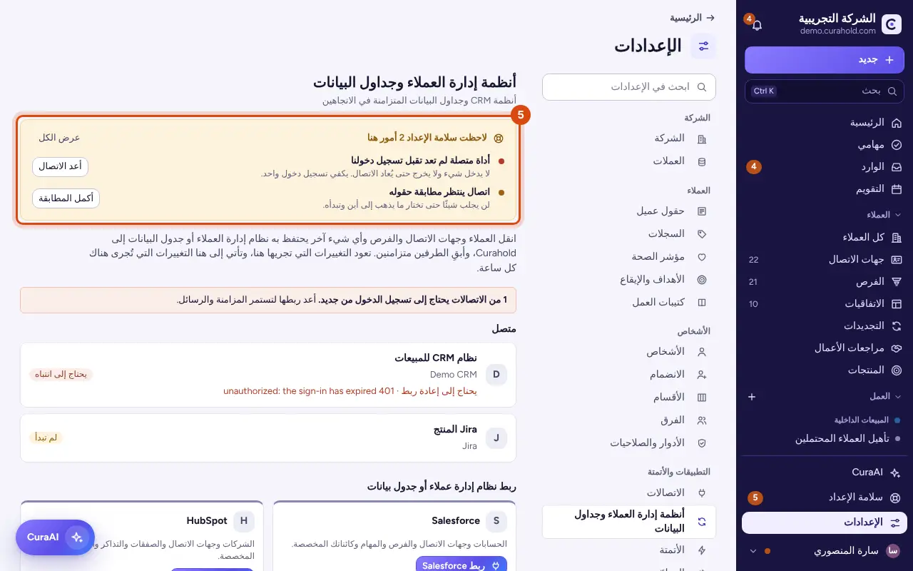

بعض الأمور لا يمكننا قراءتها من هنا، مثل سجلات SPF وDKIM وDMARC لنطاق بريدك. أضفها، ثم انقر **قمت بذلك** في ذلك السطر.

يرى كل شخص ما يمكنه إصلاحه فقط. يرى المسؤولون كل ما يخص الشركة؛ ويرى من يشغّل خادم Curahold البريد ومفتاح الذكاء الاصطناعي أيضًا. نتحقق مرة كل يوم ونُعلّم كل جديد.


## اسأل المساعد

افتح المساعد واسأل حرفيًا:

```text
ما المشكلة في إعدادي؟
```

يعرض المشكلات نفسها مع أزرارها. إنه يقرأ فقط ولا يُصلح أي شيء بنفسه.

## اختبر إعدادك

1. في **سلامة الإعداد**، انقر **اختبر إعدادك** في الأعلى.
   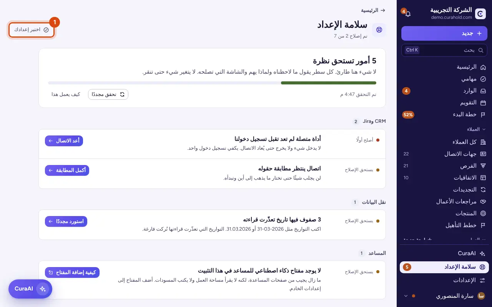
2. انقر **اختبر** في خطوة. الخطوات التي تتحقق منها بعينك فيها **نجح** و**لم ينجح** بدلًا من ذلك. إذا سألت الخطوة بماذا تُجرَّب (عميل، اتصال، زميل)، فاختر مرة واحدة: يُحفظ الاختيار للمحاولة التالية.
   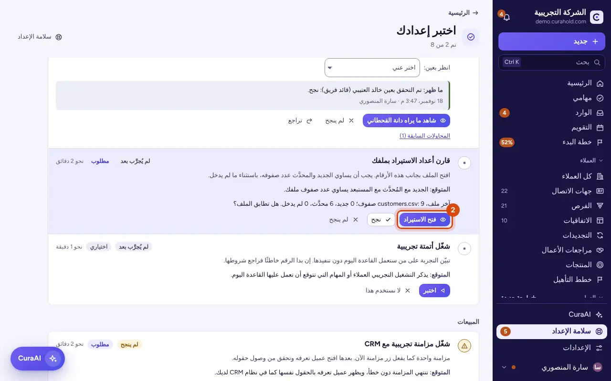
3. قارن **ما ظهر** بـ**المتوقع**. إذا تطابقا فقد نجحت الخطوة. تُحفظ كل محاولة مع من أجراها ومتى، فيمكنك إعادة الاختبار في أي وقت.
   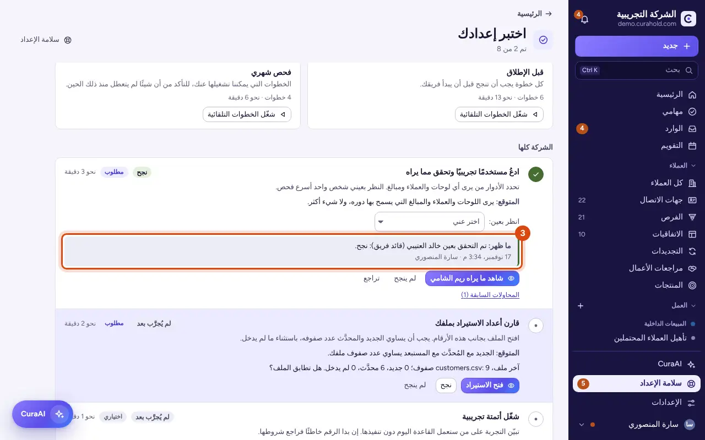
4. إذا لم ينجح، انقر **افتح الشاشة التي تصلحه**، وأصلحه، ثم اختبر مجددًا. إذا احتجت إلى مساعدة، انقر **افتح مشكلة**: تبقى المشكلة مع الخطوة وتُغلق وحدها عندما تنجح.
   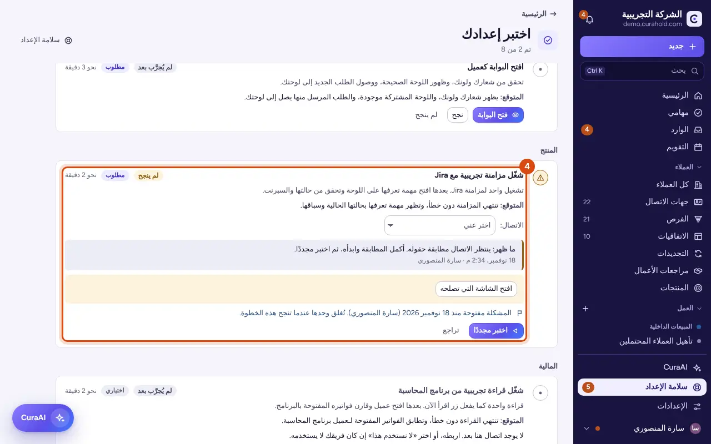
5. لتشغيل عدة خطوات معًا، اختر حزمة: **قبل الإطلاق** أو **فحص شهري**، ثم **شغّل الخطوات التلقائية**.
   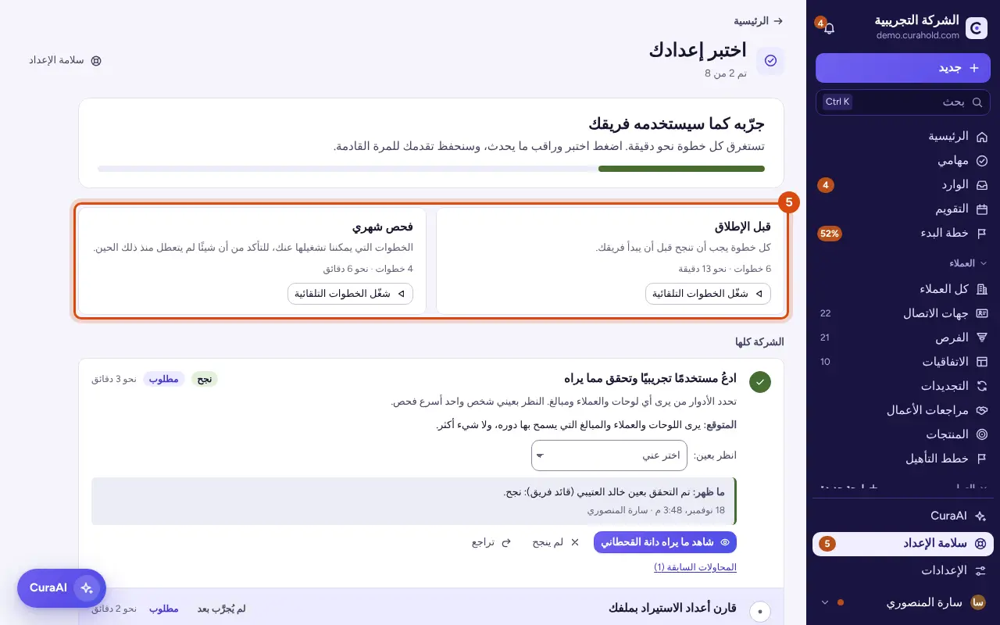
6. عندما تنجح كل خطوة **مطلوب**، ينقر مسؤول من شركتك **موافقة**، ثم شخص من Curahold. بعدها تُظهر الصفحة **اكتمل الإعداد** مع التاريخ.
   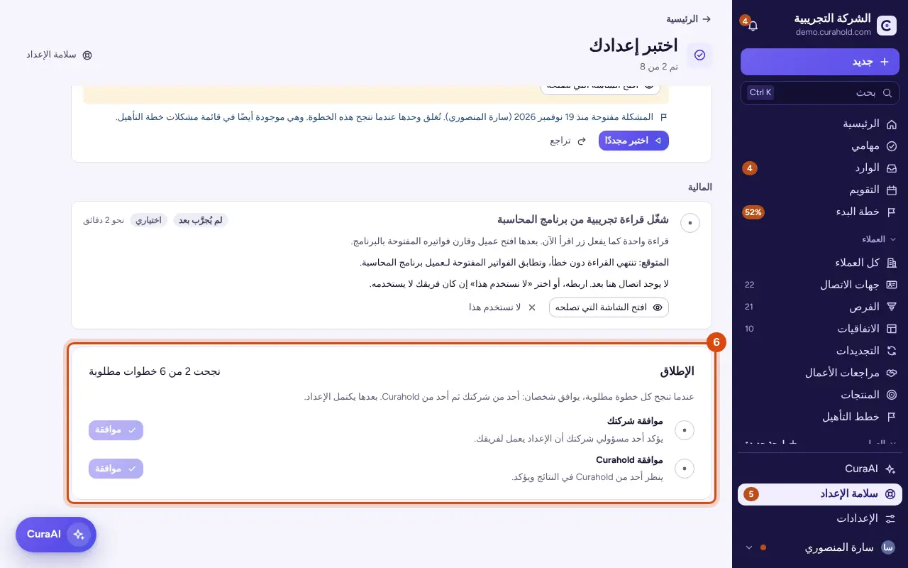

## ما معنى كل فحص

الجدول مكتوب بكلمات المنتج نفسه، فيطابق الشاشة دائمًا.

<!-- setup-checks:start (scripts/docs/setup-health-page.ts writes this part) -->

### الفريق

| ما نلاحظه | لماذا يهم | الزر |
| --- | --- | --- |
| أنت الشخص الوحيد هنا حتى الآن (أصلح أولًا) | المهام والتسليمات والتذكيرات تحتاج إلى من تُرسَل إليه. ادعُ من سيعمل في Curahold. | **ادعُ أشخاصًا** |
| … دعوات لم تُقبل منذ أكثر من أسبوع (عندما يتسنى لك) | ربما فاتهم البريد. أعد إرساله أو تحقق من العنوان. | **عرض الدعوات** |
| … أدوار لا يشغلها أحد (عندما يتسنى لك) | الدور الذي لا يشغله أحد لا يفيد. امنحه للأشخاص المناسبين أو احذفه لتبقى القائمة واضحة. | **فتح الأدوار** |

### الأقسام

| ما نلاحظه | لماذا يهم | الزر |
| --- | --- | --- |
| لم تُجهَّز الأقسام بعد (يستحق الإصلاح) | اللوحات والتسليمات ومن يرى ماذا كلها تتبع الأقسام. ضع كل شخص في قسمه. | **إعداد الأقسام** |
| … أقسام بلا قائد (يستحق الإصلاح) | وحده القائد يفتح لوحات القسم، وتذهب التسليمات إلى القسم إليه. | **اختر قائدًا** |

### نقل البيانات

| ما نلاحظه | لماذا يهم | الزر |
| --- | --- | --- |
| … صفوف من آخر استيراد لم تدخل (يستحق الإصلاح) | تعذّرت قراءة شيء في هذه الصفوف. تظهر قائمتها بأرقام الصفوف مباشرة بعد الاستيراد؛ صحّح الصفوف في ملفك واستورده مجددًا: الصفوف الموجودة تُحدَّث ولا تتكرر. | **فتح الاستيراد** |
| … صفوف في آخر استيراد بلا اسم عميل (يستحق الإصلاح) | الاسم هو العمود الوحيد الذي يحتاجه كل صف. املأه في الملف واستورد مجددًا: الصفوف الموجودة تُحدَّث ولا تتكرر. | **استورد مجددًا** |
| … صفوف فيها تاريخ تعذّرت قراءته (يستحق الإصلاح) | اكتب التواريخ مثل 2026-03-31 أو 31.03.2026. التواريخ التي تعذّرت قراءتها تُركت فارغة. | **استورد مجددًا** |
| … صفوف فيها مبلغ تعذّرت قراءته (يستحق الإصلاح) | استخدم الأرقام فقط مثل 12500 أو 12.500,00، والعملة في عمود مستقل. تُركت تلك المبالغ فارغة. | **استورد مجددًا** |
| … من العملاء مكررة مرتين (عندما يتسنى لك) | تتوزع المهام والملاحظات بين النسختين. احتفظ بواحدة وادمج الأخرى فيها. | **اعرضها** |

### CRM وJira

| ما نلاحظه | لماذا يهم | الزر |
| --- | --- | --- |
| أداة متصلة لم تعد تقبل تسجيل دخولنا (أصلح أولًا) | لا يدخل شيء ولا يخرج حتى يُعاد الاتصال. يكفي تسجيل دخول واحد. | **أعد الاتصال** |
| لم تكتمل آخر مزامنة مع … أدوات (أصلح أولًا) | التغييرات منذ ذلك الحين تنتظر. تبيّن صفحة الاتصال ما الذي أوقفها. | **اعرف ما حدث** |
| اتصال ينتظر مطابقة حقوله (يستحق الإصلاح) | لن يجلب شيئًا حتى تختار ما يذهب إلى أين وتبدأه. | **أكمل المطابقة** |
| تعذّر إرسال … تغييرات إلى الأداة الأخرى (يستحق الإصلاح) | حاولنا ثلاث مرات. تعرض صفحة الاتصال كل تغيير وسببه ويمكنها المحاولة مجددًا. | **راجعها** |
| … مفاتيح API ستتوقف خلال أسبوعين (يستحق الإصلاح) | كل ما يستخدمه سيتوقف عن الإرسال. أنشئ مفتاحًا جديدًا وضعه مكانه قبل ذلك. | **فتح مفاتيح API** |
| استبدلت الأداة الأخرى … تغييرات هذا الأسبوع (عندما يتسنى لك) | غيّر الطرفان الشيء نفسه. لم يضع شيء: القيمة المستبدلة في سجل كل مهمة. تحقق من أن قاعدة الاتصال هي ما تريد. | **تحقق من القاعدة** |

### المحاسبة

| ما نلاحظه | لماذا يهم | الزر |
| --- | --- | --- |
| تعذّرت قراءة برنامج المحاسبة (أصلح أولًا) | تبقى الفواتير والمدفوعات في صفحات العملاء كما كانت في آخر قراءة ناجحة. | **فتح الاتصال** |
| لم تُقرأ المحاسبة منذ يومين (يستحق الإصلاح) | قد لا تكون الفواتير المتأخرة محدّثة. اقرأها الآن أو تحقق من سبب توقف القراءة اليومية. | **فتح الاتصال** |

### أدوات BI

| ما نلاحظه | لماذا يهم | الزر |
| --- | --- | --- |
| … مفاتيح تحليلات ستتوقف خلال أسبوعين (يستحق الإصلاح) | ستتوقف التقارير في أداة BI عن التحديث. جدّد المفتاح والصق الجديد هناك. | **فتح مفاتيح التحليلات** |
| لم تسحب أداة BI البيانات منذ أسبوع (عندما يتسنى لك) | تعرض لوحاتها أرقام الأسبوع الماضي. تحقق من التحديث المجدول أو من المفتاح الذي تستخدمه. | **فتح مفاتيح التحليلات** |

### فحوصات بوابة العملاء

| ما نلاحظه | لماذا يهم | الزر |
| --- | --- | --- |
| بوابة العملاء مفعّلة لكنها لا تعرض لهم شيئًا (يستحق الإصلاح) | شارك لوحة واحدة على الأقل مع البوابة ليرسل العملاء طلباتهم ويتابعوها. | **اختر ما تشاركه** |
| لم يُدعَ أحد إلى البوابة بعد (عندما يتسنى لك) | لا يدخل العملاء إلا بعد دعوتهم. ابدأ بدعوة جهة اتصال لدى أحد العملاء. | **ادعُ عميلًا** |
| ما زالت البوابة بألوان Curahold (عندما يتسنى لك) | شعارك ولونك يطمئنان العملاء أنهم في المكان الصحيح. | **أضف علامتك** |

### الأتمتة

| ما نلاحظه | لماذا يهم | الزر |
| --- | --- | --- |
| … قواعد أتمتة تراقب حقلًا غير موجود (أصلح أولًا) | بهذا الشكل لن تعمل أبدًا. انقر «أصلح القاعدة» ثم «تعديل» ثم «حفظ»: تنتقل إلى حقل التاريخ الخاص بك. أو أوقف القاعدة. | **أصلح القاعدة** |
| … قواعد أتمتة تشير إلى لوحة لم تعد موجودة (أصلح أولًا) | المهام التي يجب أن تنشئها لا مكان لها. اختر لوحة أخرى. | **أصلح القاعدة** |
| لا توجد أتمتة بعد (عندما يتسنى لك) | قاعدة واحدة، مثل مهمة قبل كل تجديد بـ 60 يومًا، توفّر تذكيرًا في كل مرة. هناك قواعد جاهزة للتفعيل. | **عرض القواعد الجاهزة** |

### فحوصات بياناتك

| ما نلاحظه | لماذا يهم | الزر |
| --- | --- | --- |
| … من العملاء بلا مسؤول (يستحق الإصلاح) | لا تصل تذكيراتهم لأحد، ولا يظهرون في قائمة أحد. عيّن مسؤولًا لكل منهم. | **عيّن مسؤولًا** |
| … صفقات مفتوحة بلا مرحلة (يستحق الإصلاح) | تبقى خارج مسار المبيعات والتوقعات. | **فتح الصفقات** |
| … تذاكر مفتوحة لا يتابعها أحد (عندما يتسنى لك) | التذكرة بلا مسؤول لا تدخل قائمة أحد. عيّن كل تذكرة أو أضف قاعدة تفعل ذلك. | **فتح التذاكر** |

### البريد

| ما نلاحظه | لماذا يهم | الزر |
| --- | --- | --- |
| هذا التثبيت لا يرسل البريد بعد (أصلح أولًا) | الدعوات وروابط الدخول والتذكيرات تُكتب في سجل الخادم فقط. اضبط مرحّل البريد أو مزوّد بريد. | **كيفية إعداد البريد** |
| أكّد سجلات SPF وDKIM وDMARC لنطاق البريد (يستحق الإصلاح) | بدونها تذهب الدعوات إلى البريد العشوائي أو تُرفض. لا يمكننا قراءة DNS من هنا: أضف السجلات ثم أكّد. | **عرض السجلات** |

### الخصوصية

| ما نلاحظه | لماذا يهم | الزر |
| --- | --- | --- |
| لا أحد يستطيع الرد على طلبات البيانات الشخصية (يستحق الإصلاح) | بموجب KVKK وGDPR يجب أن يستطيع أحد تصدير بيانات الشخص أو محوها. امنح دورًا واحدًا صلاحية الخصوصية. | **فتح الأدوار** |

### الفترة التجريبية والخطة

| ما نلاحظه | لماذا يهم | الزر |
| --- | --- | --- |
| تنتهي فترتك التجريبية في … (يستحق الإصلاح) | بعدها تصبح مساحة العمل للقراءة فقط حتى تُختار خطة. لا يُحذف شيء. | **اختر خطة** |
| كل مقاعد الفترة التجريبية مشغولة (يستحق الإصلاح) | يمكن للأشخاص الجدد الانضمام كمشاهدين فقط. اطلب مقاعد إضافية أو حرّر مقعدًا. | **عرض المقاعد** |

### المساعد

| ما نلاحظه | لماذا يهم | الزر |
| --- | --- | --- |
| لا يوجد مفتاح ذكاء اصطناعي للمساعد في هذا التثبيت (يستحق الإصلاح) | ما زال يجيب من صفحات المساعدة، لكنه لا يقرأ مساحة العمل ولا يكتب المسودات. أضف المفتاح إلى إعدادات الخادم. | **كيفية إضافة المفتاح** |

<!-- setup-checks:end -->

## للمطورين

الفحوص نفسها متاحة في واجهة API، وتُقرأ باسم صاحب المفتاح. ضع عنوان شركتك ومفتاحك مكان المثالين:

```bash
curl -H "Authorization: Bearer YOUR_API_KEY" https://your-company.curahold.com/api/setup-health
```

القائمة الكاملة للعناوين في [مرجع: سلامة الإعداد](/docs/ar/ref-setup/).
