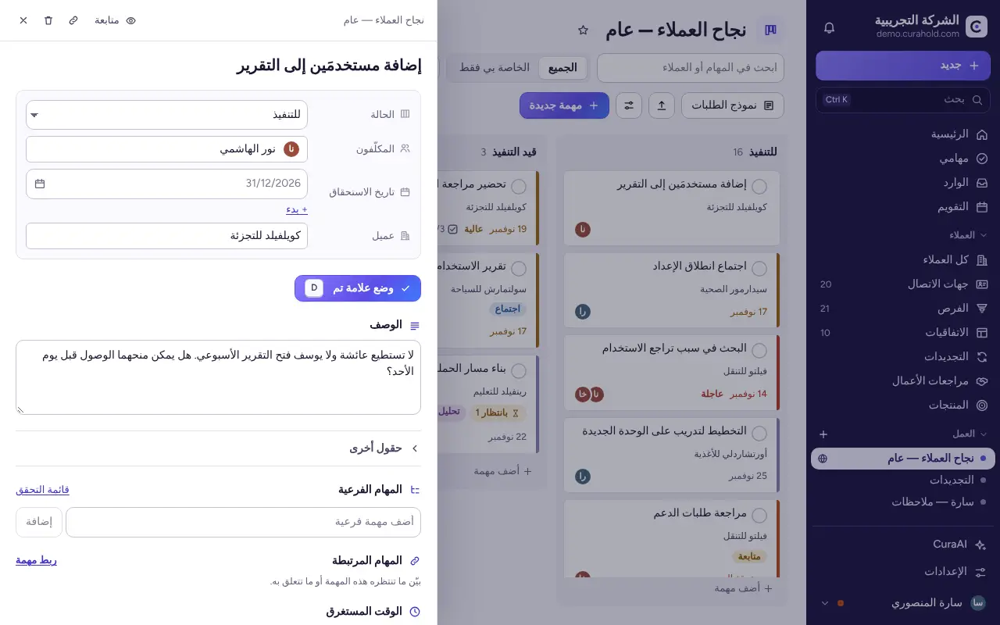

# المهام واللوحات

يسير العمل على اللوحات. تنتمي اللوحة إلى فريق، أو إلى الشركة كلها، أو إليك وحدك، وأنت من يختار أعمدتها.

## المهمة

للمهمة عنوان، ووصف، وأشخاص (حتى 10)، وتاريخ استحقاق، وأولوية، وعميل إن شئت. أضف إليها مهامًا فرعية وملفات وتعليقات. تُفتح المهمة في لوحة جانبية دون مغادرة اللوحة، ويبقى الرابط إليها صالحًا لمن ترسله إليه.

الشريط الرفيع على حافة كل بطاقة يبيّن موقع المهمة من الوقت: هادئة، أو قريبة، أو اليوم، أو متأخرة، أو منجزة. وتعود الألوان نفسها في التقويم وفي «مهامي». وتُختار التواريخ من منتقي التاريخ الخاص بالمنتج، بلغتك وبالترتيب الذي تكتب به التواريخ.

## عندما يغيّر شخصان المهمة نفسها

لا يكتب Curahold فوق عمل أحد بصمت. إذا حفظ شخص آخر وأنت تعدّل، يُحفظ تغييره ويُطبَّق تغييرك فوقه. ولا تُسأل إلا عندما يتعارض الحقل نفسه فعلًا.

## تغيير عدة مهام معًا، والتراجع

حدّد عدة مهام في لوحة أو في القائمة وغيّر حالتها أو أشخاصها أو تاريخها أو أولويتها معًا. يعرض الإشعار في الأسفل زر **تراجع**.

## المهام المتكررة

اجعل المهمة تتكرر كل بضعة أيام أو أسابيع أو أشهر. تُفتح التالية عندما تُنجز الحالية. ويُحسب التاريخ الجديد إما:

- **من تاريخ الاستحقاق:** للمواعيد الثابتة، مثل «تقرير في الأول من كل شهر».
- **من يوم الإنجاز:** لعمل مثل «اتصل مجددًا بعد أسبوعين من آخر مكالمة».

## الإشارات والكتم

اكتب `@` في تعليق للإشارة إلى أحدهم، فيصله إشعار. وإن لم تعد تريد أن تسمع عن مهمة، اختر **كتم** من قائمتها.

## البحث السريع

اضغط Ctrl K (أو ⌘ K على Mac) في أي مكان لتجد عميلًا أو مهمة أو شخصًا أو لوحة أو صفحة. تنقّل بالأسهم وافتح بـ Enter.

## المزيد في المهمة

- **متابعة:** بالزر أعلى المهمة، يصلك خبر التعليقات وتنقلات الأعمدة في مهمة ليست لك.
- **المهام المرتبطة:** قل إن المهمة **تنتظر** أخرى، أو **تؤخّر** أخرى، أو **مرتبطة** بها. تقول المهمة المنتظرة «تنتظر 1» على بطاقتها، وعندما تُنجز المهمة التي تنتظرها يصل أشخاصَها إشعار «يمكنك البدء». ولا يمكن جعل المهام تنتظر بعضها في حلقة.
- **تاريخ البدء:** **+ بداية** بجانب تاريخ الاستحقاق يسجّل متى يبدأ العمل، ويرسمه المخطط الزمني شريطًا.
- **الوقت المستغرق:** أزرار ‎+15 د و‎+30 د و‎+1 س، أو يدويًا ("1.5" أو "45m" أو "1:30"). وتعرض صفحة العميل مجموع ما سُجّل لذلك العميل.
- **قائمة التحقق:** احفظ الخطوات التي تستخدمها كثيرًا مرة واحدة (أضف مهامًا فرعية ← **قائمة التحقق ← حفظ كقائمة تحقق**)، ثم أضفها إلى أي مهمة بنقرة.
- **السجل:** من غيّر ماذا ومتى، سطرًا بسطر، في أسفل المهمة.
- **تنبيه التشابه:** إذا كانت المهمة التي توشك على إضافتها تشبه مهمة مفتوحة، تقول لك الإضافة السريعة ذلك.

## حقول اللوحة الخاصة

إعدادات اللوحة ← **الحقول ونموذج الطلبات**: أضف حقولًا إضافية لكل مهمة في تلك اللوحة (نص، أو رقم، أو مبلغ، أو تاريخ، أو اختيار، أو رابط، أو بريد إلكتروني، أو شخص، أو نعم/لا). الحقل المعلَّم **إلزامي للإنجاز** يجب ملؤه قبل نقل المهمة إلى عمود «منجز»؛ ويتخطى التغيير الجماعي هذه المهام ويقول كم عددها. وتظهر حقول الاختيار وسومًا ملوّنة على البطاقات ويمكن التصفية بها.

## التصفية والعروض المحفوظة

**تصفية** أعلى اللوحة تضيّقها حسب الشخص، وتاريخ الاستحقاق (متأخرة، اليوم، 7 أيام…)، والأولوية، وحقول الاختيار في اللوحة. وعلى الهاتف تجتمع كل عوامل التصفية في صفحة **تصفية** واحدة. سمِّ عوامل التصفية المفعّلة بـ **العروض ← حفظ**، واعرض العرض على كل من في اللوحة إن شئت.

## نموذج الطلبات

في إعدادات اللوحة فعّل **استقبال الطلبات عبر نموذج** واختر ما يسأله النموذج. يستخدم الزملاء زر **نموذج الطلبات** في اللوحة؛ فيصل الطلب مهمةً إلى العمود الذي اخترته، ويتابعه صاحب الطلب تلقائيًا.

## الانتقال من أداة أخرى: استيراد المهام من ملف

زر السهم الصاعد أعلى اللوحة (**استيراد المهام من ملف**) يأخذ ملف CSV أو Excel الذي صدّرته من أداتك القديمة. يُقرأ الملف في المتصفح، ولا يُرسل شيء حتى ترى أي عمود يذهب إلى أين.

- تُتعرّف الأعمدة وحدها (العنوان، والوصف، والحالة، والمسؤول، وتاريخ الاستحقاق، وتاريخ البدء، والأولوية، والعميل، وتاريخ الإنجاز). غيّر أيًا منها؛ ويعرض عمود «يصبح» كيف ستدخل الصفوف الأولى.
- **الحالة** تذهب إلى عمود اللوحة الذي يحمل الاسم نفسه. وتُفهم الأسماء الشائعة مثل «To do» و«In progress» و«Done» أيضًا؛ وما عداها يذهب إلى العمود الأول ويُذكر في النتيجة.
- يُطابق **المسؤول** بالاسم أو البريد الإلكتروني؛ ومن لا يوجد يُترك، ويُقال لك من هم. ويُطابق اسم العميل بالطريقة نفسها.
- تُترك المهام المنجزة إلا إذا حدّدت «أحضر المهام المنجزة أيضًا».
- لا يصل أحدًا إشعار ولا تعمل أي قاعدة. ويمكنك **التراجع** عن الاستيراد كله خلال 30 يومًا: تُحذف المهام التي لم يلمسها أحد، وتنتقل التي عمل عليها أحد إلى الأرشيف.

حتى 5000 صف في المرة الواحدة.

## التقويم

يعرض **التقويم** ما يقع في كل يوم: المهام حسب تاريخ استحقاقها، والاجتماعات والمكالمات والمراجعات التي عُقدت، والتجديدات، ومراجعات الأعمال المستحقة. الشارات فوقه تُظهر كل نوع أو تخفيه.

- **يوم، أسبوع، شهر، سنة:** المبدّل في الأعلى. يسرد اليوم كل ما فيه مع العميل وصاحبه، وتعرض السنة اثني عشر شهرًا صغيرًا، أغمق حيث يكثر ما يقع. والنقر على رقم يوم يفتحه.
- **تقويم من:** تقويمك، أو كل من تستطيع رؤيتهم. ومن يسمح له دوره *برؤية تقاويم الزملاء* (المسؤولون وقادة الفرق في البداية) يختار أيضًا شخصًا واحدًا أو فريقًا كاملًا. هذا يضيّق ما يستطيع رؤيته أصلًا ولا يُظهر شيئًا جديدًا، فتبقى اللوحة الخاصة خاصة.
- العرض واليوم وصاحب التقويم في العنوان، فيفتح الرابط الشيء نفسه.

## الأرشيف

تنتقل المهام المنجزة إلى **أرشيف** اللوحة وحدها بعد أن تحتفظ بها اللوحة مدة كافية (90 يومًا افتراضيًا؛ من 30 إلى 365 يومًا أو «دائمًا» في إعدادات اللوحة). وتفتح لوحة استُخدمت سنوات فورًا. وتبقى المهام المؤرشفة محسوبة في التقارير؛ ابحث عنها في عرض **الأرشيف** بجانب اللوحة / القائمة وأعد إحداها بـ **إعادة**. وتبقى المهمة المُعادة في اللوحة المدة نفسها مجددًا. والمهام التي تؤرشفها يدويًا من عرض القائمة موجودة هنا أيضًا.

## حذف مهمة واستعادتها

تذهب المهمة المحذوفة إلى [سلة المحذوفات](/docs/ar/trash/) مع مهامها الفرعية وتعليقاتها ووقتها وملفاتها، ويمكن إعادتها خلال 30 يومًا: اختر **تراجع** في الإشعار بعد الحذف مباشرة، أو افتح قائمتك واختر **سلة المحذوفات** ثم **إعادة**. لا يحذف المهمة إلا من أنشأها، أو من يسمح له دوره بحذف أي مهمة. ولإبعاد مهمة منجزة عن الطريق دون حذفها، أرشِفها.
