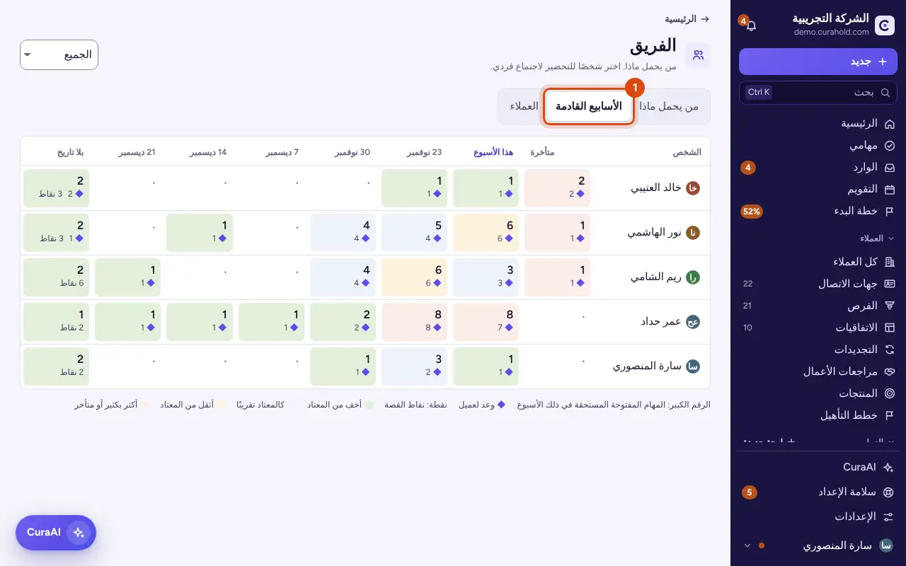
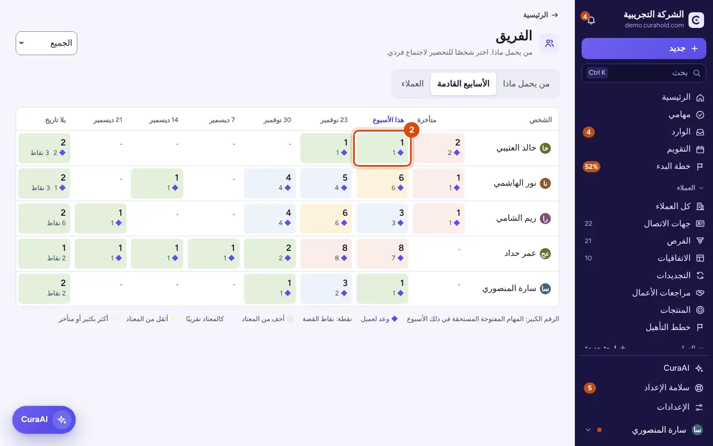
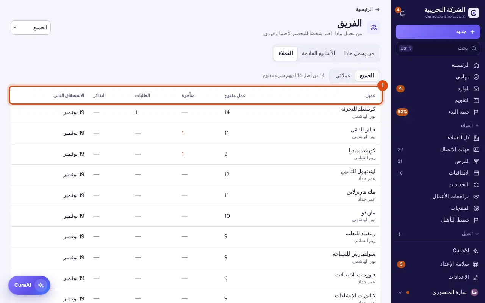
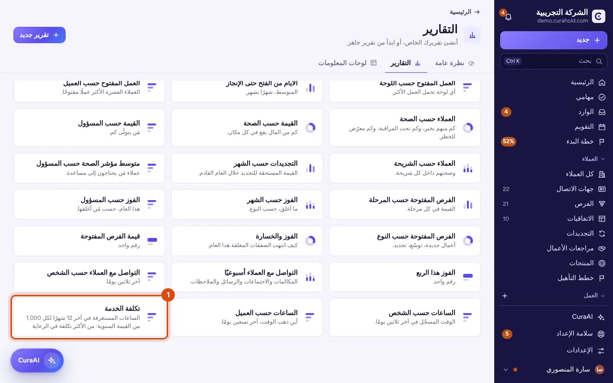

# أسابيع الفريق ومحفظة العملاء وتكلفة الخدمة

لصفحة **الفريق** (في القائمة الجانبية) ثلاث طرق عرض: **من يحمل ماذا** و**الأسابيع القادمة** و**العملاء**. اختر فريقًا في الأعلى لتضييق أي منها. لا تُحسب إلا المهام التي يحق لك رؤيتها.

## من لديه متسع في الأسابيع القادمة {#weeks}

1. افتح **الفريق** وانقر **الأسابيع القادمة**.
   
2. اقرأ صف الشخص أسبوعًا بأسبوع. في كل خانة: الرقم الكبير هو المهام المفتوحة المستحقة ذلك الأسبوع، و◆ عدد ما هو منها وعد لعميل، و**pt** نقاطها. يقارن اللون الأسبوع بما يحمله ذلك الشخص عادة: أخف، أو كالمعتاد، أو أثقل، أو أكثر بكثير. لـ **متأخرة** و**بلا تاريخ** عمودان خاصان. انقر خانة لتفتح عرض الاجتماع الفردي لذلك الشخص.
   

## العمل المفتوح لكل عميل {#customers}

1. افتح **الفريق** وانقر **العملاء**. يُعرض كل عميل لديه شيء مفتوح، الأكثر انشغالًا أولًا: العمل المفتوح، والمتأخر منه، والطلبات التي أرسلها أشخاصه عبر البوابة، وتذاكر الدعم غير المحلولة، وأقرب موعد. انقر اسم عمود للترتيب به؛ وبدّل بين **الجميع** و**عملائي**.
   

المبالغ غير معروضة هنا عمدًا: من يرى المال يُحدَّد حقلًا بحقل.

## تكلفة الخدمة {#cost-to-serve}

1. افتح **التقارير** من القائمة، وانقر تبويب **التقارير**، ثم **تكلفة الخدمة**. يعرض لكل عميل الساعات المسجلة على عمله في آخر 12 شهرًا لكل 1,000 من القيمة السنوية (ARR، وإلا MRR × 12، وإلا أول حقل مبلغ). الأعلى هم العملاء الأكثر تكلفة في الرعاية.
   

يأتي معه حقلان في منشئ التقارير: **الوقت المسجّل، آخر 12 شهرًا** و**ساعات لكل 1,000 من القيمة السنوية**. من لا يحق له رؤية قيمة العميل لا يرى رقم التكلفة.
