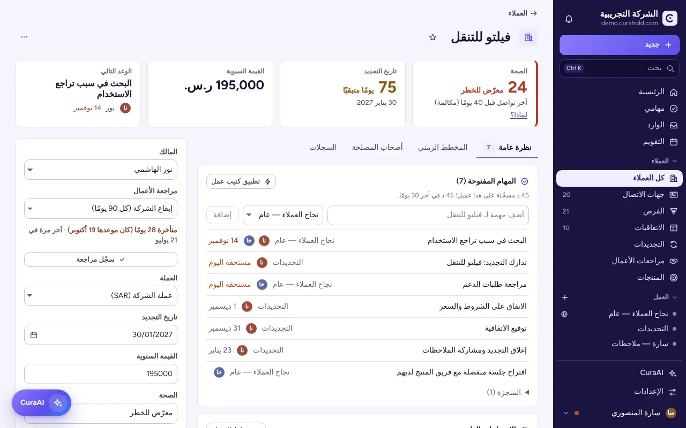

# المخطط الزمني ومؤشر الصحة

لكل صفحة عميل **مخطط زمني**، وإذا فعّلته، **مؤشر صحة**. يروي المخطط الزمني ما حدث مع العميل، ويلخّصه المؤشر في رقم واحد مع أسبابه.

## المخطط الزمني

في المربع أعلاه اختر **ملاحظة** أو **مكالمة** أو **اجتماع** أو **بريد إلكتروني**، واكتب ما حدث وأضفه. غيّر التاريخ إن احتجت، وحدّد الأشخاص الذين تحدثت معهم.

تظهر هذه في المخطط الزمني من تلقاء نفسها:

- المهام التي فُتحت وأُنجزت للعميل
- التعليقات على تلك المهام
- جهات الاتصال (أصحاب المصلحة) المضافة
- الأيام التي تحرّك فيها مؤشر الصحة 10 نقاط أو أكثر

**ثبّت** ملاحظة مهمة لتبقى في الأعلى. يستطيع كاتب الإدخال، أو من يدير العملاء، تعديله أو حذفه. والمهمة الموجودة في لوحة لا تستطيع فتحها، أو الحقل المخفي عنك، لا يظهران في المخطط الزمني أيضًا.

## الاجتماعات المخطط لها

المخطط الزمني هو ما حدث. و**الاجتماعات المخطط لها** هي ما لم يأتِ بعد. في صفحة العميل، تحت **الاجتماعات القادمة**، اختر **خطط لاجتماع**: اختر نوعًا (اجتماع، أو مراجعة، أو مكالمة، أو أحد الأنواع المحفوظة)، وحدّد موعد البدء والمدة، وادعُ أشخاصًا من الجانبين، واكتب جدول الأعمال، واختر هل يتكرر. يظهر في صفحة العميل وفي **التقويم**، لكنه لا يدخل المخطط الزمني بعد؛ فلا شيء يُسجَّل حتى يُعقد.

لكل اجتماع مخطط له مسار:

- **تمييز كمنعقد** عندما يحدث. يسجّل الاجتماع في المخطط الزمني، وجدول الأعمال ملاحظاتٍ له، ويربط بينهما. وإذا كان يتكرر يُخطَّط التالي لك. ويمكنك الاتفاق على الخطوات التالية في الوقت نفسه، فتصبح كل خطوة مهمة.
- **تأجيل** مع ذكر السبب. يُحتفظ به، ويمكنك نقله إلى يوم جديد في الساعة نفسها.
- **إلغاء** مع ذكر السبب. يبقى في السجل ملغيًا؛ لا يُحذف شيء.

**الأنواع المحفوظة.** يستطيع المسؤول تسمية الاجتماعات التي تعقدونها كثيرًا، مثل مراجعة الأعمال الربعية أو المتابعة الشهرية، ومنح كل منها موجّهًا لجدول الأعمال. اختيار نوع عند التخطيط يملأ جدول الأعمال، فتبدأ كل مراجعة من الأسئلة نفسها.

## مؤشر الصحة

فعّله من الإعدادات ← مؤشر الصحة. هو رقم من 0 إلى 100 لكل عميل، يُحسب مما هو موجود أصلًا في Curahold:

| الإشارة | النقاط كاملة | بلا نقاط |
| --- | --- | --- |
| التواصل الأخير | آخر مكالمة أو اجتماع أو بريد أو ملاحظة خلال 14 يومًا | 45 يومًا أو أكثر |
| العمل المتأخر | لا مهام متأخرة | 3 مهام متأخرة أو أكثر |
| حِمل الدعم | لا تذاكر دعم مفتوحة | 5 تذاكر مفتوحة (العاجلة تُحسب مرتين) |
| وجود مناصر | جهة اتصال واحدة على الأقل «مناصر» | لا أحد |
| صاحب القرار معروف | جهة اتصال واحدة على الأقل «صاحب قرار» | لا أحد |
| لا معرقلين | لا معرقلين ولا متشككين | معرقل |
| تقدير المسؤول | الخيار الأول في حقل اختيار (مثل «جيد») | خياره الأخير (مثل «في خطر») |
| حقل رقمي | قيمة تختارها | قيمة تختارها |

أنت من يختار الأوزان والأيام والنطاقات (سليم، يستحق المراقبة، معرّض للخطر). وقبل الحفظ تعرض معاينة ما سيحصل عليه كل عميل. والإشارة التي لا بيانات لها لدى عميل تُستبعد، وتتقاسم الإشارات الأخرى وزنها.

> **لماذا؟** بجانب الدرجة في صفحة العميل، يعرض زر **لماذا؟** النقاط التي أعطتها كل إشارة ومخططًا للأسابيع الأخيرة. المؤشر ليس صندوقًا أسود: ترى من أين تأتي كل نقطة.

يتصرف المؤشر مثل أي حقل عميل: عمود في القوائم، وعامل تصفية، وفي بطاقات الصفحة الرئيسية، وفي التصدير، وفي API وwebhooks. وإذا ربطته بحقل في مزامنة CRM يُكتب في CRM أيضًا. ولا يستطيع أحد كتابته يدويًا.

يُعاد حسابه خلال ثوانٍ من أي تغيير على ذلك العميل، ومرة كل يوم. وتُحفظ درجة كل يوم، ومنها تأتي الاتجاهات والملخص الأسبوعي.

## الملخص الأسبوعي

يوم الاثنين، في الساعة التي اخترتها لملخصك الصباحي، يصلك ملخص عن عملائك: التجديدات في الأيام الثلاثين القادمة، والدرجات التي انخفضت وسببها الرئيسي، والعملاء الذين لا تواصل معهم منذ 30 يومًا أو أكثر، وعمل الأسبوع. عطّله من إعداداتك.
