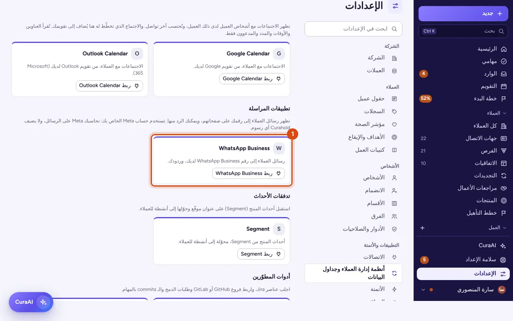
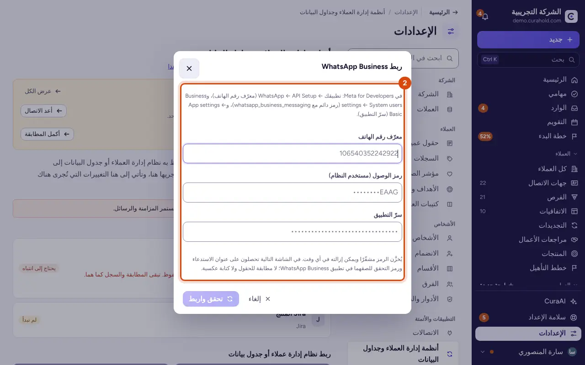

# WhatsApp Business

تظهر الرسائل التي يرسلها العملاء إلى رقم WhatsApp Business لديك في صفحاتهم، وتردّ من هناك. تستخدم تطبيق Meta **الخاص بك** ورقمك: تحاسبك Meta على الرسائل، ولا يضيف Curahold أي رسوم ولا يرى فاتورة Meta أبدًا.

## قبل أن تبدأ

تحتاج إلى حساب أعمال في Meta فيه رقم WhatsApp Business على Cloud API، وتطبيق Meta فيه منتج WhatsApp، و**مستخدم نظام** برمز دائم (صلاحية `whatsapp_business_messaging`). صفحات Meta ترشدك خطوة بخطوة؛ يستغرق ذلك نحو 15 دقيقة.

## في Curahold {#connect}

1. افتح **الإعدادات ← أنظمة إدارة العملاء وجداول البيانات**، وابحث عن **تطبيقات المراسلة**، وانقر **ربط WhatsApp Business**.
   
2. الصق القيم الثلاث أدناه وانقر **ربط**. تعرض صفحة الاتصال بعدها **عنوان الاستدعاء** و**رمز التحقق**.
   

- **معرّف رقم الهاتف**: Meta for Developers ← تطبيقك ← **WhatsApp ← API Setup**.
- **رمز الوصول (مستخدم النظام)**: Business settings ← **System users** ← المستخدم ← **Generate new token**.
- **سرّ التطبيق**: تطبيقك ← **App settings ← Basic** ← **App secret** ← **Show**.

## في Meta

1. افتح تطبيقك ← **WhatsApp ← Configuration**. وبجانب **Webhook** انقر **Edit**.
2. الصق عنوان الاستدعاء في **Callback URL** ورمز التحقق في **Verify token**. انقر **Verify and save**.
3. تحت **Webhook fields** انقر **Manage** واشترك في **messages**.

## ما الذي يصل، والرد

تصل الرسالة كملاحظة إلى العميل الذي لدى إحدى جهات اتصاله رقم المرسل (تتطابق الصيغ المحلية مثل `0532…` أيضًا). على تلك الملاحظة انقر **الرد عبر WhatsApp**. يسمح WhatsApp بالنص الحر خلال 24 ساعة فقط من آخر رسالة للعميل؛ بعدها يطلب Curahold اسم **قالب** معتمد ولغته.

## الحدود والتوقيت

تصل الرسائل كما ترسلها Meta. تعيد Meta محاولة الإرسال الفاشل حتى 7 أيام؛ وتُحفظ كل رسالة مرة واحدة. تحدّ Meta سرعة إرسال الرقم الواحد؛ ويقول الرد «مشغول» ذلك ولا يضيع شيء.

## إذا حدثت مشكلة

الرمز المنتهي أو الملغى يظهر عند الرد: الصق رمزًا جديدًا عبر **إعادة الربط**. الرسالة من رقم لا تملكه أي جهة اتصال تُحتسب على الاتصال ولا تُحفظ. **إزالة** توقف الاستدعاء فورًا؛ وتبقى الملاحظات لدى العملاء.

## انظر أيضًا

- [المخطط الزمني ومؤشر الصحة](/docs/ar/timeline-and-health/)
- [الاتصالات وCRM](/docs/ar/connections/)
