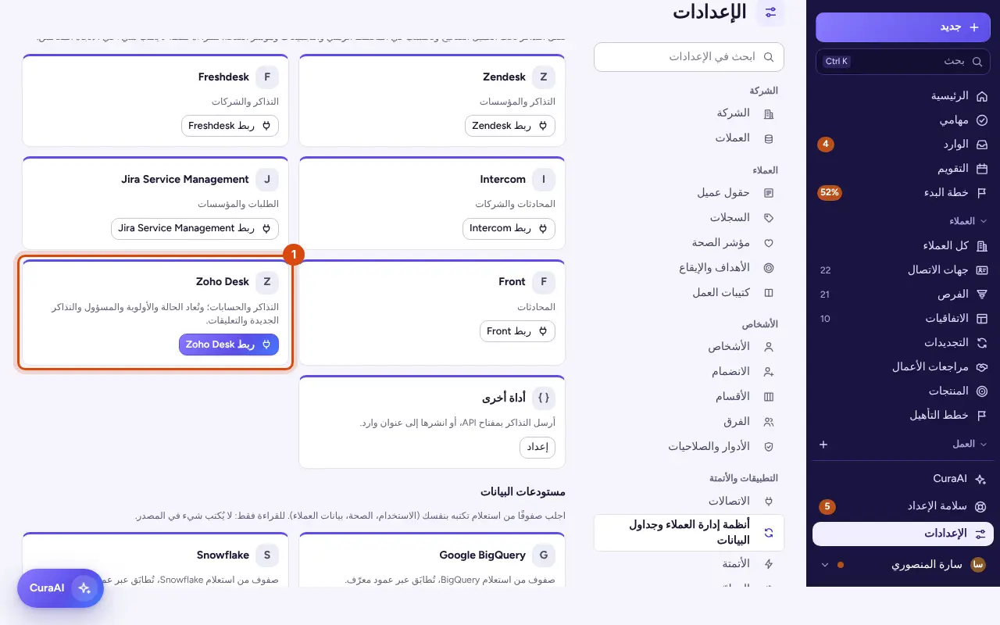

# Zoho Desk

تظهر تذاكر Zoho Desk وحساباته لدى العميل المطابق وفي الإجماليات وفي مؤشر الصحة. تُعاد الحالة والأولوية والمسؤول التي تتغير في Curahold إلى Zoho Desk، وتُنشأ هناك التذكرة التي تُنشأ في Curahold، ويُضاف الرد أو الملاحظة الخاصة كتعليق.

## في Curahold {#connect}

1. افتح **الإعدادات ← أنظمة إدارة العملاء وجداول البيانات**، وابحث عن **أدوات الدعم**، وانقر **ربط Zoho Desk**.
   

تفتح صفحة Zoho. سجّل الدخول بأحد وكلاء مكتب الدعم وانقر **Accept**. يجد Curahold مركز بياناتك (.com و.eu و.in و.com.au و.jp و.sa و.uk و.ae و.ca و.com.cn) وبوابتك. وعند العودة حدّد **التذاكر** و**الحسابات**، وراجع أزواج الحقول، وانقر **ابدأ المزامنة**.

## الحدود والتوقيت

تُقرأ التغييرات كل ساعة. يحتسب Zoho رصيدًا لكل طلب من حصة يومية حسب الخطة؛ وعند نفادها يطلب Zoho الانتظار ويستمر Curahold في المرة التالية. الرد العام من Curahold تعليق عام على التذكرة؛ أما الرد بالبريد فيُرسل من Zoho Desk.

## إذا حدثت مشكلة

تسجيل الدخول المنتهي يُجدَّد تلقائيًا. إذا فقد الوكيل الوصول يظهر الاتصال **يحتاج إلى انتباه**: انقر **إعادة الربط** وسجّل الدخول مجددًا. **إزالة** تحذف تسجيل الدخول؛ وتبقى التذاكر التي وصلت.

## انظر أيضًا

- [الاتصالات وCRM](/docs/ar/connections/)
