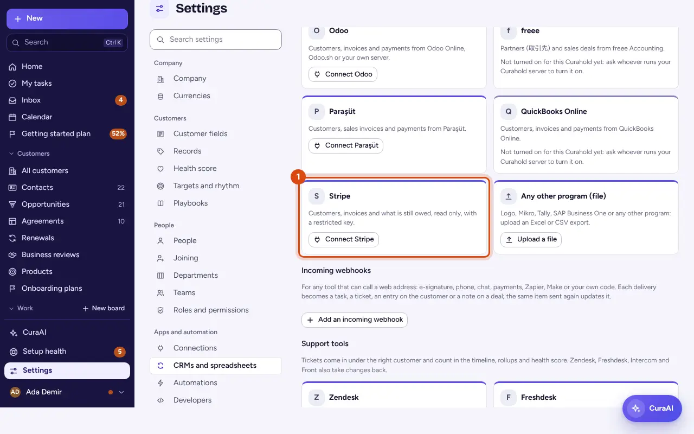

# Stripe (read only)

Customers, invoices (with their due date and what is still owed) and payments from Stripe. Curahold never writes to Stripe: the key you give it can only read.

## In Curahold {#connect}

1. Open **Settings → CRMs and spreadsheets**, find **Accounting programs** and click **Connect Stripe**.
   

Paste the restricted key into **Restricted key** and click **Connect**. A full secret key (`sk_…`) is refused on purpose. Then click **Start** and check the customers it could not match on the **Matching** tab.

## In Stripe

1. Open **Developers → API keys** and click **Create restricted key**.
2. Name it `Curahold`.
3. Set **Customers**, **Invoices** and **Events** to **Read**. Leave everything else on **None**.
4. Click **Create key**, confirm with your second step, and copy the key. It starts like this:

```text
rk_live_
```

Use a key from a sandbox (`rk_test_…`) to try it first.

## Limits and timing

The first read brings everything; then only what changed, from Stripe's list of events (kept 30 days by Stripe). Stripe allows 100 requests a second (25 in a sandbox); Curahold stays far below. Amounts follow each currency's own decimals (yen have none). An invoice Stripe marks "uncollectible" stays owed here, so a late payment still shows.

## If something goes wrong

A rolled or deleted key marks the connection **Needs attention**: make a new restricted key and paste it with **Reconnect**. If a permission is missing, the connect step names it. **Remove** deletes the key; figures already read stay until you remove them.

## See also

- [Accounting programs](/docs/en/accounting/)
