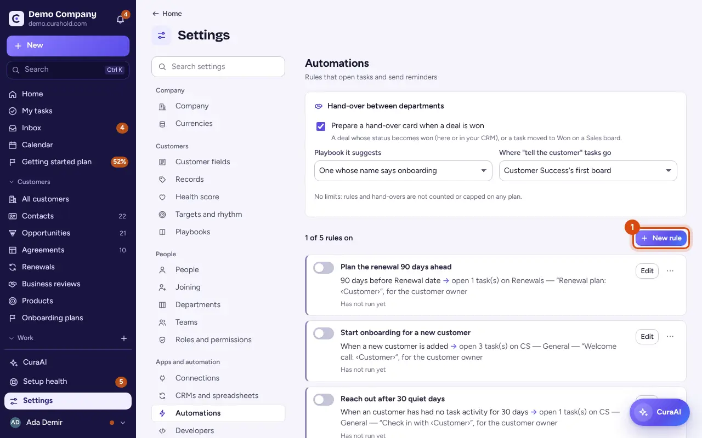
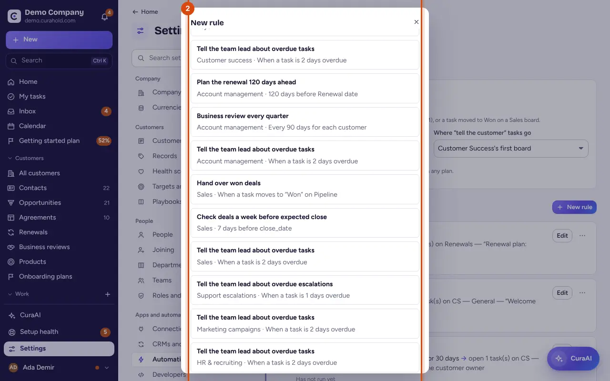
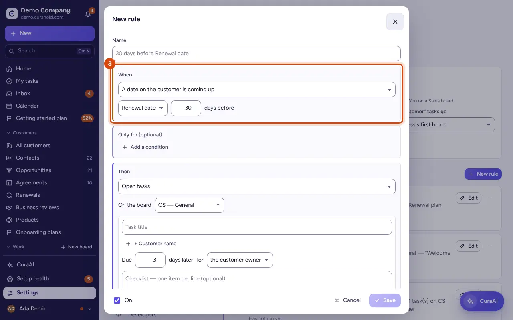
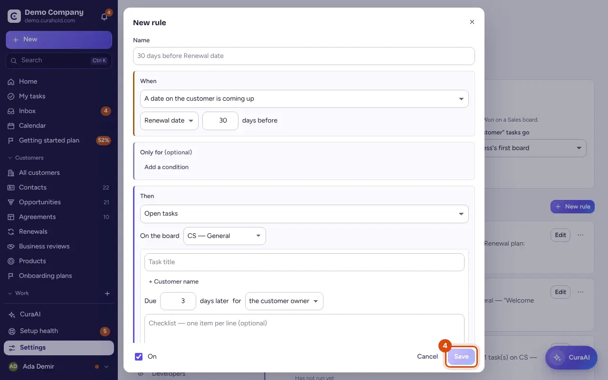

# Automations

Rules do the routine for you: a renewal plan 90 days ahead, a welcome call for a new customer, a reminder when a task is late, the hand-over card when a deal is won. They are never counted or capped on any plan.

## Make a rule {#new-rule}

You need the permission to manage automations (administrators have it).

1. Open **Settings → Automations** and click **New rule**.
   
2. Pick a ready-made rule that fits, or **Start from scratch**.
   
3. Under **When**, choose what starts it, and the details (which date, how many days, which board). Click **Add a condition** to narrow it to some customers or tasks. Under **Then**, choose what happens. Below, "Today this would act on…" shows what it would touch now; nothing is changed yet.
   
4. Give it a **Name**, leave **On** ticked and click **Save**.
   

## What can start a rule {#when}

A date on the customer coming up (renewal, contract end), every so many days for each customer, a customer gone quiet, a new customer, a task overdue, a task moving to a column, a task added or finished, a request through a board's form, a record reaching a stage, a support ticket opened.

## What a rule can do {#then}

Open tasks (with a checklist, for the customer's owner or anyone), send a reminder, assign, move, set a field, write a comment, send to your webhooks, or prepare the hand-over card.

## Running and stopping {#running}

Each rule shows how often it ran in the last 30 days. **Run now** runs a scheduled rule at once instead of waiting for the next hour; it still acts once per occasion. Switch a rule off to pause it. Deleting a rule keeps the tasks it already opened, and the rule stays in the trash for 30 days.

The hand-over settings at the top of the same page are on [Hand-over, requests and the loop back](/docs/en/handover-and-requests/).
