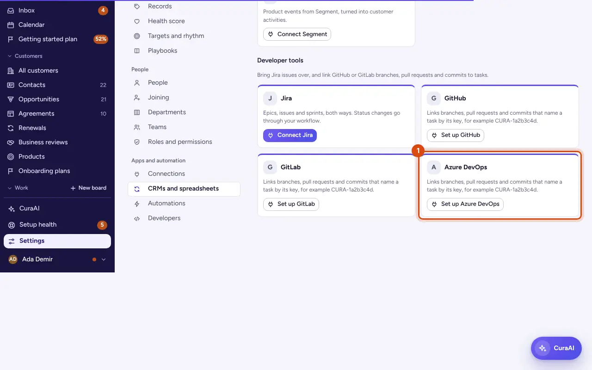
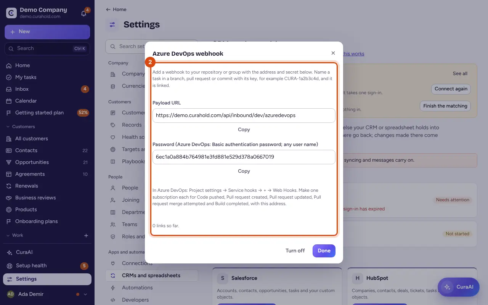

# Azure DevOps

Branches, pull requests and commits in Azure Repos that name a task are linked to it, with their state (open, merged, closed) and the build result. It works like GitHub and GitLab: put the task's key, for example `CURA-1a2b3c4d`, in the branch name, the pull request title or the commit message.

## In Curahold {#connect}

1. Open **Settings → CRMs and spreadsheets**, find **Developer tools** and click **Set up Azure DevOps**.
   
2. Click **Turn on**, then copy the **address** and the **password** it shows.
   

## In Azure DevOps

Do this once for each event (Code pushed, Pull request created, Pull request updated, Pull request merge attempted, Build completed):

1. Open the project → **Project settings** → **Service hooks** → **+** (Create subscription).
2. Choose **Web Hooks** and click **Next**.
3. Choose the event, leave the filters as they are, and click **Next**.
4. Paste the address into **URL**. Type any **Username** (for example `azure`) and paste the password into **Password**.
5. Leave **Resource details to send** on **All**, click **Test**, then **Finish**.

## Limits and timing

Links appear as soon as Azure DevOps sends them. Azure DevOps sends only over HTTPS and signs nothing: the password is the proof, so keep it like one.

## If something goes wrong

Azure DevOps shows each delivery's answer under **Service hooks → History**: 401 means the password is wrong (turn the webhook on again for a new one and update every subscription). **Turn off** stops new links; links already made stay on the tasks.

## See also

- [Webhooks](/docs/en/webhooks/)
- [Tasks](/docs/en/tasks/)
