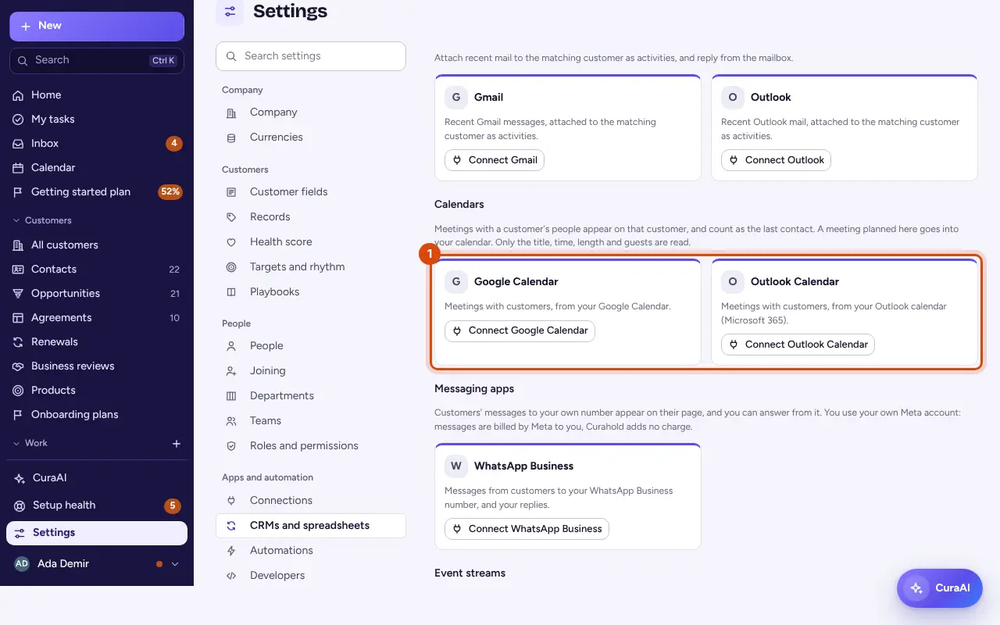

# Google Calendar and Outlook Calendar

Connect your calendar and every meeting you had with a customer's people appears on that customer's timeline, as a meeting with its length. It also counts as the last contact. From the customer's timeline you can plan a meeting straight into your calendar; the calendar sends the invitations.

## What is read, and what is not

Only meetings that already took place, from your main calendar: the title, the time, the length and the guests. Never the description, the place or the call link. Private meetings, all-day entries and meetings with no one from outside are left out. A meeting is filed under the customer whose contact is a guest, or whose web address is a guest's domain.

## In Curahold {#connect}

1. Open **Settings → CRMs and spreadsheets**, find **Calendars** and click **Connect Google Calendar** or **Connect Outlook Calendar**.
   

Google or Microsoft opens. Choose your work account and click **Allow** (Google) or **Accept** (Microsoft). Back in Curahold, click **Start**: the last 90 days are read, then every hour.

## Plan a meeting

On a customer's page, open **Timeline** and click **Plan a meeting in Google Calendar** (or Outlook). Type the title, the time, the length and the guests' emails, then click **Add to …**. The meeting appears on the timeline once it has taken place.

## Limits and timing

Read every hour; a renamed or cancelled meeting of the last week is updated or taken away. Google and Microsoft limit requests per minute: a busy answer pauses the read, which carries on next time.

## If something goes wrong

If the sign-in expires it is renewed on its own. If access was withdrawn (a changed password, an administrator's decision), the connection shows **Needs attention**: click **Reconnect** and sign in with the same account. **Remove** deletes the sign-in; meetings already on timelines stay.

## See also

- [Timeline and health](/docs/en/timeline-and-health/)
- [Connections](/docs/en/connections/)
