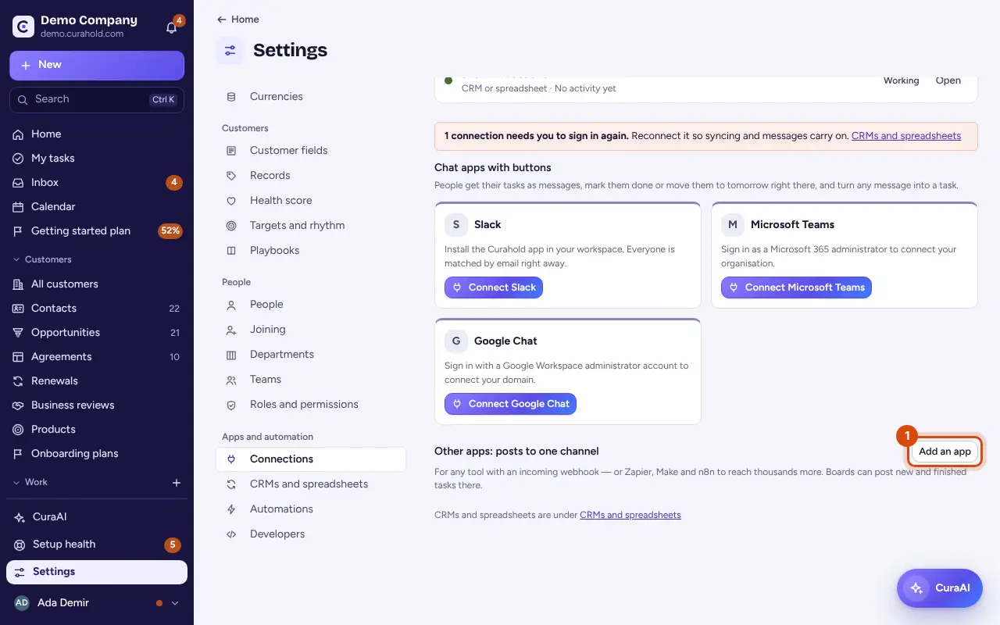
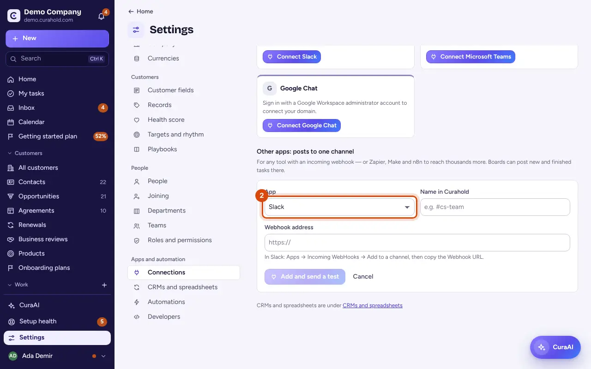

# Lark, Feishu and Telegram notifications

A board can post its news (a new task, a finished task) to a group chat. Lark and Feishu use a group's custom bot; Telegram uses a bot you make in two minutes. Both are one way: they post, nobody answers back through them.

## In Curahold {#connect}

1. Open **Settings → Connections** and click **Add an app**.
   
2. Choose **Lark · Feishu** or **Telegram** under **App**, paste what the steps below give you, and click **Add and send a test**. A test message arrives in the group.
   

Then open the board, choose **Board settings → Notifications** and pick the new connection for the news you want.

## Lark or Feishu

1. In the group, open **Settings → Bots → Add bot → Custom bot**, give it a name and click **Add**.
2. Copy the **webhook address**. It looks like this:

```text
https://open.larksuite.com/open-apis/bot/v2/hook/0f3c2a9e-7d1b-4c55-9a7e-2b8f6c1d3e4f
```

3. Optional, recommended: under **Security settings** tick **Signature verification** and copy the secret into **Signing secret** in Curahold. Do not use a keyword filter: messages would be dropped.

## Telegram

1. In Telegram, write to **@BotFather**, send `/newbot`, answer its two questions and copy the **token** it gives.
2. Add the bot to your group (for a channel: add it as an administrator).
3. Send one message in the group. Curahold finds the group from it, so you do not need its id.
4. Paste the token into **Bot token** in Curahold. For a public channel you can type its `@name` instead.

## Limits and timing

Lark accepts about 100 posts a minute per bot and Telegram about 20 a minute per group; a busy answer is retried, not lost. Telegram messages are plain text, up to 4,096 characters.

## If something goes wrong

A wrong signing secret, a removed bot or a revoked token marks the connection **Needs attention** in Settings → Connections, and the test says so. Fix it on the other side, then click **Send a test** again: a working test clears the problem. **Remove** stops the posts; the bot stays in your group until you remove it there.

## See also

- [Connections](/docs/en/connections/)
- [Notifications](/docs/en/notifications/)
