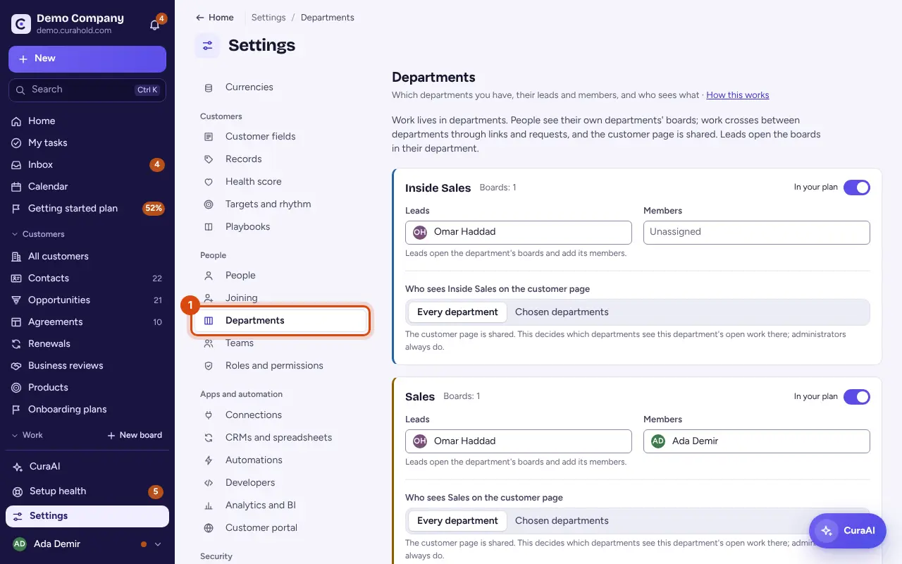
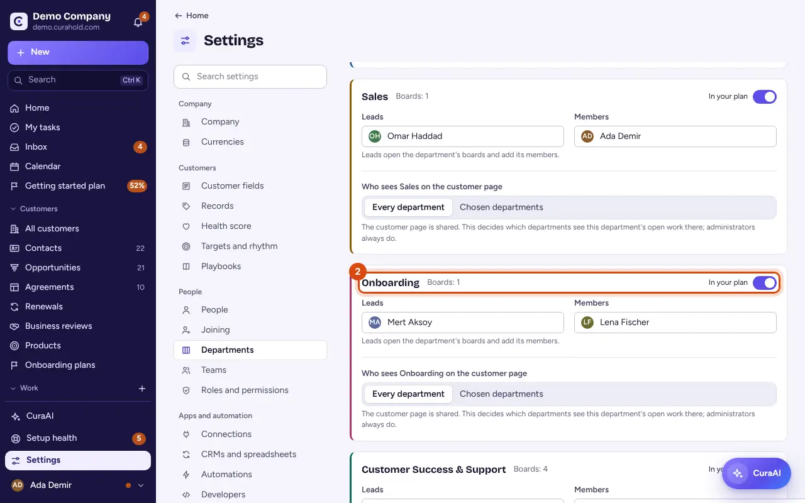
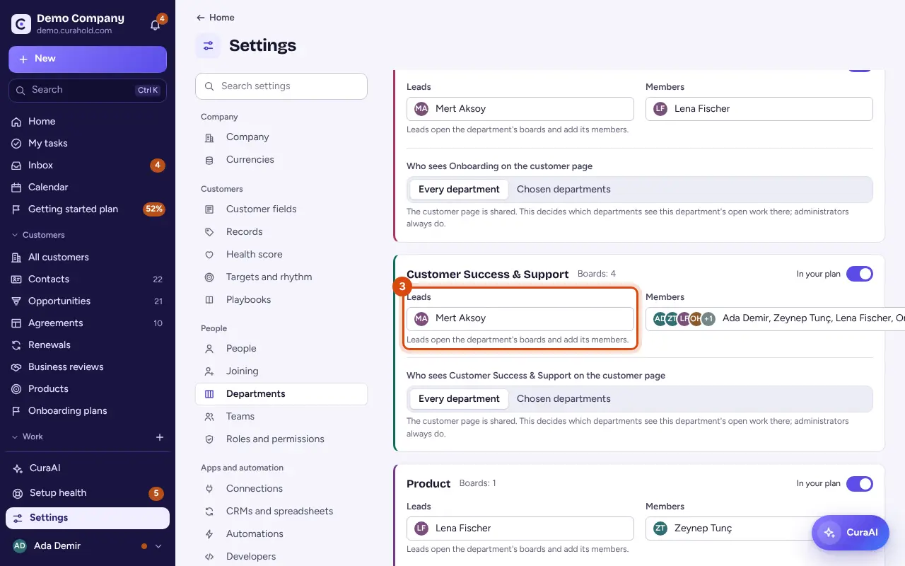
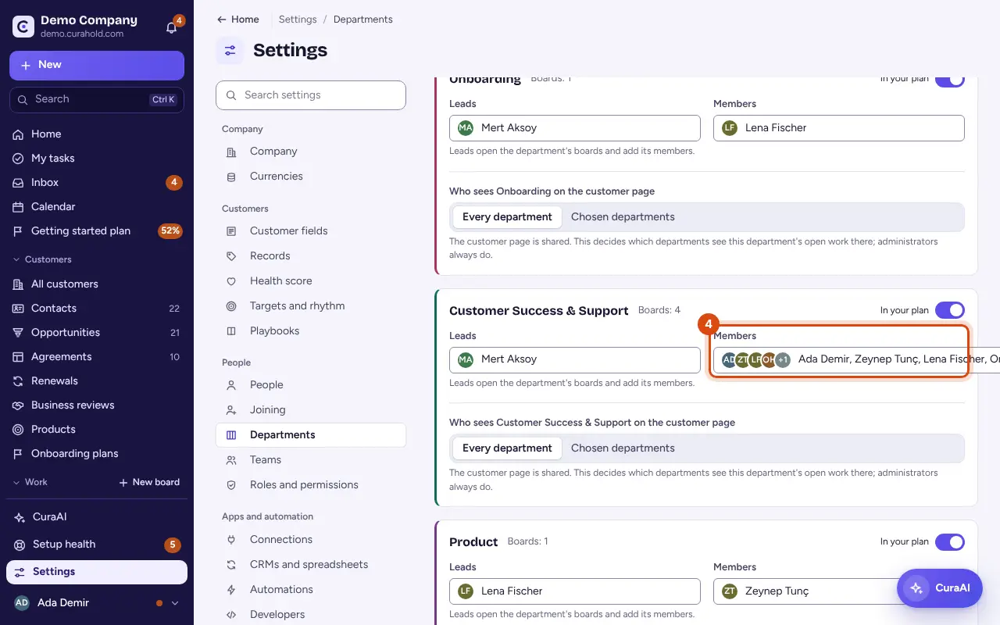
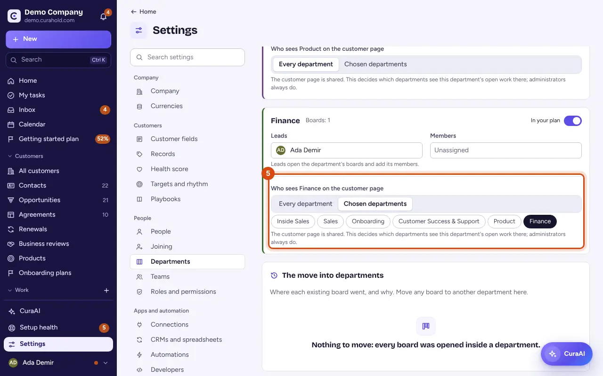
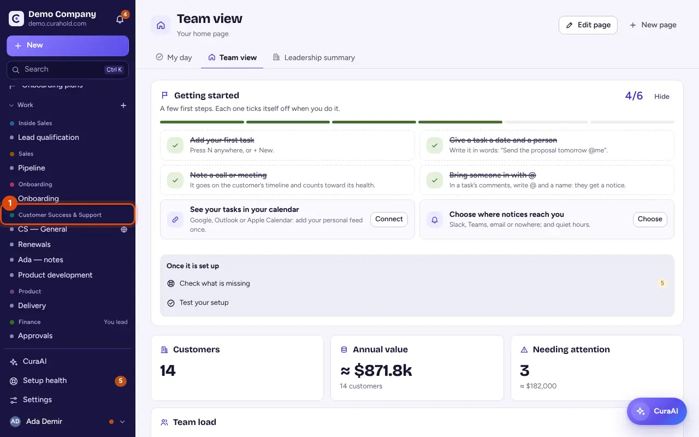
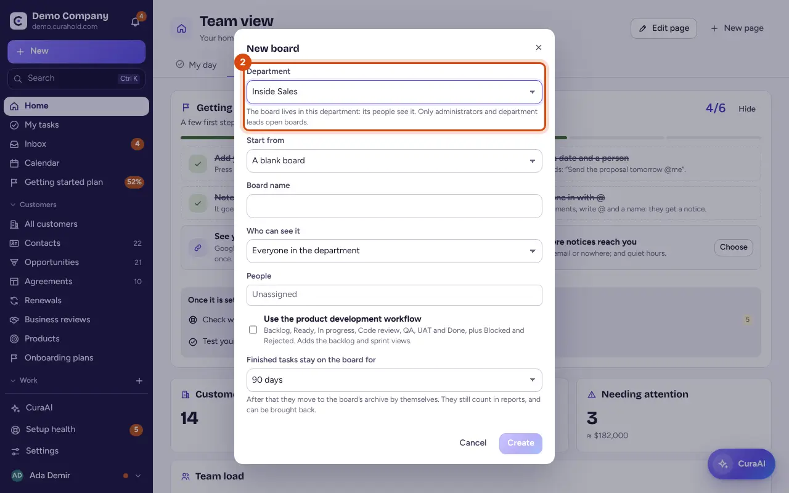
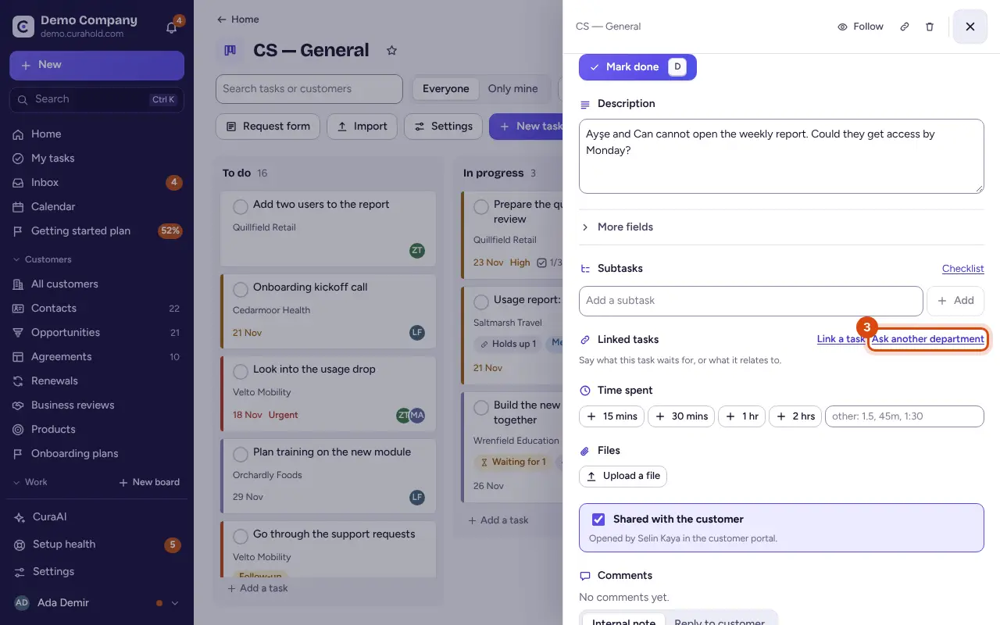
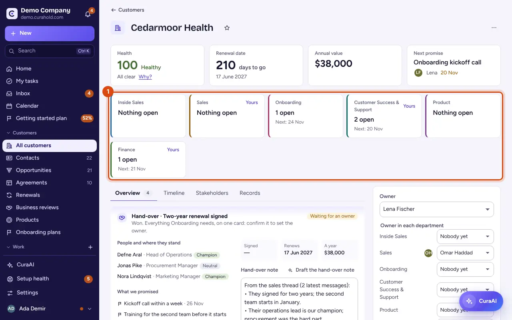
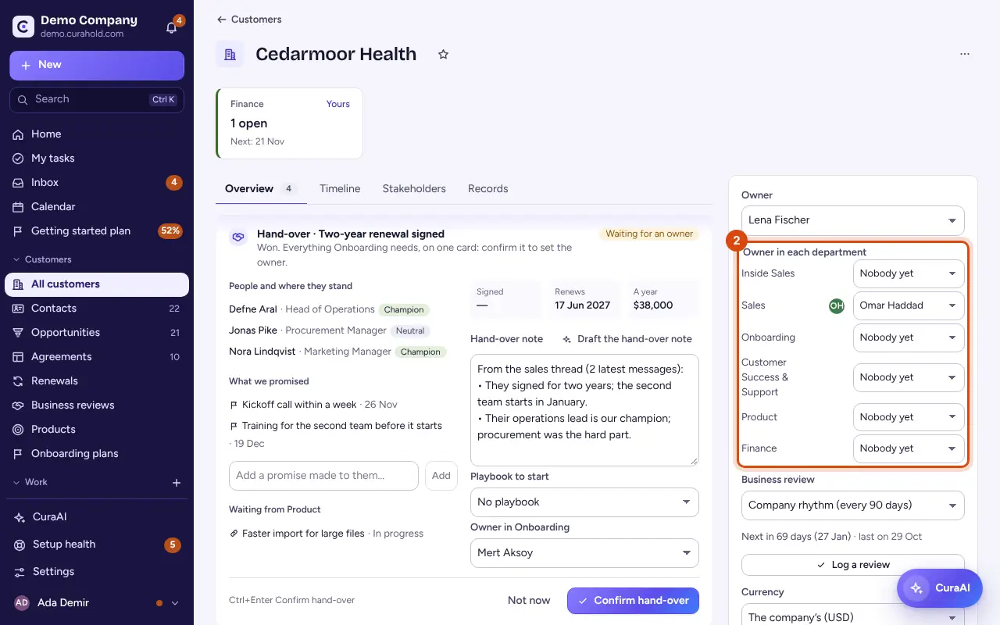

# Departments

Work in Curahold lives in departments: Inside Sales, Sales, Onboarding, Customer Success & Support, Product and Finance. Each person sees the boards of their own departments. Work crosses to another department through a request, and the customer's page is shared by everyone who may see that customer.

## Set up your departments {#set-up}

You need to be an administrator (or someone who manages people).

1. In the menu on the left, click **Settings**, then **Departments** (under **People**).
   
2. Leave **In your plan** on for every department your company has. Switch it off for one you do not use: it is hidden from everyone, and its boards are kept until you switch it on again.
   
3. Under **Leads**, pick who leads the department. Leads open the department's boards and add its members.
   
4. Under **Members**, pick everyone else who works in it. A person can be in more than one department.
   
5. Under **Who sees … on the customer page**, choose **Every department**, or **Chosen departments** and click the ones that may see this department's open work there. Administrators always see it. Finance starts as Finance only.
   

Everything is saved as you go. A person who is in no department yet keeps their own work in **My tasks** until you add them.

When your company moved into departments, every existing board was placed in one. **The move into departments**, at the bottom of the same page, shows where each board went and why; change a board's department there. **People to place** lists people who could see a board before and do not work on it: **Give access** makes them members.

## Boards in a department {#boards}

1. In the menu, the boards are grouped under their department's name. **You lead** is shown next to a department you lead.
   
2. To open a new board, click **+** next to **Work**. In **Department**, choose where the board lives, then give it a name and click **Create**. Only administrators and department leads open boards.
   

**Who can see it** is **Everyone in the department** by default; you can narrow it to a team or chosen people.

## Ask another department {#ask}

1. Open the task the request is about and click **Ask another department**. Pick the department's board in the list, fill in its request form and send it.
   

The request lands on that department's board and is linked to your task. You see its title and where it stands, never the other department's board. A department takes requests once its lead turns on a board's request form (**Board settings → Fields and request form**).

## On the customer's page {#customer-page}

1. On a customer's page, **Across departments** shows each department's open work for that customer, how much is late and the next due date. **Yours** marks the departments you are in.
   
2. On the right, **Owner in each department** shows who looks after the customer in each department. Choose a person to set one.
   

Hand-overs between departments (a won deal going to Onboarding or Customer Success) are on [Hand-over, requests and the loop back](/docs/en/handover-and-requests/).
