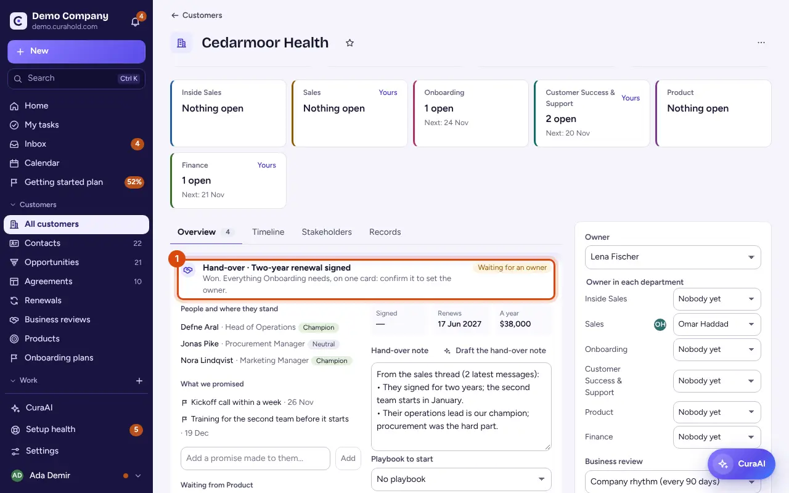
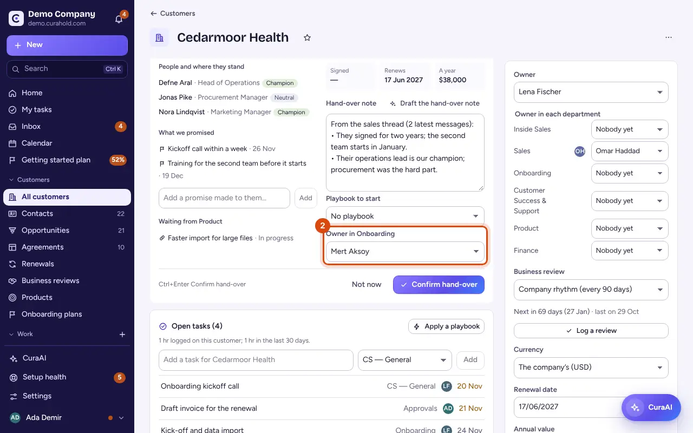
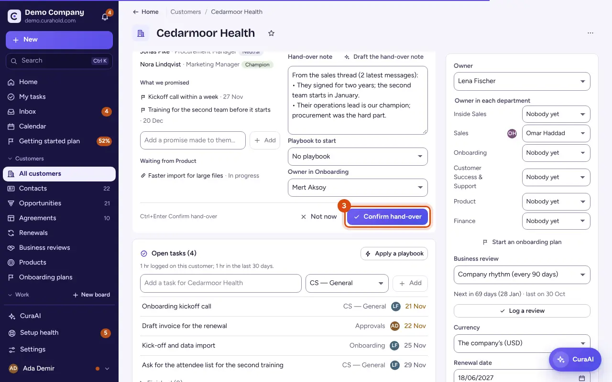
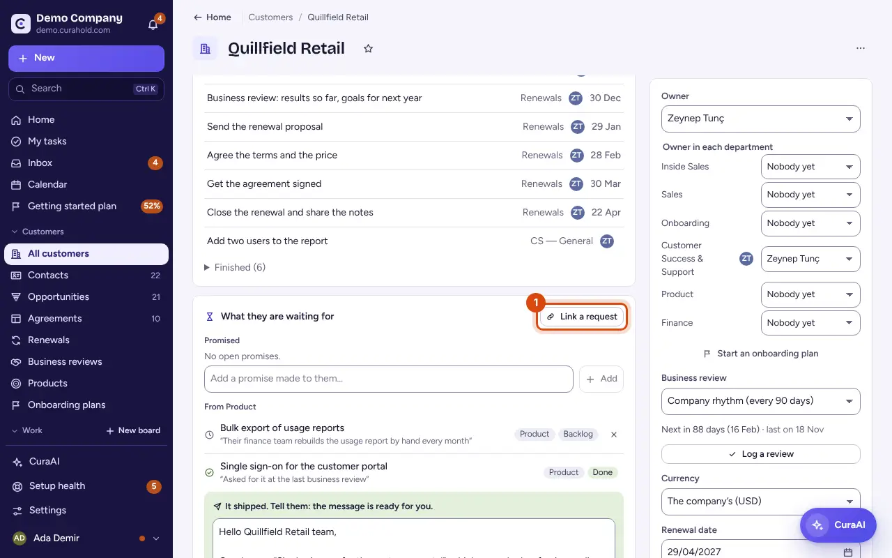
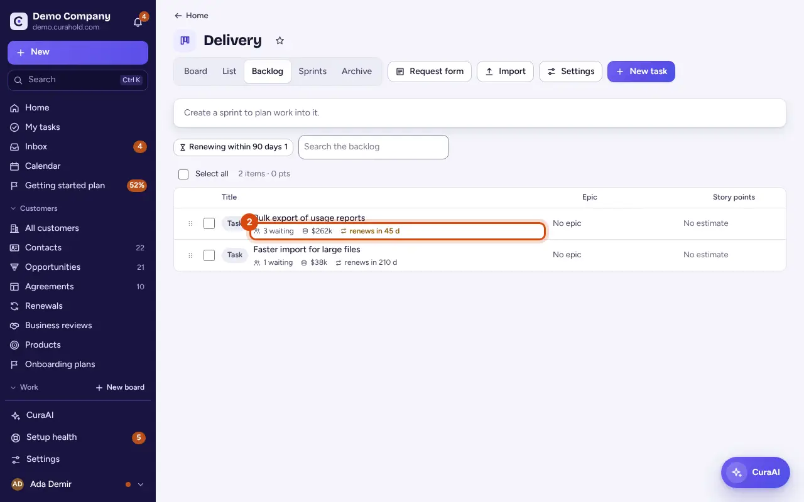
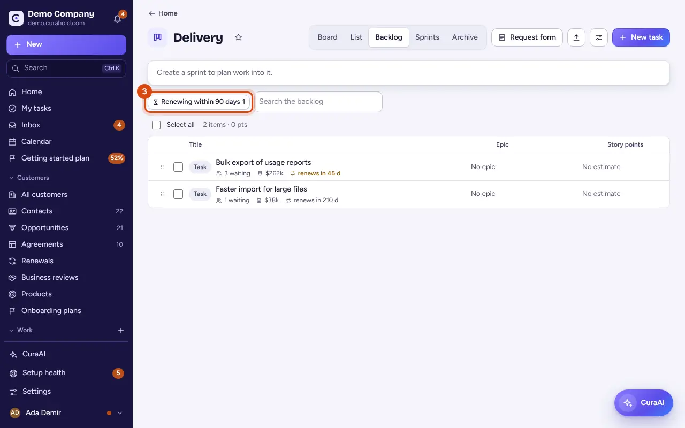
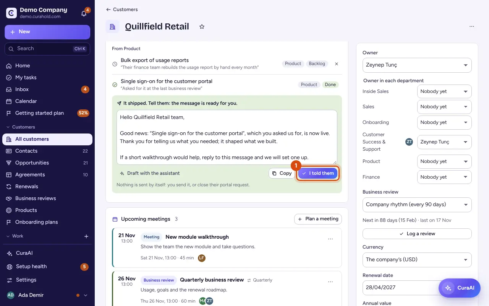
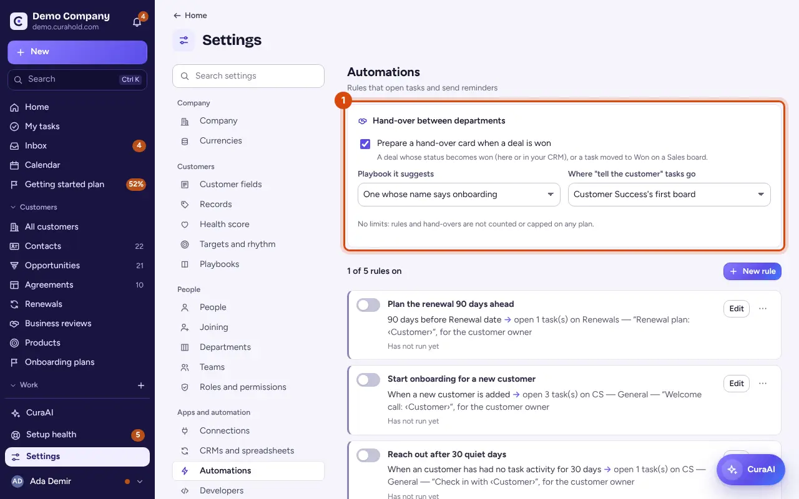

# Hand-over, requests and the loop back

Work moves from Sales to Onboarding or Customer Success, and from customers to Product. Curahold keeps what each team needs on the customer's page, so nothing is retyped and nobody has to open another department's board.

## When a deal is won {#handover}

A deal whose status becomes **won** (here or in your CRM), or a task moved to **Won** on a Sales board, gets one **hand-over card** on the customer's page. It goes to **Onboarding** when your company has that department, otherwise to **Customer Success**.

1. Open the customer's page. The card is at the top of **Overview**, marked **Waiting for an owner**. Read it: the people and where they stand towards you, what Sales promised, what the customer still waits for from Product, the dates, the yearly value (if you may see that field) and the hand-over note from the sales thread.
   
2. In **Owner in …**, choose who takes the customer over. Check **Playbook to start** next to it.
   
3. Click **Confirm hand-over** (or press Ctrl+Enter, ⌘+Enter on a Mac). The owner is set, the playbook starts, the owner is told, and the customer's timeline records both steps.
   

**Not now** puts the card away. **Draft the hand-over note** asks the assistant to write the note; you read and change it before anything is saved.

## Link a customer's request to product work {#requests}

1. On the customer's page, under **What they are waiting for**, click **Link a request**. Search Product's work, pick the story, and add what they asked in their own words if you like. If nothing fits, ask Product for it from the same window.
   

Many customers can wait for the same story; each one counts. Anyone who can see the customer sees the work's title, status, sprint end and department, never Product's board.

## What Product sees {#backlog}

1. On a Product board, open **Backlog**. Under each story: how many customers wait for it, what they are worth a year (only to people who may see that field) and the nearest renewal.
   
2. Click **Renewing within 90 days** to see only the work that customers renewing soon are waiting for, nearest renewal first.
   

## When it ships {#shipped}

When a linked story is finished, each customer's owner gets a task, and the customer's page shows a ready message under the story.

1. Read the message, change it if you like, click **Copy** and send it from your own e-mail or chat. Then click **I told them**. If the customer asked through the portal, **Close their portal request** closes it there too.
   

**Nothing is sent by itself.** The timeline says "built for them", and the renewal's summary lists it.

## Settings (administrators) {#settings}

1. Open **Settings → Automations**. Under **Hand-over between departments**, choose whether a won deal gets a hand-over card, the playbook it suggests and where "tell the customer" tasks go.
   

## Drafts from the assistant

The hand-over note, the "it shipped" message and the promises and next steps of a meeting can be drafted by the assistant. You read and change each draft before anything is saved, Undo takes it back, and without the assistant (or over its monthly limit) the draft comes from the template.

## Rules

Rules can start when a task is added or finished, a request arrives through a form, a record reaches a stage or a support ticket opens, and can assign, move, set a field, comment, send to your webhooks or prepare the hand-over. Rules are never counted or capped.
