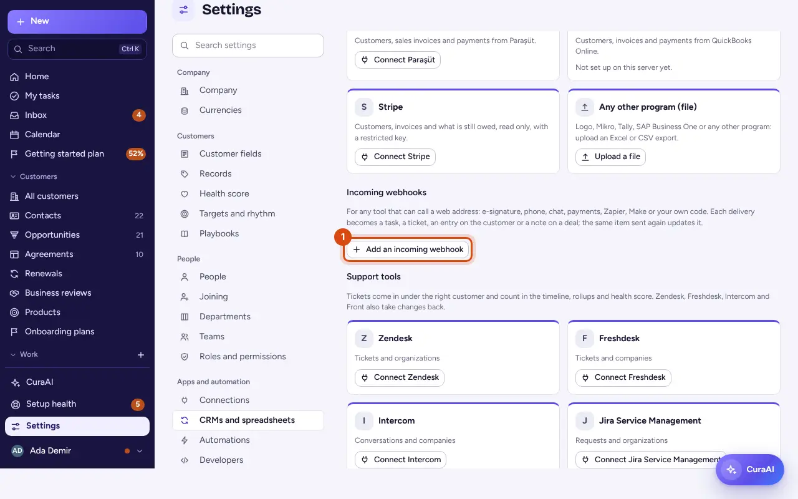
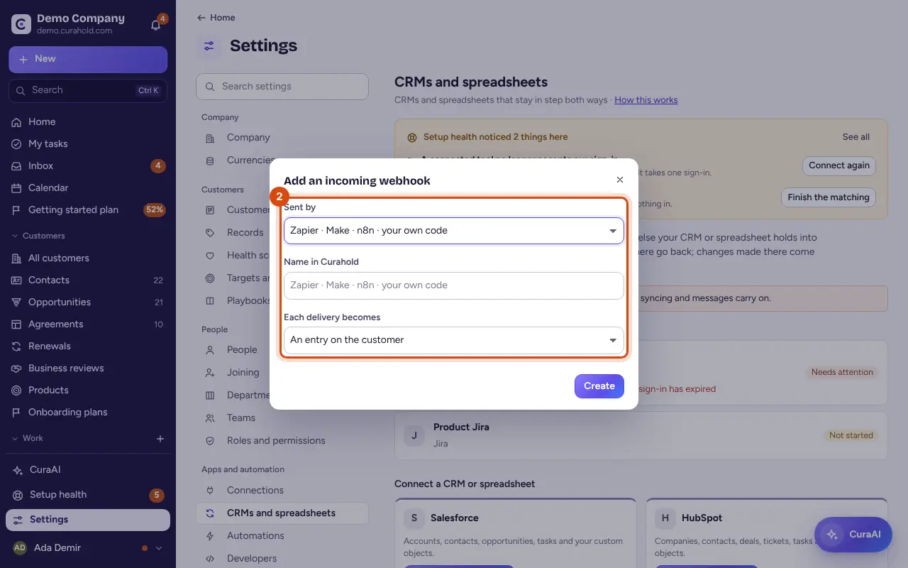
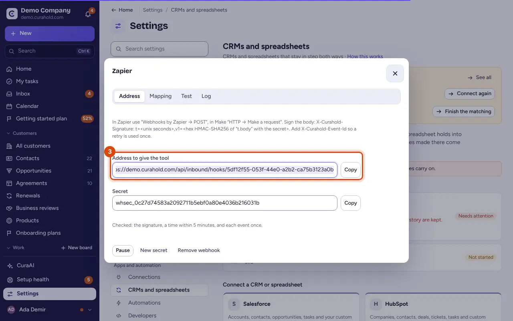
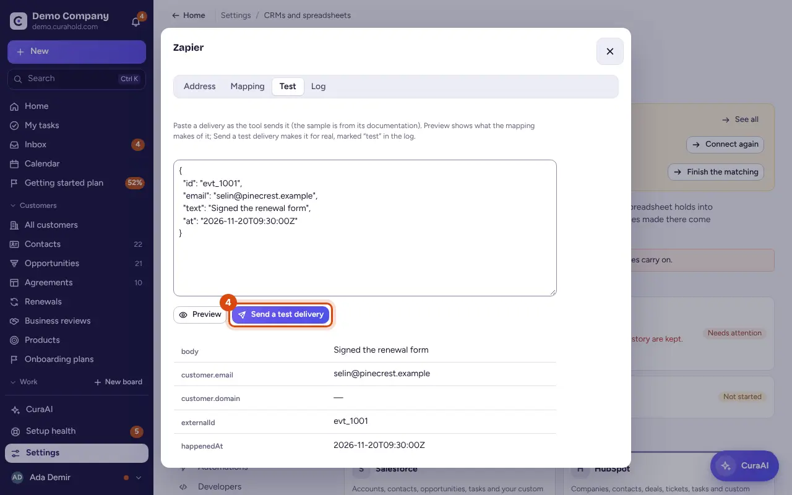
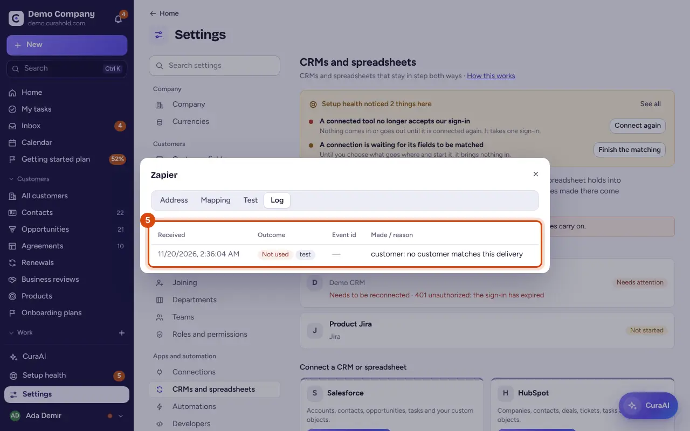

# Incoming webhooks

For tools Curahold has no ready connector for. The tool posts to an address of yours; each delivery becomes a **task**, a **support ticket**, an **entry on the customer's timeline** or a **note on a deal**. The same item sent again updates what it made. Every delivery is checked: a signature (or a shared token), its time, and each event used once.

## In Curahold {#connect}

1. Open **Settings → CRMs and spreadsheets**, scroll to **Incoming webhooks** and click **Add an incoming webhook**.
   
2. Under **Sent by**, choose the tool (or **Zapier · Make · n8n · your own code**), check **Each delivery becomes**, and click **Create**.
   
3. On **Address**, copy the address and the secret into the tool.
   
4. On **Test**, click **Preview** to see what the mapping makes of the sample, then **Send a test delivery**.
   
5. On **Log**, check each delivery: used, skipped, not used (with the reason) or refused.
   

## Mapping

Each value is text with `{{path}}` for a value from the delivery, for example `{{data.envelopeSummary.status}}` or `{{items[0].email}}`. The customer is found by a contact's email, then a web address, then the name. **The tool's id for the item** makes "create or update" work. **Use only when this value…** skips other events (they are logged as skipped).

## Ready-made recipes

| Tool | Signed with | Becomes |
| --- | --- | --- |
| E-signature (DocuSign Connect; CloudSign, Modusign, Leegality the same way) | `X-DocuSign-Signature-1`, HMAC-SHA256, base64, the key you make in the tool | a note on the deal |
| Aircall | the webhook's token in the body | a call on the customer |
| Tawk.to | `X-Tawk-Signature`, HMAC-SHA1, hex | a ticket |
| Razorpay (iyzico the same way) | `X-Razorpay-Signature`, HMAC-SHA256, hex | an entry on the customer |
| Freshchat, Kylas, Sansan and anything else | a shared token (`X-Curahold-Token` or `?token=`) | your choice |

## Signing it yourself (Zapier, Make, n8n, code) {#sign}

Send `X-Curahold-Signature` and `X-Curahold-Event-Id`:

```text
X-Curahold-Signature: t=1763631000,v1=<hex HMAC-SHA256 of "1763631000.<raw body>" with the secret>
X-Curahold-Event-Id: evt_1001
```

In code (Node.js):

```js
const t = Math.floor(Date.now() / 1000);
const v1 = crypto.createHmac('sha256', secret).update(`${t}.${body}`).digest('hex');
fetch(address, { method: 'POST', body, headers: { 'content-type': 'application/json', 'x-curahold-signature': `t=${t},v1=${v1}`, 'x-curahold-event-id': id } });
```

The time must be within 5 minutes. A repeated event id is answered `200` with `duplicate` and not used again. Answers: `200` (with `status` ok, skipped or failed), `401` (signature, time or token), `404` (unknown or paused). Full list: [API reference](/docs/en/ref-developer-settings/).

## Zapier and Make recipes for tools without a connector yet

Use the tool's trigger, then **Webhooks by Zapier → POST** (Zapier) or **HTTP → Make a request** (Make) to the address above, with the two headers. Make's **Custom JS** or Zapier's **Code** step computes the signature (the snippet above).

| Tool | Trigger | Body fields to send | Becomes |
| --- | --- | --- | --- |
| LINE WORKS | New message in a bot channel | `id`, `email` of the sender, `text` | entry |
| Chatwork | New message in a room | `id`, `email`, `text` | entry |
| kintone | Record added or edited | `id`, `email`, `title`, `status` | task |
| Money Forward Cloud | Invoice created or paid | `id`, `email`, `text` (number, amount, due date) | entry |
| Channel Talk | Chat closed | `id`, `email`, `title` | ticket |
| KakaoWork | Bot message | `id`, `email`, `text` | entry |
| LeadSquared | Lead or opportunity updated | `id`, `email`, `title`, `status` | task |
| Razorpay | Payment captured | `id`, `email`, `text` | entry (or use the recipe) |
| DingTalk | Robot message | `id`, `email`, `text` | entry |
| WeCom | App message | `id`, `email`, `text` | entry |

## Keeping and removing

The log keeps 30 days and at most 500 deliveries per webhook. **New secret** stops the old one at once; **Pause** answers `404` until resumed; **Remove webhook** deletes it and its log, and what it made stays. A webhook acts with the rights of the person who set it up: it reaches only boards and customers they can, and stops if they leave.

## When a delivery is refused or not used {#log}

The **Log** tab says what happened to each delivery, in your language: a wrong signature or token (copy the secret from **Address** into the tool again), sent too long ago (a replayed delivery is refused the same way), a value this webhook does not use, no matching customer, or a field that came out empty (check **Mapping**). The same delivery sent twice, such as a retry from Zapier or Make, is kept once. A task webhook's board can be changed on **Mapping** under **Board**: the address stays the same, so nothing changes in the sending tool.

## See also

- [Webhooks (outgoing)](/docs/en/webhooks/)
- [Connect your own tool](/docs/en/connect-your-own-tool/)
