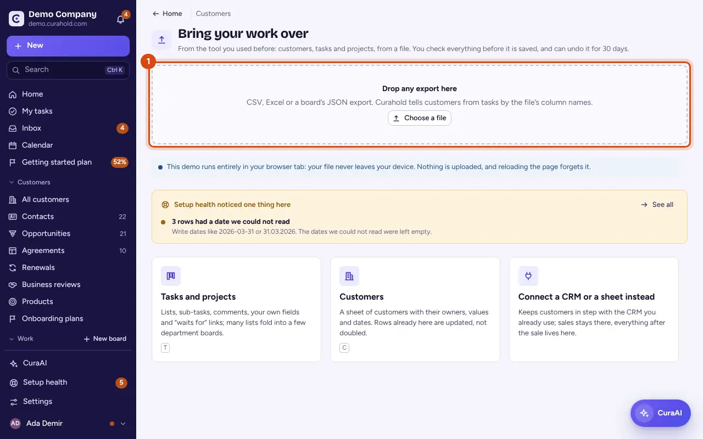
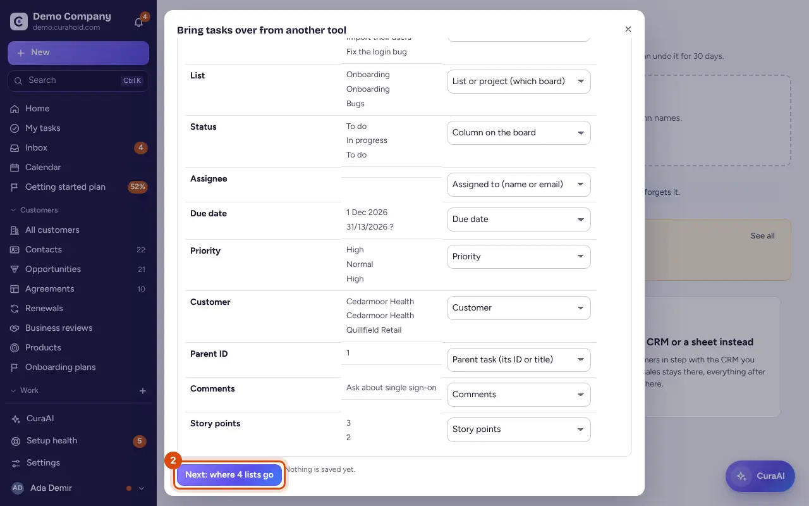
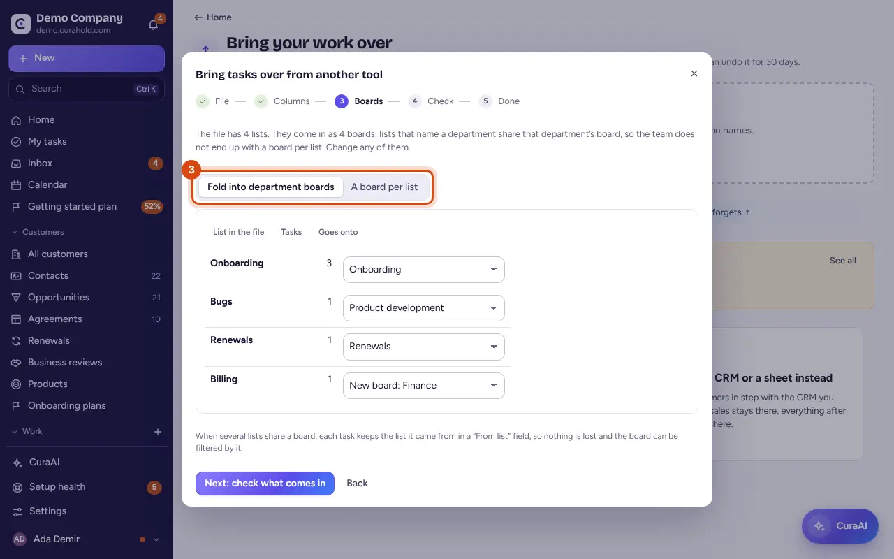
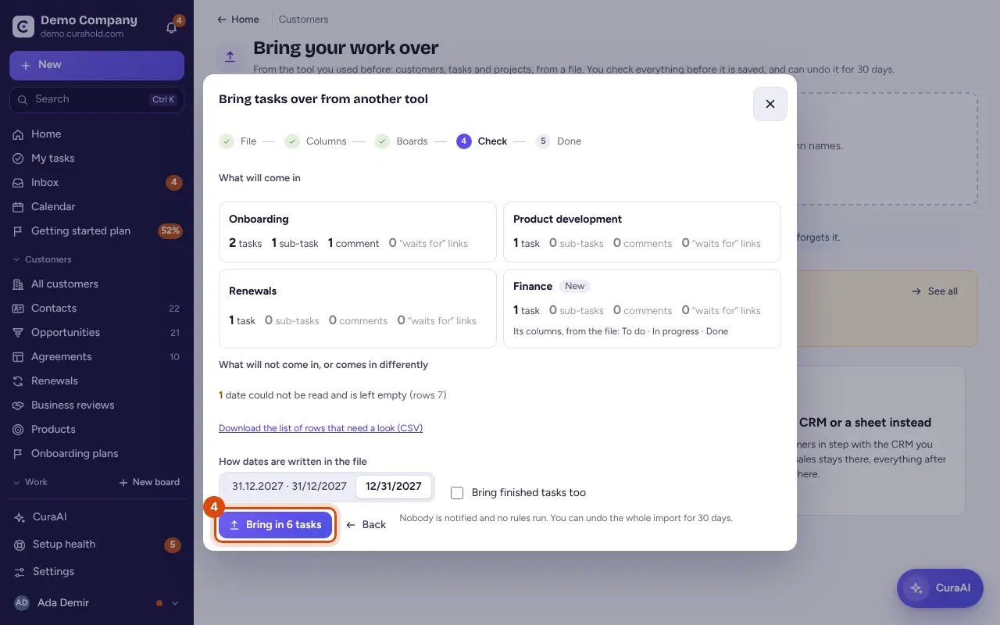
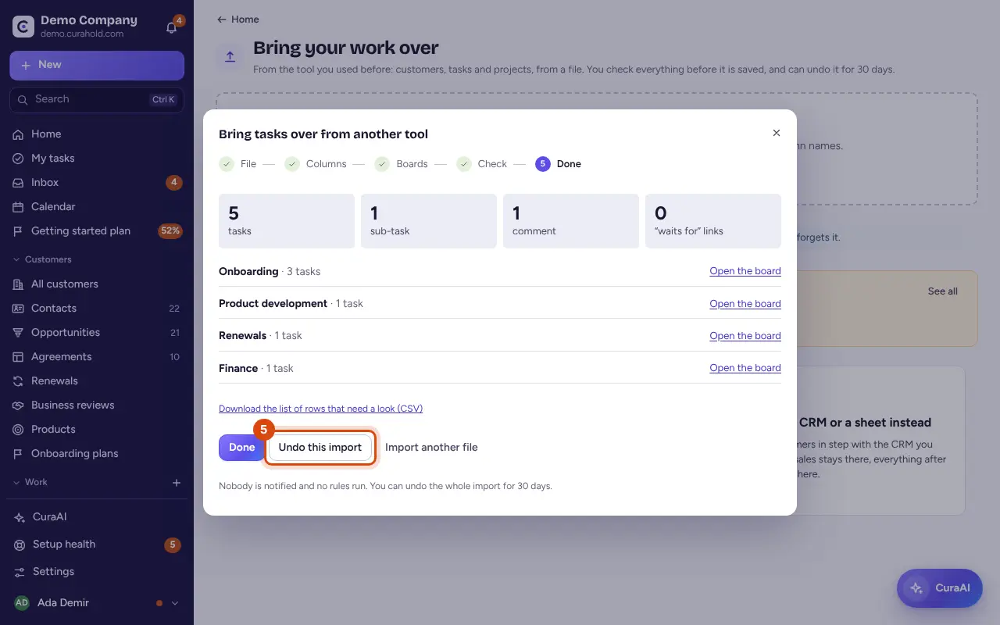

# Moving in from another tool

Export your work from the tool you used before (a CSV, an Excel sheet (.xlsx) or a kanban board's JSON export) and bring it over from that file. Nothing is saved until the last step, nobody is notified and no rules run: this is moving house, not new work.

## Bring your tasks over {#tasks}

1. Open **Bring your work over**: type "import" in search (Ctrl K, or ⌘ K on a Mac), or use the up-arrow button on a board. Drop your file on **Drop any export here**, or click **Choose a file**. Curahold tells customers from tasks by the file's column names; press **T** for tasks or **C** for customers to choose yourself.
   
2. **Columns.** Each column of your file is matched to where it goes: title, description, column on the board, people, dates, priority, customer, story points, the old tool's ID, the parent task, comments, "waits for" links, or a field of its own. The first values show what each will become. Change any that is wrong, then click **Next**.
   
3. **Boards.** If the file has many lists, they fold into a few department boards: a list named "Renewals" goes to Customer Success, "Bugs" to Product. Click **A board per list** to keep them apart, or pick any board for any list. Each task keeps the list it came from in a **From list** field. Click **Next: check what comes in**.
   
4. **Check.** Read, board by board, how many tasks, sub-tasks, comments and links will come in, and, with row numbers, what will not come in or comes in differently. **Download the list of rows that need a look (CSV)** if you want to fix them in your file first. Then click **Bring in … tasks**.
   
5. **Done.** Each board has an **Open the board** link. If something is not what you wanted, click **Undo this import**.
   

Curahold understands a title line above the headings, groups with the headings repeated under each, and sub-items indented under their item.

## Undo {#undo}

**Undo this import** works for 30 days, from the result or from **Your earlier imports** on the first step. Tasks nobody has touched go to the trash as one item; a task someone has changed or commented on since is kept, in its board's archive. A board made for the import and left empty is put away.

## Template {#template}

**Download a template** on the first step gives a file with every column Curahold reads and three example rows. It opens in Excel. Its first line (Region is an example of a column of your own):

```text
ID,Title,Description,List,Status,Assignee,Due date,Priority,Customer,Parent ID,Comments,Depends on,Story points,Region
```

## In the demo

The demo runs entirely in your browser tab. **Try your own file** in the demo bar opens the same page: your file is read in the tab and never leaves your device, and reloading the page forgets it.
