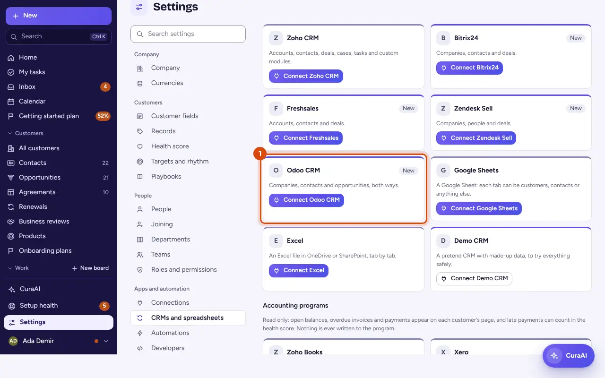

# Odoo CRM

Companies, their contacts and opportunities from Odoo Online, Odoo.sh or your own server, kept in step both ways: a change in Odoo arrives within the hour, a change in Curahold goes back at once.

## In Curahold {#connect}

1. Open **Settings → CRMs and spreadsheets** and click **Connect Odoo CRM** on its tile.
   

Then fill in the four fields and click **Check and connect**:

- **Odoo address**, for example:

```text
https://yourcompany.odoo.com
```

- **Database name**: only on Odoo.sh or your own server with several databases.
- **Login (email)**: the Odoo user whose rights Curahold works with.
- **API key**: see below.

Next, tick **Companies**, **Contacts** and **Opportunities**, check the suggested field pairs and click **Start syncing**. An opportunity counts as won at 100 % probability and lost when Odoo archives it.

## In Odoo

1. Click your picture (top right) → **Preferences** (in Odoo 17 and later: **My Profile**).
2. Open **Account Security** and click **New API Key**.
3. Type a name (for example `Curahold`), choose how long it lasts and click **Generate key**.
4. Copy the key. Odoo shows it once.

On Odoo Online, API access needs the **Custom** plan (Odoo's rule). The CRM app must be installed.

## Limits and timing

Odoo publishes no fixed limit; Curahold keeps to about two requests a second. Odoo 19 and later answer on the JSON-2 API; older versions on JSON-RPC, which Odoo removes in version 20. A key can last at most three months in Odoo 19: make a new one and reconnect before it runs out.

## Conflicts, errors and disconnecting

When both sides changed the same field, the rule chosen for the connection decides (by default the later change). A rejected value waits on the connection's **Status** tab with Odoo's own message. A revoked or expired key marks the connection **Needs attention**: paste a new key with **Reconnect**; the mapping stays. **Remove** deletes the key; customers and records already brought over stay in Curahold.

## See also

- [Connections](/docs/en/connections/)
- [Odoo (accounting)](/docs/en/accounting-odoo/)
