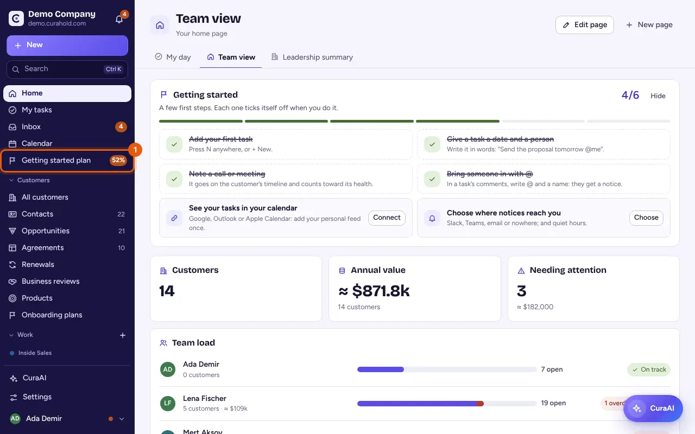
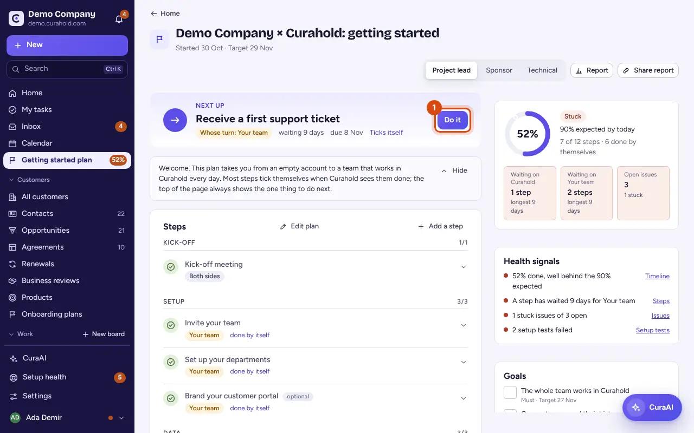
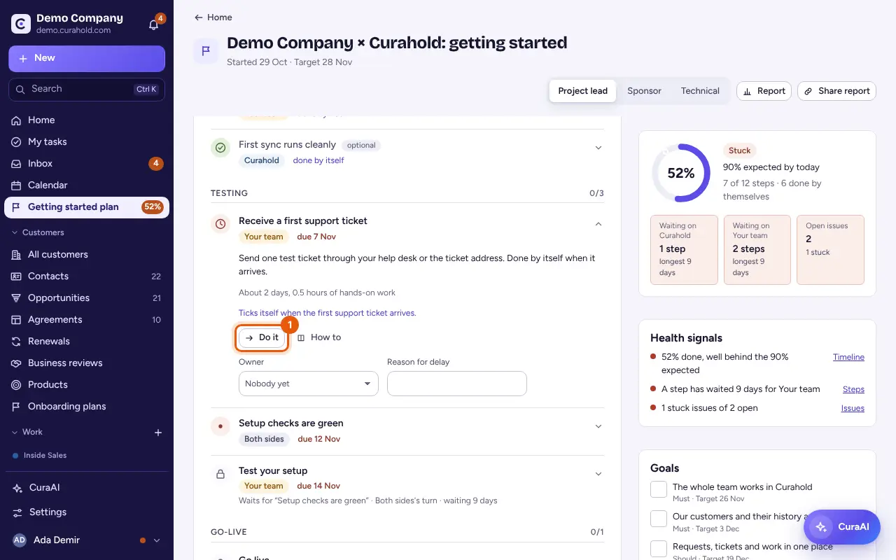
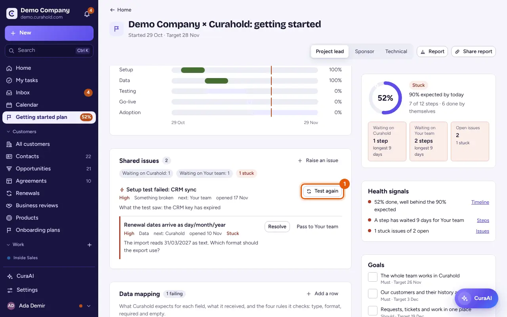
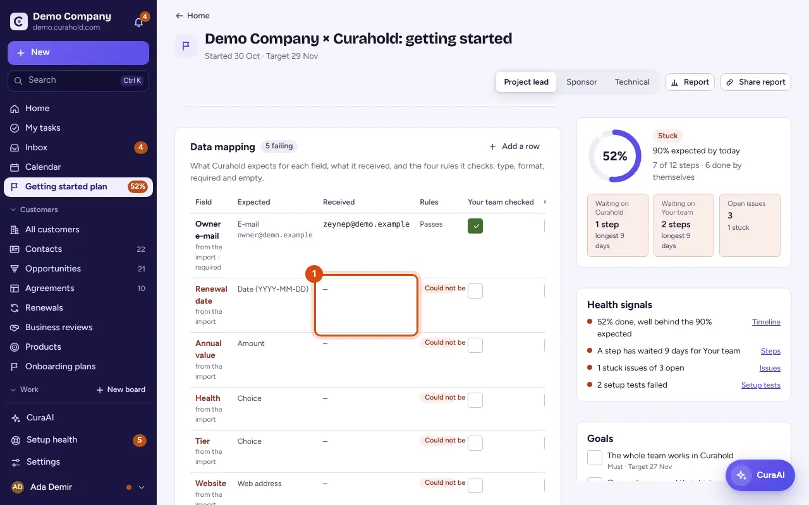
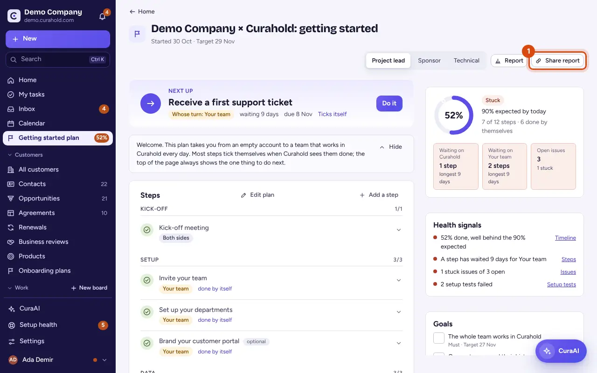
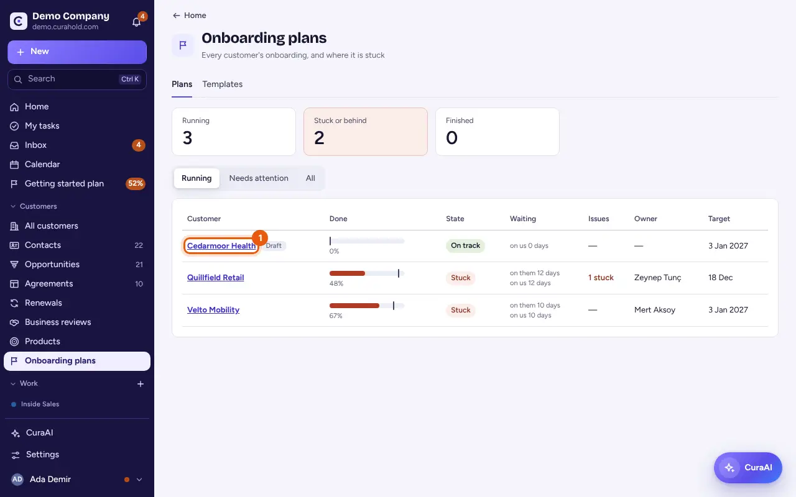
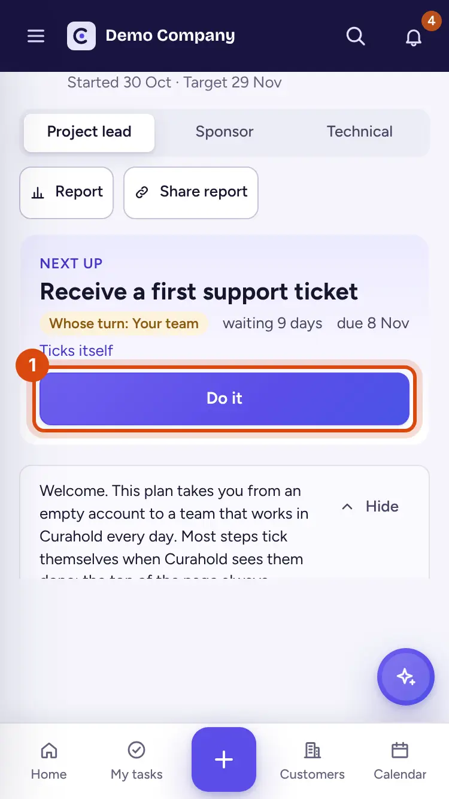

# Onboarding plan

The onboarding plan is one page that two sides work on together. Your company uses it to get started with Curahold, and you use the same plan for each customer you onboard. Most steps tick themselves when Curahold sees them done; you tick by hand only what Curahold cannot see, such as a meeting.

## 1. Open your plan {#start}

Click **Getting started plan** in the left menu. The number next to it is how much is done.



Your plan lives at your company's own address:

```text
https://<your-company>.curahold.com/onboarding
```

## 2. Do the next thing {#next}

The card at the top always shows the one thing to do next, whose turn it is and how long it has waited. Click **Do it**: Curahold opens the screen where it is done.



## 3. Open a step {#team}

Click any step to see what it is for, how long it takes and whether it ticks itself. A step with a lock waits for another one; the line under it says which one and whose turn it is. Click **Mark done** only on steps Curahold cannot see.



Steps that tick themselves: your team invited, departments set up, an import that brought rows in, a connection authorised and its last run without an error, the first support ticket, the portal turned on with your logo or colour, the setup checks green and every setup test passed.

## 4. Fix a shared issue {#health}

Shared issues are the questions and problems between the two sides. Each one says whose move it is; one open for five days or past its date is marked **Stuck**. A setup test that failed appears here once. Click **Test again** after you fixed it: when the test passes, the issue closes by itself.



## 5. Check your data {#mapping}

The data table shows, for each field, what Curahold expects, what it received and the four rules it checks: type, format, required and empty. A failing row says which rule failed. When the value is right, tick your side's box.



Dates are written like this:

```text
2027-03-31
```

## 6. Name the people {#people}

Under **People of both sides**, click **Add a person** and give their role. Each step can have one owner; Curahold reminds that person in the app when it is their turn, and again if the step stalls. Reminders by e-mail are off unless an administrator switches them on.

## 7. Share the progress report {#report}

Click **Share report** and copy the link. Whoever has it sees the progress report (no notes, no contact details). Open **Report** to print it or save it as a PDF.



## 8. Your customers' plans {#customers}

Click **Onboarding plans** under Customers. When a deal is won, a draft plan opens by itself with a hand-over note; it starts when the hand-over is confirmed. The list shows every plan, how far it is, who is waited on and which are stuck. Click a customer to open its plan.



Your customer sees the same plan in your portal, in your colours: they tick their own steps, fill in short forms that go straight to their record, check their data rows and raise issues. When it is done, click **Finish and hand over**: the health score is kept as a baseline and Customer Success gets a hand-over card.

## On a phone

The same page, one column: the next thing first.


