# Setup health and testing your setup

Two screens help you finish setting up without guessing. **Setup health** tells you what is missing or wrong. **Test your setup** lets you try everything the way your team will. Nothing is changed for you: every fix is a button that opens the right screen, and you do the rest.

## Find what is missing

1. In the menu on the left, click **Setup health**. The number next to it is how many things are worth a look. It disappears when everything is right.
   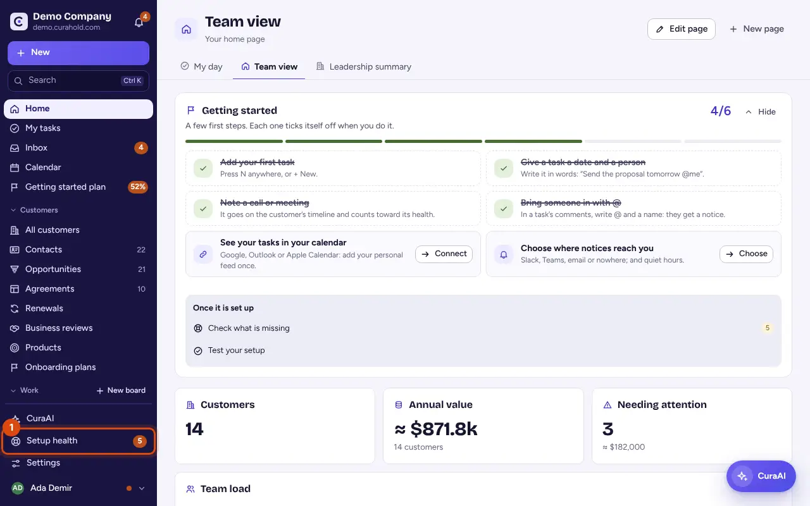
2. Read the first line. The most important comes first: **Fix first**, then **Worth fixing**, then **When you have a minute**. Each line says what we noticed and why it matters.
   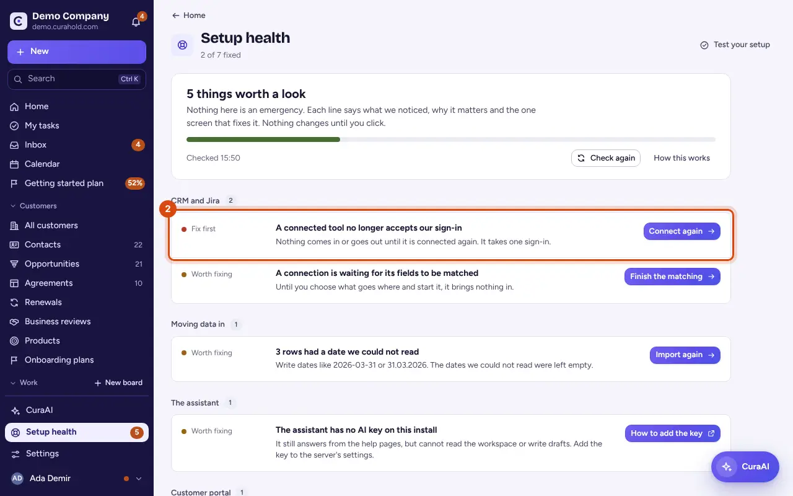
3. Click the button on that line. It opens the exact screen where you fix it.
   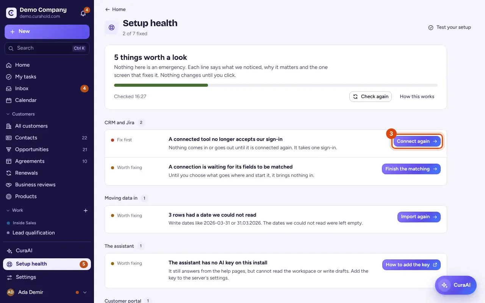
4. When you have fixed it, come back and click **Check again**. The line moves to **Fixed**, and the top of the page says how many are fixed.
   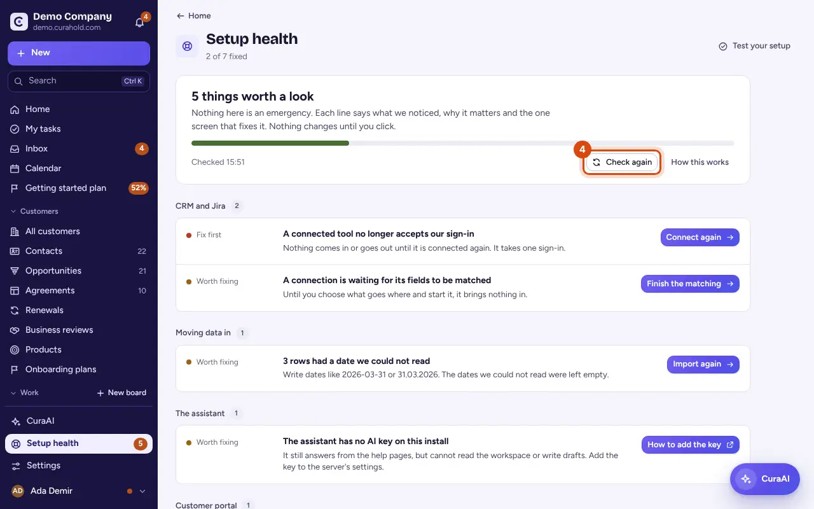
5. You also see a problem on the screen that fixes it, in a yellow box at the top. Click **See all** to open the full list.
   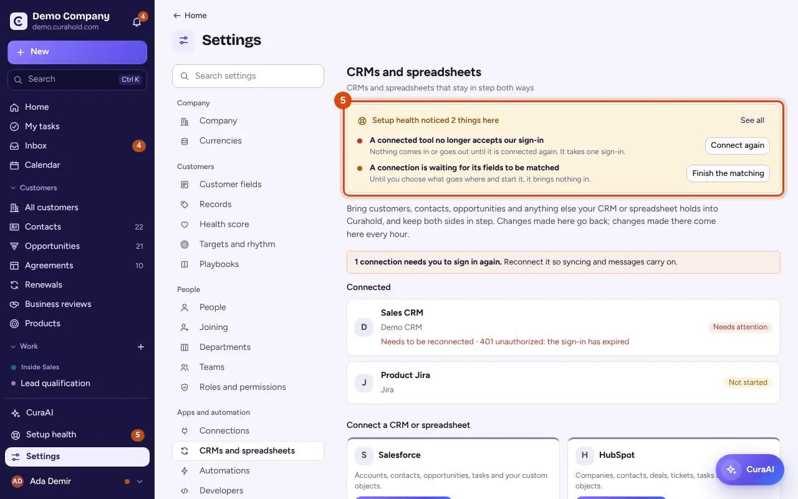

Some things we cannot read from here, such as your mail domain's SPF, DKIM and DMARC records. Add them, then click **I've done this** on that line.

Each person sees only what they can fix. Administrators see everything about the company; the person who runs the Curahold server also sees mail and the AI key. We check again once a day and mark anything new.

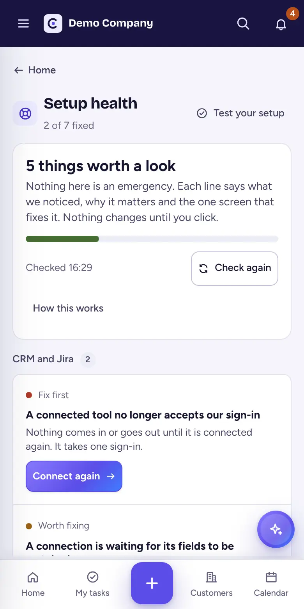

## Ask the assistant

Open the assistant and ask, word for word:

```text
What's wrong with my setup?
```

It lists the same problems with their buttons. It reads only; it never fixes anything itself.

## Test your setup

1. On **Setup health**, click **Test your setup** at the top right.
   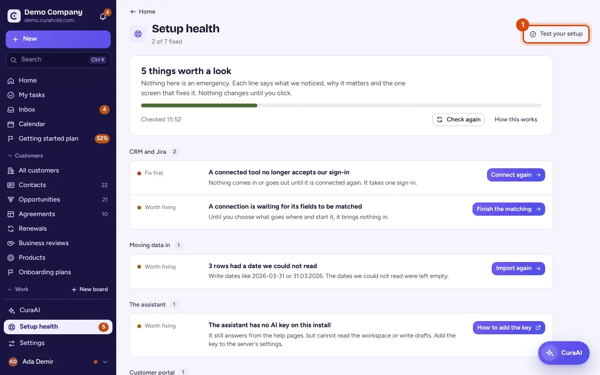
2. Click **Test it** on a step. Steps you check with your own eyes have **It worked** and **It did not work** instead. Where a step asks what to try with (a customer, a connection, a colleague), pick one once: it is kept for the next try.
   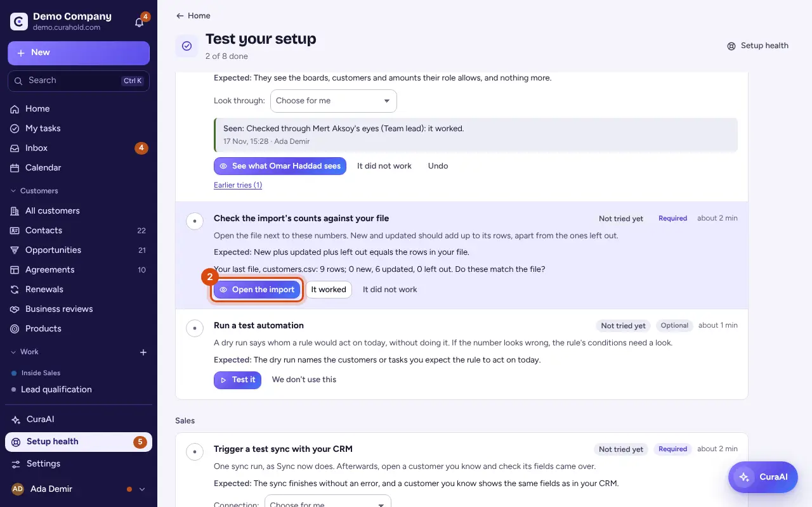
3. Compare **Seen** with **Expected**. If they match, the step passed. Every try is kept with who ran it and when, so you can test again any time.
   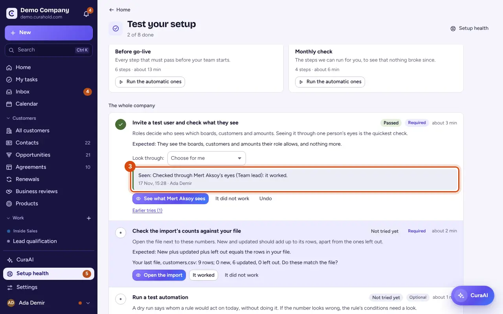
4. If it did not work, click **Open the screen that fixes it**, fix it and test again. If you need help, click **Open an issue**: the issue stays with the step and closes by itself when the step passes.
   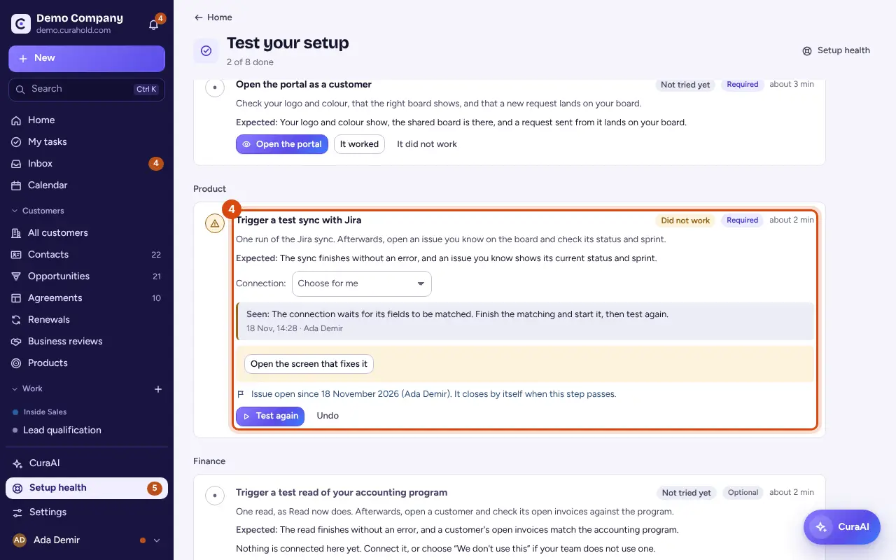
5. To run several at once, pick a bundle: **Before go-live** or **Monthly check**, then **Run the automatic ones**.
   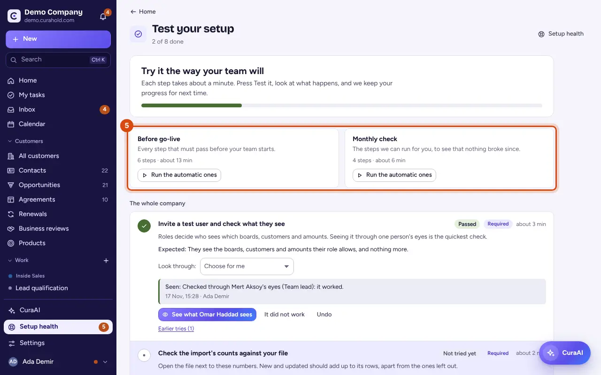
6. When every **Required** step has passed, an administrator of your company clicks **Approve**, then someone from Curahold does. The page then says **Setup complete**, with the date.
   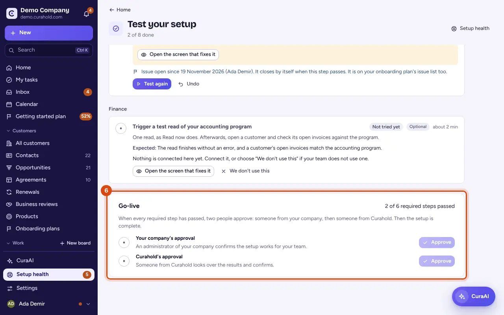

## What each check means

The table is written from the product's own words, so it always matches the screen.

<!-- setup-checks:start (scripts/docs/setup-health-page.ts writes this part) -->

### The team

| What we notice | Why it matters | The button |
| --- | --- | --- |
| You're the only person here so far (Fix first) | Tasks, hand-overs and reminders need someone to go to. Invite the people who will work in Curahold. | **Invite people** |
| … invitations not accepted for over a week (When you have a minute) | They may have missed the email. Send it again, or check the address. | **See invitations** |
| … roles have nobody in them (When you have a minute) | A role nobody holds does nothing. Give it to the right people, or remove it so the list stays clear. | **Open roles** |

### Departments

| What we notice | Why it matters | The button |
| --- | --- | --- |
| Departments are not set up yet (Worth fixing) | Boards, hand-overs and who sees what follow departments. Put each person in their department. | **Set up departments** |
| … departments have no lead (Worth fixing) | Only a lead can open the department's boards, and hand-overs to the department go to its lead. | **Choose a lead** |

### Moving data in

| What we notice | Why it matters | The button |
| --- | --- | --- |
| … rows of your last import did not come in (Worth fixing) | Something in those rows could not be read. The import screen lists them with their row numbers. | **Open the import** |
| … rows of your last import had no account name (Worth fixing) | The name is the one column every row needs. Fill it in the file and import again: rows already in are updated, not doubled. | **Import again** |
| … rows had a date we could not read (Worth fixing) | Write dates like 2026-03-31 or 31.03.2026. The dates we could not read were left empty. | **Import again** |
| … rows had an amount we could not read (Worth fixing) | Use digits only, like 12500 or 12.500,00, with the currency in a column of its own. Those amounts were left empty. | **Import again** |
| … accounts appear twice (When you have a minute) | Tasks and notes get split between the two copies. Keep one and merge the other into it. | **Show them** |

### CRM and Jira

| What we notice | Why it matters | The button |
| --- | --- | --- |
| A connected tool no longer accepts our sign-in (Fix first) | Nothing comes in or goes out until it is connected again. It takes one sign-in. | **Connect again** |
| The last sync with … tools did not finish (Fix first) | Changes made since are waiting. The connection's page says what stopped it. | **See what happened** |
| A connection is waiting for its fields to be matched (Worth fixing) | Until you choose what goes where and start it, it brings nothing in. | **Finish the matching** |
| … changes could not be sent to the other tool (Worth fixing) | We tried three times. The connection's page shows each one and why, and can try again. | **Review them** |
| … API keys stop working within two weeks (Worth fixing) | Whatever uses it will stop sending. Make a new key and put it in place before then. | **Open API keys** |
| … changes were overwritten by the other tool this week (When you have a minute) | Both sides changed the same thing. Nothing is lost: the replaced value is in each task's history. Check that the connection's rule is the one you want. | **Check the rule** |

### Accounting

| What we notice | Why it matters | The button |
| --- | --- | --- |
| Your accounting program could not be read (Fix first) | Invoices and payments on account pages stay as they were at the last good read. | **Open the connection** |
| Accounting has not been read for two days (Worth fixing) | Overdue invoices may be out of date. Read it now, or check why the daily read stopped. | **Open the connection** |

### BI tools

| What we notice | Why it matters | The button |
| --- | --- | --- |
| … analytics keys stop working within two weeks (Worth fixing) | Reports in your BI tool will stop refreshing. Rotate the key and paste the new one there. | **Open analytics keys** |
| Your BI tool has not pulled data for a week (When you have a minute) | Its dashboards show last week's numbers. Check its scheduled refresh, or the key it uses. | **Open analytics keys** |

### Customer portal

| What we notice | Why it matters | The button |
| --- | --- | --- |
| The customer portal is on, but shows customers nothing (Worth fixing) | Share at least one board with the portal so customers can send requests and follow them. | **Choose what to share** |
| Nobody has been invited to the portal yet (When you have a minute) | Customers can sign in only once they are invited. Invite a contact at one account to start. | **Invite a customer** |
| The portal still has Curahold's colours (When you have a minute) | Your logo and colour tell customers they are in the right place. | **Add your brand** |

### Automations

| What we notice | Why it matters | The button |
| --- | --- | --- |
| … automations use a field that was deleted (Fix first) | As it is, it can never run. Pick another field, or switch the rule off. | **Fix the rule** |
| … automations point at a board that is gone (Fix first) | The tasks it should make have nowhere to go. Choose another board. | **Fix the rule** |
| No automations yet (When you have a minute) | One rule, like a task 60 days before each renewal, saves a reminder every time. Ready ones are waiting to be switched on. | **See ready rules** |

### Your data

| What we notice | Why it matters | The button |
| --- | --- | --- |
| … accounts have no owner (Worth fixing) | Their reminders go to nobody, and they are on nobody's list. Give each one an owner. | **Give an owner** |
| … open deals have no stage (Worth fixing) | They are left out of the pipeline and the forecast. | **Open deals** |
| … open tickets have nobody looking after them (When you have a minute) | A ticket with no owner sits in nobody's queue. Assign each one, or add a rule that does. | **Open tickets** |

### Mail

| What we notice | Why it matters | The button |
| --- | --- | --- |
| This install does not send mail yet (Fix first) | Invitations, sign-in links and reminders are only written to the server log. Set up the mail relay or a mail provider. | **How to set up mail** |
| Confirm the mail domain's SPF, DKIM and DMARC records (Worth fixing) | Without them, invitations land in spam or are refused. We cannot read your DNS from here: add the records, then confirm. | **See the records** |

### Privacy

| What we notice | Why it matters | The button |
| --- | --- | --- |
| Nobody can answer personal-data requests (Worth fixing) | Under KVKK and GDPR someone must be able to export or erase a person's data. Give one role the privacy permission. | **Open roles** |

### Trial and plan

| What we notice | Why it matters | The button |
| --- | --- | --- |
| Your trial ends on … (Worth fixing) | After that the workspace is read-only until a plan is chosen. Nothing is deleted. | **Choose a plan** |
| Every seat of the trial is taken (Worth fixing) | New people can join only as viewers. Ask for more seats, or free one up. | **See seats** |

### The assistant

| What we notice | Why it matters | The button |
| --- | --- | --- |
| The assistant has no AI key on this install (Worth fixing) | It still answers from the help pages, but cannot read the workspace or write drafts. Add the key to the server's settings. | **How to add the key** |

<!-- setup-checks:end -->

## For developers

The same checks are in the API, read as the key's owner. Put your company's address and your key in place of the two examples:

```bash
curl -H "Authorization: Bearer YOUR_API_KEY" https://your-company.curahold.com/api/setup-health
```

The full list of addresses is in [Reference: setup health](/docs/en/ref-setup/).
