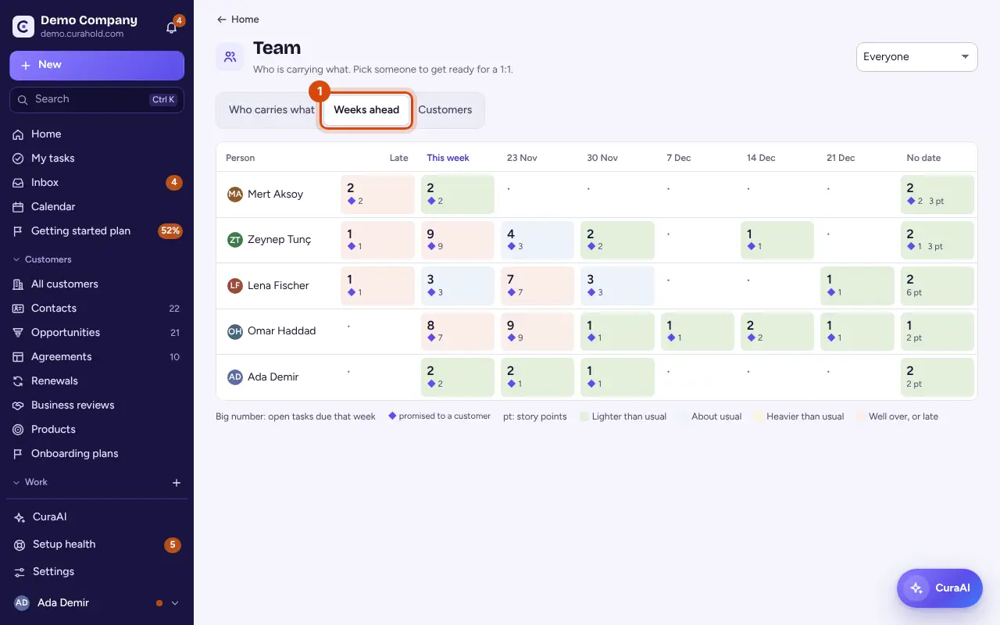
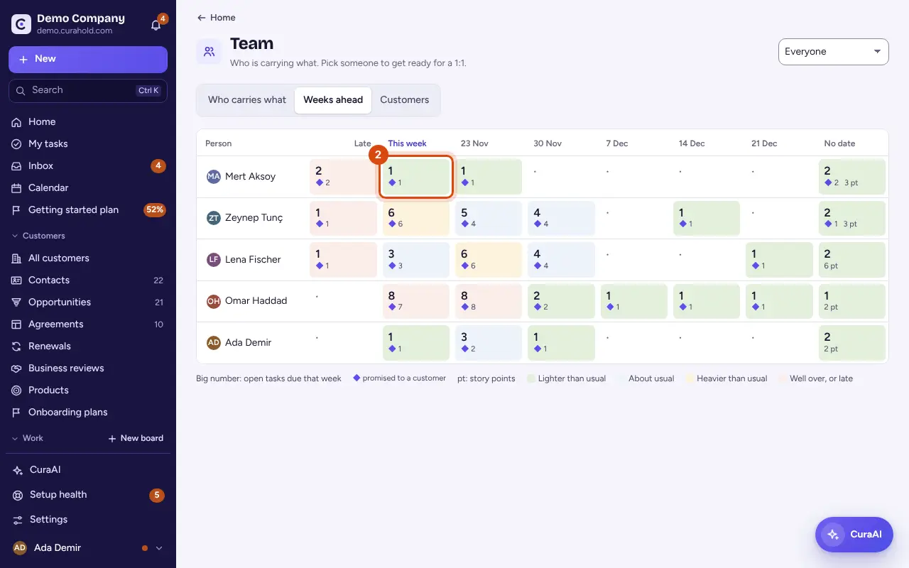
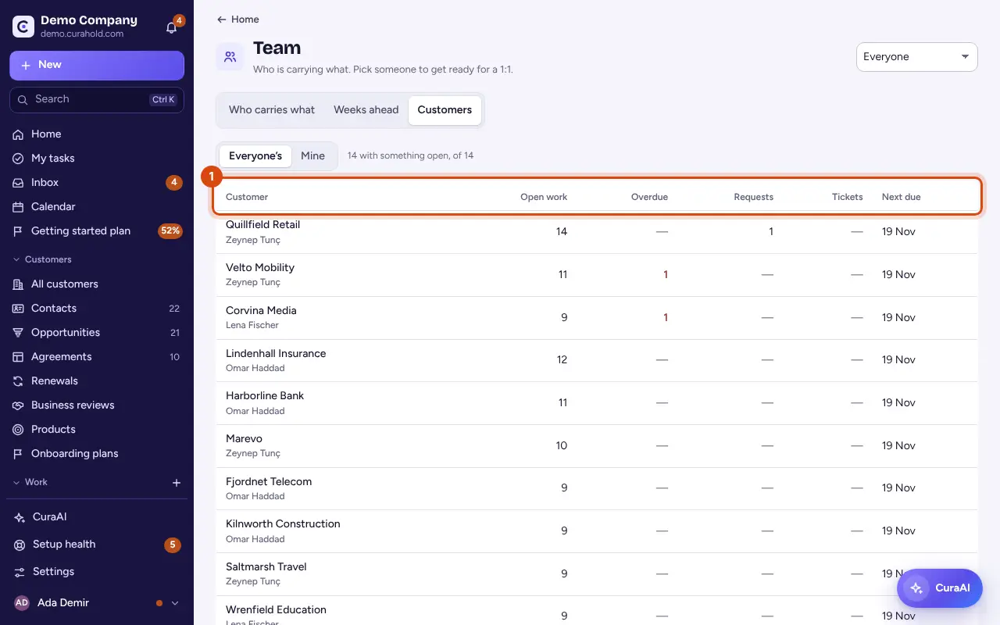
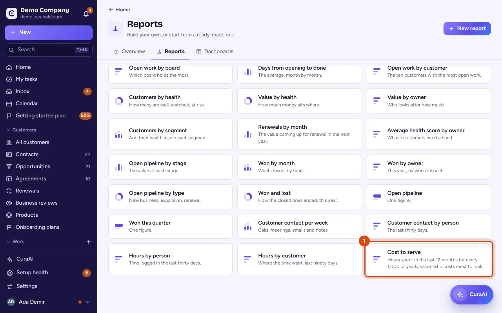

# The team’s weeks, the customer portfolio and cost to serve

**Team** (in the menu on the left) has three views: **Who carries what**, **Weeks ahead** and **Customers**. Choose a team at the top right to narrow any of them. Only tasks you may see are counted.

## Who has room in the weeks ahead {#weeks}

1. Open **Team** and click **Weeks ahead**.
   
2. Read a person's row week by week. In each cell, the big number is the open tasks due that week, ◆ how many of them are promises to a customer, and **pt** their story points. The colour compares the week with what that person usually carries: lighter, about usual, heavier or well over. **Late** and **No date** have columns of their own. Click a cell to open that person's 1:1 view.
   

## Every customer's open work {#customers}

1. Open **Team** and click **Customers**. Every customer with something open is listed, busiest first: open work, how much of it is late, requests their people sent through the portal, support tickets not yet solved, and the next due date. Click a column's name to sort by it; switch between **Everyone’s** and **Mine**.
   

Amounts are left out here on purpose: who may see money is decided field by field.

## Cost to serve {#cost-to-serve}

1. Open **Reports** in the menu, click the **Reports** tab, then **Cost to serve**. For each customer it shows the hours logged on its work in the last 12 months for every 1,000 of yearly value (ARR, else MRR × 12, else the first amount field). The highest are the customers that cost most to look after.
   

Two fields come with it in the report builder: **Time logged, last 12 months** and **Hours per 1,000 of yearly value**. Someone who may not see a customer's value gets no cost figure.
