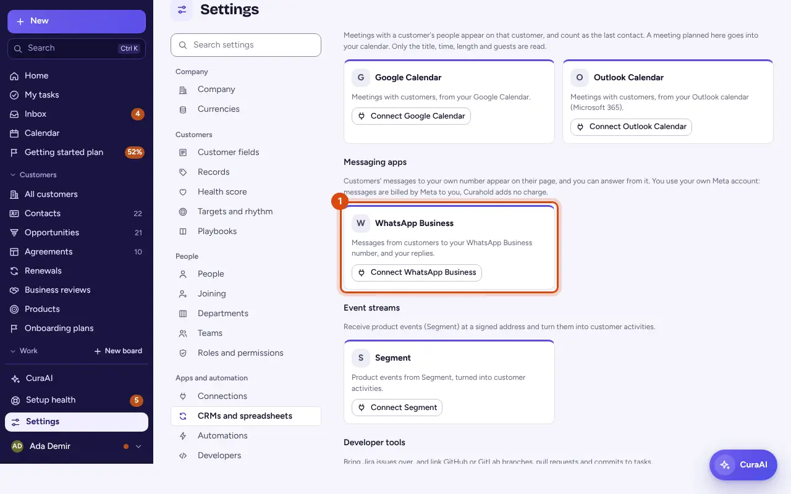
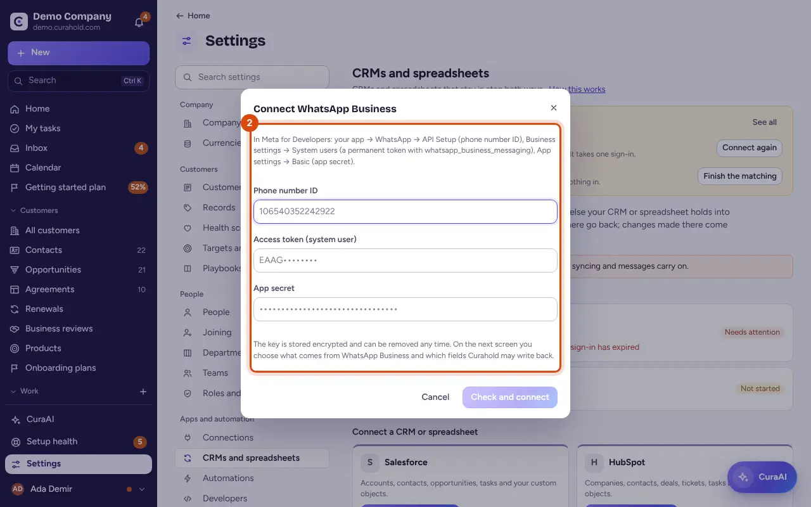

# WhatsApp Business

Messages customers send to your WhatsApp Business number appear on their page, and you answer from there. You use your **own** Meta app and number: Meta bills the messages to you, Curahold adds no charge and never sees your Meta invoice.

## Before you start

You need a Meta business account with a WhatsApp Business number on the Cloud API, a Meta app with the WhatsApp product, and a **system user** with a permanent token (permission `whatsapp_business_messaging`). Meta's own pages walk you through these; it takes about 15 minutes.

## In Curahold {#connect}

1. Open **Settings → CRMs and spreadsheets**, find **Messaging apps** and click **Connect WhatsApp Business**.
   
2. Paste the three values below and click **Connect**. The connection page then shows a **callback address** and a **verify token**.
   

- **Phone number ID**: Meta for Developers → your app → **WhatsApp → API Setup**.
- **Access token (system user)**: Business settings → **System users** → your user → **Generate new token**.
- **App secret**: your app → **App settings → Basic** → **App secret** → **Show**.

## In Meta

1. Open your app → **WhatsApp → Configuration**. Next to **Webhook**, click **Edit**.
2. Paste the callback address into **Callback URL** and the verify token into **Verify token**. Click **Verify and save**.
3. Under **Webhook fields**, click **Manage** and subscribe to **messages**.

## What arrives, and answering

A message lands on the customer whose contact has the sender's number (local forms like `0532…` match too), as a note. On that note, click **Reply on WhatsApp**. WhatsApp allows free text only within 24 hours of the customer's last message; after that, Curahold asks for an approved **template** name and language.

## Limits and timing

Messages arrive as Meta sends them. Meta retries a failed delivery for up to 7 days; each message is kept once. Meta limits how fast one number may send; a busy answer says so and nothing is lost.

## If something goes wrong

An expired or revoked token shows when you reply: paste a new one with **Reconnect**. A message from a number no contact has is counted on the connection, not stored. **Remove** stops the callback at once; notes already on customers stay.

## See also

- [Timeline and health](/docs/en/timeline-and-health/)
- [Connections](/docs/en/connections/)
