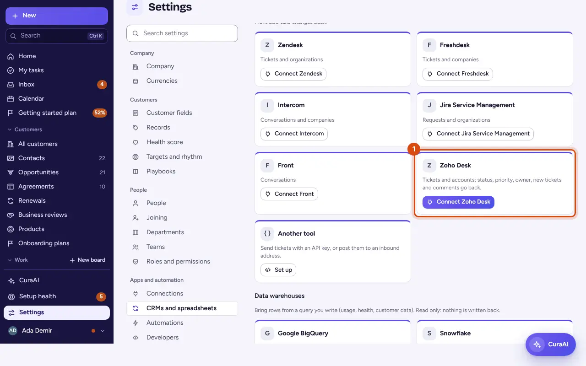

# Zoho Desk

Tickets and accounts from Zoho Desk appear on the matching customer, in rollups and in the health score. Status, priority and owner changed in Curahold go back to Zoho Desk, a ticket made in Curahold is made there, and a reply or a private note is added as a comment.

## In Curahold {#connect}

1. Open **Settings → CRMs and spreadsheets**, find **Support tools** and click **Connect Zoho Desk**.
   

Zoho opens. Sign in with an agent of your help desk and click **Accept**. Curahold finds your data centre (.com, .eu, .in, .com.au, .jp, .sa, .uk, .ae, .ca, .com.cn) and your portal. Back in Curahold, tick **Tickets** and **Accounts**, check the field pairs and click **Start syncing**.

## Limits and timing

Changes are read every hour. Zoho counts credits per call against a daily allowance by plan; when it is used up, Zoho asks to wait and Curahold carries on the next time. A public reply from Curahold is a public comment on the ticket; an email reply is sent from Zoho Desk.

## If something goes wrong

An expired sign-in is renewed on its own. If the agent lost access, the connection shows **Needs attention**: **Reconnect** and sign in again. **Remove** deletes the sign-in; tickets already brought over stay.

## See also

- [Support tickets](/docs/en/support-tickets/)
- [Connections](/docs/en/connections/)
