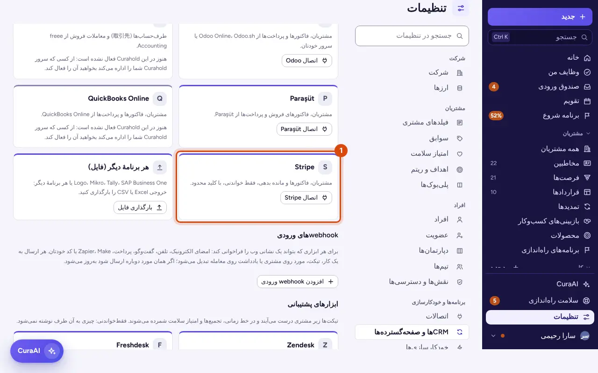

# Stripe (فقط خواندنی)

مشتریان، فاکتورها (با سررسید و ماندهٔ بدهی) و پرداخت‌ها از Stripe. Curahold هرگز در Stripe چیزی نمی‌نویسد: کلیدی که می‌دهید فقط می‌تواند بخواند.

## در Curahold {#connect}

1. **تنظیمات ← CRMها و صفحه‌گسترده‌ها** را باز کنید، **برنامه‌های حسابداری** را بیابید و **اتصال Stripe** را بزنید.
   

کلید محدود را در **کلید محدود** بچسبانید و **اتصال** را بزنید. کلید محرمانهٔ کامل (`sk_…`) عمداً پذیرفته نمی‌شود. سپس **شروع** را بزنید و مشتریان مطابق‌نشده را در زبانهٔ **تطبیق** بررسی کنید.

## در Stripe

1. **Developers ← API keys** را باز کنید و **Create restricted key** را بزنید.
2. نامش را `Curahold` بگذارید.
3. **Customers**، **Invoices** و **Events** را روی **Read** بگذارید و بقیه را روی **None**.
4. **Create key** را بزنید، با مرحلهٔ دوم تأیید کنید و کلید را کپی کنید. این‌طور شروع می‌شود:

```text
rk_live_
```

برای آزمودن اول، از کلید sandbox (`rk_test_…`) استفاده کنید.

## محدودیت‌ها و زمان‌بندی

خواندن نخست همه چیز را می‌آورد؛ بعد فقط تغییرات، از فهرست رویدادهای Stripe (که Stripe سی روز نگه می‌دارد). Stripe در هر ثانیه ۱۰۰ درخواست می‌پذیرد (در sandbox ۲۵)؛ Curahold بسیار پایین‌تر می‌ماند. مبالغ با اعشار هر ارز خوانده می‌شوند (ین اعشار ندارد). فاکتوری که Stripe «uncollectible» می‌نامد این‌جا بدهی می‌ماند تا دیرکرد دیده شود.

## اگر مشکلی پیش آمد

کلید عوض‌شده یا حذف‌شده اتصال را **نیاز به بررسی** نشان می‌دهد: کلید محدود تازه بسازید و با **اتصال دوباره** بچسبانید. اگر مجوزی کم باشد، مرحلهٔ اتصال نامش را می‌گوید. **برداشتن** کلید را پاک می‌کند؛ ارقام خوانده‌شده تا وقتی حذفشان نکنید می‌مانند.

## همچنین ببینید

- [برنامه‌های حسابداری](/docs/fa/accounting/)
