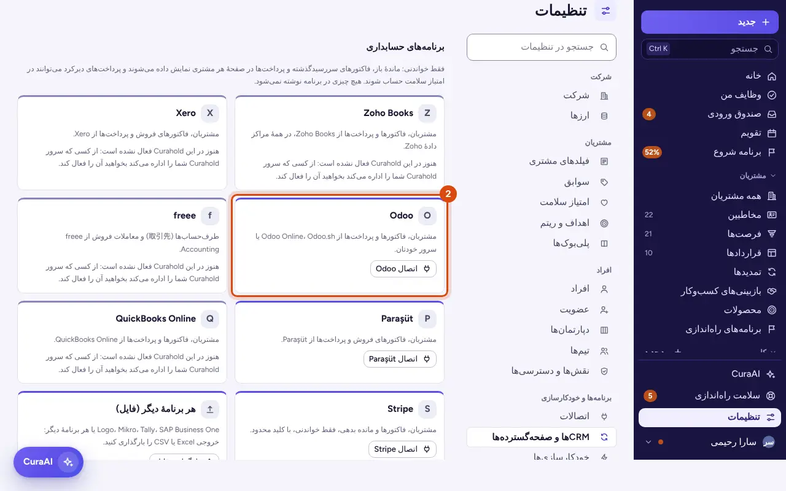

# برنامه‌های حسابداری

برنامهٔ حسابداری خود را وصل کنید تا صفحهٔ هر مشتری نشان دهد چه بدهی‌ای دارد: ماندهٔ باز، مبلغ سررسیدگذشته و مدت تأخیر، آخرین پرداخت و فاکتورها. پرداخت‌های دیرکرد می‌توانند در امتیاز سلامت حساب شوند. Curahold فقط می‌خواند: هیچ چیزی در برنامه نوشته نمی‌شود.

## کدام برنامه‌ها

| برنامه | روش اتصال | صفحه |
| --- | --- | --- |
| Zoho Books | ورود با Zoho | [Zoho Books](/docs/fa/accounting-zohobooks/) |
| Xero | ورود با Xero | [Xero](/docs/fa/accounting-xero/) |
| Odoo | نشانی، نام کاربری و کلید API | [Odoo](/docs/fa/accounting-odoo/) |
| freee | ورود با freee | [freee](/docs/fa/accounting-freee/) |
| Paraşüt | شمارهٔ شرکت، کلاینت API و یک کاربر | [Paraşüt](/docs/fa/accounting-parasut/) |
| QuickBooks Online | ورود با Intuit | [QuickBooks Online](/docs/fa/accounting-quickbooks/) |
| هر برنامهٔ دیگر (Logo، Mikro، Tally، SAP Business One…) | فایل Excel یا CSV | [فایل](/docs/fa/accounting-file/) |

## وصل کردن برنامه {#connect}

به مجوز مدیریت اتصال‌ها نیاز دارید (مدیران سیستم دارند).

1. **تنظیمات ← CRMها و صفحه‌گسترده‌ها** را باز کنید و تا **برنامه‌های حسابداری** پایین بروید. روی **اتصال …** در کاشی برنامه‌تان یا **بارگذاری فایل** در **هر برنامهٔ دیگر (فایل)** کلیک کنید و صفحهٔ همان برنامه را در جدول بالا دنبال کنید.
   

## تطبیق مشتریان

هر مشتری در برنامهٔ حسابداری با یک مشتری در Curahold تطبیق داده می‌شود: اول با شمارهٔ مالیاتی، بعد با نشانی وب یا دامنهٔ ایمیل، و سپس با نام (عنوان‌های حقوقی مثل Ltd.، A.Ş. یا 株式会社 در نظر گرفته نمی‌شوند). اگر دقیقاً یک مشتری جور باشد تطبیق انجام می‌شود؛ اگر هیچ یا چند مشتری جور باشند، در زبانهٔ **تطبیق** اتصال منتظر می‌ماند. آنجا می‌توانید مشتری را انتخاب کنید یا کنار بگذارید. تطبیق‌های دستی حفظ می‌شوند.

## چه کسی ارقام را می‌بیند

مبالغ برای نقش‌هایی نمایش داده می‌شوند که **دیدن ارقام مالی** دارند (در آغاز مدیران سیستم و مدیران؛ از تنظیمات ← نقش‌ها و دسترسی‌ها تغییر دهید). هر کس دیگری که مشتری را می‌بیند فقط در امتیاز سلامت می‌بیند پرداخت چند روز دیر شده است — هرگز مبلغی را نمی‌بیند.

افراد دپارتمان **مالی** هم، هر نقشی که داشته باشند، مبالغ را می‌بینند؛ دپارتمان‌هایی هم که در تنظیمات ← دپارتمان‌ها زیر **چه کسی مالی را در صفحه مشتری می‌بیند** انتخاب شده‌اند همین‌طور. خاموش کردن مالی این را برمی‌دارد.

## پرداخت‌های دیرکرد در امتیاز سلامت

هنگام شروع اولین خواندن می‌توانید **پرداخت‌های دیرکرد را در امتیاز سلامت حساب کنید** را علامت بزنید. سیگنال **پرداخت به‌موقع** وقتی چیزی دیر نشده امتیاز کامل می‌دهد و وقتی قدیمی‌ترین فاکتور پرداخت‌نشده ۶۰ روز دیر شده، امتیازی نمی‌دهد؛ هر دو عدد از تنظیمات ← امتیاز سلامت تغییر می‌کنند. مشتریانی که با برنامه تطبیق داده نشده‌اند حساب نمی‌شوند.

## سلامت اتصال

اتصال‌های حسابداری در تنظیمات ← اتصال‌ها کنار بقیه دیده می‌شوند: کار می‌کند، مشکل دارد یا متوقف است، و آخرین بار کی کار کرده است.
