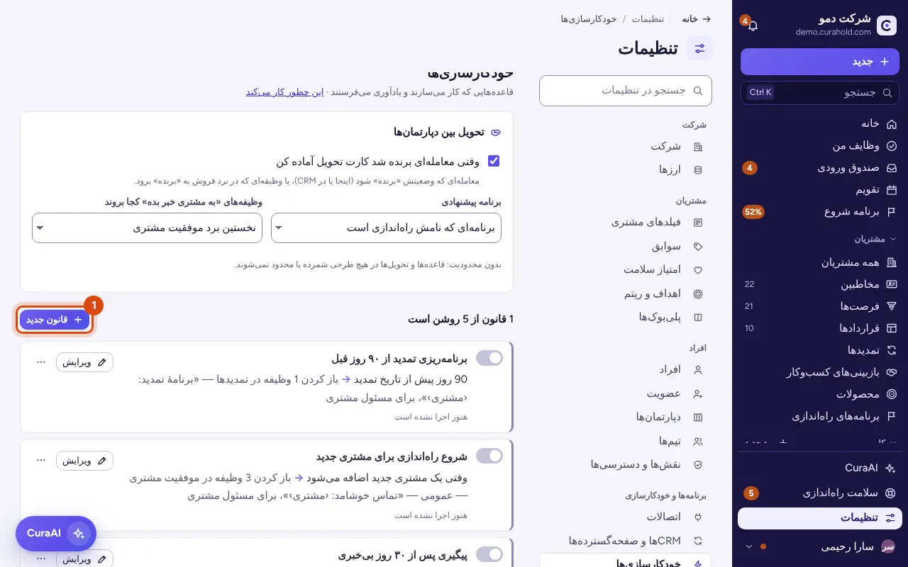
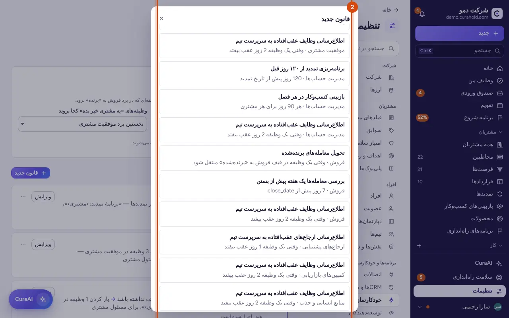
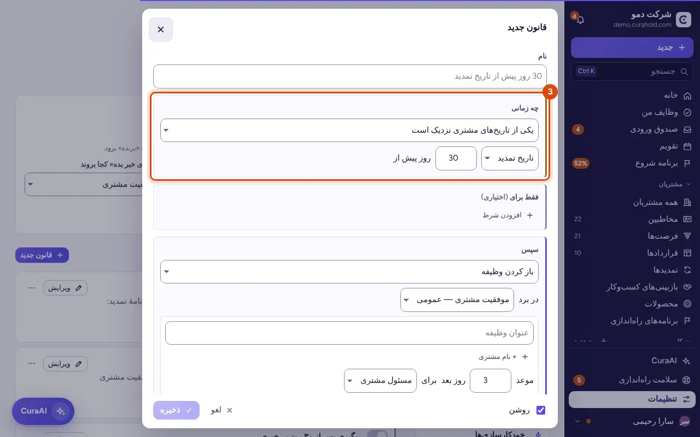
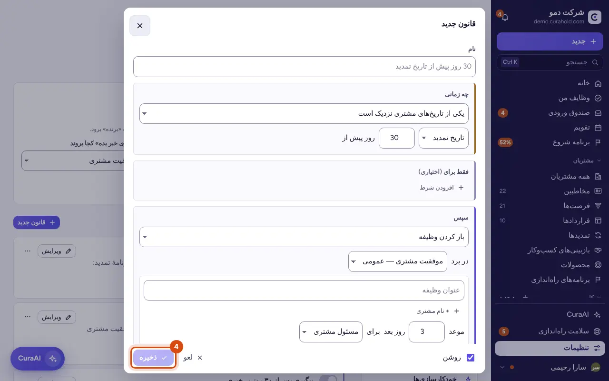

# خودکارسازی‌ها

قوانین کارهای تکراری را به جای شما انجام می‌دهند: برنامهٔ تمدید ۹۰ روز جلوتر، تماس خوش‌آمد برای مشتری تازه، یادآوری وقتی وظیفه‌ای عقب افتاده، کارت تحویل وقتی معامله‌ای برنده می‌شود. در هیچ طرحی شمرده یا سقف‌دار نمی‌شوند.

## ساختن یک قانون {#new-rule}

به مجوز مدیریت خودکارسازی‌ها نیاز دارید (مدیران سیستم دارند).

1. **تنظیمات ← خودکارسازی‌ها** را باز کنید و روی **قانون جدید** کلیک کنید.
   
2. یک قانون آماده که مناسب است انتخاب کنید، یا **شروع از صفر**.
   
3. زیر **چه زمانی** انتخاب کنید چه چیزی قانون را شروع می‌کند و جزئیاتش را (کدام تاریخ، چند روز، کدام برد). برای محدود کردن به برخی مشتریان یا وظایف روی **افزودن شرط** کلیک کنید. زیر **سپس** انتخاب کنید چه اتفاقی بیفتد. سطر «امروز این قانون روی … مورد عمل می‌کرد» نشان می‌دهد الان به چه چیزی دست می‌زند؛ هنوز چیزی تغییر نمی‌کند.
   
4. یک **نام** بدهید، **روشن** را تیک‌خورده بگذارید و روی **ذخیره** کلیک کنید.
   

## چه چیزی قانون را شروع می‌کند {#when}

تاریخی نزدیک روی مشتری (تمدید، پایان قرارداد)، هر چند روز یک بار برای هر مشتری، مشتری‌ای که ساکت شده، مشتری تازه، وظیفهٔ عقب‌افتاده، وظیفه‌ای که به ستونی می‌رود، وظیفه‌ای که اضافه یا تمام می‌شود، درخواستی از فرم یک برد، رکوردی که به مرحله‌ای می‌رسد، تیکت پشتیبانی‌ای که باز می‌شود.

## قانون چه می‌تواند بکند {#then}

باز کردن وظیفه (با چک‌لیست، برای مسئول مشتری یا هر کسی)، فرستادن یادآوری، واگذاری، جابه‌جایی، پر کردن فیلد، نوشتن نظر، فرستادن به وب‌هوک‌ها یا آماده کردن کارت تحویل.

## اجرا و توقف {#running}

هر قانون نشان می‌دهد در ۳۰ روز گذشته چند بار اجرا شده است. **اجرا در همین لحظه** قانون زمان‌بندی‌شده را بی‌درنگ اجرا می‌کند و منتظر ساعت بعد نمی‌ماند؛ باز هم برای هر مورد یک بار اعمال می‌شود. برای مکث، قانون را خاموش کنید. با حذف قانون، وظایفی که باز کرده می‌مانند و قانون ۳۰ روز در سطل زباله می‌ماند.

تنظیمات تحویل در بالای همین صفحه در [تحویل، درخواست‌ها و بازگشت به مشتری](/docs/fa/handover-and-requests/) آمده است.
