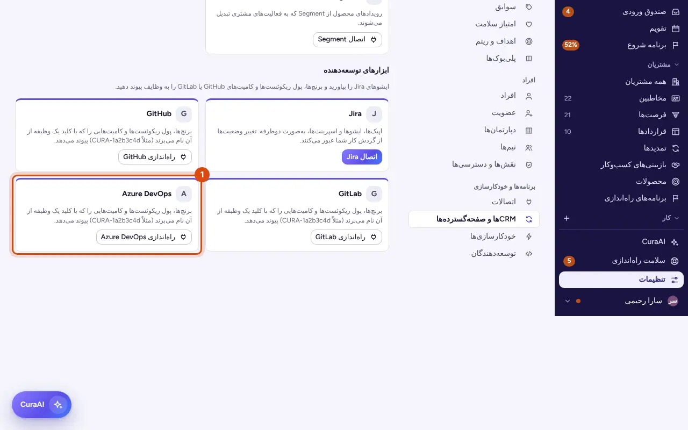
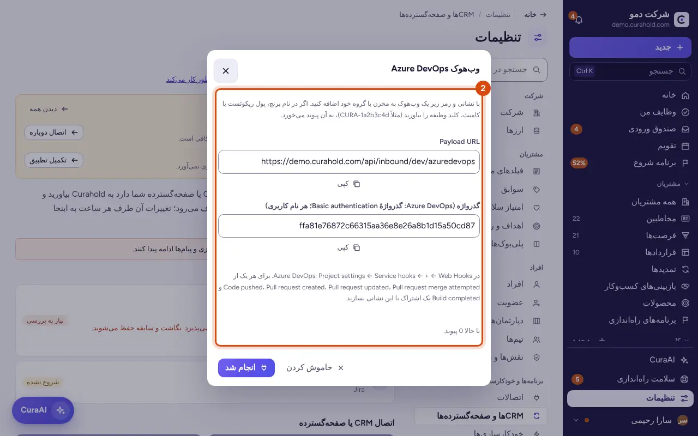

# Azure DevOps

شاخه‌ها، pull requestها و commitهای Azure Repos که از یک کار نام می‌برند به آن وصل می‌شوند، با وضعیت (باز، ادغام‌شده، بسته) و نتیجهٔ build. مانند GitHub و GitLab کار می‌کند: کلید کار، مثلاً `CURA-1a2b3c4d`، را در نام شاخه، عنوان pull request یا پیام commit بنویسید.

## در Curahold {#connect}

1. **تنظیمات ← CRMها و صفحه‌گسترده‌ها** را باز کنید، **ابزارهای توسعه‌دهنده** را بیابید و **راه‌اندازی Azure DevOps** را بزنید.
   
2. **روشن کردن** را بزنید، سپس **نشانی** و **گذرواژه**ٔ نشان‌داده‌شده را کپی کنید.
   

## در Azure DevOps

این را برای هر رویداد یک بار انجام دهید (Code pushed، Pull request created، Pull request updated، Pull request merge attempted، Build completed):

1. پروژه را باز کنید ← **Project settings** ← **Service hooks** ← **+** (Create subscription).
2. **Web Hooks** را انتخاب کنید و **Next** را بزنید.
3. رویداد را انتخاب کنید، فیلترها را دست نزنید و **Next** را بزنید.
4. نشانی را در **URL** بچسبانید. هر **Username** (مثلاً `azure`) بنویسید و گذرواژه را در **Password** بچسبانید.
5. **Resource details to send** را روی **All** بگذارید، **Test** و سپس **Finish** را بزنید.

## محدودیت‌ها و زمان‌بندی

پیوندها به‌محض ارسال Azure DevOps نشان داده می‌شوند. Azure DevOps فقط با HTTPS می‌فرستد و چیزی را امضا نمی‌کند: گذرواژه مدرک است، پس مثل گذرواژه نگهش دارید.

## اگر مشکلی پیش آمد

Azure DevOps پاسخ هر ارسال را در **Service hooks ← History** نشان می‌دهد: ۴۰۱ یعنی گذرواژه نادرست است (برای گذرواژهٔ تازه webhook را دوباره روشن کنید و همهٔ اشتراک‌ها را به‌روز کنید). **خاموش کردن** پیوندهای تازه را متوقف می‌کند؛ پیوندهای موجود روی کارها می‌مانند.

## همچنین ببینید

- [اتصالات و CRM](/docs/fa/connections/)
- [وظایف و بردها](/docs/fa/tasks/)
