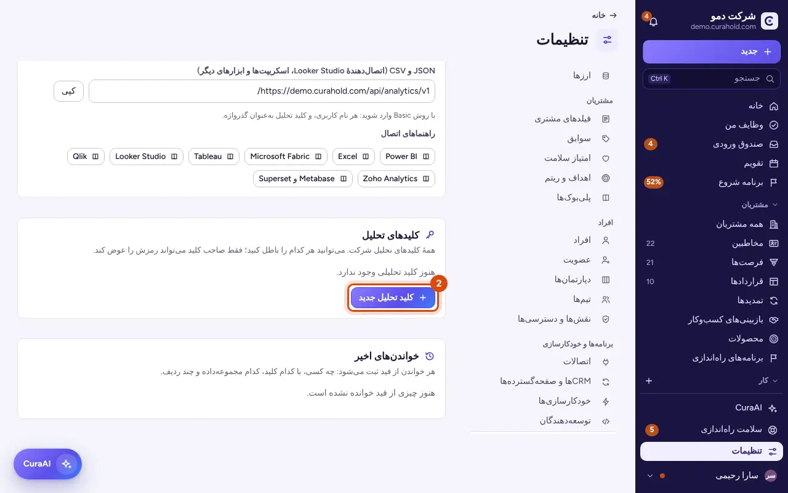
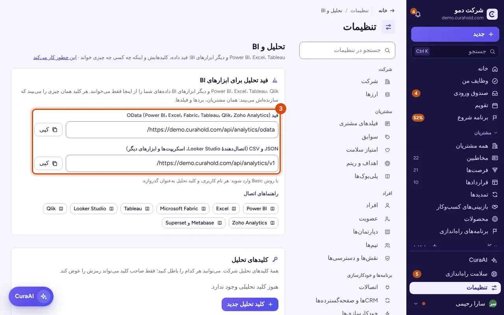

# اتصال یک ابزار BI

Curahold یک **فید تحلیل** فقط‌خواندنی برای ابزارهای BI دارد. Power BI، Excel، Microsoft Fabric، Tableau، Qlik و Zoho Analytics آن را به‌صورت **فید OData** می‌خوانند؛ Looker Studio، اسکریپت‌ها و ابزارهای دیگر همان داده‌ها را به‌صورت **JSON یا CSV** می‌گیرند. از این راه هیچ چیزی در Curahold تغییر نمی‌کند.

نام منوهای زیر همان است که در رابط انگلیسی هر ابزار دیده می‌شود؛ در رابط فارسی، گزینهٔ معادل را انتخاب کنید.

## پیش از شروع {#key}

به مجوز خروجی گرفتن از داده نیاز دارید (مدیران سیستم و مدیران دارند).

1. **تنظیمات ← تحلیل و BI** را باز کنید و روی **کلید تحلیل جدید** کلیک کنید. نامی بدهید (مثلاً «داشبورد فروش Power BI»)، مجموعه‌داده‌ها، دپارتمان‌ها و تاریخ پایان را انتخاب کنید و بسازید. کلید را همان لحظه کپی کنید: فقط یک بار نشان داده می‌شود و با `chb_` شروع می‌شود.
   
2. در همان صفحه، زیر **فید تحلیل برای ابزارهای BI**، کنار نشانی‌ای که ابزارتان می‌خواهد روی **کپی** کلیک کنید. با نشانی شرکت شما این‌طور هستند:
   

فید OData ‏(Power BI، Excel، Fabric، Tableau، Qlik، Zoho Analytics):

```text
https://your-company.curahold.com/api/analytics/odata/
```

JSON و CSV ‏(Looker Studio، اسکریپت‌ها، ابزارهای دیگر):

```text
https://your-company.curahold.com/api/analytics/v1/
```

وقتی ابزار روش ورود را پرسید، **Basic** را انتخاب کنید: در نام کاربری هر چیزی بنویسید و کلید را به‌عنوان گذرواژه بچسبانید.

کلید دقیقاً همان چیزی را می‌خواند که شما در Curahold می‌بینید: همان مشتریان، بردها و فیلدها. فیلدی که نقش شما نمی‌بیند حتی به‌صورت ستون هم نمی‌آید. اگر از شرکت بروید یا مجوز خروجی گرفتن را از دست بدهید، کلید از کار می‌افتد. **عوض کردن رمز** به همان کلید مقدار تازه‌ای می‌دهد؛ **لغو** آن را بی‌درنگ از کار می‌اندازد.

## مجموعه‌داده‌ها

| مجموعه‌داده | محتوا |
| --- | --- |
| `Customers` | یک ردیف برای هر مشتری، و هر فیلد مشتری که اجازهٔ دیدنش را دارید در ستونی جدا |
| `Renewals` | مشتریانی که تاریخ تمدید دارند: ارزش، سلامت و فرصت‌های تمدید باز |
| `HealthHistory` | امتیاز سلامت هر مشتری در هر روز |
| `Opportunities` | قیف فروش: مبلغ، مرحله، وضعیت، تاریخ بسته شدن |
| `Tickets` | تیکت‌های پشتیبانی |
| `Contacts` | مخاطبین در شرکت‌های مشتری |
| `Records…` | یک مجموعه برای هر نوع رکوردی که افزوده‌اید (قراردادها، ریسک‌ها…) |
| `Boards`، `Tasks`، `TaskAssignees` | بردها، کارهایشان، و یک ردیف برای هر کار و هر مسئول |
| `Sprints`، `SprintBurndown` | اسپرینت‌ها، و دامنه و کار باقی‌مانده در هر روز |
| `People` | نام و نقش، برای گذاشتن نام روی شناسه‌های مالک و مسئول |

هر مجموعه‌داده ستون‌های `Id` و `ModifiedAt` (آخرین زمان تغییر ردیف) را دارد. بیشترشان `IsDeleted` هم دارند: ردیف‌های بایگانی‌شده با `IsDeleted = true` در فید می‌مانند تا به‌روزرسانی بتواند آن‌ها را از گزارش‌ها حذف کند. مجموعه‌داده‌ها را با ستون‌های شناسه به هم وصل کنید: `Tasks.CustomerId` ← `Customers.Id`، `Tasks.BoardId` ← `Boards.Id`، `OwnerId` ← `People.Id`.

## Power BI

1. در Power BI Desktop گزینهٔ **Get data → OData feed** را انتخاب کنید.
2. نشانی OData را بچسبانید و **OK** را بزنید.
3. **Basic** را انتخاب کنید. نام کاربری: هر چیزی. گذرواژه: کلید تحلیل. **Connect** را بزنید.
4. در Navigator مجموعه‌داده‌های دلخواه را علامت بزنید و **Load** را بزنید (یا **Transform data** برای حذف ستون‌ها پیش از بارگذاری).
5. پس از انتشار، **Settings → Data source credentials** مدل معنایی را باز کنید، دوباره **Basic** و کلید را وارد کنید و **scheduled refresh** را روشن کنید.

اگر سرویس Power BI برای ورود Basic دروازه (gateway) خواست، کلید را به‌عنوان **Web API key** به کار ببرید: در **Transform data → Advanced editor** منبع را این‌طور بنویسید `OData.Feed("https://your-company.curahold.com/api/analytics/odata/Tasks", null, [ApiKeyName = "key", Implementation = "2.0"])`، سپس وقتی Power BI پرسید **Web API** را انتخاب کنید و کلید را بچسبانید.

**مجموعه‌داده‌های بزرگ.** برای به‌روزرسانی افزایشی، بازه را در نشانی بگذارید تا Curahold پیش از ارسال صافی کند:

```
let
    Start = DateTime.ToText(RangeStart, "yyyy-MM-ddTHH:mm:ss") & "Z",
    End = DateTime.ToText(RangeEnd, "yyyy-MM-ddTHH:mm:ss") & "Z",
    Source = OData.Feed("https://your-company.curahold.com/api/analytics/odata/Tasks?$filter=CreatedAt ge " & Start & " and CreatedAt lt " & End, null, [Implementation = "2.0"])
in
    Source
```

سپس سیاست به‌روزرسانی افزایشی جدول را مثل همیشه تنظیم کنید و **Detect data changes** را با ستون `ModifiedAt` روشن کنید تا دوره‌ای که ردیف‌هایش تغییر کرده دوباره خوانده شود.

## Excel

1. در Excel ویندوز گزینهٔ **Data → Get Data → From Other Sources → From OData Feed** را انتخاب کنید.
2. نشانی OData را بچسبانید و **OK** را بزنید.
3. **Basic** را انتخاب کنید، هر نام کاربری بنویسید، کلید را به‌عنوان گذرواژه بچسبانید و **Connect** را بزنید.
4. در Navigator مجموعه‌داده‌ها را انتخاب کنید و **Load** را بزنید.
5. **Data → Refresh All** هر وقت بخواهید تازه‌ترین داده‌ها را می‌آورد.

## Microsoft Fabric

1. در فضای کاری **New item → Dataflow Gen2** و سپس **Get data → OData** را انتخاب کنید.
2. نشانی OData را بچسبانید. در اعتبارنامهٔ اتصال **Basic** را انتخاب کنید: هر نام کاربری، و کلید به‌عنوان گذرواژه.
3. مجموعه‌داده‌ها را انتخاب کنید، در صورت نیاز شکل دهید و یک **data destination** (lakehouse یا warehouse) بیفزایید.
4. **Publish** را بزنید و برای جریان داده زمان‌بندی به‌روزرسانی بگذارید.

**Copy activity** در یک خط لولهٔ داده هم می‌تواند همین فید را با اتصال‌دهندهٔ OData و ورود Basic بخواند.

## Tableau

1. در Tableau Desktop گزینهٔ **Connect → To a Server → OData** را انتخاب کنید.
2. به‌عنوان سرور، نشانی یک مجموعه‌داده را بچسبانید، مثلاً `https://your-company.curahold.com/api/analytics/odata/Customers`.
3. **Use username and password** را انتخاب کنید: هر نام کاربری، و کلید به‌عنوان گذرواژه. **Sign In** را بزنید.
4. Tableau فید OData را به‌صورت **extract** می‌خواند. برای هر مجموعه‌دادهٔ دیگری که می‌خواهید یک اتصال OData دیگر بیفزایید و آن‌ها را با ستون‌های شناسه به هم مرتبط کنید.
5. هنگام انتشار در Tableau Cloud یا Server اعتبارنامه را جاسازی کنید و برای extract زمان‌بندی به‌روزرسانی بگذارید.

## Looker Studio

Looker Studio برای خواندن چنین فیدی به یک اتصال‌دهنده نیاز دارد. **اتصال‌دهندهٔ Looker Studio ویژهٔ Curahold به‌زودی می‌آید.** تا آن زمان:

1. در یک Google Sheet تازه، در خانهٔ A1 بنویسید: `=IMPORTDATA("https://your-company.curahold.com/api/analytics/v1/Customers.csv?limit=5000&key=کلید-شما")`.
2. در Looker Studio گزینهٔ **Create → Data source → Google Sheets** را انتخاب کنید و همان برگه را برگزینید.
3. برای این کار کلیدی جداگانه بسازید که فقط به مجموعه‌داده‌های لازم برگه محدود باشد: هر کس بتواند برگه را ویرایش کند، کلید را در فرمول می‌بیند. اگر برگه بیش از حد هم‌رسانی شد، کلید را در Curahold لغو کنید.

همچنین می‌توانید یک برگه را با **CRMها و صفحه‌گسترده‌ها** (تنظیمات ← CRMها و صفحه‌گسترده‌ها) به‌روز نگه دارید و همان را در Looker Studio به کار ببرید.

## Qlik

1. در Qlik Sense یا Qlik Cloud گزینهٔ **Add data → OData** (یا **Create new connection → OData**) را انتخاب کنید.
2. نشانی OData را بچسبانید و احراز هویت **Basic** را انتخاب کنید: هر نام کاربری، و کلید به‌عنوان گذرواژه.
3. مجموعه‌داده‌ها را انتخاب و بارگذاری کنید؛ بارگذاری دوباره را در تنظیمات برنامه زمان‌بندی کنید.

اتصال‌دهندهٔ REST در Qlik هم با نشانی JSON (`…/api/analytics/v1/Customers.json`) کار می‌کند: ورود Basic و صفحه‌بندی «next URL» با فیلد `next`.

## Zoho Analytics

1. گزینهٔ **Create → New Workspace → Web URL / Feeds** (وارد کردن از فید وب) را انتخاب کنید.
2. نشانی یک مجموعه‌داده را بچسبانید: نشانی OData (`…/api/analytics/odata/Customers`) یا نشانی CSV (`…/api/analytics/v1/Customers.csv`).
3. در احراز هویت **Basic** را انتخاب کنید: هر نام کاربری، و کلید به‌عنوان گذرواژه.
4. برای صفحه‌بندی **next page URL** را انتخاب کنید: در OData ‏`@odata.nextLink` و در JSON ‏`next`.
5. تعیین کنید وارد کردن هر چند وقت یک بار تکرار شود.

## Metabase / Superset

Metabase و Superset پایگاه‌داده می‌خوانند، نه فید وب. اتصال مستقیم با قابلیت **خروجی به انبار داده** در Curahold (به BigQuery یا Snowflake) ممکن می‌شود که به‌زودی می‌آید. تا آن زمان، اگر نصب شما اجازهٔ بارگذاری فایل می‌دهد، CSV گرفته‌شده از `…/api/analytics/v1/<مجموعه‌داده>.csv` را بارگذاری کنید.

## ابزارهای دیگر و اسکریپت‌ها

نشانی JSON و CSV این گزینه‌ها را می‌پذیرد:

| گزینه | معنا |
| --- | --- |
| `limit` | ردیف در هر صفحه، حداکثر 5000 (پیش‌فرض 1000) |
| `page` یا `offset` | صفحه‌بندی با شمارهٔ صفحه یا با جایگاه ردیف |
| `cursor` | مقدار `next` صفحهٔ قبل (سریع‌ترین راه برای مجموعه‌های بزرگ) |
| `since` | فقط ردیف‌هایی که در این تاریخ یا زمان یا پس از آن تغییر کرده‌اند، مثلاً `2026-11-01` |
| `fields` | فقط این ستون‌ها، مثلاً `Id,Name,ModifiedAt` |
| `filter`، `orderby` | همان عبارت‌های `$filter` و `$orderby` در OData |
| `count=1` | تعداد کل ردیف‌ها را هم برگردان |

کلید را به‌صورت Basic (گذرواژه) یا با سرآیند `Authorization: Bearer chb_…` بفرستید. هر صفحهٔ JSON این شکل را دارد `{ "dataset": "Tasks", "rows": [...], "next": "…" }`؛ صفحه‌های CSV نشانی بعدی را در سرآیند `Link` می‌دهند. ابزارهایی مثل Domo، SAP Analytics Cloud، Quick BI و FineBI هم نشانی JSON یا OData را به همین شکل می‌خوانند.

فید OData این‌ها را می‌فهمد: `$select`، `$filter` (`eq ne gt ge lt le`، `and`، `or`، `not`، `contains`، `startswith`، `endswith`)، `$orderby`، `$top`، `$skip`، `$count` و `/$count`. ‏`$expand` را ندارد: به‌جای آن مجموعه‌داده‌ها را با ستون‌های شناسه به هم وصل کنید.

## به‌روزرسانی و محدودیت‌ها

- مجموعه‌داده‌های بزرگ در صفحه‌های ۱٬۰۰۰ ردیفی می‌آیند؛ ابزارهای BI خودشان پیوند صفحهٔ بعد را دنبال می‌کنند.
- **فقط تغییرها:** روی `ModifiedAt` صافی بگذارید (`$filter=ModifiedAt ge 2026-11-01T00:00:00Z`) یا در JSON از `since` استفاده کنید. با سرآیند `Prefer: odata.track-changes` آخرین صفحه یک `@odata.deltaLink` هم می‌دهد که بعداً فقط تغییرها را برمی‌گرداند.
- هر کلید می‌تواند حدود دو درخواست در ثانیه بفرستد و هر شرکت سهمیهٔ روزانهٔ ردیف دارد. اگر بیشتر شود، فید پاسخ 429 می‌دهد و می‌گوید کی دوباره امتحان کنید.
- هر خواندن ثبت می‌شود (چه کسی، با کدام کلید، کدام مجموعه‌داده، چند ردیف) و در تنظیمات زیر **خواندن‌های اخیر** دیده می‌شود.

## وقتی چیزی درست کار نمی‌کند

- **401 / ابزار دوباره اعتبارنامه می‌خواهد:** کلید اشتباه است، لغو شده یا تاریخش گذشته؛ یا در ابزاری که نام کاربری لازم دارد این خانه خالی مانده: هر چیزی در آن بنویسید.
- **403:** صاحب کلید دیگر مجوز خروجی گرفتن از داده‌ها را ندارد.
- **404 برای یک مجموعه‌داده:** کلید به مجموعه‌داده‌ها یا دپارتمان‌های دیگری محدود است، یا فیلدهای آن مجموعه برای نقش صاحب کلید بسته است.
- **400 همراه پیام:** پرس‌وجو از چیزی استفاده می‌کند که فید پشتیبانی نمی‌کند؛ پیام آن را نام می‌برد.
