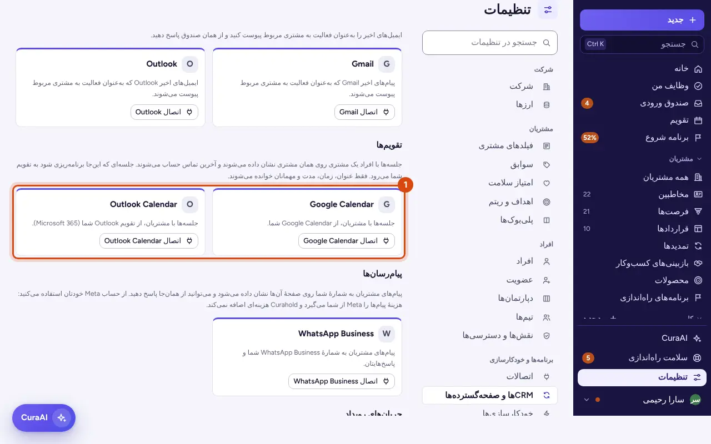

# Google Calendar و Outlook Calendar

تقویمتان را وصل کنید تا هر جلسه با افراد یک مشتری، با مدتش، در خط زمانی همان مشتری نشان داده شود و آخرین تماس حساب شود. از خط زمانی مشتری می‌توانید جلسه را مستقیم در تقویم برنامه‌ریزی کنید؛ دعوت‌نامه‌ها را تقویم می‌فرستد.

## چه خوانده می‌شود و چه نه

فقط جلسه‌هایی که برگزار شده‌اند، از تقویم اصلی: عنوان، زمان، مدت و مهمانان. توضیح، مکان و پیوند تماس هرگز. جلسه‌های خصوصی، رویدادهای تمام‌روز و جلسه‌هایی که کسی از بیرون در آن‌ها نیست کنار گذاشته می‌شوند. جلسه به مشتری‌ای می‌رسد که یکی از مخاطبانش مهمان است یا نشانی وبش دامنهٔ یکی از مهمانان است.

## در Curahold {#connect}

1. **تنظیمات ← CRMها و صفحه‌گسترده‌ها** را باز کنید، **تقویم‌ها** را بیابید و **اتصال Google Calendar** یا **اتصال Outlook Calendar** را بزنید.
   

صفحهٔ Google یا Microsoft باز می‌شود. حساب کاری را انتخاب کنید و **Allow** (Google) یا **Accept** (Microsoft) را بزنید. در Curahold روی **شروع** بزنید: ۹۰ روز گذشته خوانده می‌شود و بعد هر ساعت.

## برنامه‌ریزی جلسه

در صفحهٔ مشتری **خط زمانی** را باز کنید و **برنامه‌ریزی جلسه در Google Calendar** (یا Outlook) را بزنید. عنوان، زمان، مدت و ایمیل مهمانان را بنویسید و **افزودن به …** را بزنید. جلسه پس از برگزاری در خط زمانی دیده می‌شود.

## محدودیت‌ها و زمان‌بندی

هر ساعت خوانده می‌شود؛ جلسه‌ای از هفتهٔ گذشته که جابه‌جا شده یا نامش عوض شده به‌روز می‌شود. جلسهٔ لغوشده می‌ماند: اگر برگزار نشد، آن را از خط زمانی حذف کنید (به سطل زباله می‌رود). Google و Microsoft تعداد درخواست در دقیقه را محدود می‌کنند: پاسخ «مشغول» خواندن را متوقف می‌کند و دفعهٔ بعد ادامه می‌یابد.

## اگر مشکلی پیش آمد

ورود منقضی خودش تمدید می‌شود. اگر دسترسی پس گرفته شد (گذرواژهٔ تازه، تصمیم مدیر)، اتصال **نیاز به بررسی** نشان می‌دهد: **اتصال دوباره** را بزنید و با همان حساب وارد شوید. **برداشتن** ورود را پاک می‌کند؛ جلسه‌های موجود در خط زمانی‌ها می‌مانند.

## همچنین ببینید

- [خط زمانی و امتیاز سلامت](/docs/fa/timeline-and-health/)
- [اتصالات و CRM](/docs/fa/connections/)
