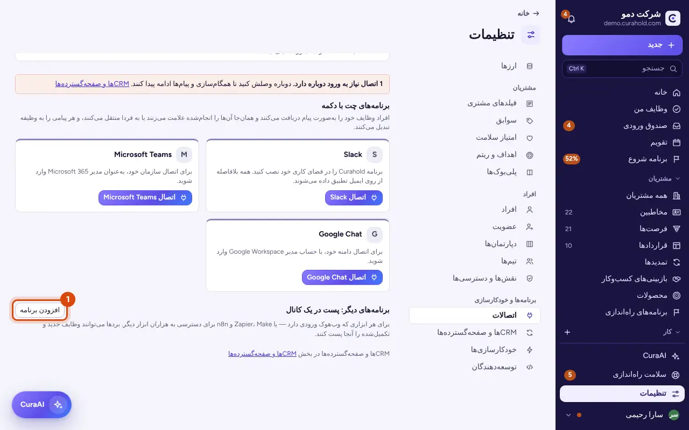
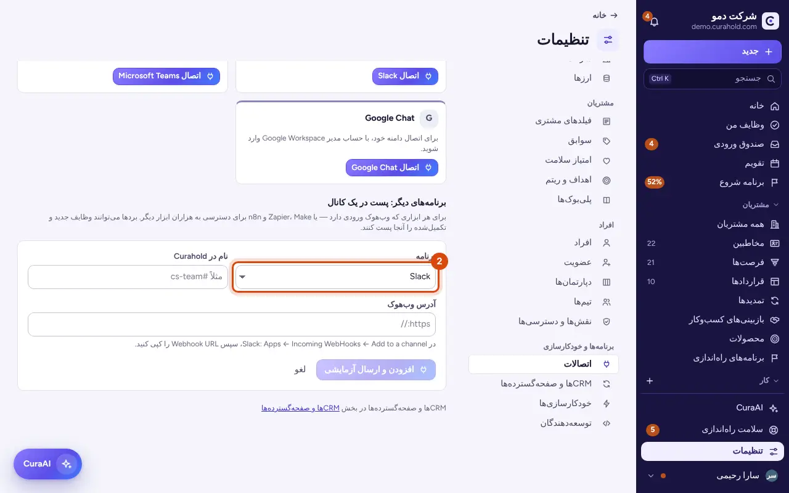

# اعلان‌های Lark، Feishu و Telegram

یک برد می‌تواند خبرهایش (کار تازه، کار تمام‌شده) را در یک گفت‌وگوی گروهی منتشر کند. Lark و Feishu از بات سفارشی گروه استفاده می‌کنند و Telegram از باتی که در دو دقیقه می‌سازید. هر دو یک‌طرفه‌اند: منتشر می‌کنند و پاسخی از آن‌ها برنمی‌گردد.

## در Curahold {#connect}

1. **تنظیمات ← اتصالات** را باز کنید و روی **افزودن برنامه** بزنید.
   
2. **Lark · Feishu** یا **Telegram** را انتخاب کنید، آنچه مراحل زیر می‌دهد بچسبانید و روی **افزودن و ارسال آزمایشی** بزنید. یک پیام آزمایشی به گروه می‌رسد.
   

سپس برد را باز کنید، در تنظیمات آن اعلان‌ها را بیابید و اتصال تازه را برای خبرهای دلخواه انتخاب کنید.

## Lark · Feishu

1. در گروه **Settings ← Bots ← Add bot ← Custom bot** را باز کنید، نامی بدهید و روی **Add** بزنید.
2. **نشانی webhook** را کپی کنید. شبیه این است:

```text
https://open.larksuite.com/open-apis/bot/v2/hook/0f3c2a9e-7d1b-4c55-9a7e-2b8f6c1d3e4f
```

اختیاری و توصیه‌شده: زیر **Security settings** گزینهٔ **Signature verification** را تیک بزنید و رمز را در **کلید امضا** در Curahold کپی کنید. از فیلتر کلیدواژه استفاده نکنید: پیام‌ها حذف می‌شوند.

## Telegram

1. در Telegram به **‎@BotFather‎** پیام دهید، `/newbot` را بفرستید، به دو پرسش آن پاسخ دهید و **توکن** را کپی کنید.
2. بات را به گروه اضافه کنید (برای کانال: به‌عنوان مدیر).
3. یک پیام در گروه بفرستید. Curahold گروه را از آن پیدا می‌کند و به شناسه‌اش نیازی نیست.
4. توکن را در **توکن بات** در Curahold بچسبانید. برای کانال عمومی می‌توانید `@نام` آن را بنویسید.

## محدودیت‌ها و زمان‌بندی

Lark حدود ۱۰۰ پست در دقیقه برای هر بات و Telegram حدود ۲۰ پست در دقیقه برای هر گروه می‌پذیرد؛ پاسخ «مشغول» دوباره فرستاده می‌شود و گم نمی‌شود. پیام‌های Telegram متن ساده‌اند، حداکثر ۴٬۰۹۶ نویسه.

## اگر مشکلی پیش آمد

کلید امضای نادرست، بات حذف‌شده یا توکن باطل‌شده اتصال را در تنظیمات ← اتصالات **نیاز به بررسی** نشان می‌دهد و آزمایش هم همین را می‌گوید. در طرف دیگر درستش کنید و دوباره **ارسال آزمایشی** بزنید: آزمایش موفق مشکل را برمی‌دارد. **برداشتن** انتشار را متوقف می‌کند؛ بات تا وقتی آن‌جا حذفش نکنید در گروه می‌ماند.

## همچنین ببینید

- [اتصالات و CRM](/docs/fa/connections/)
- [اعلان‌ها](/docs/fa/notifications/)
