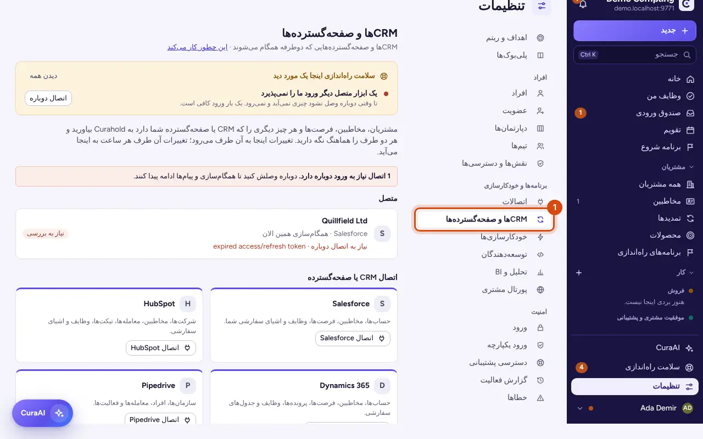
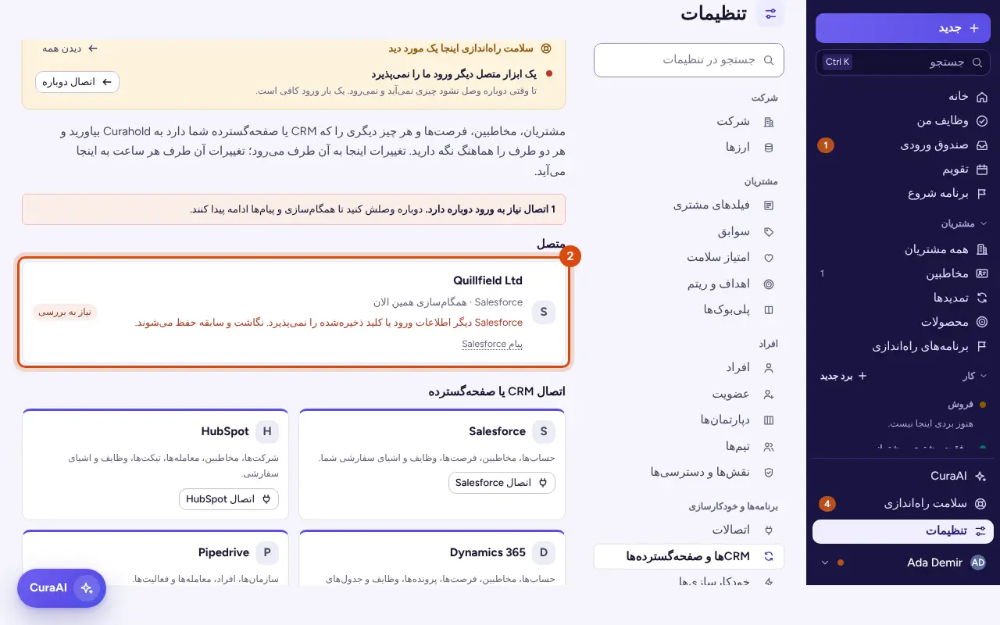
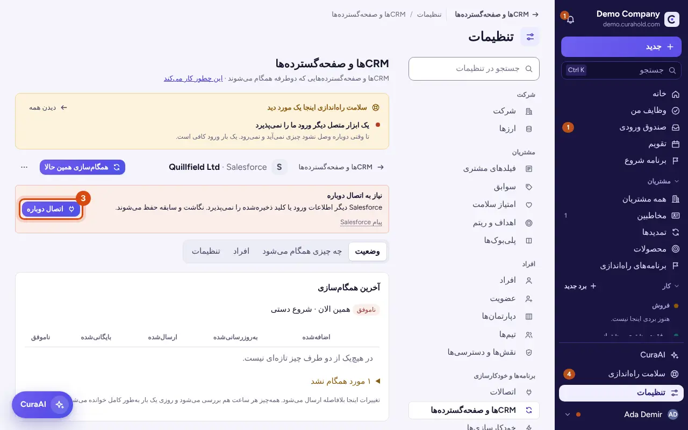
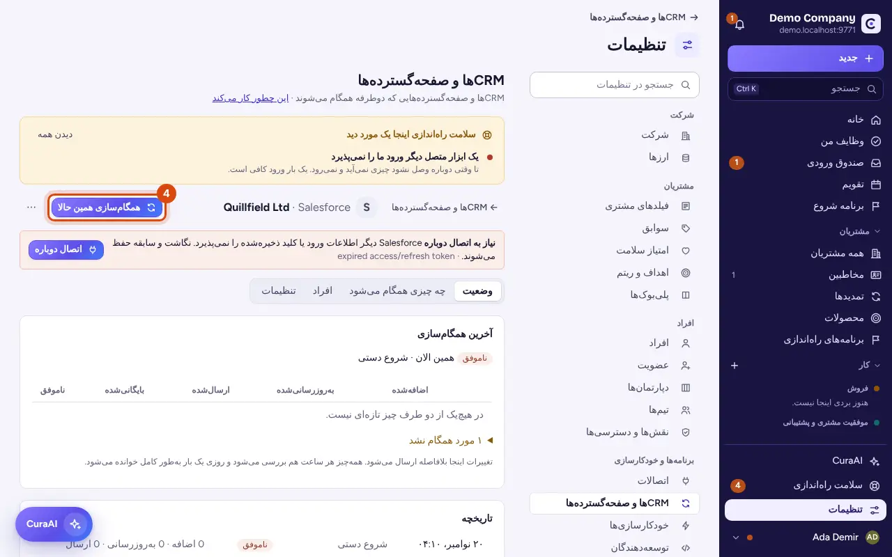

# اتصالات و CRM

Curahold کنار ابزارهایی کار می‌کند که تیم شما از قبل استفاده می‌کند. اتصال‌ها را در «تنظیمات» ← اتصالات و «تنظیمات» ← منابع داده مدیریت کنید.

## برنامه‌های گفت‌وگو

وقتی Slack، Microsoft Teams یا Google Chat وصل باشد، اعلان‌ها به‌صورت پیام مستقیم به افراد می‌رسند و می‌توانند از خود پیام وظیفه‌ای را تمام کنند یا دوباره باز کنند.

## CRM و صفحه‌گسترده‌ها

مشتری‌ها، مخاطبین و فرصت‌ها را با Salesforce، HubSpot، Microsoft Dynamics، Pipedrive، Zoho، Bitrix24، Freshsales، Zendesk Sell، Google Sheets و Excel همگام کنید. **«تنظیمات» ← CRMها و صفحه‌گسترده‌ها** را باز کنید و **اتصال** را بزنید.

1. **ورود.** به صفحهٔ ورود خود CRM برده می‌شوید و تأیید می‌کنید Curahold چه چیزهایی را بخواند و بنویسد. هرگز گذرواژه‌ای در Curahold نوشته نمی‌شود. (Bitrix24، Freshsales و Zendesk Sell به‌جای آن کلید می‌گیرند؛ پایین‌تر را ببینید.)
2. **انتخاب این‌که چه چیزی می‌آید.** شیءهایی را که لازم دارید تیک بزنید و بگویید هر کدام در Curahold چیست: مشتری، مخاطب، فرصت، نوع رکورد خودتان یا وظایف روی یک برد.
3. **جور کردن فیلدها.** Curahold برای هر فیلد جفتی پیشنهاد می‌دهد؛ هر کدام را می‌توانید عوض کنید و برای هر فیلد انتخاب کنید که فقط وارد شود یا در هر دو طرف یکسان بماند.
4. **بررسی و شروع.** پیش‌نمایش، پیش از هر تغییری نشان می‌دهد چندتا اضافه و چندتا به‌روز می‌شوند.

بعد از آن همگام‌سازی هر ساعت خودش اجرا می‌شود و تغییری که در Curahold بدهید فوراً در CRM نوشته می‌شود. هر چه همگام نشده باشد با دلیلش فهرست می‌شود و می‌توان دوباره امتحانش کرد. وقتی یک چیز در هر دو طرف تغییر کرده باشد، تغییر تازه‌تر برنده است؛ می‌توانید به‌جای آن تعیین کنید که همیشه CRM یا Curahold برنده باشد (زبانهٔ تنظیمات اتصال).

برای اتصال، اجازهٔ مدیریت اتصال‌ها لازم است. افراد با ایمیل جور می‌شوند، پس مسئول هر مشتری در CRM در Curahold هم مسئول آن می‌شود.

## Salesforce

می‌آید: accounts، contacts، opportunities، tasks و شیءهای سفارشی شما. برای استفاده از یک org آزمایشی، پیش از اتصال **Sandbox** را تیک بزنید.

**بار اول، مدیر Salesforce، ‏Curahold را نصب می‌کند.** Salesforce برنامه‌هایی را که در org شما نصب نشده‌اند مسدود می‌کند، پس پیش از اولین ورود، مدیر صفحهٔ نصب را باز می‌کند (پیوندش هنگام انتخاب اتصال نشان داده می‌شود) و آن را تأیید می‌کند. این بسته هیچ کد، فیلد یا شیئی اضافه نمی‌کند: فقط به افراد org شما اجازه می‌دهد Curahold را تأیید کنند. هر وقت بخواهید از Setup ← Installed Packages حذف‌شدنی است و Curahold فوراً دسترسی‌اش را از دست می‌دهد. اگر Salesforce پاسخ دهد که برنامه مجاز نیست، این قدم هنوز انجام نشده. کاربری که وصل می‌کند در Salesforce به دسترسی API نیاز دارد (در Enterprise و بالاتر هست، در Professional افزونه است).

## HubSpot

می‌آید: companies، contacts، deals، tickets، tasks و شیءهای سفارشی. HubSpot می‌پرسد کدام حساب وصل شود و فهرست می‌کند Curahold چه چیزهایی را می‌تواند بخواند و بنویسد؛ contacts و deals فقط اگر طرح HubSpot شما آن‌ها را داشته باشد خواسته می‌شوند.

## Microsoft Dynamics 365

می‌آید: accounts، contacts، opportunities، cases، tasks و جدول‌های سفارشی. پیش از ورود، نشانی سازمان شما را وارد می‌کنید (شبیه `https://yourcompany.crm4.dynamics.com`). اگر Microsoft پیام «Need admin approval» را نشان داد، یک مدیر Microsoft 365 باید یک بار Curahold را برای سازمان شما تأیید کند.

## Pipedrive

می‌آید: organizations، people، deals و activities. فیلدهای سفارشی هم مثل فیلدهای استاندارد جور می‌شوند.

## Zoho CRM

می‌آید: accounts، contacts، deals، cases، tasks و ماژول‌های سفارشی. Curahold مرکز دادهٔ Zoho شما (آمریکا، اروپا، هند، استرالیا…) را خودش پیدا می‌کند.

## Bitrix24، Freshsales و Zendesk Sell

این سه با کلیدی وصل می‌شوند که در خود CRM می‌سازید، پس صفحهٔ ورودی نیست و چیزی برای تأیید کسی نیست. Curahold کلید را همان لحظه که جای‌گذاری‌اش می‌کنید بررسی می‌کند، رمزگذاری‌شده نگه می‌دارد و دیگر هرگز نشانش نمی‌دهد؛ اتصال را حذف کنید، کلید هم از بین می‌رود. بقیه مثل CRMهای دیگر است: انتخاب می‌کنید چه چیزی بیاید، فیلدها را جور می‌کنید و تغییرات در هر دو جهت می‌روند.

| CRM | چه جای‌گذاری کنید | کجا پیدایش کنید | چه می‌آید |
| --- | --- | --- | --- |
| Bitrix24 | نشانی inbound webhook | Developer resources ← Other ← Inbound webhook؛ اجازهٔ CRM و همچنین Users را به آن بدهید تا مسئول‌ها جور شوند | companies، contacts، deals |
| Freshsales | نشانی شما و کلید API | عکس نمایه ← Settings ← API settings | accounts، contacts، deals |
| Zendesk Sell | یک access token | Settings ← Integrations ← OAuth ← Access tokens | companies، people، deals |

خوب است بدانید:

- **کلید به‌جای کسی که آن را ساخته عمل می‌کند.** Curahold همان چیزی را می‌بیند که آن فرد در CRM می‌بیند. کلید را با حسابی بسازید که همهٔ مشتری‌هایی را که این‌جا می‌خواهید ببیند.
- **ایمیل، تلفن و نشانی وب در Bitrix24** آن‌جا فهرست هستند. Curahold اولی را می‌خواند و وقتی مخاطب یا شرکت تازه‌ای می‌سازد پرش می‌کند، اما بعداً هرگز فهرست را بازنویسی نمی‌کند.
- **Freshsales از طریق نماهای «All accounts»، «All contacts» و «All deals» خوانده می‌شود.** اگر یکی از آن‌ها تغییر نام داده یا حذف شده باشد، آن فهرست خوانده نمی‌شود و اجرا همین را می‌گوید، به‌جای این‌که فقط بخشی از آن را بیاورد.
- **معامله در Zendesk Sell به یک شرکت نیاز دارد.** معامله‌ای که در Curahold ساخته شود، آن‌جا زیر شرکتِ مشتری ساخته می‌شود.
- این اتصال‌ها تازه‌اند. اگر چیزی آن‌طور که انتظار دارید نیامد، از بخش راهنما در محصول برای ما بنویسید.

## Google Sheets و Excel

صفحه‌گسترده ساده‌ترین راه برای آوردن داده است و برای هر ابزاری که بتواند خروجی صفحه‌گسترده بدهد کار می‌کند. یک Google Sheet، یا یک فایل Excel در OneDrive یا SharePoint را برگه به برگه وصل کنید؛ هر برگه می‌تواند مشتری‌ها، مخاطبین یا نوع رکورد خودتان باشد. ستونی را انتخاب کنید که هر ردیف را مشخص می‌کند، تا ردیفی که تغییر می‌کند همان مشتری را به‌روز کند و مشتری دومی اضافه نشود. صفحه‌گسترده برای هر ردیف زمان تغییر نگه نمی‌دارد؛ پس اگر یک خانه در هر دو طرف تغییر کند، تغییر Curahold برنده است. اگر می‌خواهید صفحه‌گسترده برنده باشد، این را از زبانهٔ تنظیمات اتصال انتخاب کنید.

## ابزارهای پشتیبانی

Zendesk، Freshdesk، Intercom و Jira Service Management با یک نشانی و یک کلید API وصل می‌شوند؛ درخواست‌ها زیر مشتری درست می‌نشینند. cases در Salesforce و Dynamics را هم می‌توان به‌عنوان درخواست پشتیبانی نگاشت کرد. جزئیات: [درخواست‌های پشتیبانی](/docs/fa/support-tickets/).

## وقتی همگام‌سازی متوقف می‌شود {#sync-stops}

زبانهٔ **وضعیت** اتصال با زبان ساده می‌گوید چه شد و پیام خود سرویس زیر آن است.

| چه می‌گوید | چه باید کرد |
| --- | --- |
| سرویس از Curahold خواست آهسته‌تر پیش برود | هیچ. جای شما نگه داشته می‌شود و اجرای ساعتی بعدی ادامه می‌دهد. |
| دیگر ورود یا کلید Curahold را نمی‌پذیرد | طبق مراحل زیر دوباره وصل کنید. |
| حساب اجازهٔ خواندن یا تغییر چیزی را ندارد | از مدیر آن ابزار بخواهید به حساب دسترسی بدهد، سپس **همگام‌سازی همین حالا** را بزنید. |
| دسترسی به آن ممکن نشد | هیچ. Curahold در اجرای ساعتی بعدی دوباره تلاش می‌کند. |

برای اتصال دوباره:

1. **تنظیمات ← CRMها و صفحه‌گسترده‌ها** را باز کنید.
   
2. روی اتصالی که **نیاز به بررسی** دارد کلیک کنید.
   
3. در بالای صفحه روی **اتصال دوباره** کلیک کنید.
   
   با همان حساب قبلی وارد شوید (یا کلید تازه را بچسبانید) و تأیید کنید.
4. روی **همگام‌سازی همین حالا** کلیک کنید. فیلدهایی که جفت کرده‌اید همان‌طور می‌مانند.
   

برای حذف یک اتصال، آن را باز کنید، روی **⋯** بزنید و **حذف** را انتخاب کنید. همگام‌سازی متوقف می‌شود؛ مشتریان، مخاطبان و فرصت‌هایی که آمده‌اند در Curahold می‌مانند و در ابزار دیگر چیزی پاک نمی‌شود. در برنامهٔ حسابداری، مانده‌ها، فاکتورها و پرداخت‌هایی که از آن خوانده شده‌اند از صفحهٔ مشتریان برداشته می‌شوند.

## ابزارهای خودتان

برای وصل کردن سامانه‌ای دیگر، [کلیدهای API](/docs/fa/api-keys/)، [webhookها](/docs/fa/webhooks/) یا [وصل کردن Claude و ChatGPT](/docs/fa/ai-assistants/) را ببینید.
