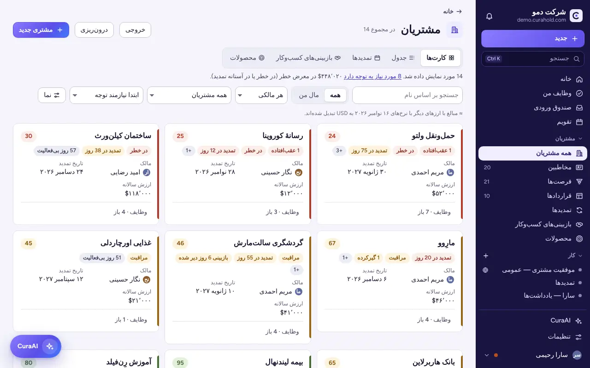
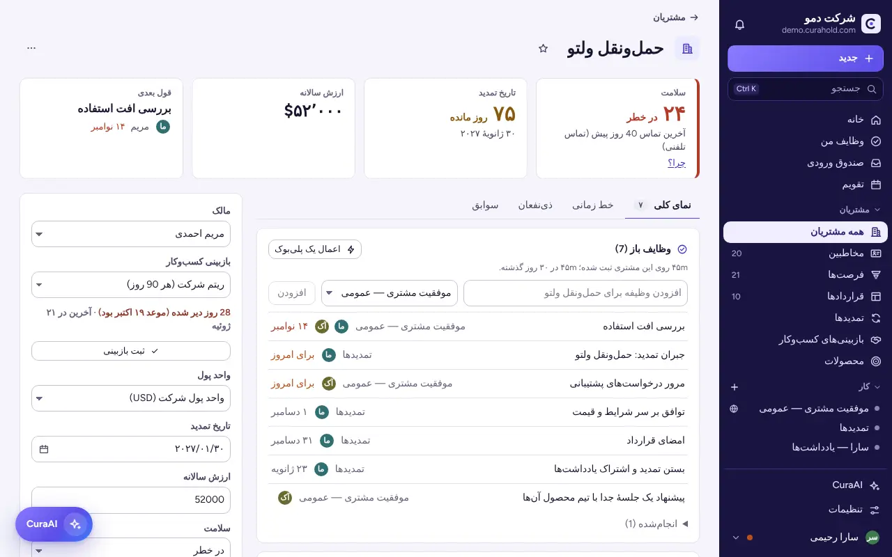

# مشتری‌ها، فیلدها و سوابق

مشتری‌ها در مرکز Curahold هستند. هر مشتری یک مسئول، یک تیم (اختیاری) و فیلدهای مخصوص شما دارد.

## صفحهٔ مشتری

بالای صفحهٔ هر مشتری نواری هست که با یک نگاه خوانده می‌شود: **سلامت** با دلیلش و دکمهٔ **چرا؟**، تاریخ تمدید و روزهای باقی‌مانده، ارزش سالانه، و **قول بعدی**: نزدیک‌ترین قدمی که به مشتری قول داده‌اید و این‌که دست چه کسی است. زیر نوار زبانه‌ها هستند: **نمای کلی** (وظایف باز و جلسه‌های پیش رو)، **خط زمانی**، **ذی‌نفعان**، **سوابق** و **جزئیات**. زبانهٔ باز در نشانی صفحه می‌ماند، پس با بارگذاری دوباره یا لینکی که می‌فرستی همان زبانه باز می‌شود.

## فیلدها

فیلدها را در «تنظیمات» ← فیلدهای مشتری اضافه کن: متن، عدد، مبلغ، تاریخ، گزینه، ایمیل، لینک. گزینه‌های یک فیلد گزینه‌ای می‌توانند رنگ داشته باشند، پس فیلدی مثل سلامت در فهرست‌ها و کارت‌ها با همان رنگ دیده می‌شود.

می‌توانی خود کلمهٔ «مشتری» را هم عوض کنی: «حساب»، «برند»، «شریک»؛ هر کلمه‌ای که تیمت به کار می‌برد در کل رابط کاربری نشان داده می‌شود.

## سوابق: مخاطبین، فرصت‌ها و بیشتر

سوابق را زیر مشتری‌ها نگه دار:

- **مخاطبین (ذی‌نفعان):** عنوان شغلی، نقش در تصمیم (تصمیم‌گیرنده، تأییدکننده (بودجه)، اثرگذار، ارزیاب، کاربر) و موضعش نسبت به شما (حامی اصلی، حامی، بی‌طرف، مردد، مانع).
- **فرصت‌ها:** مبلغ، تاریخ بستن، مرحله و وضعیت.
- **انواع سوابق خودت:** مثلاً «پروژه‌ها» یا «قراردادها».

سوابق می‌توانند فیلدهای مشتری را پر کنند: «قیف فروش باز»، «تعداد حامیان اصلی»، «تعداد مانع‌ها». وقتی سابقه‌ای تغییر کند، فیلد خودبه‌خود به‌روز می‌شود.

## نماها: کارت‌ها، جدول، تمدیدها، محصولات

با دکمه‌های بالای صفحهٔ مشتریان بین چهار نما جابه‌جا شو؛ انتخابت روی همان دستگاه به خاطر سپرده می‌شود.

- **کارت‌ها:** برای هر مشتری یک کارت که می‌گوید چه چیزی نیاز به نگاه دارد: وظایف عقب‌افتاده، سلامت در خطر یا زیر نظر، تمدیدی نزدیک یا گذشته، وظایفی که ۱۴ روز دست نخورده‌اند، ۳۰ روز بی‌تماس. جدی‌ترین مورد اول می‌آید؛ وقتی چیزی نیست «همه‌چیز مرتب» نوشته می‌شود. کارت‌ها به‌طور پیش‌فرض با «اول آن‌هایی که توجه می‌خواهند» مرتب می‌شوند و می‌توان آن‌ها را بر اساس نام، سلامت، ارزش، تمدید یا وظایف باز مرتب کرد. این‌که کدام فیلدها روی کارت باشند را از منوی **نما** انتخاب کن.
- **جدول:** فهرستی قابل مرتب‌سازی که در آن می‌توانی چند مشتری را با هم تغییر دهی.
- **تمدیدها:** تمدیدهای ۱۲ ماه آینده، ماه به ماه، با جمع هر ماه و این‌که چقدر از آن در خطر یا زیر نظر است.
- **محصولات:** چه کسی کدام محصول را دارد، بر اساس یک فیلد گزینه‌ای از یک نوع سابقه (مثلاً «اشتراک ← محصول»). **+** در یک خانهٔ خالی، وظیفهٔ فروش مکمل برای همان مشتری باز می‌کند.

جملهٔ بالای صفحه می‌گوید چند مشتری توجه می‌خواهند و چه مقدار ارزش در خطر است؛ لینک «توجه می‌خواهند» فهرست را به همان‌ها محدود می‌کند. روی گوشی همهٔ فیلترها با هم در یک برگهٔ **فیلتر** هستند.

## افزودن تمدید

تمدید همان **تاریخ تمدید** مشتری است. مشتری را باز کنید و آن را در **جزئیات** پر کنید، یا هنگام ورود داده با یک ستون بیاورید. از آن پس مشتری در **تمدیدها**، در ماه خودش و با مبلغش دیده می‌شود. هنوز چنین فیلدی ندارید؟ در «تنظیمات» ← فیلدهای مشتری یک فیلد تاریخ اضافه کنید. برای اینکه کار تمدید خودش شروع شود، در «تنظیمات» ← **اهداف و ریتم** گزینهٔ **شروع خودکار تمدیدها** را روشن کنید و بگویید چقدر زودتر و با کدام playbook.

## ورود داده

یک فایل Excel یا CSV را رها کن، ستون‌ها را با فیلدها جور کن، پیش‌نمایش را بررسی کن و وارد کن. ورودی‌ای را که اشتباه پیش رفته تا ۳۰ روز می‌توانی با یک کلیک برگردانی.

## خروجی گرفتن

فهرست مشتری‌ها و سوابق را با فیلتری که روشن است، به‌صورت Excel یا CSV دانلود کن. فایل در مرورگر خودت ساخته می‌شود و فیلدهایی که نمی‌توانی ببینی در آن نیستند.

## تغییر چند مورد با هم

چند مشتری را در فهرست انتخاب کن و مسئول، تیم یا یک فیلدشان را یک‌جا عوض کن. پیام پایین صفحه **واگرد** را پیشنهاد می‌دهد.

## حذف مشتری و برگرداندن مشتری حذف‌شده

مشتری حذف‌شده با سوابق، خط زمانی، جلسه‌ها و افراد پورتالش به [سطل زباله](/docs/fa/trash/) می‌رود و تا ۳۰ روز قابل برگرداندن است: درست بعد از حذف در پیام **واگرد** را بزن، یا منوی خودت را باز کن، **سطل زباله** و بعد **بازگرداندن** را انتخاب کن. وظایفش بدون مشتری روی بردها می‌مانند و وقتی برگردد دوباره به آن اشاره می‌کنند. برای کنار گذاشتن مشتری بدون حذف، بایگانی‌اش کن.

## پلی‌بوک‌ها

**پلی‌بوک** مجموعه‌ای از وظایف تاریخ‌دار است که با یک کلیک روی یک مشتری گذاشته می‌شود: آشناسازی، آمادگی تمدید، QBR. مدیر آن را یک بار در «تنظیمات» ← **پلی‌بوک‌ها** می‌نویسد (عنوان وظیفه، چند روز بعد از شروع، برای چه کسی)؛ در صفحهٔ مشتری **اعمال یک پلی‌بوک** اجازه می‌دهد روز شروع را انتخاب کنی و همه را اضافه کنی. `{account_name}` در عنوان به نام مشتری تبدیل می‌شود.

## بازبینی‌های کسب‌وکار

یک بار تصمیم بگیر هر چند وقت یک بار با هر مشتری می‌نشینی: «تنظیمات» ← **اهداف و ریتم** ← *بازبینی‌های کسب‌وکار* (مثلاً هر ۹۰ روز). یک مشتری می‌تواند در فیلد **بازبینی کسب‌وکار** صفحهٔ خودش ریتم جداگانه داشته باشد؛ «بدون بازبینی» آن مشتری را از ریتم بیرون نگه می‌دارد.

بازبینی کسب‌وکار جلسه‌ای است که هر چند وقت یک بار با هر مشتری (QBR) برای مرور نتایج و برنامه‌ها برگزار می‌کنی. **مشتریان ← بازبینی‌های کسب‌وکار** آن‌هایی را که موعدشان رسیده فهرست می‌کند: عقب‌افتاده، در ۳۰ روز آینده و بعدتر. وقتی بازبینی را برگزار کردی، **انجام‌شده** روی ردیف (یا صفحهٔ مشتری) فرم جلسه را باز می‌کند؛ پس از ذخیره، به‌عنوان «بازبینی کسب‌وکار» در **جلسات** و خط زمانی مشتری ثبت می‌شود و تاریخ بعدی خودش جلو می‌رود. برای مشتری‌ای که هرگز بازبینی نشده، شمارش از روز افزوده شدنش شروع می‌شود. بازبینی عقب‌افتاده به‌صورت نشانه‌ای روی کارت مشتری هم دیده می‌شود.

## جلسات

**جلسات** در صفحهٔ مشتری هر جلسه، بازبینی کسب‌وکار و تماس با آن مشتری را از جدید به قدیم نشان می‌دهد: تاریخ، نوع، عنوان، مدت، چه کسی ثبتش کرده، چه کسانی حاضر بودند (از طرف آن‌ها و ما)، یادداشت‌ها و قدم‌های بعدی. دکمه‌های بالای فهرست فقط یک نوع را نشان می‌دهند؛ تاریخ بازبینی کسب‌وکار بعدی کنار عنوان است.

**ثبت جلسه** (در صفحهٔ مشتری، یا **+ جدید ← ثبت جلسه، تماس یا یادداشت**) این‌ها را می‌پرسد:

- نوع (جلسه، بازبینی کسب‌وکار، تماس)، عنوان، تاریخ و مدت،
- افراد آن‌ها که حاضر بودند (مخاطبین مشتری) و افراد ما،
- یادداشت‌ها: درباره‌ی چه حرف زده شد و چه تصمیمی گرفته شد،
- قدم‌های بعدی: هر کدام، با مسئول و موعدش، روی بردی که انتخاب می‌کنی به وظیفه‌ای برای همین مشتری تبدیل می‌شود.

قدم‌های بعدی زیر جلسه با وضعیتشان نشان داده می‌شوند (تمام‌شده‌ها خط‌خورده)؛ با کلیک روی هر کدام وظیفه‌اش باز می‌شود. جلسه را بعداً می‌توان ویرایش کرد، قدم‌های بیشتری به آن داد یا حذفش کرد؛ وظایف جلسهٔ حذف‌شده می‌مانند و خود جلسه را تا ۳۰ روز می‌توان از [سطل زباله](/docs/fa/trash/) برگرداند.
