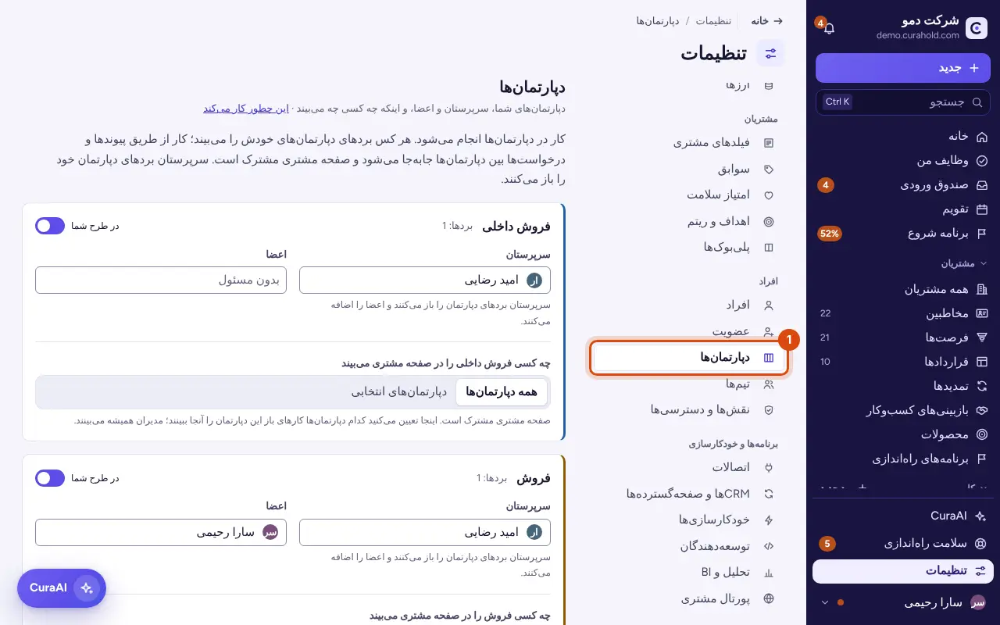
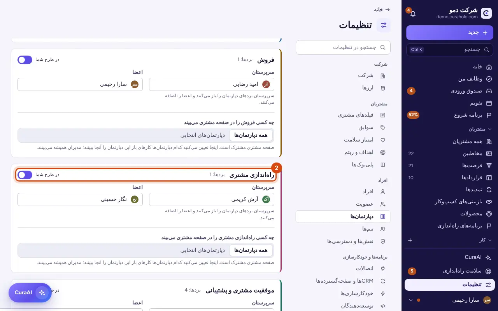
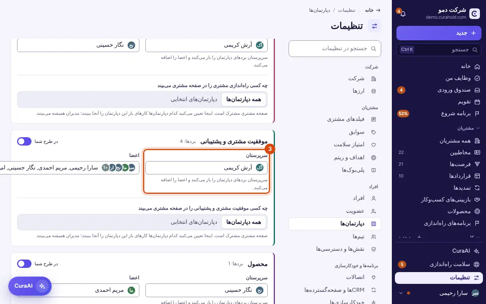
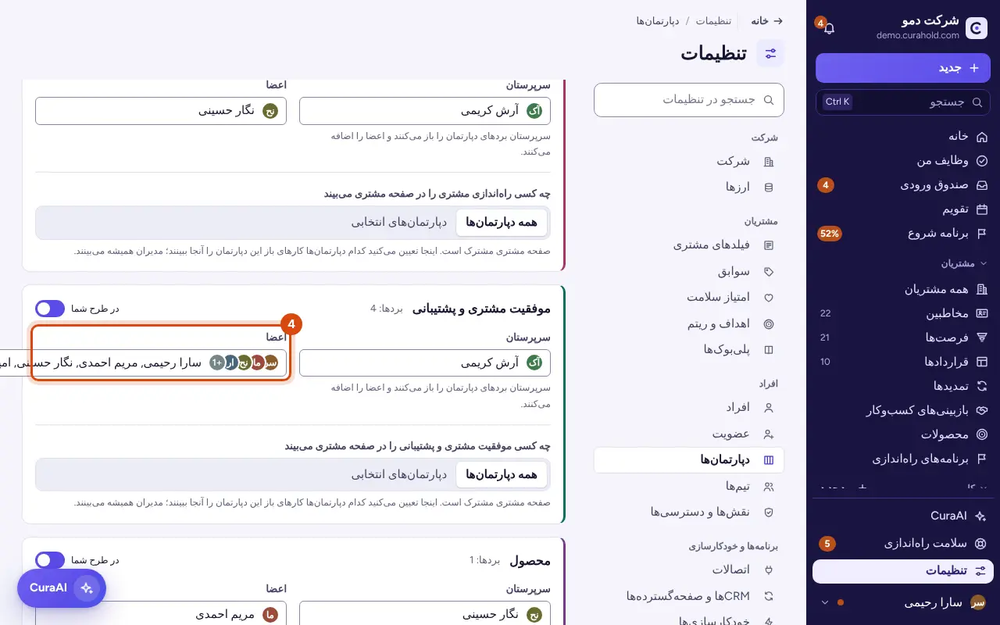
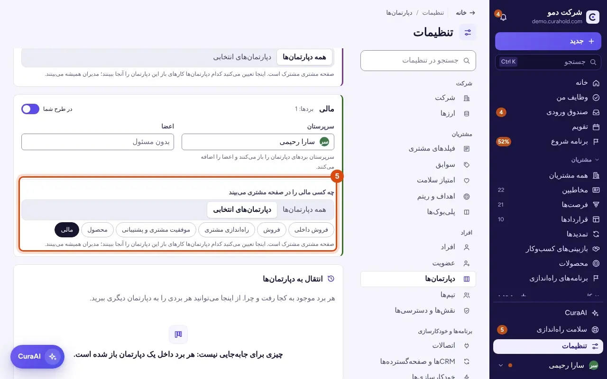
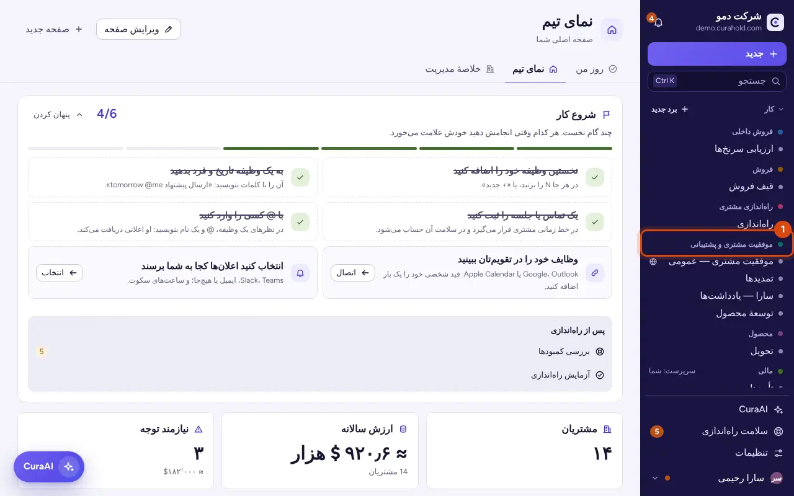
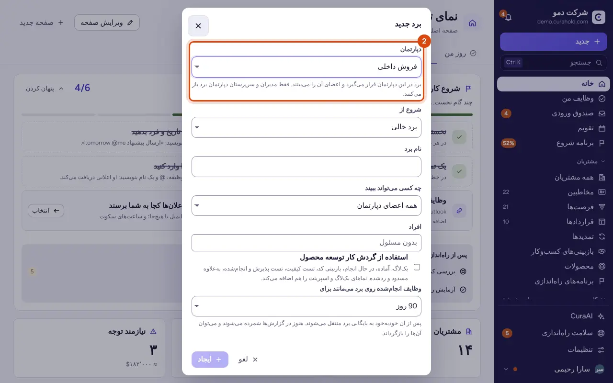
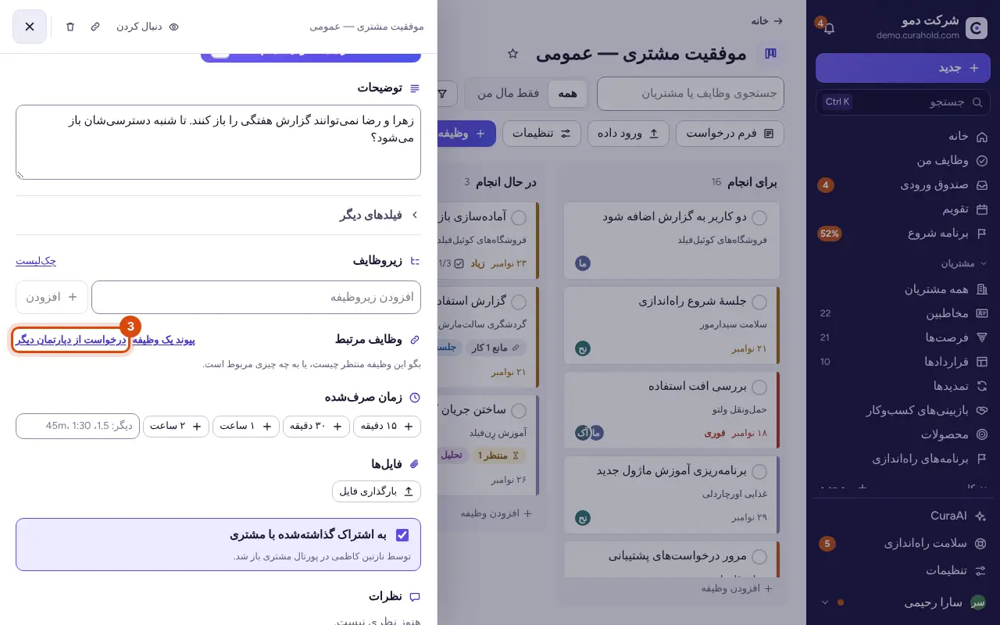
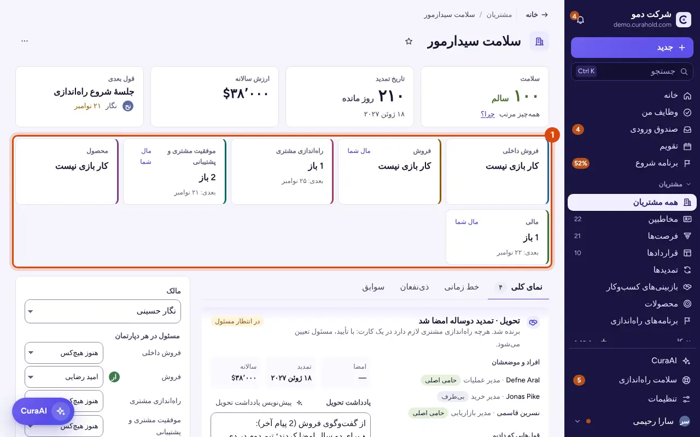
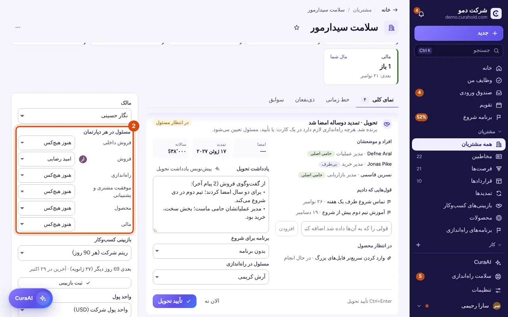

# دپارتمان‌ها

کار در Curahold داخل دپارتمان‌ها است: فروش داخلی، فروش، راه‌اندازی مشتری، موفقیت مشتری و پشتیبانی، محصول و مالی. هر کس بردهای دپارتمان‌های خودش را می‌بیند. کار با یک درخواست به دپارتمان دیگری می‌رود و صفحهٔ مشتری میان همهٔ کسانی که اجازهٔ دیدن آن مشتری را دارند مشترک است.

## راه‌اندازی دپارتمان‌ها {#set-up}

باید مدیر سیستم باشید (یا کسی که افراد را مدیریت می‌کند).

1. در منوی کناری روی **تنظیمات** و سپس **دپارتمان‌ها** (زیر **افراد**) کلیک کنید.
   
2. **در طرح شما** را برای هر دپارتمانی که شرکت دارد روشن بگذارید. برای دپارتمانی که استفاده نمی‌کنید خاموشش کنید: از همه پنهان می‌شود و بردهایش تا روشن کردن دوباره نگه داشته می‌شوند.
   
3. در **سرپرستان** انتخاب کنید چه کسی دپارتمان را هدایت می‌کند. سرپرستان بردهای دپارتمان را باز می‌کنند و اعضایش را اضافه می‌کنند.
   
4. در **اعضا** بقیهٔ کسانی را که آنجا کار می‌کنند انتخاب کنید. هر کس می‌تواند در بیش از یک دپارتمان باشد.
   
5. زیر **چه کسی … را در صفحه مشتری می‌بیند** گزینهٔ **همه دپارتمان‌ها** را بزنید، یا **دپارتمان‌های انتخابی** و روی دپارتمان‌هایی کلیک کنید که می‌توانند کار باز این دپارتمان را آنجا ببینند. مدیران سیستم همیشه می‌بینند. مالی در آغاز فقط برای مالی دیده می‌شود.
   

همه‌چیز همان لحظه ذخیره می‌شود. کسی که هنوز در هیچ دپارتمانی نیست کارهایش را تا وقتی اضافه‌اش کنید در **وظایف من** نگه می‌دارد.

وقتی شرکت به دپارتمان‌ها رفت، هر برد موجود در یک دپارتمان قرار گرفت. **انتقال به دپارتمان‌ها** پایین همین صفحه نشان می‌دهد هر برد کجا رفت و چرا؛ دپارتمان هر برد را همان‌جا عوض کنید. **افراد برای جای‌دهی** کسانی را نشان می‌دهد که پیش‌تر بردی را می‌دیدند و روی آن کار نمی‌کنند: **دسترسی بدهید** آن‌ها را عضو می‌کند.

## بردهای یک دپارتمان {#boards}

1. در منو، بردها زیر نام دپارتمانشان دسته‌بندی شده‌اند. کنار دپارتمانی که سرپرستش هستید **سرپرست: شما** می‌آید.
   
2. برای باز کردن برد تازه روی **+** کنار **کار** کلیک کنید. در **دپارتمان** جای برد را انتخاب کنید، نامی بدهید و روی **ایجاد** کلیک کنید. فقط مدیران سیستم و سرپرستان دپارتمان برد باز می‌کنند.
   

چه کسی می‌بیند به‌طور پیش‌فرض **همه اعضای دپارتمان** است؛ می‌توانید آن را به یک تیم یا افراد انتخابی محدود کنید.

## درخواست از دپارتمان دیگر {#ask}

1. وظیفه‌ای را که درخواست دربارهٔ آن است باز کنید و روی **درخواست از دپارتمان دیگر** کلیک کنید. برد دپارتمان را از فهرست انتخاب کنید، فرم درخواستش را پر کنید و بفرستید.
   

درخواست روی برد آن دپارتمان می‌نشیند و به وظیفهٔ شما پیوند می‌خورد. عنوان و وضعیتش را می‌بینید، هرگز برد دپارتمان دیگر را. دپارتمان وقتی درخواست می‌پذیرد که سرپرستش فرم درخواست یک برد را فعال کند (**تنظیمات برد ← فیلدها و فرم درخواست**).

## در صفحهٔ مشتری {#customer-page}

1. در صفحهٔ یک مشتری، **در همه دپارتمان‌ها** کار باز هر دپارتمان برای آن مشتری، مقدار عقب‌افتاده و موعد بعدی را نشان می‌دهد. **مال شما** دپارتمان‌هایی را که در آن‌ها هستید مشخص می‌کند.
   
2. در کنار، **مسئول در هر دپارتمان** نشان می‌دهد چه کسی در هر دپارتمان به مشتری رسیدگی می‌کند. برای تعیین، یک نفر را انتخاب کنید.
   

تحویل بین دپارتمان‌ها (معاملهٔ برنده‌ای که به راه‌اندازی یا موفقیت مشتری می‌رود) در [تحویل، درخواست‌ها و بازگشت به مشتری](/docs/fa/handover-and-requests/) آمده است.
